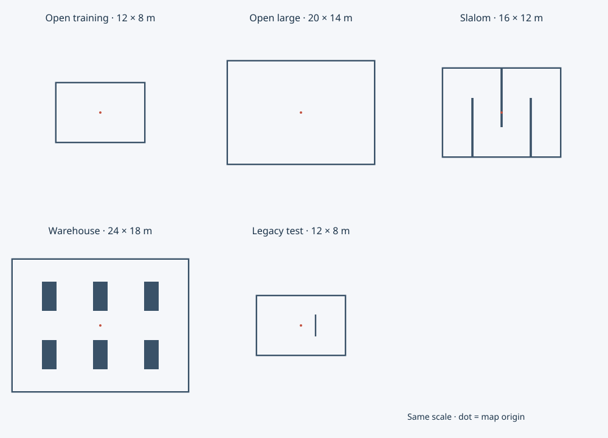

# 地图资产

地图使用米、`map` 坐标系，+x 向右、+y 向上。尺寸指边界墙内侧的净空间；“空旷”表示没有内部障碍，仍保留围墙与原有碰撞/弹丸反弹规则。



| 文件 | 净尺寸 | 布局与当前用途 |
| --- | --- | --- |
| [open_training.yaml](open_training.yaml) | 12×8 m | 公共C0、Weapons C1–C5及Navigation C0–C3共用；仅四面边界墙 |
| [open_large.yaml](open_large.yaml) | 20×14 m | 更大的空旷场地；未绑定关卡 |
| [navigation_slalom.yaml](navigation_slalom.yaml) | 16×12 m | 三道交替连接上下边界的隔墙，形成连续绕行通道；未绑定关卡 |
| [navigation_warehouse.yaml](navigation_warehouse.yaml) | 24×18 m | 六组货架，保留中央、纵向及外围通道；Navigation C4 |
| [training_legacy.yaml](training_legacy.yaml) | 12×8 m | 原公共地图，含 x=2 的内部隔墙；自由试验场及原物理回归 |

仓储地图已用于连续追踪课程，其他预留布局仍只是可加载资产；这不代表已实现玩家规划器或地图热切换。新关卡需要自行指定安全初态、目标及权限；例如绕行地图原点落在墙内，不能机械复用教学关卡零位姿，可选择左侧空地 (-6,-4)。仓储地图原点位于中央通道。

## 引用与格式

关卡在 `world.map` 引用，默认自由试验场在 `config/game.yaml` 的 `scene.map` 引用：

```yaml
source: asset
path: maps/open_training.yaml
```

路径相对于 `assets/`，文件必须存在且解析后仍在该目录内。地图仅有 `walls` 字段，每项为 `center: [x,y]`、`size: [width,height]`；墙体轴对齐，尺寸必须为正。不包含机器人、关卡目标、脚本或隐藏配置，不支持旋转墙、多边形或高度。支持空墙列表，但没有围墙的世界不会自动生成边界。

解析器复用受限安全 YAML、现有墙体 Schema 和数值校验；错误指出资产文件及具体墙体字段。所有地图在加载时展开为同一 `scene.walls` 私有数据，供 Rust 碰撞、Python 遮挡和获授权的 Web 绘制共用；不需要新增地图类型或改协议。浏览器启动器发送已解析地图，勿把所有导航地图自动暴露给玩家。

## Navigation C5栅格解析

C5复用navigation_warehouse.yaml，地图墙体未改动。可信准备从同一墙体联合包围盒确定场地边界与0.20m网格覆盖/原点，再将这些值交付SDK、裁判与UI；UI和规划器不各自反推边界。墙体与格闭区域相交即占用，范围外也为障碍；公开输入是原始bool网格，4格方形膨胀由玩家实现，规范结果只供裁判/UI。当前地图解析为92×122格，完整合同见 [42](../../docs/42_NAVIGATION_GLOBAL_PLANNING.md)。

## 修改与验证

共享资产修改会影响所有引用它的关卡。需要不同布局时新增地图文件并修改引用，不复制墙体到各关卡。当前教学图保留旧边界/初态/巡逻，仅移除内部隔墙；由此产生的行驶、射线和弹丸路径变化是明确的地图变化。关卡 ID、模板版本、玩家算法和进度保持。

运行 `PYTHONPATH=sdk/python .m1-cache/learning-venv/bin/python -m unittest discover -s tests -p test_map_assets.py -v`。测试覆盖加载、错误路径、原地图保留、场地连通性、真实车体穿过已移除隔墙且被边界阻挡。通道连通性按 0.25 m 网格、保守 0.5 m 膨胀验证，不等同于完成导航任务。运行完整相关测试并通过 `python3 tools/export_profile.py --offline` 更新生成夹具。发布应包含 `assets/maps/`。

历史验证（2026-10-28；不含后续Navigation路径课程）：完整 Python 回归 192 项通过（含上述 5 项地图测试与课程通关）；渲染测试 15 项通过；原生/WASM 共享 ABI 的武器、课程、角加速度/装甲及小陀螺状态对比通过。浏览器资源包和生成夹具已更新；本次未另行进行真实浏览器人工游玩验收。

## 启动覆盖与游戏内预览

使用 `python3 tools/tankbot.py --list-maps` 查看可用地图，`python3 tools/tankbot.py serve --level c0 --map open_large` 覆盖关卡绑定；browser/headless 同样支持。覆盖在重试与切关时保留，省略参数重启服务恢复默认。自定义地图仅作练习，不写正式完成记录或解锁后续关卡。

顶部「地图预览」提供全景、刻度、外包尺寸及坐标方向；开发者可浏览全部地图，玩家只查看本关授权地图。选择预览不改变当前仿真，关闭使用 Esc 或 ×。初态与墙重叠时启动会明确拒绝，尤其注意绕行地图的原点墙。详细接口与限制见 [31](../../docs/31_MAP_OVERRIDE_AND_PREVIEW.md)。

Navigation C4正式引用 `maps/navigation_warehouse.yaml`，零初态保持不变。裁判从同一份已解析墙体按seed生成安全绕障路径；路线、终点和中间控制点不存入地图资产。其余 Navigation C0–C3继续使用空旷场地；地图覆盖仍是练习，不能计正式进度。参数与保守车体通道见 [连续路径设计](../../docs/40_NAVIGATION_CONTINUOUS_PATH_TRACKING.md)。
