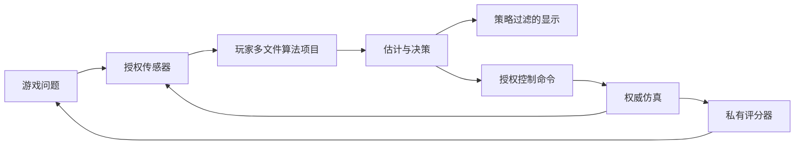

# 01 项目愿景与范围

## 目的、范围与核心需求

TankBot 将 `Robot Algorithms Learning + Simulation + Programming + Competition` 组成持续的软件开发体验。灵感来自 Tank Trouble、PythonRobotics、Robocode、Screeps；不要求兼容其代码、资产或玩法。核心机制是逐步撤回直接信息与控制权限，让玩家用自己的机器人系统补回能力。

玩家应先遇到问题，例如“雷达抖动导致瞄不准”，再自行选择滤波或跟踪方法。关卡验收衡量任务表现，不检查是否采用 EKF 等指定算法。前期编写的函数应能成为后续模块内部实现，最终组成多文件自主软件。

## 产品边界

| 模式 | 主要职责 | 共享基础 |
| --- | --- | --- |
| Campaign | 能力逐步接管、提示、问题驱动关卡 | Core、传感器、Runtime、SDK、协议、View Policy |
| Algorithm Lab | 参数实验、轨迹图、录制数据和算法比较 | 相同模块 Contract 与 Replay；真值只供授权评估 |
| Arena | 服务器执行机器人、赛制、公平性和赛后回放 | 同一规则库与协议语义；更强隔离和版本锁定 |

首轮实现范围是小地图、单个可控坦克、少量静态障碍、基础传感器、一个 Python 位姿模块与估计视图闭环。联网竞技、复杂履带动力学、插件市场、移动端、全局分布式通信和完整 SLAM 框架均不进入首个 MVP。

## 设计假设与冲突处理

1. 目标是二维平面，初期坦克以差速驱动近似；公共 Twist 速度接口保留 vx/vy/wz，未来可通过底盘适配加入全向轮。炮塔独立角度作为后续能力。物理精度服务于可理解的误差模型，而非认证级机器人仿真。
2. 初期 Workspace 依赖限 SDK、标准库与受控数学库。不能承诺桌面 CPython 的任意扩展能在 Pyodide 使用。
3. 离线本机运行无法向设备所有者保密全部 Ground Truth；仍禁止 UI、SDK 获得未授权真值。防作弊保证以远程 Authority 为边界。
4. 单纯“随关卡移除更多信息”可能破坏前序代码。关卡必须先提供替代输入、模板、测试与局部视图，再撤回系统能力；允许练习回退。
5. 实时比赛和严格复现存在冲突。比赛记录实际接受的输出与超时；算法重跑仅在受控测试模式给出限定保证，详见 07。
6. 关卡隐藏完整地图时，秘密地图资产也不得预下载给远程玩家；公开贴图与秘密几何分开。

## 能力接口与数据流

关卡用 `LevelDefinition` 声明传感器配置、`capabilities`、`view_policy_id`、可选 Contract、模板版本、评分规则和执行配置。能力撤回只更换 Provider、连接与策略，不改 Game Core。

## 替代方案、取舍与开放问题

独立算法练习实现简单，但无法积累机器人软件；采用可复用项目，代价是版本迁移和教学支架更复杂。全知 UI 更容易做出即时反馈，但破坏核心机制；使用局部传感器与估计图层维持反馈。Campaign 与 Arena 可共享组件，不强求相同进程部署或运行时性能。

尚需用户测试确认：关卡撤权速度、失真程度、算法难度、键盘与代码并行操作的负担。原始需求给出的 Level 0–6 属于方向，不作为冻结关卡编号。

## 验收条件

- 首个可玩原型能够展示“真值与错误估计不同”，且错误估计不改变碰撞。
- 玩家能从函数练习升级为多模块项目，无须复制或重写前序算法。
- 关卡失败能归因于观测、估计或控制问题，并提供可操作反馈。
- 所有平台、教学效果和性能声明均附验证记录；路线图不算完成证据。
