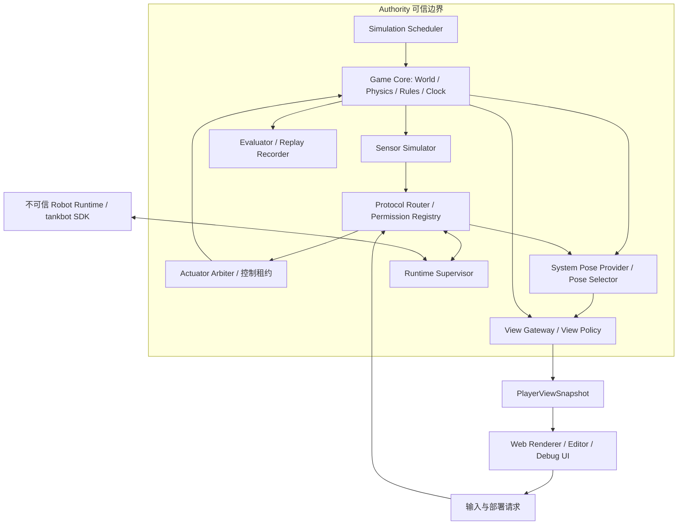

# 02 系统架构

当前十三关的声明式入口为 `levels/*.yaml`：公共 c0、Weapons c1–c5、Navigation c0–c6。共享Host加载器发现、严格校验并解析地图、完整底盘和传感器实例，再构造Authority/Core；原生和浏览器共用规则与权限。关卡加载见 [27](27_LEVEL_PLUGIN_ARCHITECTURE.md)，场景装配见 [32](32_RESOLVED_SCENE_AND_COMPONENTS.md)。当前应用配置为 `2.1`；课程清单与解锁取YAML，不由本页维护注册表。

## 目的、范围与约束

定义逻辑职责、进程边界和部署映射，避免把“共享库”误解成“所有平台同一个进程”。本设计不引入 ROS2、DDS，不将 Python 嵌入权威物理循环，不使用前端游戏框架的物理作为权威结果。关联 ADR：0001–0006、0012。

## 逻辑架构与职责

`CORE → VIEW` 是私有只读输入，由 Gateway 按策略裁剪；绝不代表世界对象可以序列化到前端。所有跨信任边界的箭头经过身份绑定、限额、结构与语义验证。

| 模块 | 拥有的状态和接口 | 禁止职责 |
| --- | --- | --- |
| Game Core | `World`、规则、底盘控制器、`step(ActuatorInputBatch) -> StepEvents` | I/O、Python 回调、渲染、账号 |
| Sensor Simulator | 从私有世界快照采样，输出测量与延迟计划 | 给算法传世界引用、公开 RNG 秘密种子 |
| Scheduler | tick 顺序、采样计划、执行批次与命令提交 | 等待不可信程序无限运行 |
| Protocol Router | 频道注册、授权、单写者租约、有界队列 | 自动发现所有世界实体 |
| Actuator Arbiter | 对 cmd_vel Topic/离散操作检查控制租约，产生已验证执行器输入 | 信任 Topic 名称或客户端自报来源 |
| Chassis Controller（Core 内） | 最新速度目标/生成时刻、watchdog、限幅与底盘运动映射 | 决定网络权限、把估计位姿写回 World |
| Runtime Supervisor | 不可变部署、预算、进程/Worker 管理、输出入口 | 信任 Python 内部校验或模块自报身份 |
| Pose Selector | 从许可候选选择标准位姿 | 自动选择最接近真值的算法 |
| View Gateway | 将私有数据投影为授权 DTO、效果和音频事件 | 转发原始世界 dump |
| Workspace Service | 草稿、模板、快照、迁移和测试报告 | 编辑即热改运行代码 |
| Web UI | DTO 插值、传感器图层、编辑、调试、工作区操作 | 权威碰撞、评分、ACL 决策 |

实际目录为 `core/`（纯核心）、`host/`（场景、权限、调度与管理）、`web/`（授权表现和编辑器）、`sdk/python/`、`runtime/`、`protocol/`、`tests/` 和 `docs/`。`levels/` 存课程，`config/chassis/` 存完整底盘，`config/` 存时钟/求解器与运行策略，`assets/maps/` 存共享地图；没有另外一套 `content/` 关卡源。依赖从Host指向Core、Schema与适配接口；Core不反向依赖Host或UI。

机器人接口优先参考 ROS 习惯，见 [ADR-0014](adr/0014-ros-style-velocity-interface.md)。`/robot/cmd_vel` 的 Twist 属于连续设定值 Topic；Host 在提交门转换成 Core 的内部 `BodyVelocityTarget(vx, vy, wz, source_tick)` 或目标失效事件。Core 不解析 Envelope，不关心网络和请求 ID；差速/径向全向轮模型共享输入形状，分别执行自己的运动学与动力学。

## 进程与部署架构

| 部署 | 权威仿真 | Python | UI / Transport | 保证范围 |
| --- | --- | --- | --- | --- |
| 本机开发/无头 | 原生 Core Host | 隔离 CPython worker | CLI/浏览器；IPC、loopback WebSocket | 同机边界，隔离能力依宿主 |
| 浏览器单机 | Core WASM 的独立 Worker | 另一 Pyodide Worker | 主线程 UI；MessagePort | 教学隔离；无法对设备所有者防作弊 |
| 桌面应用 | 原生 Host sidecar 或浏览器方案 | 独立受限 Runtime | WebView；受控 IPC | Windows/macOS 隔离需专项验证 |
| 远程单人/多人 | 服务器 Core Host | 服务器沙箱，每机器人隔离 | 浏览器仅授权 DTO；WebSocket | 服务器执行权限；客户端不可信 |
| 批量测试/Replay | 无头 Host | 受控 Runtime 或记录输出 | Replay/Test Transport | 固定构建与输入的可复现范围 |

桌面壳建议研究 Tauri，也可先用浏览器连接本机 Host，不把桌面打包阻塞在首个闭环之前。浏览器不用 `SharedArrayBuffer` 共享 World；MessagePort 接口首先满足可审查性，再测是否值得优化。

## 核心语言比较与建议

下表保留最初的候选比较，属于项目推断而非测量；M2 已验证并接受 Rust 路线，证据见 ADR-0002。

| 维度 | Rust | C++ |
| --- | --- | --- |
| 跨平台编译 | Cargo 统一依赖与 feature；原生库仍可能阻碍交叉编译 | 成熟编译器与 CMake；ABI、工具链与依赖打包组合更多 |
| WASM | `wasm32-unknown-unknown`、显式 JS 绑定；需移除 OS 假设 | Emscripten/Embind 可用；现有库也需核查线程和文件系统 |
| 物理仿真 | Rapier 候选，贴近纯 Rust 核心 | Box2D 候选，集成成熟的 C/C++ 生态；当前 Box2D 主线为 C API，不能误写为只支持 C++ |
| Python 集成 | IPC 不依赖语言；PyO3 适合可信绑定，不充当沙箱 | IPC 同样适用；CPython API/pybind11 需额外处理生命周期 |
| 内存安全 | 安全 Rust 降低悬垂指针与数据竞争风险；FFI/unsafe 仍需审查 | RAII、智能指针与 sanitizer 有帮助，仍需持续人工约束 |
| 网络服务 | Tokio 等适合 Host；保持异步运行时在核心外 | Asio 等也可实现；团队熟悉度决定复杂度 |
| 长期维护 | 类型与所有权增强边界；编译时间、学习曲线及生态更新有成本 | 人才与库广；模板、构建矩阵和 UB 排查有成本 |
| 开发复杂度 | 借用与跨平台 feature 需要前期设计 | 上手取决于经验；长期内存、ABI 和并发纪律要求高 |

当前采用经 M1/M2 验证的 **Rust + Rapier2D**，不同时维护 C++ 引擎。C++/C API Box2D 比较保留为历史备选；若未来遇到明确技术失败，再以同类探针评估并更新 ADR。当前不因采用物理库引入复杂 ECS。

依据：Rust 最小 WASM 目标的部分 `std` API 不可用，需适配线程与文件系统（[rustc target 文档](https://doc.rust-lang.org/stable/rustc/platform-support/wasm32-unknown-unknown.html)）；C++ 可通过 [Emscripten JS 互操作](https://emscripten.org/docs/porting/connecting_cpp_and_javascript/) 接入；Rust 所有权提供无需 GC 的安全保证（[Rust Book](https://doc.rust-lang.org/book/ch04-00-understanding-ownership.html)）。物理候选依据 [Rapier 介绍](https://www.rapier.rs/docs/) 和 [Box2D FAQ](https://box2d.org/documentation/md_faq.html)。这些资料不证明 TankBot 已跨平台可用。

## 前端架构与接口

M3 接受现有 ES module JavaScript/Canvas + CodeMirror 6 + 可选 Vim 的本机组合，见 [ADR-0021](adr/0021-editor-and-deployment-profile.md)。多文件、焦点、错误定位和原生/浏览器部署已验证；不为编辑器替换渲染器。Phaser/TypeScript 仍可在后续有明确需求时重新评估，不能将其建议当成当前依赖。确切 npm 版本与许可见 [M3 设计](17_EDITOR_AND_DEPLOYMENT.md)。

前端职责划分为连接、授权视图缓存、渲染、Workspace、编辑器和诊断；这些是逻辑职责名，不表示存在同名类。实际代码包括 `web/rendering.js`、`workspace-ui.js`、`editor.js`、`timing-ui.js`。渲染器只消费授权DTO，不提供 `getWorld()`。草稿缓冲、相机缩放、面板布局由客户端维护；碰撞、命中、能力、部署生效、计分均由Authority决定。

逻辑接口草案：`CoreHost.advance(tick_inputs) -> AuthorizedOutputs`；`ViewGateway.build(principal, policy, tick) -> PlayerViewSnapshot`；`RuntimeSupervisor.submit(step_request) -> StepHandle`；`WorkspaceService.snapshot(revision) -> DeploymentArtifact`。现有 Python/Worker 映射见 16/17，未来扩展应保留这些边界，输入输出语义以 03–08 为准。

## 替代方案、风险与验收

完整游戏引擎能加快关卡编辑，却可能引入渲染/物理耦合；先采用小型纯核心，未来在边界外集成编辑工具。全平台强制同进程会损害服务器隔离；采用共享语义与不同 Host。JSON 的分配与编码开销先测量，不能直接跳到自制二进制总线。

开放项：独立 Web 持久化、其他浏览器编辑体验、更多实体时的 WASM 启动/运行成本、桌面隔离能力。验收需证明：无头运行不加载 UI/Python 库；同一传感器/命令夹具能经过本地、Worker 与网络适配；Renderer 在隐藏位姿时根本收不到私有字段；任一 Runtime 崩溃不停止 Core tick。

## 当前实现映射

| 职责 | 实现入口与范围 |
| --- | --- |
| 发现与场景准备 | `level_plugins.py`、`scene_definition.py`：YAML/地图/模型校验和已解析定义；重试创建新实例 |
| 权威物理与课程任务 | Rust Core保存真实状态；`campaign.py`、`path_tracking.py` 等可信裁判计算任务与评分 |
| 模块图与Runtime | `robot_graph.py` / `runtime/module_runner.py`；周期/event输入冻结、跨批次Topic与整图部署 |
| 执行约束与观测 | `execution_profiles.py`、两种Supervisor、`runtime_timing.py`；独立声明准入与往返截止，见 [41](41_RUNTIME_EXECUTION_PROFILES.md) |
| 项目与实验 | `workspace_maintenance.py` 提供备份/固定版本/恢复；`experiments.py` 仅提供C2滤波回放试点，见 [38](38_ENGINEERING_AND_ALGORITHM_LAB.md) |

本机已接受Rust/Rapier（ADR-0002）、Canvas/ES module/CodeMirror/Vim（ADR-0021，替代0003）及共享Authority浏览器拓扑（ADR-0020）。完整平台隔离组合ADR-0013仍为Proposed；桌面壳、远程服务器和Arena部署仍是计划。

## 历史：M1 实施映射

`core/` 为 Rust/Rapier2D-f64 0.36.1 固定步长库；`core_worker` 是可信私有长度前缀 IPC 适配器。Python `host/` 驱动核心、校验消息、监督外部 worker；它与 `runtime/worker.py` 是独立进程，后者只收到授权传感器、轮组标定和公开起点。SDK 不获得核心管道。`PoseSelector` 独占标准位姿 Topic，再由不接受 World 参数的 `ViewGateway` 投影。

M1页面通过loopback HTTP Adapter获取profile/授权view、提交Twist；当时WebSocket、Pyodide和多Adapter等价性留待M2，现已按M2范围实现。桌面壳仍未交付。`/api/profile` 返回公开地图/模型、ControllerProfile、目录、UI和执行profile摘要，绝不转发完整私有仿真配置。M1报告记录当时的选型状态，不覆盖上表的现行ADR。

## 当前两种本机运行方式（M2建立，后续沿用）

本地浏览器的可信Core Worker同时运行Rust/WASM和Pyodide内的共享Python Authority；另一无凭据origin的iframe管理独立Pyodide Robot Worker。主线程处理授权View、公开Profile与管理/控制请求。原生模式继续使用外部CPython/stdio；不要求相同进程拓扑。本机前端组合已接受，服务器隔离组合仍为Proposed。接口、启动资源公开范围与成本见 [16](16_BROWSER_RUNTIME.md) 和 [ADR-0020](adr/0020-shared-browser-authority.md)；Linux/Firefox证据不能外推其他平台。
