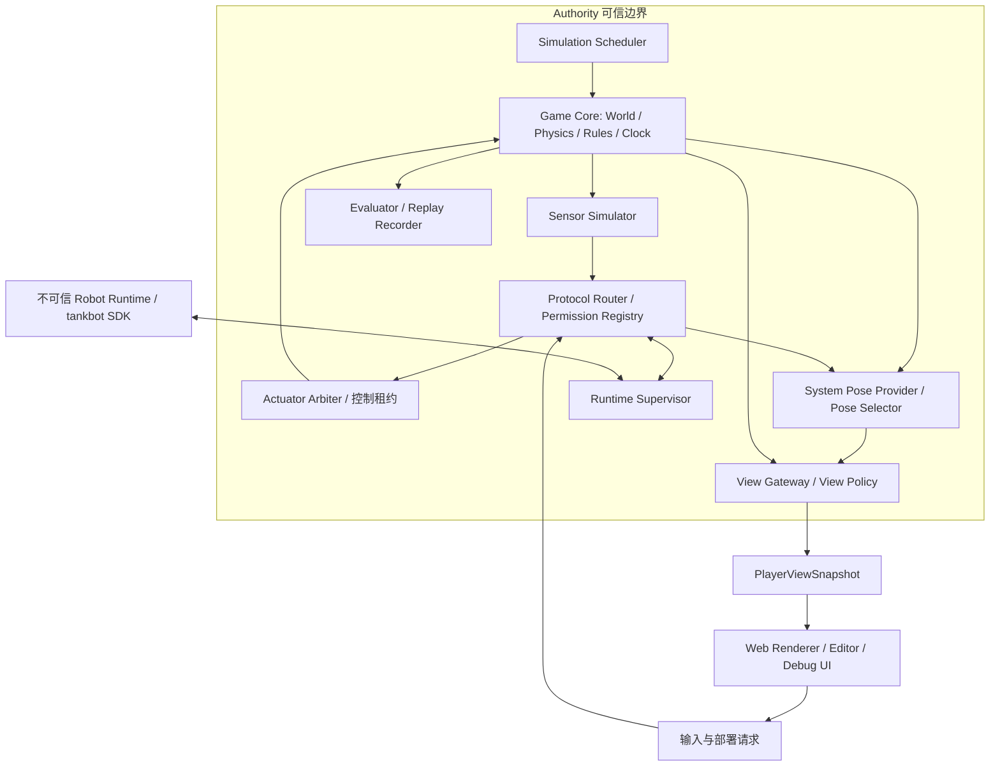

# 02 系统架构

## 目的、范围与约束

定义逻辑职责、进程边界和部署映射，避免把“共享库”误解成“所有平台同一个进程”。本设计不引入 ROS2、DDS，不将 Python 嵌入权威物理循环，不使用前端游戏框架的物理作为权威结果。关联 ADR：0001–0006、0012。

## 逻辑架构与职责

`CORE → VIEW` 是私有只读输入，由 Gateway 按策略裁剪；绝不代表世界对象可以序列化到前端。所有跨信任边界的箭头经过身份绑定、限额、结构与语义验证。

| 模块 | 拥有的状态和接口 | 禁止职责 |
| --- | --- | --- |
| Game Core | `World`、规则、底盘控制器、`step(ActuatorInputBatch) -> StepEvents` | I/O、Python 回调、渲染、账号 |
| Sensor Simulator | 从私有世界快照采样，输出测量与延迟计划 | 给算法传世界引用、公开 RNG 秘密种子 |
| Scheduler | tick 顺序、采样计划、执行批次与命令提交 | 等待不可信程序无限运行 |
| Protocol Router | 频道注册、授权、单写者租约、有界队列 | 自动发现所有世界实体 |
| Actuator Arbiter | 对 cmd_vel Topic/离散操作检查控制租约，产生已验证执行器输入 | 信任 Topic 名称或客户端自报来源 |
| Chassis Controller（Core 内） | 最新速度目标/生成时刻、watchdog、限幅与底盘运动映射 | 决定网络权限、把估计位姿写回 World |
| Runtime Supervisor | 不可变部署、预算、进程/Worker 管理、输出入口 | 信任 Python 内部校验或模块自报身份 |
| Pose Selector | 从许可候选选择标准位姿 | 自动选择最接近真值的算法 |
| View Gateway | 将私有数据投影为授权 DTO、效果和音频事件 | 转发原始世界 dump |
| Workspace Service | 草稿、模板、快照、迁移和测试报告 | 编辑即热改运行代码 |
| Web UI | DTO 插值、传感器图层、编辑、调试、工作区操作 | 权威碰撞、评分、ACL 决策 |

建议目录为 `core/`（纯核心）、`host/`（适配与权限）、`web/`、`sdk/python/`、`runtime/`、`content/`、`tests/`、`docs/`；M1 已创建这些目录中的 `core/host/web/sdk/python/runtime/tests` 及 `protocol/`、`config/`、`examples/robot/`。未创建的后续目录仍只是建议。依赖从 Host 指向 Core、Schema 与适配接口；Core 不反向依赖 Host 或 UI。

机器人接口优先参考 ROS 习惯，见 [ADR-0014](adr/0014-ros-style-velocity-interface.md)。`/robot/cmd_vel` 的 Twist 属于连续设定值 Topic；Host 在提交门转换成 Core 的内部 `BodyVelocityTarget(vx, vy, wz, source_tick)` 或目标失效事件。Core 不解析 Envelope，不关心网络和请求 ID；差速/麦克纳姆全向模型共享输入形状，分别执行自己的运动学与动力学。

## 进程与部署架构

| 部署 | 权威仿真 | Python | UI / Transport | 保证范围 |
| --- | --- | --- | --- | --- |
| 本机开发/无头 | 原生 Core Host | 隔离 CPython worker | CLI/浏览器；IPC、loopback WebSocket | 同机边界，隔离能力依宿主 |
| 浏览器单机 | Core WASM 的独立 Worker | 另一 Pyodide Worker | 主线程 UI；MessagePort | 教学隔离；无法对设备所有者防作弊 |
| 桌面应用 | 原生 Host sidecar 或浏览器方案 | 独立受限 Runtime | WebView；受控 IPC | Windows/macOS 隔离需专项验证 |
| 远程单人/多人 | 服务器 Core Host | 服务器沙箱，每机器人隔离 | 浏览器仅授权 DTO；WebSocket | 服务器执行权限；客户端不可信 |
| 批量测试/Replay | 无头 Host | 受控 Runtime 或记录输出 | Replay/Test Transport | 固定构建与输入的可复现范围 |

桌面壳建议研究 Tauri，也可先用浏览器连接本机 Host，不把桌面打包阻塞在首个闭环之前。浏览器不用 `SharedArrayBuffer` 共享 World；MessagePort 接口首先满足可审查性，再测是否值得优化。

## 核心语言比较与建议

下表是项目推断而非性能测量。两个候选都必须通过相同原型和维护成本验证。

| 维度 | Rust | C++ |
| --- | --- | --- |
| 跨平台编译 | Cargo 统一依赖与 feature；原生库仍可能阻碍交叉编译 | 成熟编译器与 CMake；ABI、工具链与依赖打包组合更多 |
| WASM | `wasm32-unknown-unknown`、显式 JS 绑定；需移除 OS 假设 | Emscripten/Embind 可用；现有库也需核查线程和文件系统 |
| 物理仿真 | Rapier 候选，贴近纯 Rust 核心 | Box2D 候选，集成成熟的 C/C++ 生态；当前 Box2D 主线为 C API，不能误写为只支持 C++ |
| Python 集成 | IPC 不依赖语言；PyO3 适合可信绑定，不充当沙箱 | IPC 同样适用；CPython API/pybind11 需额外处理生命周期 |
| 内存安全 | 安全 Rust 降低悬垂指针与数据竞争风险；FFI/unsafe 仍需审查 | RAII、智能指针与 sanitizer 有帮助，仍需持续人工约束 |
| 网络服务 | Tokio 等适合 Host；保持异步运行时在核心外 | Asio 等也可实现；团队熟悉度决定复杂度 |
| 长期维护 | 类型与所有权增强边界；编译时间、学习曲线及生态更新有成本 | 人才与库广；模板、构建矩阵和 UB 排查有成本 |
| 开发复杂度 | 借用与跨平台 feature 需要前期设计 | 上手取决于经验；长期内存、ABI 和并发纪律要求高 |

建议优先验证 **Rust + Rapier2D**；C++/C API 的 Box2D 是备选。若小型运动学与碰撞原型足够，不为选定引擎而引入复杂 ECS。最终需比较原生/WASM 构建、炮弹高速碰撞、回放和实际 profiling，再接受 ADR-0002。

依据：Rust 最小 WASM 目标的部分 `std` API 不可用，需适配线程与文件系统（[rustc target 文档](https://doc.rust-lang.org/stable/rustc/platform-support/wasm32-unknown-unknown.html)）；C++ 可通过 [Emscripten JS 互操作](https://emscripten.org/docs/porting/connecting_cpp_and_javascript/) 接入；Rust 所有权提供无需 GC 的安全保证（[Rust Book](https://doc.rust-lang.org/book/ch04-00-understanding-ownership.html)）。物理候选依据 [Rapier 介绍](https://www.rapier.rs/docs/) 和 [Box2D FAQ](https://box2d.org/documentation/md_faq.html)。这些资料不证明 TankBot 已跨平台可用。

## 前端架构与接口

建议 TypeScript + Phaser 负责场景/精灵/Canvas 或 WebGL，CodeMirror 6 负责编辑器；Vim 模式为可切换扩展，焦点在编辑器时停止游戏按键捕获。UI 面板框架与图表库暂不冻结。Phaser 的 `update` 只进行表现更新，不推进权威模拟（[Phaser Game 文档](https://docs.phaser.io/phaser/concepts/game)）。Vim 扩展是独立社区组件，需许可证与兼容性验证（[扩展仓库](https://github.com/replit/codemirror-vim)）。CodeMirror 官网抓取受限，故其打包与扩展组合仍列技术验证项。

前端划分 `ConnectionAdapter`、`AuthorizedViewStore`、`RendererAdapter`、`WorkspaceStore`、`EditorAdapter`、`DiagnosticsStore`。连接模块只向渲染器交付 `PlayerViewSnapshot`，不提供 `getWorld()`。草稿缓冲、相机缩放、面板布局由客户端维护；碰撞、命中、能力、部署生效、计分均由 Authority 决定。

逻辑接口草案：`CoreHost.advance(tick_inputs) -> AuthorizedOutputs`；`ViewGateway.build(principal, policy, tick) -> PlayerViewSnapshot`；`RuntimeSupervisor.submit(step_request) -> StepHandle`；`WorkspaceService.snapshot(revision) -> DeploymentArtifact`。其语言实现待选型后补齐，输入输出语义以 03–08 为准。

## 替代方案、风险与验收

完整游戏引擎能加快关卡编辑，却可能引入渲染/物理耦合；先采用小型纯核心，未来在边界外集成编辑工具。全平台强制同进程会损害服务器隔离；采用共享语义与不同 Host。JSON 的分配与编码开销先测量，不能直接跳到自制二进制总线。

开放项：Phaser 与轻量 Canvas renderer 的包体/性能差、编辑器多文件体验、WASM 启动时延、桌面隔离能力。验收需证明：无头运行不加载 UI/Python 库；同一传感器/命令夹具能经过本地、Worker 与网络适配；Renderer 在隐藏位姿时根本收不到私有字段；任一 Runtime 崩溃不停止 Core tick。

## M1 实施映射

`core/` 为 Rust/Rapier2D-f64 0.36.1 固定步长库；`core_worker` 是可信私有长度前缀 IPC 适配器。Python `host/` 驱动核心、校验消息、监督外部 worker；它与 `runtime/worker.py` 是独立进程，后者只收到授权传感器、轮组标定和公开起点。SDK 不获得核心管道。`PoseSelector` 独占标准位姿 Topic，再由不接受 World 参数的 `ViewGateway` 投影。

Web 页面通过 loopback HTTP Adapter 获取 profile/授权 view，提交 Twist；HTTP 不定义新的执行时间语义。该最小 Adapter 是 M1 的本机选择；WebSocket、Pyodide、桌面壳及多 Adapter 等价性留到 M2。`/api/profile` 只返回公开地图/车体外形、ControllerProfile 与 UI 配置，绝不转发完整仿真 profile。技术选择状态见 ADR-0002/0003/0013 与 M1 报告。
