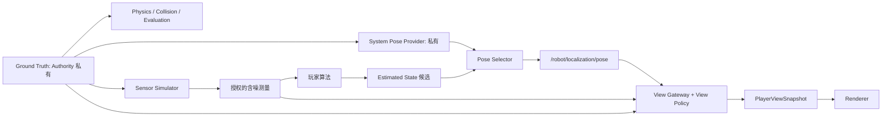

# 04 Ground Truth、Estimated State 与 Player View

## 目的、范围与硬约束

本文件定义最重要的信息边界：真实世界是物理唯一权威；估计允许错误；表现只消费授权视图。ADR-0006、0007 接受这些原则。局部教学隔离不等同于对本机所有者的防作弊，远程模式由服务器执行全部裁剪。

## 三层状态与数据流



World 的写权限只属于 Core；估计写入独立存储。Gateway 的真值输入仅用于策略显式允许的图层和事件；禁止通用 serializer 或 debug dump。公开地图与玩家估计的地图也分别存储，不能把后者写回秘密碰撞几何。

## Pose Publication 与来源选择

| 组件 | 输入 | 输出与限制 |
| --- | --- | --- |
| System Pose Provider | 私有真实位姿、关卡 grant | `SystemPoseSample`；仅 Authority 内部，不能注册为可订阅真值 topic |
| Player Pose Provider | SDK 输出端口和候选 topic | `pose2d@1`；各模块写 `/robot/estimates/{module_id}/pose` |
| Pose Selector | 配置、候选、帧与新鲜度验证 | 唯一写者向 `/robot/localization/pose` 发布选中样本 |
| View Policy | 主体、能力、允许来源、允许图层 | 决定选择资格与表现渠道，不能只在 UI 执行 |
| Topic Permission | 主体、部署、频道、操作 | 决定能否产生/读取某个消息，不能替代 View Policy |

标准 topic 是 Selector 的只读出口；玩家在 SDK 调用 `ctx.publish("pose", estimate, frame_id="map")`，其输出连接到候选频道，再由 Selector 发布标准结果。当前标准Envelope的发布者为 `pose_selector`（由Host绑定），原候选来源保存在 Authority 的选择记录与授权视图 `source_id`，不能把客户端自报来源当凭据。这样满足“发布估计后恢复显示”，同时杜绝多个模块争写标准频道。

UI 能显示系统位姿不代表 Runtime 可以读取它。向玩家订阅者转发标准 Topic 时，还须按选中来源检查数据许可：玩家估计读权限不能自动获得系统真值读权限；来源切换时重新检查并清除不再许可的缓存。前期如确需程序读取理想位姿，应作为明确授权传感器能力另行声明。

Selector 配置形如 `{ "mode": "player", "module_id": "odometry", "fallback": "none" }`。`system` 模式必须有 `view.system_pose` grant；`player` 模式只能选择本部署注册的候选。多候选并行运行时由玩家显式选择或采用任务给定固定优先级，不按真值误差、最新网络到达者或置信度最小者自动选优。自动融合必须是玩家自己的模块。

Navigation C2 在 `view_snapshot@5` 中显式授权 `pose_estimate_channels` 对照列表，让纯里程计和 EKF 可同时显示；Gateway 仍检查候选白名单、帧与过期，UI 不从私有调试对象补数据。`evaluation.module_id` 和 `reference_module_id` 固定主评分与独立对照，显示选源不切换评分。GPS/对照轨迹/选中位姿1σ椭圆分别由图层权限限制，误差反馈每项独立授权。具体时序、协方差和有界历史见 [35](35_NAVIGATION_GPS_LOCALIZATION.md)。

选源在 tick 边界原子提交并发出授权事件。模式、来源或 `run_id` 改变时清空插值历史。`fallback="none"` 是默认且唯一的首发回退策略；玩家源失效不自动回落到系统真值。

## 初始位姿、坐标系与合法性

- 关卡可授权一次起始定位 fix、起点区域或完全未知起点；这属于任务公开输入，不能从隐藏 spawn 状态“顺便初始化”玩家地图。
- `map` 不必等同 `world`。`map → odom → base_link` 的估计链由玩家维护；仅在任务公开变换时可把公共环境地图与估计叠加。没有合法 map 对齐时只显示 `odom` 估计轨迹或局部视图。
- 原始 `odom` 位姿不能标成 `map` 使用；转换需已授权的完整、无环帧链。首个版本只接受 `map`/`odom` 的 `base_link` Pose2D，其他动态 TF 接口不提前实现。
- Host 能检查声明帧、变换与权限，无法仅凭数值证明玩家确实使用了该坐标系；错标但数值合法仍是算法错误，不能借真值检测后偷偷修正。
- Pose 坐标要求有限，绝对值不超过任务公开的数值安全界限（初始建议 10⁶ m）；yaw 规范化。离开显示地图边界不等于估计无效，可以显示越界箭头和诊断，不能吸回真实位置。
- 协方差允许 `null`，否则 9 项有限、对角线非负、近似对称、PSD。建议先检查绝对不对称误差 ≤10⁻⁹，再在按公开参考尺度 1 m/1 rad 归一化后检查最小特征值 ≥−10⁻⁹。超过容差拒绝；不得静默截断负值掩盖算法问题。
- 验证仅判断数值与声明语义，不借助 Ground Truth 判断估计是否“正确”。数值合法而严重错误的位姿仍显示为估计。

## 新鲜度、跳变与显示

消息时间表示被估计状态的时间；显示时计算 `age_ticks = now_tick - sample_tick`。初始阈值：`age_ticks ≤12` 为 fresh，`13..60` 为 stale，`>60` 不显示全局坦克标记；stale 以虚线和年龄提示，且不新增运动外推。阈值写入 View Policy 并随关卡改变，不由 UI 自行扩大。

同源样本时间倒退只进入历史图，不覆盖当前值；相同 tick 用该源更高序号替代。未知帧、未来时间、无效协方差和非有限值拒绝并生成脱敏诊断，当前合法样本按原时间自然过期。

Renderer 只在同 `run_id`、同 source、同 frame 且有效的相邻估计样本之间做短角度插值。显示缓冲与跳变阈值读取rendering/view配置，实际时间规则见 [15](15_RENDERING_DESIGN.md)；无未来样本保持最后位置，不使用真值修正或默认外推。超过公开跳变阈值时重建历史，阈值不与真值比较。yaw 插值取最短弧，协方差只作为误差图层，不能保证真实覆盖率。

碰撞始终根据真实位置：估计坦克可能看起来穿墙，实际仍会撞墙。UI 必须标明“估计位置”，通过授权接触/里程计异常提示帮助排查；不能为视觉一致修改物理，或把真实碰撞点直接标到全局图。

## PlayerViewSnapshot与当前局部视图

`view_snapshot@1` 首发最小字段为 `view_revision`、`policy_id`、`selected_pose`（可空）、`local_observations`、`objects`、`effects`。`view_revision` 是该 run/主体的可见性代号，策略、授权、选源或部署切换时递增；普通快照沿用当前值。UI 见新代号清理旧缓存，拒绝随后迟到的旧代号快照，并按 Envelope sequence 排序。同代号内仍需执行样本新鲜度与 source/frame 检查。

`selected_pose` 含frame、source、sample tick、freshness与pose2d@1。旧view_snapshot@1仍要求objects/effects为空；当前@2增加获授权弹丸/目标，@3增加目标估计、@4增加图输出、@5增加白名单自身位姿候选。Authority按实际能力选用已注册版本，effects仍不发送任意命中特效；不得附带隐藏World字段。协议结构权威见 [03](03_PROTOCOL_SPECIFICATION.md) 和Schema。

未定位时当前保留获授权的局部传感器/状态面板，不显示全局车体。自由试验场的车体系键盘速度不依赖全局位姿，Navigation课程则不授予人工驾驶。通用近距scan、接触方向提示与完整局部几何视图尚未实现；未来增加时只能由授权测量构建，不能用真值相机裁剪全知局部地图。

地图显示一片未知区域、最后估计轨迹或公开任务地图；没有位姿时不显示全局坦克。相机跟随获选估计或由用户平移；不得隐式跟随真实位置。传感器视图、全局估计图层和获授权评分图层使用不同标签和数据权限。

## 受信View Policy

```json
{
  "policy_id": "campaign-l3-v1",
  "system_pose_allowed": false,
  "player_pose_allowed": true,
  "allowed_pose_frames": ["map", "odom"],
  "public_map": "task-map-01",
  "local_observation_channels": ["/robot/sensors/radar"],
  "true_enemy_objects": false,
  "world_effects": false,
  "camera_source": "selected_pose_or_manual",
  "pose_fresh_ticks": 12,
  "pose_hide_after_ticks": 60
}
```

这是策略结构示例，不是玩家可申请同等权限的消息，也不是当前某一关的完整YAML。View Policy与Selector原则由Accepted ADR-0007约束，当前已由加载器、Authority/ViewGateway及权限测试执行；不再整体标为Proposed。字段来自受信关卡，经Schema和语义验证后与主体grant取交集。未注册/未授权效果默认拒绝；撤权原子清空不再许可的缓存，无法撤回用户已保存的信息。

## 泄漏分析与防护矩阵

| 泄漏渠道 | Authority 侧处理 | 保留的反馈 |
| --- | --- | --- |
| 炮弹从隐藏坦克真实位置生成 | 无许可时不发其发射坐标/实体；仅按传感器观测生成局部回波 | 可见范围内的弹道或匿名告警 |
| 碰撞、死亡、命中特效 | 只发本机器人接触方向/事件，隐藏精确世界点和对手 ID | 车体局部震动、图标与结果反馈 |
| 定位音效、音量、立体声 | 按许可听觉模型量化或不发方向/距离；禁止携带内部位置 | 非定位音或含噪声学测量 |
| 相机、视差、小地图、阴影 | 相机基于估计；所有辅助图层消费同一授权 DTO | 手动相机、局部传感器面板 |
| 调试接口、错误堆栈、指标 | 无世界调试端点；日志脱敏；只允许已授权频道 | 玩家变量、延迟和合同错误 |
| 原始对象 ID、序号、消息大小 | 每主体观察标签；隐藏实体不影响公开全局计数，必要时固定快照节奏 | 自己的消息统计 |
| 静态资源、地图 seed、Replay | 秘密地图不进客户端包；私有录制与可公开回放分开 | 公开资源、批准的赛后视图 |
| Python 引擎对象、共享内存 | Runtime 仅获序列化输入；不注入 World/FFI 句柄 | 类型化 SDK 数据和安全状态 |

真实观测带来的信息推断是玩法；绕过传感器与策略直接泄漏才是缺陷。精确的时序侧信道和本机逆向无法在首期完全消除，Arena 另做威胁测试，不能宣称信息论无泄漏。

## 替代方案、开放问题与验收

把真值下发后隐藏违反核心约束；系统真值自动回退会掩盖定位失败；把估计钳到真实地图位置会偷偷提供定位服务，均不采用。过严隐藏可能不可玩，需用局部观测、可选练习关与赛后评估缓解。

开放项：未来局部scan/听觉模型、未授权炮弹的传感器观测规则与现有失效阈值的教学效果。Weapons炮弹显示已确认，不能继续视为未定显示权限。验收覆盖“无估计不显示全局坦克”“数值合法的错误估计照常显示”“系统源禁用后所有旁路无未授权真值”“多源切换清空历史”“漂移不改碰撞”“客户端抓包仅有授权 DTO”。以两份仅隐藏状态不同、授权观测相同的世界比较输出，是重要的泄漏回归测试。

## 历史：M1实施边界

M1 只有玩家位姿源 odometry，默认 System Pose Provider 禁用；开启未实现的系统源会拒绝配置。Selector 独占 `/robot/localization/pose`，Gateway 只接受标准估计与授权观测，不接受真值对象。UI 只在同 run/revision/source/frame 内插值，来源变化清缓存；跳变阈值以 config/game.yaml 的 `view` 为准。`view_revision` 不随普通快照递增，Envelope sequence 负责排序。

公开地图和零初始位姿属于用户确认的试验场任务信息；这不授予运行中的世界状态读取权限。未定位时仍能使用键盘与轮速/IMU 面板；完整局部 scan/接触提示、通用选源服务和 TF 留在后续任务。C0 系统显示及 C1/C2 雷达已在 M4 增加，相关权限见下节。

## 历史：M1b实施范围

默认估计模式仍禁用系统定位，objects/effects 为空。显式 `--view weapons-practice` 在启动时启用单独受信策略：System Pose Provider 按字段投影真实位姿，经同一个 Pose Selector 发布内部标准位姿，再由 Gateway 生成 view_snapshot@2。实体只包含已授权的弹丸 ID/位置/半径和静态靶标位姿/命中计数；无原始世界句柄或通用 dump。UI 显著标记真值练习。Python 仍只获轮组、IMU、炮台关节和自身武器反馈，不能订阅系统位姿或视图。具体已确认限制与测试见 [14](14_WEAPONS_DESIGN.md)。本阶段只在启动时选择模式，不提供动态提权/撤权服务。

## 显示时间与跟随相机修订

当前显示实现见 [15](15_RENDERING_DESIGN.md)：快照 30 Hz，RAF 独立刷新；使用仿真/采样时间插值车体、累计炮台角与同 ID 授权弹丸。相机直接跟随同一显示位姿的 x/y，始终保持世界坐标方向，不使用真实位姿修正估计。无合法位姿时隐藏全局车体并保持最后合法相机位置；run/权限 revision 改变清理缓存。新增外观配置属于公开元数据，不授予额外世界读取权限。

## 当前逐关授权

以下由 `levels/*.yaml` 的data_access、visualization、evaluation声明；UI管理状态和Robot Runtime输入是独立通道。

| 关卡 | 普通玩家视图与UI反馈 | 玩家程序输入边界 |
| --- | --- | --- |
| 公共C0 | 系统自身位姿、地图、真实靶标与炮弹 | 仅声明的自身系统位姿；无需编程，不获世界对象 |
| Weapons C1–C5 | 系统自身位姿、公开地图、局部观测、玩家目标估计；全章授权炮弹，隐藏敌车真值和命中特效位置 | C1–C4中心Radar、C5匿名装甲；自身位姿、炮台/武器状态按各关inputs授权，不因图层可见新增Topic |
| Weapons C2/C3 | 另授权累计目标位置RMSE、有效样本和有界曲线；C1/C4/C5无运行中误差授权 | 聚合误差不进入滤波器输入；C2实验反馈另按38约束 |
| Navigation C0 | 系统自身位姿、地图、控制曲线与运动任务标量，无武器 | 目标Twist与轮速；只输出轮电压 |
| Navigation C1 | 一次起点，运行中车体/相机跟随玩家里程计；授权位置/朝向RMSE | 轮速与Twist，无持续系统位姿 |
| Navigation C2–C4 | 玩家EKF与纯里程计对照、GPS、协方差椭圆、授权定位RMSE对比 | 轮速/GPS及声明参考，不含当前真实位姿或评分误差 |
| Navigation C3/C4任务 | C3公开航点；C4公开路径/检查点与真实距终点标量，真实追踪误差只在终局 | C3授权目标Topic，C4一次性静态路径；任务UI标量不进入控制器 |

HP与击杀结果是显式游戏反馈，不含命中位置。炮弹显示可能提供物理推断，属于Weapons已明确接受的显示授权，不代表敌车信息绝对不可推断；当前敌车不主动开火。目标标记保持合法错误估计、按采样时间插值，没有真值回退。allowed_metrics/live_feedback与task_feedback限制管理状态发布；关闭图层不能撤销数据权限，也不能授予程序订阅。切关新建run并清空候选、插值和指标走势，规则见 [18](18_CAMPAIGN_DESIGN.md)、[35](35_NAVIGATION_GPS_LOCALIZATION.md)、[40](40_NAVIGATION_CONTINUOUS_PATH_TRACKING.md)、[ADR-0034](adr/0034-authorized-live-evaluation.md)。

## 本机玩家与开发者角色

默认玩家模式继续使用本关 View Policy；C1/C2 的目标只能来自获授权的玩家估计。开发者模式额外获得 Authority 检查的只读视图 grant，可通过独立 DeveloperSnapshot 和图层开关查看当前已实现的真值、估计与传感器；它不进入 PlayerViewSnapshot 或 Robot Runtime，也不改写 Pose Selector。图层开关是呈现偏好，不能给玩家授予新数据。模式切换重建 Authority/Worker 并清除旧缓存，完整权限、文件与单机信任边界见 [22](22_SETTINGS_MODES_AND_PROGRESS.md) 和 [ADR-0026](adr/0026-settings-modes-and-campaign-progress.md)。

## Weapons 目标估计与传感器授权

当前渐进 Weapons 见 [28](28_WEAPONS_PROGRESSIVE_ESTIMATION.md)。C3/C4 的地图目标标记由玩家 r/theta 与**同采样 tick 已公开的自身位姿**投影得到，使用有界公开位姿历史；缺少对应样本不回退到私有世界查询。极坐标协方差按 Jacobian 转为 x/y，估计误差照常保留。C4 控制适配器同样只使用公开位姿投影中心估计，玩家负责运动预测。C5 只提供匿名装甲测量，车体/装甲位置来自玩家 TargetPoseEstimate；当前正式关卡不启用车头 GPS。程序订阅和 UI 显示分别校验，测量不能画成真值。
