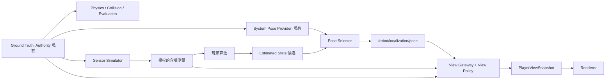

# 04 Ground Truth、Estimated State 与 Player View

## 目的、范围与硬约束

本文件定义最重要的信息边界：真实世界是物理唯一权威；估计允许错误；表现只消费授权视图。ADR-0006、0007 接受这些原则。局部教学隔离不等同于对本机所有者的防作弊，远程模式由服务器执行全部裁剪。

## 三层状态与数据流



World 的写权限只属于 Core；估计写入独立存储。Gateway 的真值输入仅用于策略显式允许的图层和事件；禁止通用 serializer 或 debug dump。公开地图与玩家估计的地图也分别存储，不能把后者写回秘密碰撞几何。

## Pose Publication 与来源选择

| 组件 | 输入 | 输出与限制 |
| --- | --- | --- |
| System Pose Provider | 私有真实位姿、关卡 grant | `SystemPoseSample`；仅 Authority 内部，不能注册为可订阅真值 topic |
| Player Pose Provider | SDK 输出端口和候选 topic | `pose2d@1`；各模块写 `/robot/estimates/{module_id}/pose` |
| Pose Selector | 配置、候选、帧与新鲜度验证 | 唯一写者向 `/robot/localization/pose` 发布选中样本 |
| View Policy | 主体、能力、允许来源、允许图层 | 决定选择资格与表现渠道，不能只在 UI 执行 |
| Topic Permission | 主体、部署、频道、操作 | 决定能否产生/读取某个消息，不能替代 View Policy |

标准 topic 是 Selector 的只读出口；玩家在 SDK 调用 `ctx.publish("pose", estimate, frame_id="map")`，其输出连接到候选频道，再由 Selector 发布标准结果。标准 Envelope 的发布者是 `host:pose_selector`，原候选来源保存在 Authority 的选择记录与授权视图 `source_id`，不能把客户端自报来源当凭据。这样满足“发布估计后恢复显示”，同时杜绝多个模块争写标准频道。

UI 能显示系统位姿不代表 Runtime 可以读取它。向玩家订阅者转发标准 Topic 时，还须按选中来源检查数据许可：玩家估计读权限不能自动获得系统真值读权限；来源切换时重新检查并清除不再许可的缓存。前期如确需程序读取理想位姿，应作为明确授权传感器能力另行声明。

Selector 配置形如 `{ "mode": "player", "module_id": "odometry", "fallback": "none" }`。`system` 模式必须有 `view.system_pose` grant；`player` 模式只能选择本部署注册的候选。多候选并行运行时由玩家显式选择或采用任务给定固定优先级，不按真值误差、最新网络到达者或置信度最小者自动选优。自动融合必须是玩家自己的模块。

选源在 tick 边界原子提交并发出授权事件。模式、来源或 `run_id` 改变时清空插值历史。`fallback="none"` 是默认且唯一的首发回退策略；玩家源失效不自动回落到系统真值。

## 初始位姿、坐标系与合法性

- 关卡可授权一次起始定位 fix、起点区域或完全未知起点；这属于任务公开输入，不能从隐藏 spawn 状态“顺便初始化”玩家地图。
- `map` 不必等同 `world`。`map → odom → base_link` 的估计链由玩家维护；仅在任务公开变换时可把公共环境地图与估计叠加。没有合法 map 对齐时只显示 `odom` 估计轨迹或局部视图。
- 原始 `odom` 位姿不能标成 `map` 使用；转换需已授权的完整、无环帧链。首个版本只接受 `map`/`odom` 的 `base_link` Pose2D，其他动态 TF 接口不提前实现。
- Host 能检查声明帧、变换与权限，无法仅凭数值证明玩家确实使用了该坐标系；错标但数值合法仍是算法错误，不能借真值检测后偷偷修正。
- Pose 坐标要求有限，绝对值不超过任务公开的数值安全界限（初始建议 10⁶ m）；yaw 规范化。离开显示地图边界不等于估计无效，可以显示越界箭头和诊断，不能吸回真实位置。
- 协方差允许 `null`，否则 9 项有限、对角线非负、近似对称、PSD。建议先检查绝对不对称误差 ≤10⁻⁹，再在按公开参考尺度 1 m/1 rad 归一化后检查最小特征值 ≥−10⁻⁹。超过容差拒绝；不得静默截断负值掩盖算法问题。
- 验证仅判断数值与声明语义，不借助 Ground Truth 判断估计是否“正确”。数值合法而严重错误的位姿仍显示为估计。

## 新鲜度、跳变与显示

消息时间表示被估计状态的时间；显示时计算 `age_ticks = now_tick - sample_tick`。初始阈值：`age_ticks ≤12` 为 fresh，`13..60` 为 stale，`>60` 不显示全局坦克标记；stale 以虚线和年龄提示，且不新增运动外推。阈值写入 View Policy 并随关卡改变，不由 UI 自行扩大。

同源样本时间倒退只进入历史图，不覆盖当前值；相同 tick 用该源更高序号替代。未知帧、未来时间、无效协方差和非有限值拒绝并生成脱敏诊断，当前合法样本按原时间自然过期。

Renderer 只在同 `run_id`、同 source、同 frame 且有效的相邻估计样本之间做短角度插值。建议显示缓冲 6 tick，无未来样本则保持最后位置，不使用真值修正或默认外推。超过公开跳变阈值（初始 2 m 或 π/2）立即重建历史、显示“估计重定位”；阈值不是与真值比较。yaw 插值取最短弧，协方差只作为误差图层，不能保证真实覆盖率。

碰撞始终根据真实位置：估计坦克可能看起来穿墙，实际仍会撞墙。UI 必须标明“估计位置”，通过授权接触/里程计异常提示帮助排查；不能为视觉一致修改物理，或把真实碰撞点直接标到全局图。

## PlayerViewSnapshot 与局部视图

`view_snapshot@1` 首发最小字段为 `view_revision`、`policy_id`、`selected_pose`（可空）、`local_observations`、`objects`、`effects`。`view_revision` 是该 run/主体的可见性代号，策略、授权、选源或部署切换时递增；普通快照沿用当前值。UI 见新代号清理旧缓存，拒绝随后迟到的旧代号快照，并按 Envelope sequence 排序。同代号内仍需执行样本新鲜度与 source/frame 检查。

`selected_pose` 含估计 frame、source、sample tick、freshness 与 `pose2d@1`；`objects`/`effects` 首发保留为空数组，后续增加类型须单独 Schema 与权限审查。不得附带隐藏 World 的任意对象字段。

未定位但可键盘控制时，保留以 `base_link` 为中心的局部观测面板、车体固定图标、朝向约定、近距 scan/雷达回波与授权碰撞提示。局部世界不是以真值为相机中心裁剪的全彩全知地图：画面只由实际可见/可测到的观测产生，包含遮挡、噪声和采样延迟。键盘发送车体坐标速度意图，无需全局位姿。局部几何可由 Simulator 生成测量，但不能包含超出关卡传感器能力的信息。

地图显示一片未知区域、最后估计轨迹或公开任务地图；没有位姿时不显示全局坦克。相机跟随获选估计或由用户平移；不得隐式跟随真实位置。传感器视图、全局估计图层和获授权评分图层使用不同标签和数据权限。

## View Policy 草案

```json
{
  "policy_id": "campaign-l3-v1",
  "system_pose_allowed": false,
  "player_pose_allowed": true,
  "allowed_pose_frames": ["map", "odom"],
  "public_map": "task-map-01",
  "local_observation_channels": ["/robot/sensors/radar"],
  "true_enemy_objects": false,
  "world_effects": false,
  "camera_source": "selected_pose_or_manual",
  "pose_fresh_ticks": 12,
  "pose_hide_after_ticks": 60
}
```

这是策略配置示例，不是玩家可申请同等权限的消息。Host 从受信关卡内容加载、按版本验证，再与主体权限取交集。初期 policy 格式仍为 Proposed，M1 的测试夹具先覆盖上述字段；未增加授权类型的效果默认拒绝。撤权需原子切换、清空不再许可的缓存；无法撤回已获授权并被用户保存的历史信息，关卡设计不能声称能“让玩家忘记”前关地图。

## 泄漏分析与防护矩阵

| 泄漏渠道 | Authority 侧处理 | 保留的反馈 |
| --- | --- | --- |
| 炮弹从隐藏坦克真实位置生成 | 无许可时不发其发射坐标/实体；仅按传感器观测生成局部回波 | 可见范围内的弹道或匿名告警 |
| 碰撞、死亡、命中特效 | 只发本机器人接触方向/事件，隐藏精确世界点和对手 ID | 车体局部震动、图标与结果反馈 |
| 定位音效、音量、立体声 | 按许可听觉模型量化或不发方向/距离；禁止携带内部位置 | 非定位音或含噪声学测量 |
| 相机、视差、小地图、阴影 | 相机基于估计；所有辅助图层消费同一授权 DTO | 手动相机、局部传感器面板 |
| 调试接口、错误堆栈、指标 | 无世界调试端点；日志脱敏；只允许已授权频道 | 玩家变量、延迟和合同错误 |
| 原始对象 ID、序号、消息大小 | 每主体观察标签；隐藏实体不影响公开全局计数，必要时固定快照节奏 | 自己的消息统计 |
| 静态资源、地图 seed、Replay | 秘密地图不进客户端包；私有录制与可公开回放分开 | 公开资源、批准的赛后视图 |
| Python 引擎对象、共享内存 | Runtime 仅获序列化输入；不注入 World/FFI 句柄 | 类型化 SDK 数据和安全状态 |

真实观测带来的信息推断是玩法；绕过传感器与策略直接泄漏才是缺陷。精确的时序侧信道和本机逆向无法在首期完全消除，Arena 另做威胁测试，不能宣称信息论无泄漏。

## 替代方案、开放问题与验收

把真值下发后隐藏违反核心约束；系统真值自动回退会掩盖定位失败；把估计钳到真实地图位置会偷偷提供定位服务，均不采用。过严隐藏可能不可玩，需用局部观测、可选练习关与赛后评估缓解。

开放项：局部 scan 的分辨率、噪声与炮弹观测规则、失效阈值的教学效果。验收覆盖“无估计不显示全局坦克”“数值合法的错误估计照常显示”“系统源禁用后所有旁路无未授权真值”“多源切换清空历史”“漂移不改碰撞”“客户端抓包仅有授权 DTO”。以两份仅隐藏状态不同、授权观测相同的世界比较输出，是重要的泄漏回归测试。

## M1 实施边界

M1 只有玩家位姿源 odometry，默认 System Pose Provider 禁用；开启未实现的系统源会拒绝配置。Selector 独占 `/robot/localization/pose`，Gateway 只接受标准估计与授权观测，不接受真值对象。UI 只在同 run/revision/source/frame 内插值，来源变化清缓存；跳变阈值以 config/game.yaml 的 `view` 为准。`view_revision` 不随普通快照递增，Envelope sequence 负责排序。

公开地图和零初始位姿属于用户确认的试验场任务信息；这不授予运行中的世界状态读取权限。未定位时仍能使用键盘与轮速/IMU 面板；完整局部 scan/接触提示、通用选源服务和 TF 留在后续任务。C0 系统显示及 C1/C2 雷达已在 M4 增加，相关权限见下节。

## M1b 实施范围

默认估计模式仍禁用系统定位，objects/effects 为空。显式 `--view weapons-practice` 在启动时启用单独受信策略：System Pose Provider 按字段投影真实位姿，经同一个 Pose Selector 发布内部标准位姿，再由 Gateway 生成 view_snapshot@2。实体只包含已授权的弹丸 ID/位置/半径和静态靶标位姿/命中计数；无原始世界句柄或通用 dump。UI 显著标记真值练习。Python 仍只获轮组、IMU、炮台关节和自身武器反馈，不能订阅系统位姿或视图。具体已确认限制与测试见 [14](14_WEAPONS_DESIGN.md)。本阶段只在启动时选择模式，不提供动态提权/撤权服务。

## 显示时间与跟随相机修订

当前显示实现见 [15](15_RENDERING_DESIGN.md)：快照 30 Hz，RAF 独立刷新；使用仿真/采样时间插值车体、累计炮台角与同 ID 授权弹丸。相机直接跟随同一显示位姿的 x/y，始终保持世界坐标方向，不使用真实位姿修正估计。无合法位姿时隐藏全局车体并保持最后合法相机位置；run/权限 revision 改变清理缓存。新增外观配置属于公开元数据，不授予额外世界读取权限。

## M4 教学授权

C0–C2 明确授权自身系统位姿，仍由 Selector 唯一写标准位姿。C0 额外开放真实靶标/弹道；C1/C2 仅发送系统自身位姿、局部 Radar、玩家 `target_estimate@1` 及授权任务反馈。目标估计与自身 Pose Selector 分离，合法错误估计保持原值；旧时间不能替换新状态。`view_snapshot@3` 的目标标记也使用采样时间插值，无合法输出时隐藏，无真值回退。

C2 的 HP/击杀结果属于明确授权的游戏反馈，不含命中坐标、目标位姿或实体运动信息。真值误差仅在本次 Runtime 停止后发布；切换关卡建立新 run 并清空插值和候选。具体规则与本机威胁边界见 [18](18_CAMPAIGN_DESIGN.md)。

## 本机玩家与开发者角色

默认玩家模式继续使用本关 View Policy；C1/C2 的目标只能来自获授权的玩家估计。开发者模式额外获得 Authority 检查的只读视图 grant，可通过独立 DeveloperSnapshot 和图层开关查看当前已实现的真值、估计与传感器；它不进入 PlayerViewSnapshot 或 Robot Runtime，也不改写 Pose Selector。图层开关是呈现偏好，不能给玩家授予新数据。模式切换重建 Authority/Worker 并清除旧缓存，完整权限、文件与单机信任边界见 [22](22_SETTINGS_MODES_AND_PROGRESS.md) 和 [ADR-0026](adr/0026-settings-modes-and-campaign-progress.md)。
