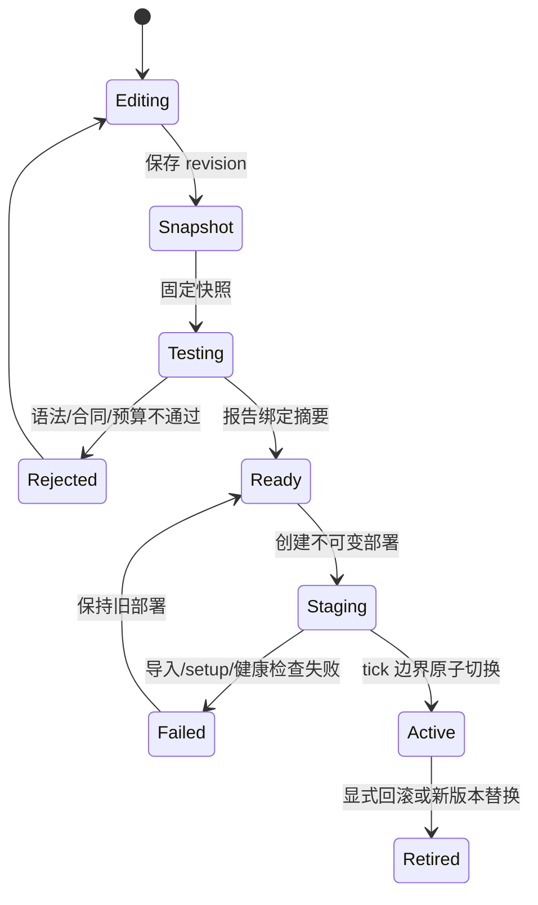

# 06 Workspace、模板与 Edit / Test / Deploy

## 目的、范围与约束

支持持久化、多文件Python项目、无损解锁新模块和不可变部署。当前本机已支持单模块兼容包装及同步周期/event模块图、整图测试/部署/回滚、模板升级预览和项目维护；分别见 [17](17_EDITOR_AND_DEPLOYMENT.md)、[26](26_MODULE_GRAPH_AND_WEAPONS_CHAPTER.md)、[38](38_ENGINEERING_AND_ALGORITHM_LAB.md)。ADR-0009/0012约束非覆盖管理与编辑/运行分离。独立静态Web存储、云同步、持久运行checkpoint和动态RobotApp组装仍未实现。

## Navigation规划工程增量

C5只补缺失的navigation/global_planner.py；已有轮控、里程计、EKF、PathFollower、自建文件和历史保持。一次性准备声明由关卡runtime.preparation派生到Manifest，不加入周期modules；旧Manifest变化通过原升级预览/CAS显式应用。返回C4时不运行未授权准备任务，也不删除新增算法。相同revision的测试与正式部署各用新Worker，静态路径不复用测试对象；再次规划需重试同一任务。合同见 [42](42_NAVIGATION_GLOBAL_PLANNING.md)。

## Workspace目录与所有权

下列是目录组织示意，实际文件由各关模板按需生成；data与运行checkpoint不是当前默认能力，模板ledger实际保存在Store快照中，不要求玩家手建.tankbot目录。

```text
workspace/
  tankbot.json
  main.py
  contracts/odometry.json
  localization/__init__.py
  localization/odometry.py
  perception/__init__.py
  planning/__init__.py
  control/__init__.py
  tests/test_odometry.py
  data/                       # 可选玩家数据，不默认打入代码部署
  .tankbot/template-lock.json  # 宿主维护的模板来源记录
```

按解锁需要创建目录；不要求所有目录从第一关存在。算法文件与玩家自建工具库均属玩家内容。受管框架包装器与玩家算法分文件保存，部署使用不可变副本；升级只通过预览更新受管文件，不靠注释区或自动AST改写玩家算法。玩家文件允许同项目绝对 import；`localization` 是 Python 包，SDK 自带 `tankbot` 不被工作区同名文件覆盖，检测同名遮蔽并报错。

两种本机运行方式都由启动器在 `userdata/workspaces/<项目标识>/` 保存源码revision、模板ledger、测试/部署观察归档、实验记录和备份；旧缓存库非覆盖复制迁移，见 [17](17_EDITOR_AND_DEPLOYMENT.md)。campaign/navigation按scope选择独立工程，与稳定关卡ID和进度记录分开。可执行DeploymentArtifact与Ready授权只活在Authority会话中，不等同于磁盘归档；运行checkpoint尚未实现。独立Web的IndexedDB/OPFS、桌面应用数据及服务器按用户存储是待验证的部署适配，不是当前持久化后端。

## Manifest

`tankbot.json` 是可编辑的声明，不是权限来源。当前受管Manifest/Contract由关卡生成，单模块类入口和模块图格式分别见 [m3-workspace.json](examples/m3-workspace.json)、[m5-workspace.json](examples/m5-workspace.json)；实际模块与连接以课程YAML为准。下面保留早期高级组装目标示例，`main:build_robot` 尚不能作为当前受管项目入口：

```json
{
  "manifest_version": "1.0",
  "sdk_version": "0.1.0",
  "protocol_version": "1.0",
  "project_id": "my-first-robot",
  "entry_point": "main:build_robot",
  "modules": [{
    "module_id": "odometry",
    "contract": "contracts/odometry.json",
    "config": {}
  }],
  "connections": [
    {"from": "/robot/sensors/encoder", "to": "odometry.encoder"},
    {"from": "/robot/sensors/imu", "to": "odometry.imu"},
    {"from": "odometry.pose", "to": "/robot/estimates/odometry/pose"}
  ],
  "dependencies": [],
  "pose_source": {"mode": "player", "module_id": "odometry", "fallback": "none"}
}
```

SDK `0.1.0` 是当前仓库本地profile，尚未发布到pip。M3历史单模块入口等于唯一Contract类入口；现行图模式由Host验证Manifest/Contract并冻结，不调用玩家的动态build_robot工厂。未来高级组装仍须与声明端口/权限兼容，不能运行时增加特权连接。

玩家依赖按 [23](23_PLAYER_CODE_AND_LIBRARIES.md) 的课程白名单开放：当前仅 NumPy、SDK、指定基础标准库和自建模块，测试文件另可使用 unittest。Manifest dependencies 必须为空，不提供自由 pip 安装。允许库由游戏自动准备并纳入部署环境摘要；新增基础库需维护者审查教学影响及两平台兼容。sdk_version 不等于 Protocol 或模板版本。

## 模板元数据与非覆盖式生成

模板元数据至少为：`template_id`、`template_version`、`required_sdk_profile`、`module_contract`、`files`（相对路径、内容摘要、用途）、`migration_from`。模板包只包含文本与声明，不能执行任意安装钩子。Host ledger 记录来源版本、首次生成摘要和生成 revision；工作区内 ledger 只是可导出的镜像，不信任玩家修改后的哈希声明。

生成算法必须是事务：

1. 读取当前 `workspace_revision`，校验模板签名/摘要及目标路径；预览新增文件与冲突。
2. 对每个目标做存在检测，包括 symlink、大小写冲突、Unicode 规范化冲突；已存在任何文件均不直接覆盖。
3. 不存在的文件通过 exclusive-create 或事务等价操作创建；已有文件保持原样，新建议放在独立 `.incoming` 预览区，不能成为部署 import 路径。
4. 如需更新，提供基于旧模板、玩家版本、新模板的三方 diff；只有玩家明确应用的合并结果才创建新 revision，保留旧 revision 可恢复。
5. 在 revision 未变的条件下原子提交文件与 ledger；并发修改则重算计划，不以最后写入者覆盖。

即使现有文件仍等于旧模板，也默认只建议升级。禁止 `TODO` 匹配替换、重生成覆盖、静默删除“已废弃”模块或迁移时复制新模板盖住旧目录。失败回滚本次事务，不能损伤旧源码。

## 迁移与存储接口

```typescript
interface WorkspaceStore {
  readSnapshot(revision: string): Promise<WorkspaceSnapshot>;
  planTemplate(templateId: string, version: string,
               baseRevision: string): Promise<MigrationPlan>;
  commit(planId: string, expectedRevision: string,
         resolutions: Resolution[]): Promise<WorkspaceRevision>;
  exportSnapshot(revision: string): Promise<Archive>;
}
```

游戏/SDK 升级先做只读兼容检查并备份，报告需要的 API/Manifest/模板迁移。迁移本身可重复执行，以 migration ID 防重复；冲突必须显式解决。旧 SDK 在受支持窗口内可作为隔离兼容 profile 运行；窗口暂建议至少上一个已发布 minor，正式发布前确认。不能运行旧 profile 时允许导出和编辑，不能宣称项目已自动适配。

路径必须是规范化相对路径，拒绝绝对路径、`..`、symlink/hardlink、设备文件、压缩包路径逃逸与不安全文件名；导入按总大小、文件数与展开后大小限额。不能通过 Workspace API 访问 Host 凭据或其他玩家目录。

## Edit / Test / Deploy 生命周期



Edit只改变草稿，不改变当前机器人。Test固定revision，检查路径/语法、Contract/连线/依赖与声明准入，再在独立Runtime执行项目unittest和配置数量的授权短输入批次。测试输出不驱动正式世界或计分，也不是另建完整闭环比赛。玩家测试、import/setup均不在Authority主进程执行；本机CPython仍仅限本人可信代码，不能称为服务端安全沙箱。

Test报告绑定源码、SDK、协议、Schema bundle、内容、ControllerProfile与冻结执行profile摘要；编辑或配置变化后不能复用旧Ready。当前Test只执行项目单元测试和配置数量的授权短输入/接口检查，输出不驱动物理或正式计分；完整隔离场景闭环测试仍是后续扩展，短测不证明通关。私有裁判可读Ground Truth，Runtime仍只收授权输入；聚合指标逐关授权，详细真值不得回灌算法。

Deploy 将所有允许代码文件、Manifest、Contract、依赖锁、配置及已绑定环境摘要打包成按 SHA-256 内容寻址的不可变 `DeploymentArtifact`。内容摘要使用规范化相对路径、排序清单和各文件原始字节摘要计算，不把归档 mtime/压缩器差异算成代码版本；Host 生成不可由 Manifest 冒充的 `schema_bundle_sha256` 等元数据。`tests/`、`.incoming`、秘密文件和大 `data/` 默认不进 artifact，白名单规则须出现在报告。多文件加载只能从该快照，不能引用继续编辑的工作区或残留 Python import cache。

Supervisor 为新部署创建干净 Runtime，验证导入与 setup，随后在 tick 边界停止旧控制租约、清理旧输入/输出队列、激活新租约与来源，最后关闭旧 Runtime。World 在热部署时继续运行，默认算法状态清空；暂停 Campaign 的切换体验与 Arena 禁止赛中换代码是不同模式策略。

Staging 失败保留旧部署；激活后失败进入安全控制，不能自动信任旧状态。显式回滚到旧 artifact 也创建新 deployment ID 和干净 Runtime，只在许可模式下进行。重启/回滚不回滚物理世界；需要重置场景时新建 `run_id`。

## 备选、开放问题与验收

单文件脚本阻碍累积开发；任意热加载无法稳定复现；自动AST修改可能破坏玩家语义，均不作为默认。磁盘历史已有预览、引用保护和可恢复清理；这不等于会话内DeploymentArtifact GC。Authority达到会话artifact数量上限仍拒绝新增，不自动删除仍有引用或已验证的部署。

开放项：独立Web存储、云同步冲突UI、会话artifact GC与已发布SDK兼容窗口。文件数、字节、备份和恢复配额已在workspace/engineering配置中，不再是无界待定项。验收须覆盖源码不覆盖、CAS/磁盘失败可恢复、摘要一致、编辑不影响Active、失败保旧、恢复可追溯；具体受支持导入格式与负例见17/38，不能由目标存储接口推断支持任意压缩项目。

## M5 当前增量

M5已扩展多模块Manifest、整图测试与回滚，见 [26](26_MODULE_GRAPH_AND_WEAPONS_CHAPTER.md)。当前模板版本由各关YAML/ledger声明，不以早期C3/C4的2.0.0代替。跨关只补缺失文件；升级计划包含受管wrapper、Manifest、Contract和系统测试，已修改算法不替换。只有来源可证明未修改的旧空模板可列入显式升级预览，旧revision始终可恢复，见 [ADR-0044](adr/0044-preview-untouched-algorithm-upgrades.md)。

## 当前项目维护实现

当前Store提供完整项目备份、容量分类、固定revision和预览式历史保留。沿用文件锁/CAS；清理先备份并写恢复日志，再移动不可变对象，中断回滚，显式清空前验证备份。恢复先预览源码差异并备份当前HEAD，再导入历史，最后原子发布；不自动覆盖算法。旧迁移保留备份/固定项/恢复区，接口及限制见 [38](38_ENGINEERING_AND_ALGORITHM_LAB.md)。

## C6增量与已有工程

`navigation/local_controller.py`是玩家文件，非覆盖追加；GlobalPlanner、PathFollower及三项控制/定位算法和自建文件保持。`navigation/local_module.py`、Manifest与受管Contract走升级预览及显式应用，沿用不可变revision、ledger/history与恢复机制。C6不会将参考避障器写入正式模板。接口和教材见 [43](43_NAVIGATION_LOCAL_AVOIDANCE.md)。
