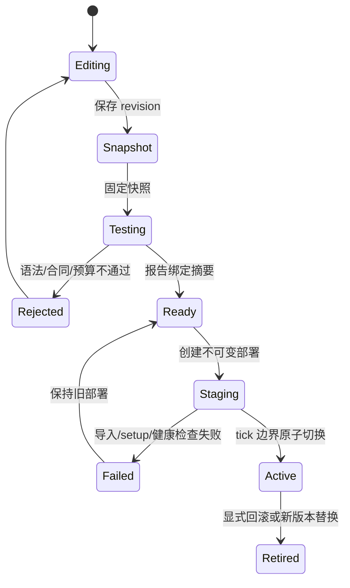

# 06 Workspace、模板与 Edit / Test / Deploy

## 目的、范围与约束

支持持久化、多文件 Python 项目、无损解锁新模块和不可变部署。ADR-0009 接受非覆盖式 Workspace 管理；ADR-0012 接受编辑/运行分离。M3 已实现本机单模块 profile，文件服务、模板预览和部署状态机见 [17](17_EDITOR_AND_DEPLOYMENT.md)；本文其余多模块/独立 Web 存储仍为扩展设计。

## Workspace 目录与所有权

```text
workspace/
  tankbot.json
  main.py
  contracts/odometry.json
  localization/__init__.py
  localization/odometry.py
  perception/__init__.py
  planning/__init__.py
  control/__init__.py
  tests/test_odometry.py
  data/                       # 可选玩家数据，不默认打入代码部署
  .tankbot/template-lock.json  # 宿主维护的模板来源记录
```

按解锁需要创建目录；不要求所有目录从第一关存在。算法文件与玩家自建工具库均属玩家内容。框架包装器放在 SDK 包或 Host 生成的只读部署层，避免在玩家文件内反复改“自动生成区”。玩家文件允许同项目绝对 import；`localization` 是 Python 包，SDK 自带 `tankbot` 不被工作区同名文件覆盖，检测同名遮蔽并报错。

本机源码 revision、模板 ledger 和测试/部署归档位于 `userdata/workspaces/<项目标识>/`，旧缓存库非覆盖复制迁移，具体规则见 [17](17_EDITOR_AND_DEPLOYMENT.md)。持久化设计分别存储源码 revision、模板 ledger、测试报告、部署 artifact 和运行 checkpoint。浏览器建议 IndexedDB/OPFS 适配并提供导出；需应对配额、隐私模式和存储清理，不能把浏览器存储视为永久备份。桌面使用项目目录/应用数据，服务器按用户存储；底层差异隐藏于 `WorkspaceStore`。

## Manifest

`tankbot.json` 是可编辑的声明，不是权限来源：

```json
{
  "manifest_version": "1.0",
  "sdk_version": "0.1.0",
  "protocol_version": "1.0",
  "project_id": "my-first-robot",
  "entry_point": "main:build_robot",
  "modules": [{
    "module_id": "odometry",
    "contract": "contracts/odometry.json",
    "config": {}
  }],
  "connections": [
    {"from": "/robot/sensors/encoder", "to": "odometry.encoder"},
    {"from": "/robot/sensors/imu", "to": "odometry.imu"},
    {"from": "odometry.pose", "to": "/robot/estimates/odometry/pose"}
  ],
  "dependencies": [],
  "pose_source": {"mode": "player", "module_id": "odometry", "fallback": "none"}
}
```

示例 SDK `0.1.0` 是规划中的 API profile，不代表已经发布此包。M3 的项目 entry point 直接等于唯一 Module Contract 的类入口，实际夹具见 [M3 Manifest](examples/m3-workspace.json)；下述项目 `build_robot` 是后续高级图组装入口，初学者由模板生成。高级组装结果必须与 Manifest 声明端口和权限兼容，不能运行时偷偷增加特权连接。

玩家依赖按 [23](23_PLAYER_CODE_AND_LIBRARIES.md) 的课程白名单开放：当前仅 NumPy、SDK、指定基础标准库和自建模块，测试文件另可使用 unittest。Manifest dependencies 必须为空，不提供自由 pip 安装。允许库由游戏自动准备并纳入部署环境摘要；新增基础库需维护者审查教学影响及两平台兼容。sdk_version 不等于 Protocol 或模板版本。

## 模板元数据与非覆盖式生成

模板元数据至少为：`template_id`、`template_version`、`required_sdk_profile`、`module_contract`、`files`（相对路径、内容摘要、用途）、`migration_from`。模板包只包含文本与声明，不能执行任意安装钩子。Host ledger 记录来源版本、首次生成摘要和生成 revision；工作区内 ledger 只是可导出的镜像，不信任玩家修改后的哈希声明。

生成算法必须是事务：

1. 读取当前 `workspace_revision`，校验模板签名/摘要及目标路径；预览新增文件与冲突。
2. 对每个目标做存在检测，包括 symlink、大小写冲突、Unicode 规范化冲突；已存在任何文件均不直接覆盖。
3. 不存在的文件通过 exclusive-create 或事务等价操作创建；已有文件保持原样，新建议放在独立 `.incoming` 预览区，不能成为部署 import 路径。
4. 如需更新，提供基于旧模板、玩家版本、新模板的三方 diff；只有玩家明确应用的合并结果才创建新 revision，保留旧 revision 可恢复。
5. 在 revision 未变的条件下原子提交文件与 ledger；并发修改则重算计划，不以最后写入者覆盖。

即使现有文件仍等于旧模板，也默认只建议升级。禁止 `TODO` 匹配替换、重生成覆盖、静默删除“已废弃”模块或迁移时复制新模板盖住旧目录。失败回滚本次事务，不能损伤旧源码。

## 迁移与存储接口

```typescript
interface WorkspaceStore {
  readSnapshot(revision: string): Promise<WorkspaceSnapshot>;
  planTemplate(templateId: string, version: string,
               baseRevision: string): Promise<MigrationPlan>;
  commit(planId: string, expectedRevision: string,
         resolutions: Resolution[]): Promise<WorkspaceRevision>;
  exportSnapshot(revision: string): Promise<Archive>;
}
```

游戏/SDK 升级先做只读兼容检查并备份，报告需要的 API/Manifest/模板迁移。迁移本身可重复执行，以 migration ID 防重复；冲突必须显式解决。旧 SDK 在受支持窗口内可作为隔离兼容 profile 运行；窗口暂建议至少上一个已发布 minor，正式发布前确认。不能运行旧 profile 时允许导出和编辑，不能宣称项目已自动适配。

路径必须是规范化相对路径，拒绝绝对路径、`..`、symlink/hardlink、设备文件、压缩包路径逃逸与不安全文件名；导入按总大小、文件数与展开后大小限额。不能通过 Workspace API 访问 Host 凭据或其他玩家目录。

## Edit / Test / Deploy 生命周期



Edit 只改变草稿，不改变当前机器人。Test 使用选定 revision：严格路径/语法检查 → Contract/连线/依赖验证 → 玩家单元测试 → 合同与数据夹具测试 → 无头仿真 → 资源预算检查。运行任何玩家测试、import 和 setup 都必须在同等级沙箱内，不能在测试服务器主进程执行。

Test 报告绑定源码、SDK、协议、Schema bundle、内容、ControllerProfile、执行 profile 的摘要；编辑或运行配置变化后报告变旧，不能把旧通过状态套到新文件/看门狗设置。Schema bundle 摘要保证未发布草案的同版本修订也不会误复用报告。评分器可以私有读取 Ground Truth，但只向 Runtime 注入授权输入，输出聚合指标；初期详细真值对比仅在停止后的独立评估视图，Arena 活跃比赛不下发私有回放。

Deploy 将所有允许代码文件、Manifest、Contract、依赖锁、配置及已绑定环境摘要打包成按 SHA-256 内容寻址的不可变 `DeploymentArtifact`。内容摘要使用规范化相对路径、排序清单和各文件原始字节摘要计算，不把归档 mtime/压缩器差异算成代码版本；Host 生成不可由 Manifest 冒充的 `schema_bundle_sha256` 等元数据。`tests/`、`.incoming`、秘密文件和大 `data/` 默认不进 artifact，白名单规则须出现在报告。多文件加载只能从该快照，不能引用继续编辑的工作区或残留 Python import cache。

Supervisor 为新部署创建干净 Runtime，验证导入与 setup，随后在 tick 边界停止旧控制租约、清理旧输入/输出队列、激活新租约与来源，最后关闭旧 Runtime。World 在热部署时继续运行，默认算法状态清空；暂停 Campaign 的切换体验与 Arena 禁止赛中换代码是不同模式策略。

Staging 失败保留旧部署；激活后失败进入安全控制，不能自动信任旧状态。显式回滚到旧 artifact 也创建新 deployment ID 和干净 Runtime，只在许可模式下进行。重启/回滚不回滚物理世界；需要重置场景时新建 `run_id`。

## 备选、开放问题与验收

单文件脚本阻碍累积开发；任意热加载无法稳定复现；自动 AST 修改仍可能破坏玩家语义，均不作为默认。快照部署增加存储成本，需后续做有引用的 GC，不能删除仍被 Replay 引用的 artifact。

开放项：浏览器存储后端、云同步冲突 UI、项目大小限额、旧 SDK 支持周期。验收：已编辑文件解锁后逐字节不变；冲突/并发/磁盘失败可恢复；同一 snapshot 得相同 artifact digest；编辑不影响 Active；导入失败不替换旧版本；回滚可追溯；恶意路径、压缩炸弹和依赖安装钩子被拒绝。

## M5 当前增量

M5 已扩展多模块 Manifest、整图测试与回滚，见 [26](26_MODULE_GRAPH_AND_WEAPONS_CHAPTER.md)。C3/C4 模板版本 2.0.0；跨关只补缺失文件，升级计划仅含系统 wrapper、Manifest、Contract 和指定系统测试。既有 perception/ 与 weapons/ 算法不进入替换计划，旧 revision 可恢复。
