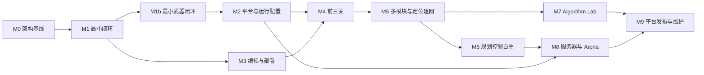
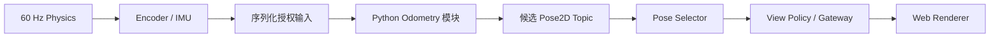

# 10 分阶段开发路线图

## 目的与执行原则

先验证本项目独特的端到端数据流，再扩展内容。M0 已交付文档；本轮按用户新增授权完成 M1 本机闭环，证据与限制见 [报告](reports/M1_VALIDATION.md)。M2 及以后仍为未来计划。Accepted 安全/状态边界从 M1 开始，不把三层状态分离推迟到画面完成以后。

## 里程碑交付与完成标准

| 阶段 | 目标、依赖与关键交付物 | 完成标准 | 主要风险 |
| --- | --- | --- | --- |
| M0 Architecture and Documentation | 本文档集、ADR、Schema、正反样例；无实现依赖 | 所有领域有接口与验收；链接/结构/样例检查通过，未验证选择标 Proposed | 文档之间隐性矛盾、虚假的完成声明 |
| M1 Minimal Vertical Slice | 依赖 M0；最小地图、坦克运动/碰撞、Encoder/IMU、受控 Python worker、位姿发布、Selector、Gateway、简单 Web 视图 | 完成下述闭环；错误估计与碰撞分离；worker 卡死物理不停；原生/WASM 编译探针形成选型证据 | Rust/WASM 库兼容、批次延迟、信息泄漏 |
| M1b Minimal Weapon Loop（本机完成） | 依赖 M1；已确认炮台/弹丸/后坐模型，程序控制接口、单发、靶标和授权表现 | 完成武器物理、Python 调用、冷却/幂等、命中/反弹、权限/泄漏与重放测试；见 [14](14_WEAPONS_DESIGN.md) | 高速连续碰撞、反作用耦合、信息泄漏 |
| M2 Platform and Runtime Profiles | 依赖 M1b；浏览器 Pyodide 双 Worker、IPC/WebSocket/Test Adapter 一致性、构建矩阵、资源测量 | 同一协议夹具跨 Adapter 等价；浏览器主 UI 无长任务；明确平台保证范围；更新 ADR-0002/0003/0013 状态 | 冷启动、存储、CSP、OS 安全差异 |
| M3 Editor and Deployment | 依赖 M1；CodeMirror 原型、多文件 Workspace、模板 ledger、Manifest、Edit/Test/Deploy、失败回滚 | 不覆盖玩家文件；编辑不改变 Active；快照测试/部署摘要一致；Vim 焦点不误触控制 | 迁移冲突、多文件 import、安全打包 |
| M4 First Three Playable Levels | 依赖 M2/M3；C0–C2、坐标/理想 Radar/噪声跟踪、函数到类 | 初学者可从问题完成任务；非唯一算法可通关；摄像机/声音/弹丸无未授权定位泄漏 | 难度曲线、反馈与保密冲突 |
| M5 Multi-Module Robot Software | 依赖 M4；完整 Contract 图、C3/C4、候选选源、Encoder/IMU/scan、估计地图 | 多模块项目复用旧代码；无系统定位仍可玩；错帧/过期/PSD 负例通过；迁移无损 | 帧对齐、积累漂移、主题图复杂度 |
| M6 Planning and Autonomous Control | 依赖 M5；C5–C7、路径/速度控制、任务决策、控制租约切换 | 无键盘执行器完成多次隐藏场景；失效时安全制动；不改 Core 即接管能力 | 闭环时延、规划开销、弹道/碰撞边界 |
| M7 Algorithm Lab | 依赖 M5；录制输入、参数比较、估计轨迹、停止后授权真值评分 | 传感器回放与闭环比较有明确区别；可重现错误；私有数据不进正式 Runtime | Replay 容量、评估 oracle、数据权限 |
| M8 Remote Server and Arena | 依赖 M2/M6，复用 M7 录制设计；服务器 Authority、强化沙箱、公平配额、比赛审计 | 第三方代码攻击测试通过；客户端无真值/秘密地图；服务器评分；版本/资源锁定，超载处理可审计 | 逃逸、DoS、公平性、运维成本 |
| M9 Cross-Platform Release and Maintenance | 依赖 M7/M8；桌面打包、验证后的平台支持表、兼容窗口、文档 CI、回放保留政策 | 每个声称支持的平台有安装/启动/安全/性能报告；旧项目可迁移或在声明窗口内运行 | 兼容回归、签名分发、浏览器/系统更新 |

M2 的服务器沙箱探针可以与 M3–M7 并行推进；M8 无须等完整 Lab UI，但必须具备私有审计 Replay。排行榜、账号体系和大量内容不是 M1–M7 的隐含依赖。

## 首个 MVP 必须验证的完整数据流

M1 验收场景包括：正常估计、故意偏移 2 m 的合法估计、没有输出、迟到、错误帧、非法协方差和死循环。默认禁用 System Pose Provider；UI 只能看到候选选中的估计或局部观测，不能读真值。可信测试评分器可比较真值，但与算法/正式视图使用不同通道。

建议记录 600 tick，验证精确 tick 时间公式、采样与内部提交时刻、cmd_vel 最新目标替换/控制器 watchdog、差速拒绝非零 vy 和同构建重放；M1 同时验证差速和四轮径向全向轮全向模型。性能报告至少包含 Host/浏览器版本、构建摘要、地图/实体规模、tick p50/p95/max、Python 批次耗时、消息大小与冷启动；没有基准设备前不规定虚假的绝对 FPS 保证。

## 建议的第一个具体开发任务：M1a

任务名：**建立最小可重复的 Authority → Python → 授权视图闭环探针**。

输入：本设计基线、协议正反夹具、一个固定场景和公开仿真 profile。交付：最小 Core/Host 边界、一个 Encoder/IMU 测量源、一个外部 Python 模板、候选与标准位姿路由、无真值接口的简易 Canvas 页面，以及 600 tick 的时间/故障报告。先允许本人可信代码的受控本机 Runtime，明确不开放第三方上传。

并行于同一个探针做 Rust/Rapier 与原生/WASM 的构建可行性；只有遇到明确失败或成本超标再验证 C++/Box2D 备选，不把两个正式引擎一起实现。选型根据结果更新 Proposed ADR，不能先接受再补证据。

范围不含完整战斗、复杂美术、账号、Arena、全功能编辑器或模板迁移 UI。完成标准是上述端到端数据链与错误/超时行为可检查，而非“能画出坦克”。M1 原阶段到此为止；用户随后授权 M1b 武器实现，已完成范围与证据见 14 和 M1b 报告，不自动开始 M2。

## 计划取舍与复审

先完成精美对战再添加权限更易出现真值旁路；先建完整中间件则推迟玩法验证。M1 选最小但完整的纵向闭环；跨平台目标通过后续 profile 扩展，而不是假设一次编译就覆盖所有平台。

开放项与技术准入门见 [12](12_VALIDATION_AND_OPEN_QUESTIONS.md)。每阶段结束复审风险、实际性能和教学反馈，更新路线图与相关 ADR；不以修改验收阈值掩盖边界失效。

## M1 完成与下一任务

M1 交付：两底盘/静态接触/理想 joint_states 与 IMU、外部 Python 多文件里程计、固定 tick/预算、候选→标准位姿→授权视图、键盘控制和简单 Canvas。物理建模由用户逐项确认，参数在唯一文件；正常/错估计/无输出/错帧/PSD/迟到/死循环及同构建重放有测试。Rust 原生与 WASM 均已构建并执行同一个探针；完整浏览器 WASM Runtime 尚属 M2。

**M1b 最小武器闭环已完成本机验收**，见 [报告](reports/M1B_VALIDATION.md)。下一任务仍为 **M2a 浏览器双 Worker 可行性探针**：将当前 Core 编译为带显式初始化/step DTO 的 WASM Worker，同时在独立 Pyodide Worker 运行同一授权输入与里程计例子，比较固定提交/异常终止行为。先验证模块加载、预算和包体，再决定是否接受 ADR-0002/0013；不把 Node WASM 探针当作浏览器隔离证据。
