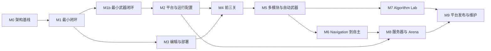
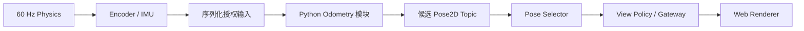

# 10 分阶段开发路线图

## 目的与执行原则

当前状态更新于2026-11-11：应用配置2.1，十三关；C5已由435adcd记录，本轮C6增量仍在工作区。公共c0后Weapons/Navigation并列开放，里程碑依赖表示工程开发顺序，不是玩家解锁链。后端profile拆分已实现，默认仍experimental；下表区分已交付子项与未来范围，历史阶段不由当前测试重写。证据层次见 [核对表](reports/DOCUMENTATION_STATE_SYNC_20261110.md)。

先验证本项目独特的端到端数据流，再扩展内容。M0、M1/M1b 已交付并完成[收尾复核](reports/M1_CLOSEOUT.md)；M2 已完成浏览器双 Worker、Adapter 一致性及本机资源验收，见 [M2 报告](reports/M2_VALIDATION.md)。其他 OS/浏览器验证仍待执行；M3 编辑部署和 M4 C0–C2 本机教学闭环已完成，见 [M3](reports/M3_VALIDATION.md)、[M4 报告](reports/M4_VALIDATION.md)。M5 多模块和 Weapons C3/C4 已完成本机验收，见 [M5 报告](reports/M5_VALIDATION.md)；M6a–M6g 已接入 Navigation 双轮控制、控制调试、里程计、GPS/EKF、航点闭环、连续路径追踪、已知地图规划和局部静态避障；其他导航课程尚未实施。Accepted 安全/状态边界从 M1 开始，不把三层状态分离推迟到画面完成以后。

## 里程碑交付与完成标准

| 阶段 | 目标、依赖与关键交付物 | 完成标准 | 主要风险 |
| --- | --- | --- | --- |
| M0 Architecture and Documentation | 本文档集、ADR、Schema、正反样例；无实现依赖 | 所有领域有接口与验收；链接/结构/样例检查通过，未验证选择标 Proposed | 文档之间隐性矛盾、虚假的完成声明 |
| M1 Minimal Vertical Slice（本机完成） | 依赖 M0；最小地图、坦克运动/碰撞、Encoder/IMU、受控 Python worker、位姿发布、Selector、Gateway、简单 Web 视图 | 完成下述闭环；错误估计与碰撞分离；worker 卡死物理不停；原生/WASM 编译探针形成选型证据 | Rust/WASM 库兼容、批次延迟、信息泄漏 |
| M1b Minimal Weapon Loop（本机完成） | 依赖 M1；已确认炮台/弹丸/后坐模型，程序控制接口、单发、靶标和授权表现 | 完成武器物理、Python 调用、冷却/幂等、命中/反弹、权限/泄漏与重放测试；见 [14](14_WEAPONS_DESIGN.md) | 高速连续碰撞、反作用耦合、信息泄漏 |
| M2 Platform and Runtime Profiles（本机 profile 已验收） | 依赖 M1b；浏览器 Pyodide 双 Worker、IPC/WebSocket/Test Adapter 一致性、构建矩阵、资源测量 | 同一协议夹具跨 Adapter 等价；算法/物理不进入主 UI，并测量帧间隔；明确平台保证范围；复审 ADR-0002/0003/0013 状态 | 冷启动、存储、CSP、OS 安全差异 |
| M3 Editor and Deployment（本机完成） | 依赖 M1；CodeMirror 原型、多文件 Workspace、模板 ledger、Manifest、Edit/Test/Deploy、失败回滚 | 不覆盖玩家文件；编辑不改变 Active；快照测试/部署摘要一致；Vim 焦点不误触控制 | 迁移冲突、多文件 import、安全打包 |
| M4 First Three Playable Levels（本机完成） | 依赖 M2/M3；C0–C2、理想/噪声 Radar、函数到类、巡逻敌车与 3 HP 击杀 | 原生/Firefox 实际编辑部署并通关；两种跟踪法可用；跨关保留源码，无未授权敌车状态旁路；炮弹按当前YAML显式可见 | 其他平台、难度曲线与长期教学反馈 |
| M5 Multi-Module Robot Software（本机完成） | 依赖 M4；同步周期/event Contract 图、选源、章节；当前 C3 极坐标滤波、C4 中心预测与自瞄、C5 小陀螺自瞄，见 [28](28_WEAPONS_PROGRESSIVE_ESTIMATION.md) | 冻结/固定提交、失败与整图回滚；算法迁移无损；新三关闭环、旧三关冻结基线与原生/浏览器真实 UI 通关 | 管线时延、噪声融合、多文件预测与难度曲线 |
| M6 Navigation → Autonomous Control（前七关已接入） | 依赖 M5；双轮 FK/IK 与电机控制、理想里程计、GPS/EKF定位、航点闭环、连续路径及已知地图规划已实现，局部避障按43接入，建图与决策仍待设计；本章节不含武器，不加载 Weapons 算法 | 首关按固定指令测试运动；定位按同tick累计误差评价；C3按序到点停稳；C4安全连续追踪并按真实轨迹评价；C5玩家规划后无碰撞到点停稳，其他课程独立确认 | 电机/车体耦合、滚动约束、闭环时延、验收区分度 |
| M7 Algorithm Lab（C2滤波试点已实现） | 依赖 M5；C2授权输入录制、同输入A/B、误差/失败复现已实现，完整控制/多模块实验仍待建设，见 [38](38_ENGINEERING_AND_ALGORITHM_LAB.md) | 传感器回放与闭环比较有明确区别；可重现错误；私有数据不进正式 Runtime | Replay 容量、评估 oracle、数据权限 |
| M8 Remote Server and Arena | 依赖 M2/M6，复用 M7 录制设计；服务器 Authority、强化沙箱、公平配额、比赛审计 | 第三方代码攻击测试通过；客户端无真值/秘密地图；服务器评分；版本/资源锁定，超载处理可审计 | 逃逸、DoS、公平性、运维成本 |
| M9 Cross-Platform Release and Maintenance | 依赖 M7/M8；桌面打包、验证后的平台支持表、兼容窗口、文档 CI、回放保留政策 | 每个声称支持的平台有安装/启动/安全/性能报告；旧项目可迁移或在声明窗口内运行 | 兼容回归、签名分发、浏览器/系统更新 |

M2 的服务器沙箱探针可以与 M3–M7 并行推进；M8 无须等完整 Lab UI，但必须具备私有审计 Replay。排行榜、账号体系和大量内容不是 M1–M7 的隐含依赖。

## 首个 MVP 必须验证的完整数据流

M1 验收场景包括：正常估计、故意偏移 2 m 的合法估计、没有输出、迟到、错误帧、非法协方差和死循环。默认禁用 System Pose Provider；UI 只能看到候选选中的估计或局部观测，不能读真值。可信测试评分器可比较真值，但与算法/正式视图使用不同通道。

建议记录 600 tick，验证精确 tick 时间公式、采样与内部提交时刻、cmd_vel 最新目标替换/控制器 watchdog、差速拒绝非零 vy 和同构建重放；M1 同时验证差速和四轮径向全向轮全向模型。性能报告至少包含 Host/浏览器版本、构建摘要、地图/实体规模、tick p50/p95/max、Python 批次耗时、消息大小与冷启动；没有基准设备前不规定虚假的绝对 FPS 保证。

## 首个 MVP 任务：M1a（已完成，保留验收定义）

任务名：**建立最小可重复的 Authority → Python → 授权视图闭环探针**。

输入：本设计基线、协议正反夹具、一个固定场景和公开仿真 profile。交付：最小 Core/Host 边界、一个 Encoder/IMU 测量源、一个外部 Python 模板、候选与标准位姿路由、无真值接口的简易 Canvas 页面，以及 600 tick 的时间/故障报告。先允许本人可信代码的受控本机 Runtime，明确不开放第三方上传。

并行于同一个探针做 Rust/Rapier 与原生/WASM 的构建可行性；只有遇到明确失败或成本超标再验证 C++/Box2D 备选，不把两个正式引擎一起实现。选型根据结果更新 Proposed ADR，不能先接受再补证据。

范围不含完整战斗、复杂美术、账号、Arena、全功能编辑器或模板迁移 UI。完成标准是上述端到端数据链与错误/超时行为可检查，而非“能画出坦克”。M1 原阶段到此为止；后续M1b/M2等已分别交付，具体以当前状态表和各历史报告为准。阶段范围不随文档中的未来建议自动扩大。

## 计划取舍与复审

先完成精美对战再添加权限更易出现真值旁路；先建完整中间件则推迟玩法验证。M1 选最小但完整的纵向闭环；跨平台目标通过后续 profile 扩展，而不是假设一次编译就覆盖所有平台。

开放项与技术准入门见 [12](12_VALIDATION_AND_OPEN_QUESTIONS.md)。每阶段结束复审风险、实际性能和教学反馈，更新路线图与相关 ADR；不以修改验收阈值掩盖边界失效。

## 当前完成状态与下一任务

M1/M1b 本机功能、最新配置测量和回归已完成，见收尾表。M2 已实现 Rust 显式 init/step WASM ABI、共享 Authority 的 Core Worker、独立 origin 的 Pyodide Robot Worker、双向 MessagePort、固定提交/截止强制终止及同 SDK 武器程序。49 个协议夹具经过 IPC/WebSocket/In-Process/Replay 与浏览器 Authority，具备本机真实运行证据。

M2 仍需其他 OS/浏览器执行构建与安全检查；CI 的 Linux/Windows/macOS 构建矩阵已配置，本次未取得远程Runner结果或这些平台的完整玩家流程证据，不声称已受支持。服务端 OS 沙箱和公平配额仍是 M8 的上线门；ADR-0013 保持 Proposed。Rust/Rapier 在已验证范围接受，M3 的编辑器选择和接受证据见 ADR-0021。

M3 已完成 CodeMirror/Vim、多文件 Workspace、Manifest、非覆盖模板预览、不可变测试/部署、失败保留与显式回滚；具体接口和 profile 限制见 [17](17_EDITOR_AND_DEPLOYMENT.md)。原生和 Firefox 都有实际 UI 验收。ADR-0021 接受当前 Canvas/ES module/CodeMirror 组合，替代 ADR-0003。

M4 已按用户确认实现 12 m / 360° / 10 Hz Radar、C2 高斯噪声/10% 丢失、同物理世界的差速巡逻敌车、逐发扣血与死亡销毁。C2 以限时内存活并击杀通关；M4原验收仅结束后显示误差，后续ADR-0034已增加显式授权的运行中累计RMSE，后续ADR-0051另补C2授权滤波回放试点。函数→类的自动模板解锁保留既有源码；原生/Firefox 真实 UI 证据见报告。

M5最初按多模块图、C3自动武器、C4敌车姿态/装甲验收，历史见 [26](26_MODULE_GRAPH_AND_WEAPONS_CHAPTER.md)。当前已由后续用户修订为C3极坐标滤波、C4中心预测/自瞄、C5匿名装甲/小陀螺，见 [28](28_WEAPONS_PROGRESSIVE_ESTIMATION.md)。Accepted ADR-0031/0032 记录实际语义。原“Weapons C3自身定位 / C4 scan建图”已撤回；自身定位后来在独立Navigation实现，scan/建图仍未交付。

原插件重构将当时五关迁移到独立YAML，统一发现/规则/权限/教材，见 [27](27_LEVEL_PLUGIN_ARCHITECTURE.md)、[验收](reports/LEVEL_PLUGINS_VALIDATION.md) 和 ADR-0033。该次迁移保留当时玩法和进度、不增加正式关卡；后续Navigation增量另行验收。

M6a 已按用户逐项确认实现 **Navigation C0：双轮驱动与运动控制**，见 [33](33_NAVIGATION_MOTION_CONTROL.md)。独立工程、无武器/敌车、轮电压模型、固定 24 秒方形指令与双阈值结算已接入；原生/WASM 及真实网页证据见 [验收报告](reports/NAVIGATION_CONTROL_VALIDATION.md)。该首关验收不代表整个M6完成；后续C1/C2/C3定位与航点闭环增量见本文后段，已知地图规划见M6f，更精细轮胎模型仍未实施。

## 历史阶段：2026-10-25范围核对

当前 M1–M4 的平台、资源、存储与教学开放项统一见 [状态核对](reports/M1_M4_STATUS_AUDIT.md)。本轮补充课程依赖白名单、NumPy 矩阵和运行日志反馈，强沙箱和独立浏览器存储仍未实现；M5 多模块/C3/C4 的新增证据单列于 M5 报告。

本机 Campaign 另补每关运行时限、编辑器主动结束、C2 玩家 HP 与死亡失败，并统一迁移 YAML 参数源，见 [25](25_ATTEMPT_RULES_AND_CONFIGURATION.md) 和 [验收](reports/ATTEMPT_RULES_VALIDATION.md)。这不增加敌车攻击 AI，M5 的课程范围由本轮用户确认修订，以 26 为准。

## Navigation 当前增量与下一步

M6b 已补 C0/C1 的授权控制曲线，并新增 navigation.c1 理想编码器里程计。C1 复用 C0 控制代码，只新增定位文件；地图/车体/相机使用玩家估计，运行中显示分别授权的位置/朝向累计 RMSE，评分按采样 tick 对齐。设计与当前接口见 [34](34_NAVIGATION_ODOMETRY_AND_FEEDBACK.md)，实际验证见 [报告](reports/NAVIGATION_ODOMETRY_VALIDATION.md)。

M6c 已按用户确认新增 navigation.c2：带噪编码器与2 Hz GPS共享实例调度、玩家 predict/correct EKF、协方差传播/更新教材、纯里程计对照、GPS点/1σ椭圆及分别授权的RMSE。24秒末固定评分EKF，要求实际路程与定位阈值，不要求回原点。既有源码/进度保留，具体接口见 [35](35_NAVIGATION_GPS_LOCALIZATION.md)，实际结果见 [验收](reports/NAVIGATION_GPS_LOCALIZATION_VALIDATION.md)。

M6d 已新增 navigation.c3：复用三项既有算法，以玩家EKF反馈产生Twist参考并经过轮电压执行。公开四航点、120秒、到点/停稳和安全边界由用户逐项确认，见 [37](37_NAVIGATION_WAYPOINT_CONTROL.md)；原生/浏览器实际通关及287项回归见 [验收](reports/NAVIGATION_WAYPOINT_CONTROL_VALIDATION.md)。其后用户另行确认连续路径追踪与已知地图规划，见M6e/M6f；局部避障已按用户后续确认接入C6，见43；IMU融合与建图仍需独立确认，尚未实现。当前不代表Navigation全章或完整自主导航完成。

## 双主线进度调整

当前十三关采用公共c0后分Weapons/Navigation的进度树，主线内依赖不变；Navigation C0不再依赖Weapons C5。展示顺序、里程碑先后不构成解锁条件，代码工程继续隔离。此调整只涉及进度与选择UI，物理/合同/评分不变；设计和验证入口见 [36](36_BRANCHING_PROGRESSION.md) 与 [ADR-0049](adr/0049-branching-course-progression.md)。原阶段验收报告保留当时进度描述，不将其改写为本次已测事实。

## 历史阶段：2026-11-05工程增量

本轮先收口本地/CI普通前端测试入口，再以Weapons C2试点有界传感器录制、同输入双版本回放、误差与失败复现；随后补运行耗时观测、工作区容量/完整备份/保留预览，并提取重复职责。当前实现边界见 [38](38_ENGINEERING_AND_ALGORITHM_LAB.md)，实际检查、两种运行环境、截止失败和限制见 [验收](reports/ENGINEERING_QUALITY_VALIDATION_20261105.md)。该阶段保持当时20ms/6tick、课程数量和评分；20ms是历史配置，现由41的后端profile取代。这不是整个M7 Algorithm Lab交付完成。

工程轮次提出的连续路径跟踪已获后续确认并在M6e实施。已知地图全局规划已获确认并在M6f实施；局部避障已按43接入C6，独立IMU/建图/SLAM仍为Planned，见 [39](39_NAVIGATION_COURSE_PROPOSALS.md)，需独立确认模型、权限与阈值。历史M1–M6报告保留各自时间、课程和平台范围。

## M6e：Navigation C4连续路径追踪

本轮按已确认规则新增navigation.c4，前置navigation.c3，复用既有四模块基础。完整地图仅引用仓储资产，可信准备阶段自动生成12–18m路线、平滑并按0.10m重采样与逐线段安全复验；PathFollower只读公开路径和玩家EKF。Authority独立限速并拒绝倒车，裁判逐tick使用真实质心到完整折线的距离，累计时间加权RMSE和顺序检查点，碰撞/控制故障/偏离优先。终点连续停稳后立即结算，固定6tick、物理和评分保持；后续墙钟/声明准入拆分采用41的冻结profile。接口与参数依据见 [40](40_NAVIGATION_CONTINUOUS_PATH_TRACKING.md)，实际平台、结果及截止风险见 [验收](reports/NAVIGATION_PATH_TRACKING_VALIDATION.md)。

C4验收后，用户逐项确认C5规划，现见M6f；后续用户已确认局部scan/避障并在M6g接入；SLAM仍未授权实施。

## 运行profile与截止加固（已实现，2026-11-06至07验收）

本轮独立于后续课程：先拆分声明准入与整批墙钟、冻结后端profile和新旧配置兼容，再统一两后端完整解码后的整数截止；最后以逐批流式记录执行候选/诊断/宿主负载矩阵。物理、算法dt、6tick门、课程评分与玩家工程不变。实现合同见 [41](41_RUNTIME_EXECUTION_PROFILES.md)，已测候选和完整UI见 [验收](reports/RUNTIME_EXECUTION_PROFILES_VALIDATION_20261107.md)。当前原生30ms/浏览器40ms墙钟与20ms声明上限独立，均为experimental；历史M1–Navigation C4的20ms描述表示当期验收配置，不能替代当前profile。可靠性结论必须附实际样本和尝试级不确定性，不由一次零失败或p99推断。

## M6f：Navigation C5已知地图全局规划

新增navigation.c5，前置C4。复用同一仓储地图与四项玩家算法；新增不可变原始OccupancyGrid、统一安全定义、有界确定终点、一次性5秒规划准备、独立整段路径校验和到点停稳裁判。测试不移动正式世界，部署新Worker重新规划；玩家自行膨胀/搜索/后处理，路径冻结后由原跟踪链执行。规划预算不扩大周期profile，不增加C4误差/检查点门槛，旧源码与工程历史保留。接口与约束见 [42](42_NAVIGATION_GLOBAL_PLANNING.md)、[ADR-0054](adr/0054-known-map-planning-preparation.md)，实际检查/两种搜索/多seed/原生与Firefox范围见 [验收](reports/NAVIGATION_GLOBAL_PLANNING_VALIDATION.md)。下一课程可研究局部感知与避障，先按39共同确认模型、权限与参数。

## M6g：局部感知与静态障碍避让

Navigation C6按用户确认引入先验/私有场景分离、一个有界生成的静态障碍、独立距离scan及同模块LocalController。既有五项玩家算法保留，升级显式确认，评分仍无碰撞到点停稳；合理绕行不触发C4偏离或RMSE失败门槛。当前接口与验收边界见 [43](43_NAVIGATION_LOCAL_AVOIDANCE.md)。该增量不表示在线全局重规划、建图、SLAM或移动避障已完成。
