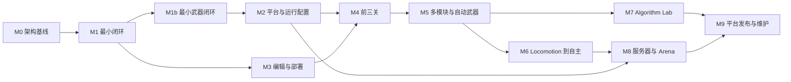
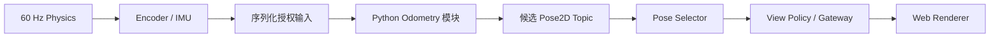

# 10 分阶段开发路线图

## 目的与执行原则

先验证本项目独特的端到端数据流，再扩展内容。M0、M1/M1b 已交付并完成[收尾复核](reports/M1_CLOSEOUT.md)；M2 已完成浏览器双 Worker、Adapter 一致性及本机资源验收，见 [M2 报告](reports/M2_VALIDATION.md)。其他 OS/浏览器验证仍待执行；M3 编辑部署和 M4 C0–C2 本机教学闭环已完成，见 [M3](reports/M3_VALIDATION.md)、[M4 报告](reports/M4_VALIDATION.md)。M5 多模块和 Weapons C3/C4 已完成本机验收，见 [M5 报告](reports/M5_VALIDATION.md)；M6 以后尚未实施。Accepted 安全/状态边界从 M1 开始，不把三层状态分离推迟到画面完成以后。

## 里程碑交付与完成标准

| 阶段 | 目标、依赖与关键交付物 | 完成标准 | 主要风险 |
| --- | --- | --- | --- |
| M0 Architecture and Documentation | 本文档集、ADR、Schema、正反样例；无实现依赖 | 所有领域有接口与验收；链接/结构/样例检查通过，未验证选择标 Proposed | 文档之间隐性矛盾、虚假的完成声明 |
| M1 Minimal Vertical Slice（本机完成） | 依赖 M0；最小地图、坦克运动/碰撞、Encoder/IMU、受控 Python worker、位姿发布、Selector、Gateway、简单 Web 视图 | 完成下述闭环；错误估计与碰撞分离；worker 卡死物理不停；原生/WASM 编译探针形成选型证据 | Rust/WASM 库兼容、批次延迟、信息泄漏 |
| M1b Minimal Weapon Loop（本机完成） | 依赖 M1；已确认炮台/弹丸/后坐模型，程序控制接口、单发、靶标和授权表现 | 完成武器物理、Python 调用、冷却/幂等、命中/反弹、权限/泄漏与重放测试；见 [14](14_WEAPONS_DESIGN.md) | 高速连续碰撞、反作用耦合、信息泄漏 |
| M2 Platform and Runtime Profiles（本机 profile 已验收） | 依赖 M1b；浏览器 Pyodide 双 Worker、IPC/WebSocket/Test Adapter 一致性、构建矩阵、资源测量 | 同一协议夹具跨 Adapter 等价；算法/物理不进入主 UI，并测量帧间隔；明确平台保证范围；复审 ADR-0002/0003/0013 状态 | 冷启动、存储、CSP、OS 安全差异 |
| M3 Editor and Deployment（本机完成） | 依赖 M1；CodeMirror 原型、多文件 Workspace、模板 ledger、Manifest、Edit/Test/Deploy、失败回滚 | 不覆盖玩家文件；编辑不改变 Active；快照测试/部署摘要一致；Vim 焦点不误触控制 | 迁移冲突、多文件 import、安全打包 |
| M4 First Three Playable Levels（本机完成） | 依赖 M2/M3；C0–C2、理想/噪声 Radar、函数到类、巡逻敌车与 3 HP 击杀 | 原生/Firefox 实际编辑部署并通关；两种跟踪法可用；跨关保留源码，无目标/弹道真值旁路 | 其他平台、难度曲线与长期教学反馈 |
| M5 Multi-Module Robot Software（本机完成） | 依赖 M4；同步周期/event Contract 图、选源、章节和 C3/C4 自动瞄准/敌车姿态/装甲 | 冻结/固定提交、失败与整图回滚；算法迁移无损；两种数值方案与原生/浏览器真实 UI 通关 | 管线时延、中心观测不可观区间、难度曲线 |
| M6 Locomotion → Autonomous Control（待设计） | 依赖 M5；先底盘驱动/运动控制，再自身状态估计，后续建图、规划与决策；具体关卡另行确认 | 每步只增加主要学习负担；最终无键盘自主任务，失效安全制动，不改 Core 接管能力 | 新传感器、漂移、闭环时延、规划开销 |
| M7 Algorithm Lab | 依赖 M5；录制输入、参数比较、估计轨迹、停止后授权真值评分 | 传感器回放与闭环比较有明确区别；可重现错误；私有数据不进正式 Runtime | Replay 容量、评估 oracle、数据权限 |
| M8 Remote Server and Arena | 依赖 M2/M6，复用 M7 录制设计；服务器 Authority、强化沙箱、公平配额、比赛审计 | 第三方代码攻击测试通过；客户端无真值/秘密地图；服务器评分；版本/资源锁定，超载处理可审计 | 逃逸、DoS、公平性、运维成本 |
| M9 Cross-Platform Release and Maintenance | 依赖 M7/M8；桌面打包、验证后的平台支持表、兼容窗口、文档 CI、回放保留政策 | 每个声称支持的平台有安装/启动/安全/性能报告；旧项目可迁移或在声明窗口内运行 | 兼容回归、签名分发、浏览器/系统更新 |

M2 的服务器沙箱探针可以与 M3–M7 并行推进；M8 无须等完整 Lab UI，但必须具备私有审计 Replay。排行榜、账号体系和大量内容不是 M1–M7 的隐含依赖。

## 首个 MVP 必须验证的完整数据流

M1 验收场景包括：正常估计、故意偏移 2 m 的合法估计、没有输出、迟到、错误帧、非法协方差和死循环。默认禁用 System Pose Provider；UI 只能看到候选选中的估计或局部观测，不能读真值。可信测试评分器可比较真值，但与算法/正式视图使用不同通道。

建议记录 600 tick，验证精确 tick 时间公式、采样与内部提交时刻、cmd_vel 最新目标替换/控制器 watchdog、差速拒绝非零 vy 和同构建重放；M1 同时验证差速和四轮径向全向轮全向模型。性能报告至少包含 Host/浏览器版本、构建摘要、地图/实体规模、tick p50/p95/max、Python 批次耗时、消息大小与冷启动；没有基准设备前不规定虚假的绝对 FPS 保证。

## 首个 MVP 任务：M1a（已完成，保留验收定义）

任务名：**建立最小可重复的 Authority → Python → 授权视图闭环探针**。

输入：本设计基线、协议正反夹具、一个固定场景和公开仿真 profile。交付：最小 Core/Host 边界、一个 Encoder/IMU 测量源、一个外部 Python 模板、候选与标准位姿路由、无真值接口的简易 Canvas 页面，以及 600 tick 的时间/故障报告。先允许本人可信代码的受控本机 Runtime，明确不开放第三方上传。

并行于同一个探针做 Rust/Rapier 与原生/WASM 的构建可行性；只有遇到明确失败或成本超标再验证 C++/Box2D 备选，不把两个正式引擎一起实现。选型根据结果更新 Proposed ADR，不能先接受再补证据。

范围不含完整战斗、复杂美术、账号、Arena、全功能编辑器或模板迁移 UI。完成标准是上述端到端数据链与错误/超时行为可检查，而非“能画出坦克”。M1 原阶段到此为止；后续用户已授权并完成 M1b，本轮继续授权 M2。阶段范围不随文档中的未来建议自动扩大。

## 计划取舍与复审

先完成精美对战再添加权限更易出现真值旁路；先建完整中间件则推迟玩法验证。M1 选最小但完整的纵向闭环；跨平台目标通过后续 profile 扩展，而不是假设一次编译就覆盖所有平台。

开放项与技术准入门见 [12](12_VALIDATION_AND_OPEN_QUESTIONS.md)。每阶段结束复审风险、实际性能和教学反馈，更新路线图与相关 ADR；不以修改验收阈值掩盖边界失效。

## 当前完成状态与下一任务

M1/M1b 本机功能、最新配置测量和回归已完成，见收尾表。M2 已实现 Rust 显式 init/step WASM ABI、共享 Authority 的 Core Worker、独立 origin 的 Pyodide Robot Worker、双向 MessagePort、固定提交/截止强制终止及同 SDK 武器程序。49 个协议夹具经过 IPC/WebSocket/In-Process/Replay 与浏览器 Authority，具备本机真实运行证据。

M2 仍需其他 OS/浏览器执行构建与安全检查；CI 的 Linux/Windows/macOS 构建矩阵已配置，尚未在远程 Runner 运行，不声称这些平台已受支持。服务端 OS 沙箱和公平配额仍是 M8 的上线门；ADR-0013 保持 Proposed。Rust/Rapier 在已验证范围接受，M3 的编辑器选择和接受证据见 ADR-0021。

M3 已完成 CodeMirror/Vim、多文件 Workspace、Manifest、非覆盖模板预览、不可变测试/部署、失败保留与显式回滚；具体接口和 profile 限制见 [17](17_EDITOR_AND_DEPLOYMENT.md)。原生和 Firefox 都有实际 UI 验收。ADR-0021 接受当前 Canvas/ES module/CodeMirror 组合，替代 ADR-0003。

M4 已按用户确认实现 12 m / 360° / 10 Hz Radar、C2 高斯噪声/10% 丢失、同物理世界的差速巡逻敌车、逐发扣血与死亡销毁。C2 以限时内存活并击杀通关，误差仅结束后显示。函数→类的自动模板解锁保留既有源码；原生/Firefox 真实 UI 证据见报告。

M5 已按用户修订完成：M5a 多模块图、M5b C3 自动武器、M5c C4 敌车姿态与有效装甲，见 [26](26_MODULE_GRAPH_AND_WEAPONS_CHAPTER.md)。Accepted ADR-0031/0032 记录实际语义。原“C3 自身定位 / C4 scan 建图”移至未来 Locomotion，不属于已完成项。

建议下一项为 **M6a：Locomotion 首关设计与底盘驱动练习**。先共同确定任务、驱动输入与教学传感器；复用已有两个底盘和武器模块，先验证运动学/速度控制，不同时撤销系统自身位姿。交付关卡说明、带类型数值接口、非覆盖模板、权限和可测验收，再实现。新增物理或观测参数继续逐项确认；不在 M5 结束时自动开始。

## 2026-10-25 范围核对

当前 M1–M4 的平台、资源、存储与教学开放项统一见 [状态核对](reports/M1_M4_STATUS_AUDIT.md)。本轮补充课程依赖白名单、NumPy 矩阵和运行日志反馈，强沙箱和独立浏览器存储仍未实现；M5 多模块/C3/C4 的新增证据单列于 M5 报告。

本机 Campaign 另补每关运行时限、编辑器主动结束、C2 玩家 HP 与死亡失败，并统一迁移 YAML 参数源，见 [25](25_ATTEMPT_RULES_AND_CONFIGURATION.md) 和 [验收](reports/ATTEMPT_RULES_VALIDATION.md)。这不增加敌车攻击 AI，M5 的课程范围由本轮用户确认修订，以 26 为准。
