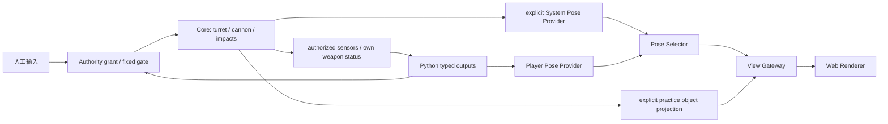

# 14 M1b 武器系统设计与确认记录

## 目的、范围与状态

用户授权先实现 M1b，再开展 M2a。本文维护炮台、弹丸、冲量、控制接口与表现授权的共同约定，实施证据见 [M1b 验证报告](reports/M1B_VALIDATION.md)。沿用 [13](13_PHYSICS_MODEL_DECISIONS.md)，后坐作用刚体/方向以本轮新增 [ADR-0017](adr/0017-confirmed-weapons-loop.md) 为准。未约定的新物理行为仍须询问用户。

本阶段实现单车、静态靶标、单发与命中计数；不实现生命/死亡、敌方 AI、网络比赛、编辑器或服务端沙箱。可调物理、控制与资源参数集中于 `config/m1.json`，缺项拒绝。配置版本从内部 `1.0` 升为 `1.1`，将 `deferred_weapons` 显式迁移为 `weapons`；不自动改写玩家项目或旧配置。

## Requirements：逐项确认

| ID | 用户确认的约束 |
| --- | --- |
| W01 | 独立炮台质量 2 kg、惯量 0.08 kg·m²；整车 22 kg。底盘伺服继续按裸底盘 20 kg / 2 kg·m² 计算，无负载补偿 |
| W02 | 炮台质心/转轴在车体中心；双刚体转动关节耦合；炮台/炮管无独立环境碰撞外形 |
| W03 | 相对角速度输入、受限力矩、连续旋转；初始相对角/速均零，0.5 s 看门狗主动制动 |
| W04 | 单发、无限弹药、0.25 s 冷却、幂等请求；长按不连射，冷却中拒绝，不延后排队 |
| W05 | 同时提供人工与 Python 炮台/开火入口；每个执行器通过启动配置选择单一控制源 |
| W06 | 离膛前忽略发射者，完全离开后允许自伤；命中弹丸销毁，仅计数 |
| W07 | 用弹丸半径检查转轴至炮口整段；墙/靶标阻塞则拒绝，无弹丸、后坐或冷却 |
| W08 | 静态圆角矩形靶标与车体同外形，初态 (-3,0,0)；车体与靶标沿用墙体静态接触参数 e=0、μ=0.4 |
| W09 | 专用 `/robot/turret/cmd_vel` 与 `/robot/weapons/cannon/fire`，SDK 类型及 `ctx.fire`，不要求玩家构造 JSON |
| W10 | 默认估计视图不发真实弹丸；显式真值练习视图可显示真实车体/弹丸/靶标，Python 输入权限不变 |
| W11 | 坦克/靶标命中 → 弹丸互撞 → 墙；互撞图所有参与弹丸销毁，不反弹；同刻墙按稳定 ID 逐面计数 |
| W12 | 同刻容差 1 ns、分离容差 1 μm；每主 tick 四子步，受击冲量在子步末施加，后坐在发射边界施加 |
| W13 | 受击采用弹丸世界动量；差速投影到车体 x，全向保留完整方向；后坐同样投影；均不改变质量 |
| W14 | 受击与后坐作用于底盘，保留实际接触点/炮口的偏心角冲量；替代旧版“后坐施加于炮台” |
| W15 | 30 Hz 理想炮台 JointState、冷却/自身发射/受击计数、脱敏请求结果；J/L ±2 rad/s、空格单发 |
| W16 | 发射前采样炮口世界速度，然后施加后坐；冷却 n+15 可再次开火；拒绝/重复请求不重置冷却 |
| W17 | 弹丸生命周期半开区间 [出生,出生+5 s)，到期优先于同刻碰撞；三次反射后第四次墙接触销毁 |

以上均已明确确认，没有以预选项或超时替代用户答复。

## Proposed Design：物理与数值方案

令底盘世界角为 θ，炮台累计相对角为 q，炮台世界角为 φ=θ+q：

- `T = clamp(I_t * (u - q_dot) / tau_t, -T_max, T_max) - c_t*q_dot`。
- 炮台承受 `+T`、底盘承受 `-T`，由转动关节约束质心平移；不把炮台贴图角度当动力学。超时目标 u=0，真实角速度逐渐制动。
- `v_muzzle = v_turret_com + omega_turret × r_muzzle`，均在施加后坐之前采样。
- `v_bullet_world = v_muzzle + v_relative * direction_world`；默认相对速度 15 m/s、质量 0.05 kg、半径 0.03 m。无重力/空气阻力。
- `J_hit = m_bullet*v_bullet_world`，`J_recoil = -m_bullet*v_relative*direction_world`。
- 差速 `J_applied = R_body*(R_body^-1*J).x_axis_projection`；全向 `J_applied=J`。底盘角冲量为 `r_world × J_applied`，炮台随后经关节响应。

固定车体质量的无限弹药是游戏近似；差速丢弃的横向动量也不另施加给炮台，不宣称完整自由系统动量守恒。偏心炮口配置可产生底盘角冲量。

弹丸用圆形扫掠，静态墙/靶标用形状查询；车体采用已积分子步首尾位姿的连续刚体插值，弹丸对解析求相对运动最早接触。全体弹丸按最早事件推进到同一仿真时刻，再按 W11 处理；稳定弹丸 ID 为创建顺序，墙 ID 为配置数组索引。到期优先；角点两面分别反射/计数。每次反射沿法线移出配置的分离容差，循环预算超限显式报错，不静默穿透。

受击不回滚重算当前子步：在子步末按碰撞时车体朝向投影冲量，并把碰撞时世界力臂平移到子步末质心位置，保留该次角冲量；位移变化从下一子步开始，最大门延迟 `1/240 s`。它是已接受的数值近似，不是精确耦合连续解。离膛状态单调从 protected 变为 armed，包括同子步出膛、反弹、返回。

## Interfaces：协议与 SDK

| 端口 | 频道 / Schema | 语义 |
| --- | --- | --- |
| `turret_velocity` | `/robot/turret/cmd_vel` / `turret_velocity@1` Topic | `{ "velocity_radps": 2.0 }`，相对角速度，frame=`base_link`，无执行起止字段 |
| `fire` | `/robot/weapons/cannon/fire` / `fire_command@1` Command | 空 payload；非空 `request_id`、frame=null，单发 |
| `turret` | `/robot/turret/joint_states` / `joint_state@1` | name=`["turret_joint"]`，累计相对角 rad、相对角速度 rad/s，effort=[] |
| `weapon` | `/robot/weapons/cannon/state` / `weapon_state@1` | ready、cooldown_remaining_ticks、shots_fired、hits_received、last_result |

完整发射消息示例（当前 tick=18，60 Hz）：

```json
{
  "protocol_version": "1.0",
  "message_type": "command",
  "channel": "/robot/weapons/cannon/fire",
  "sequence_number": 3,
  "simulation_tick": 18,
  "simulation_time_ns": 300000000,
  "run_id": "weapons-demo",
  "publisher_id": "module:odometry",
  "request_id": "shot-18",
  "frame_id": null,
  "schema": "fire_command@1",
  "payload": {}
}
```

玩家代码在已授权 Contract 的 `Module.update` 内调用：

```python
from tankbot import TurretVelocity

ctx.publish("turret_velocity", TurretVelocity(2.0), frame_id="base_link")
request_id = ctx.fire("fire", request_id="shot-18")
```

`ctx.fire` 返回请求 ID，不同步等待物理结果；后续 `inputs.latest("weapon").data.last_result` 为不可变 `FireResult(request_id,status,processed_tick)` 或 None。status 为 fired/cooldown/blocked/resource_limit。反馈不含命中点、目标 ID 或真值位姿，也不报告自己击中哪个隐藏目标；`hits_received` 仅为自身受击计数。若需要所有历史结果，由后续事件接口另设计；当前 last_result 可能合并多个历史结果。

SDK 无参数时生成 `fire-{activation_tick}-{command_index}`，在当前单模块/单 run 生命周期内唯一。重复 ID 指同一操作，不能当成下一发。Host 与 Core 使用 `(run_id, bound_publisher, request_id)` 日志，结果（包括拒绝）不变；日志不淘汰，满后拒绝新 ID，直到新 run。协议普通服务的短缓存规则不适用于这个武器业务日志。

人工 HTTP 适配器为 `POST /api/turret_cmd_vel`（上述速度 payload）和 `POST /api/fire`（仅 `{request_id}`）。服务绑定会话身份并校验 Origin/token/结构/限额，返回 queued 或已有结果；queued 不表示物理发射成功。机器人输出随整批验证在固定提交门生效，不能通过 Command 绕过延迟。过期新命令拒绝，生成时间不改写为接收时间。

`control_sources.{chassis,turret,weapon}` 各为 keyboard/robot；启动派生 Contract 与 grant，未授予的输出/人工入口拒绝，无运行中争写或动态租约切换。故障撤销程序控制目标，之后仍按伺服制动。所有执行器输入及边界时刻进入私有 Replay。

## 状态与视图边界



默认 `view_snapshot@1` 仍有空 objects/effects；没有合法估计就隐藏全局车体，炮台局部读数与武器反馈仍可用。炮台视觉使用已选车体位姿加相对关节角，不用真值修正错误估计。

`--view weapons-practice` 在 Authority 启动时加载显式策略；System Pose Provider 经 Selector 输出位姿，Gateway 仅接收逐字段裁剪的弹丸/靶标对象，使用新增 `view_snapshot@2`。旧 @1 的空实体约束保持。练习视图必须标明真值，UI 无可自行提权的布尔开关；传给 Python 的输入仍只有轮组、IMU、炮台关节和自身武器状态。无通用世界 dump、世界音效或调试真值端点。局部碰撞/blocked 反馈本身可帮助推断环境，是已授权游戏反馈。

## Alternatives、Trade-offs 与开放问题

旋转贴图/单刚体会失去惯性与反向力矩；仅位置离散检测会漏掉高速弹丸与互撞；所有碰撞立即回滚重积分会增加接触求解复杂度。当前选择真实双刚体、连续查询和固定冲量门，接受单子步延迟与微米分离误差。

后续再讨论多坦克动态碰撞、连射/弹种、损伤、音效传感器、动量近似升级与动态控制权。当前没有把这些方案写成可用功能。精确旋转轨迹、受击后同子步再次命中的反馈误差仍受已接受的插值/末端冲量近似约束，应在更高速度场景复测。

## Acceptance Criteria

- 真实双刚体反向力矩、质量负载、连续相对角、看门狗与独立关节观测通过测试。
- 发射前速度继承、炮口整段阻塞、冷却 n+15/重复拒绝不改冷却、结果幂等和有界队列可复测。
- 靶标/自伤、弹丸互毁图、同刻优先级、墙角计数、第四接触销毁、寿命半开边界与高速扫掠通过测试。
- 世界动量、两底盘投影、偏心角冲量和质量不变得到数值断言；原 M1 回归保持。
- Python 真正调用、未授权入口拒绝、默认视图不泄漏、练习视图不增加 Runtime 输入、全执行器同构建重放一致。
- 原生与 WASM 武器探针、浏览器人工旋转/单发均有实际记录，平台/安全限制明确。
