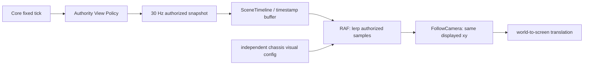

# 15 时间插值、跟随相机与底盘外观

## Purpose / Scope

修正 M1b 弹丸逐快照跳动、固定场景相机与两底盘共用外形的问题。本文规定浏览器表现，不改物理、武器或机器人调度。遵守 [ADR-0010](adr/0010-simulation-scheduling.md) 与新增 [ADR-0018](adr/0018-authorized-rendering-timeline.md)；实际证据见 [渲染验收](reports/RENDERING_VALIDATION.md)。

## Requirements 与频率

物理保持 60 Hz / 4 子步，传感器 30 Hz、算法 10 Hz。视图快照从 10 Hz 改为独立的 30 Hz，HTTP 轮询间隔 33 ms；显示使用 requestAnimationFrame，随浏览器/显示器可用刷新率运行，不用刷新回调推进物理。低频授权数据必须插值，不能仅提高 Canvas 重绘次数。

所有显示参数仍在唯一 `config/m1.json`：`view` 负责快照/轮询；新增 `rendering` 负责缓存时延、相机视宽、网格和独立外观。内部配置升为 1.3，旧自定义配置须显式补充字段；不自动覆盖文件。协议仍为 1.0 草案，消息 Schema 未改。

## Proposed Design：显示数据流

`web/rendering.js` 是无网络/DOM/物理依赖的表现模块；`web/app.js` 负责输入、单路轮询、面板与 Canvas 组合。HTTP 仅额外开放该静态模块，不新增真值端点。

### SceneTimeline

- 接收既有 view_snapshot@1/@2；使用 Envelope simulation_tick 及 physics_hz 得到快照仿真时间，用 sequence/revision 拒绝旧包。
- 缓存 2 s。根据仿真时间选择两个包围显示时刻的样本，`p = a + (b-a)*alpha`；alpha 受样本范围限制。显示时钟不因迟到包倒退；流停滞时保持最后样本，不外推未授权未来事件。
- 真值练习默认落后快照时钟 80 ms；玩家估计默认 220 ms，容纳算法 n+6 提交与 10 Hz 间隔。后者不是将算法升级为 30 Hz。两项可分别调整，history 必须覆盖时延及至少一个快照间隔。
- 位姿按 selected_pose.simulation_tick 独立存样，重复传输旧估计不产生新样本；yaw 走最短角。炮台按其传感器采样 tick 插值，累计关节角不做 ±π 折叠。车体与炮台在同一显示时刻取值。
- 弹丸仅在同一 projectile_id 的授权样本之间 lerp；新 ID 不提前显示，消失 ID 在已收到的消失快照边界移除，不把新旧弹丸相互插值。静态靶标仍用授权对象。
- run/revision/source/frame 改变时清理缓存；定位跳变超过 view.interpolation_jump_m 时重建位姿历史，直接显示合法新估计，不画虚假飞越轨迹。失去合法位姿立即隐藏车体。

### FollowCamera

每显示帧直接取同一份已插值车体位置 `(camera_x,camera_y)=(display_x,display_y)`，不额外做第二次相机平滑。映射为 `screen_x = width/2 + (world_x-camera_x)*scale`、`screen_y = height/2 - (world_y-camera_y)*scale`；相机无 yaw 输入。

坦克在视口中心，世界 +x 始终向右、+y 始终向上；仅绘制车体/炮台时局部旋转。网格、墙、弹丸、靶标与轨迹共用同一平移。估计视图跟随估计，练习视图跟随明确授权的系统源。没有位姿时保持最后合法相机位置，初始为配置中的公开坐标原点；权限 revision/run 改变则清理相机。不得隐藏读取真值来实现跟随。

### Independent Chassis Visuals

`rendering.chassis_models.differential` 为履带、独立车壳/侧板与绿色调；`omnidirectional` 当前为 radial_omni：四组普通全向轮，轮轴径向、主滚动方向切向；相邻组件整体旋转 90°，使用横向小滚子、轮毂、径向支撑臂和对称甲板/装甲。两者拥有不同 model_id、kind、hull、颜色和部件配置，Host 只下发当前选择的 chassis_visual。Renderer 不用物理 body 配置生成两种车体的共用外观；body 外形仍用于静态靶标。

按 [ADR-0019](adr/0019-fourfold-omni-wheel-layout.md)，取消原平行麦轮绘制。`omniMounts(wheel_calibration)` 从公开标定派生轮心 `R*[cosα,sinα]` 与滚动角 `α+π/2`，轮径直接用标定 `2r`；显示配置只保存部件样式/宽度，不再复制四组安装坐标。参考和验收见 [全向轮报告](reports/OMNI_VALIDATION.md)。

## Interfaces / Constraints

public_profile 包含 rendering（不含全套 chassis_models）与当前 chassis_visual，均从受信配置裁剪；新增 wheel_calibration 仅在全向模式下发，并使用 wheel-calibration.schema.json 验证。物理质量、控制器内部对象和真值不在这些字段中。SceneTimeline 与 FollowCamera 只接收授权样本/公开显示参数。Canvas 诊断字段仅为当前显示的位置、相机和模型 ID，可用于 UI 验收，不提供私有世界对象。

## Alternatives / Trade-offs / Open Questions

仅提高快照率仍不能适应高刷新率或抖动；直接用最新点会跳动；速度预测/前端重算碰撞会产生权威分歧。当前采用有界时间缓冲与 lerp，代价是 80/220 ms 的显示时延。两帧之间若发生反弹，线段插值不能恢复精确碰撞拐点；出生/消失可见时刻也有一个快照周期的量化。后续如需要精确慢放，应由 Authority 提供版本化、受授权的轨迹关键点，不能在 Renderer 偷算权威碰撞。

网络波动自适应缓存、手动相机、动态视觉模型注册仍待后续需求；本轮不引入新通信中间件或渲染依赖。

## Acceptance Criteria

JS 行为测试验证不同接收间隔的插值、断流/迟到、出生/消失、角度、估计延迟、权限/跳变、相机矩阵与四轮/履带绘制。Python 回归验证显示配置不改变物理结果、两底盘配置独立且不下发内部对象。浏览器在实际 RAF 中采样，确认同一快照序号下弹丸位置继续改变，转向时车体居中且 camera_yaw=0；分别检查两底盘截图。

## M4 目标估计显示

`SceneTimeline.sample()` 增加可空 `targetEstimate`，从 `view_snapshot@3.target_estimates` 的合法采样时间缓存生成。系统自定位与玩家目标估计同时存在时使用估计显示缓冲，10 Hz 输出也在 RAF 帧之间插值；失去授权/过期时立即隐藏，没有未来外推或真值回退。局部 Radar 面板仅画车体系距离/方位回波；地图目标标记与物理目标严格分离，详见 [18](18_CAMPAIGN_DESIGN.md)。
