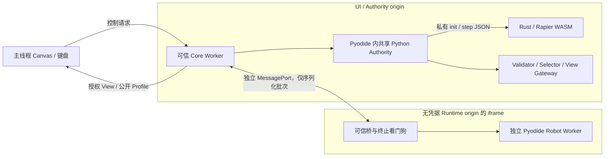

# 16 浏览器 Runtime 与平台适配

## 目的、范围与当前状态

M2 在 Linux / Firefox 上验证纯浏览器物理与 Python 闭环，并复用原生模式的权限、时间和 SDK 语义。已实现双 Worker、固定资源的双 origin 启动器、受限部署快照和 Adapter 一致性测试；证据见 [M2 验收](reports/M2_VALIDATION.md)。当前仍是单机器人本地原型，不是 Arena 沙箱或桌面发行包。

## 进程与信任边界

`host/tankbot_host/authority.py` 增加可信的 `core_factory`、`worker_factory` 注入点。原生仍使用 `CoreAdapter` / `Supervisor`；浏览器使用 `runtime/browser_authority.py` 的 `WasmCore` / `BrowserSupervisor`。Authority、JSON Schema 注册、PSD/帧/时间/权限校验、Pose Selector 和 View Gateway 使用同一份 Python 源码，避免另写一套 JS 权限规则。

可信 Worker 因此也加载 Pyodide；物理仍完全运行在 Rust 内。代价是两个 Python 解释器、启动与 JSON 转换成本。当前测量可支持单机器人闭环；多机器人前需重新基准，不能用这一选择预设 Arena 的部署结构。决策见 [ADR-0020](adr/0020-shared-browser-authority.md)。

## 私有 Core ABI

`core/src/session.rs` 共享原生长度前缀 IPC 与 WASM 的操作分派。WASM 导出：

| 调用 | 约束 |
| --- | --- |
| `tankbot_input(size) -> pointer` | Rust 拥有输入槽；超过 1 MiB 返回 0；写入后才能 exchange |
| `tankbot_exchange() -> output_length` | 消费整个输入槽；返回 `{ok,data}` 或 `{ok:false,error}` 的 JSON 字节长度 |
| `tankbot_output() -> pointer` | 只读输出槽；下次调用失效；内存增长后必须重取 `memory.buffer` |

`web/wasm-core.js` 实现顺序调用、UTF-8 编解码和槽拷贝。每个可信 Worker 只有一个实例，不并发、不重入、不向 UI/Robot Worker 转移 WASM Memory。`init(config,chassis)`、`step(target,turret_target,fire_requests,revoke,revoke_turret)`、`snapshot` 的私有 DTO 不属于玩家协议；返回值含真值，仅 Authority 可以持有。错误路径返回结构化失败，不能把任意私有操作接到 UI RPC。

## Python 加载、时序与失败

`runtime/module_runner.py` 复用 CPython/Pyodide 的 Module 生命周期、传感器类型转换、输出收集与 Envelope 构造。玩家源码单独复制到 `/workspace`，不挂载宿主目录；只打包 `.py`，拒绝越界路径/符号链接和超长快照。M2 的启动种子路径继续只读；M3 的多文件编辑/部署和允许的 Manifest/Contract 文件见 [17](17_EDITOR_AND_DEPLOYMENT.md)。

Authority Worker 在每个固定边界调用同一 `advance()`：先提交上一批→采样→激活→裁剪视图→推进物理。60 Hz/4 子步、30 Hz 观测、10 Hz 算法和 6 tick 提交延迟保持原约定。Worker 的墙钟 timer 只负责调度，Python 响应绝不改变提交 tick。每次边界之间让出事件循环，不 await 玩家。

iframe 以独立 timer 执行 20 ms 批次截止，超时 `Worker.terminate()`；可信 Authority 再检查接收时间、关联 ID 和完整批次。缺结果在原定门丢弃，撤销程序执行器目标；晚到、重复或无对应激活的结果不能恢复控制。浏览器后台降频和系统调度可能延迟 timer，不能声称硬实时 CPU 配额。初始化单独使用配置的 45 s 上限；失败不开始世界时钟。M3 编辑器通过共享 Authority 启动候选 Worker，在 tick 边界替换旧 Runtime；用 worker_id 隔离并存与旧消息，最多两个玩家 Worker。候选启动失败不停止世界。SDK/Authority 修改仍须重新 prepare bundle。

## 资源、网络与数据权限

- UI origin 默认 `http://127.0.0.1:8765`，Runtime origin 默认 `http://127.0.0.1:8766`。Runtime 不设置 Cookie、不提供配置、Workspace、Authority bundle、Core WASM 或 API 路由。
- iframe 校验父 origin/source，仅绑定一次端口；Worker 只收到授权初始化/传感器和自己的 Python 源码。局部 UI 与 Sensor Envelope 仍走 Authority 既有权限路径。
- Robot Worker 响应头使用 `worker-src 'none'`、`connect-src 'self'`、`script-src 'self' 'wasm-unsafe-eval'`。允许读取自己的固定 Runtime 资源，阻止访问 UI origin、外网和嵌套 Worker；不是宣称绝对无网络。
- 固定 Pyodide **0.29.5**；Robot 使用 classic Worker + `importScripts`。本机 Firefox 的 module Worker 静态依赖图在严格策略下加载失败，classic 路径通过实测且保留限制。未来升级 Pyodide 必须重验 Worker 类型和 CSP，不能直接采用滚动 stable 示例。
- Worker 有自己的 MEMFS，可以写自己的文件；没有可靠的浏览器硬内存/磁盘额度。没有做破坏性内存耗尽压力测试，不保证浏览器进程可抵御所有 DoS，也不把 IndexedDB 当跨项目安全存储。
- 本地场景配置与 WASM 是设备所有者可检查的静态启动资源；只使用公开试验场，不把秘密 seed/地图放在浏览器部署中。Renderer 接口只收授权 DTO。远程隐藏世界必须留在服务器 Authority，不能照搬本地静态启动资源分发。

## 构建、配置与替代方案

`tools/prepare_browser.py` 校验 `config/browser-assets.lock.json` 的每个 SHA-256，首次下载固定文件，之后可 `--offline` 重建两份 bundle；不运行浏览器时联网安装包。底层资源和生成 bundle 放在忽略的 `build/browser/`，不提交第三方二进制。

M2 内部 `config_version` 从 1.3 升为 **1.4**，仅新增 `browser.runtime_port/startup_timeout_s/max_pending_requests/probe_enabled`，物理参数未变。旧自定义配置须显式补齐 browser 段并升级版本；工具不会自动覆盖文件。公共 Protocol 仍为 `1.0` 草案，没有改变任何消息含义。

曾比较：JS 重写 Authority（少一个解释器但易发生权限/调度漂移）、把完整 Authority 移植 Rust（长期可评估，当前扩大重构范围）、仅做 Node WASM 探针（不能验证浏览器运行）。当前先以共享 Python 源码减少语义分叉，记录性能后再决定优化。

## 验收与开放项

验收：两底盘原生/WASM 各 600 tick 全快照对比；浏览器真实闭环、固定提交、程序武器、死循环终止后 tick/画面继续；同一 49 个协议夹具跨 Adapter；CSP/文件/宿主句柄负例；启动、内存分配和帧间隔报告。浏览器未实现的性能观察 API须标明，不能把 rAF 测量当所有 Long Task 的证明。

Windows/macOS 与 Chromium/WebKit 尚无本机执行证据；CI 构建矩阵已配置，运行结果不在此次本机报告内。强 OS 沙箱、数学扩展库准入、移动端、持久化/多项目存储、正式网络会话协商与 Arena 公平配额仍未完成。

官方依据：[Pyodide 0.29.5 发布](https://github.com/pyodide/pyodide/releases/tag/0.29.5)、[Worker CSP](https://developer.mozilla.org/en-US/docs/Web/HTTP/Reference/Headers/Content-Security-Policy)、[websockets 官方 API](https://websockets.readthedocs.io/en/stable/reference/asyncio/server.html)。这些来源用于接口研究，具体能力以上述锁定版本的实测为准。

M3 在此基础上升为 `1.5`，增加 workspace 限额；UI origin 提供带 Host/Origin/token 校验的管理 API，Runtime origin 仍无 Workspace 路由。源码持久化由本机启动器提供，独立静态 Web 存储仍未验证。候选启动期间可信 Core + Active + candidate 共三个解释器。
