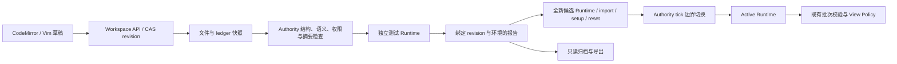

# 17 M3 编辑器与部署实现

## 目的、范围与保证

M3 提供可持久化的多文件 Python 编辑、Manifest/Contract 校验、非覆盖模板、不可变快照测试、原子切换和显式回滚。继承 [06](06_WORKSPACE_AND_TEMPLATES.md)、ADR-0009/0012；实际入口见根 [README](../README.md)。此处定义已实现的本机 profile，不把后续的多模块图、Arena、云同步或独立托管网站存储视为已完成。

M3 不改变物理模型或 Protocol 1.0 Envelope。`config/game.yaml` 内部版本升为 `1.5`，增加 `workspace` 段：文件数、源码字节、迁移预览数、测试批次数、部署数量、归档数量和界面轮询间隔。旧配置需显式补齐，工具不改写用户配置。

## 职责与数据流

`workspace.py` / `workspace_api.py` 管理文件；不 import 玩家代码。`deployment.py` 只使用授权传感器、Contract 和 Supervisor，不把 World 传给 Runtime。`module_profile.py` 生成任务授权的初始合同，Manifest 不能增加输入、输出或执行器权限。`web/workspace-ui.js` 管理编辑事务与状态；`web/editor.js` 是 CodeMirror 适配器，Canvas 继续只消费授权视图。

原生模式由 Host 驱动 `DeploymentManager`，候选 CPython 子进程异步启动；浏览器模式由可信 Core Worker 驱动同一个类，独立 Runtime origin 为 Active 和候选各创建一个 Pyodide Worker。最多两个玩家 Worker；Core Worker 自身还有一个可信解释器。候选加载、import、单元测试不能阻塞 UI 或直接执行于 Authority。

## Workspace 与存储

M3 的两种启动方式都由本机 HTTP 启动器提供版本库；默认路径为 `.m1-cache/workspaces/<seed-and-control-profile-hash>/`，可用 `--workspace-store PATH` 指定持久目录。此选择不等于独立静态网站的浏览器存储方案；IndexedDB/OPFS 留待独立 Web 分发验证。

`--workspace PATH` 是只读种子：首次建立编辑库时导入文件，只补不存在的基础模板；原目录和仓库示例均不回写。后续启动继续读取保存的编辑库。启动机器人使用原种子示例；编辑库须经 Test/Deploy 才成为 Active，避免启动时自动执行未测试草稿。

每个 revision 保存 `{files, ledger, revision}`，其中 `revision` 是 `{files, ledger}` 排序 JSON 的 SHA-256。原始 UTF-8 源码内容参与摘要；文件顺序和归档时间不参与。`HEAD.json` 在文件落盘后原子替换；历史 revision 保留，可按完整摘要预览、导出和恢复。源码不按可变文件逐个覆盖，因此一批保存是一个事务。线程锁与文件锁保护 CAS；旧 revision 的并发保存拒绝并提示重新加载/导出草稿。断电与 Windows 文件锁仍需目标平台专项验证，不承诺分布式事务。

当前允许 ASCII 相对路径的 `.py`、`.json`、`.md`，拒绝绝对路径、点段、反斜杠、设备名、大小写冲突和 NUL。磁盘种子拒绝 symlink/hardlink；编辑库不接受压缩包，因此没有解压入口。限制默认 64 文件、32768 源码 UTF-8 字节，详见配置。SDK、标准库及 Runtime 名称不能被 Python 文件/包遮蔽。

## Manifest、模板与渐进扩展

M3 managed profile 恰有一个周期模块，但源码和测试可跨多个文件。`tankbot.json.entry_point` 必须等于该模块 Contract 的类入口，如 `localization.odometry:Odometry`；高级 `main:build_robot` 图组装是 M5 范围。支持 SDK `0.1.0` 本地 profile、NumPy、指定基础标准库与空 `dependencies`，不执行安装钩子或联网 pip。

模块 `config` 传入 `ctx.config['module']`；场景、传感器标定、授权端口和执行预算由任务提供。Contract 可修改 `entry_point`、`state_version`；模块 ID、端口、频率、截止、依赖图须匹配任务 profile。`connections` 必须恰好是任务授予的连线；`pose_source` 为该玩家模块且无真值 fallback。练习模式的系统显示仍只由 Authority 的 View Policy 决定。

模板 `odometry-starter@1.0.0` 来自随应用发布的本地文本包，使用内容摘要；没有远程模板安装机制。预览返回 template ID/version、base revision、每个路径的旧模板/当前文件/新建议；ledger 保存来源版本、原始内容与摘要、生成 revision。默认保留所有现有文件，显式选择 incoming 才替换到**新的** revision；旧内容仍可恢复。手工合并在编辑器进行，保存后重做预览。重复应用相同模板不覆盖代码；并发修改使旧 plan 失效。导入项目也经过相同预览，不信任导入 ledger。

## Test 与 DeploymentArtifact

Test 冻结指定 revision，依次检查路径、所有 Python 语法、Manifest、Contract、连线、依赖与选源。语法错误返回 `path:line:column` 并定位编辑器；import/setup/测试错误返回受限诊断，超时强制结束候选。

在新的同等级 Runtime 中运行 `tests/test_*.py` 的 `unittest` 用例，再初始化模块。随后在固定提交门执行配置数量的**授权传感器仿真批次**：采样当前正在运行的世界，测试输出只校验、不驱动该世界、不进入视图。检查结果关联、时间、frame、协方差、重复端口、权限和每批预算。它是开放环观察式 smoke test，不是另开一场受候选控制的完整无头比赛，也不能证明所有工况的算法正确性；后续关卡增加领域测试和受控闭环场景。

报告绑定 Workspace revision、部署文件摘要、完整任务配置、Core 二进制、SDK、Schema、Host/Runtime/协议实现及 Python 平台版本。报告包含单元测试数量、仿真批次数和最大批次耗时。源码、测试文件、ledger 或环境发生变化后，不能把旧通过状态套到新 revision。

artifact 只包含普通源码、Manifest 和 `contracts/*.json`；排除 `tests/`、`data/`、ledger 和 incoming。SHA-256 输入为排序的路径/文件原始字节摘要与环境摘要。测试可能使用更多测试文件，但部署源码字节必须和该次检查的源码相同。Authority 保存会话内不可变副本，部署不重新读取可变草稿。

## 部署、失败与恢复

`Test → Ready → Starting → Active`。Deploy 再次核对 revision/环境报告，为同一 artifact 启动全新 Runtime，完成 import/setup/reset 的启动健康检查；在算法周期边界换入新实例。旧 Runtime 直到此时仍处理自己的传感器和输出。

切换同时清除旧 pending 批次、候选位姿、旧程序控制目标与未执行开火，撤销程序执行器目标；人工控制不受换代码隐式接管。新实例使用新 publisher 身份和 deployment ID，旧 Worker 句柄/结果被丢弃；Runtime 序列状态重新建立。`view_revision` 增加，渲染器清空跨版本插值。`run_id`、物理位置、速度、弹丸和世界时钟继续，不能用部署偷偷重置世界。

默认重置算法状态；`setup/reset` 收到部署起始 tick 与 `reason='deployment'`。公开初始位姿仍是任务原始值，不向新算法注入当前真值。因状态清空产生的估计误差会保留。

任何 Test/Starting 失败保留旧 Active。激活后的程序错误按既有策略制动/隐藏估计，不自动恢复旧内存。Rollback 选择历史 artifact，重新创建干净 Runtime，在相同门切换；它不是恢复旧进程、旧 Python import cache 或旧 World。每会话最多保存配置数量的 artifacts；当前不做会话内 GC。

UI 看到的测试/部署结果连同对应源码快照保存在 `archive-<sha256>.json`，可导出。归档是审计观察，不是可从客户端重放的部署授权；刷新/重启清除 Ready 与 Active 会话，须重新 Test。源码 revision、ledger 和归档继续保存。运行中关闭页面可能错过尚未归档的最后一个结果；不会损坏已保存源码。可用导出记录恢复 artifact 源码，再按导入预览/Test/Deploy 操作。

## 本地管理接口

这些是 M3 启动器/Worker 的管理接口，不是新的机器人 Topic 或公共网络协议。HTTP 修改需匹配 Host、Origin、控制 token、JSON 类型与帧大小；独立 Runtime origin 没有这些路由。

| 接口 | 输入与语义 |
| --- | --- |
| `GET /api/workspace` | 当前 snapshot、limits、CSRF token |
| `POST /api/workspace/save` | `{revision, changes}`；路径映射到新文本，null 为显式删除；CAS 保存 |
| `POST /api/workspace/template` | `{revision}`；基础模板预览，现有文件默认 keep |
| `POST /api/workspace/upgrade` | `{revision}`；教学运行框架专用预览，排除已有算法和非系统测试文件；不自动应用 |
| `POST /api/workspace/import` | `{revision, files}`；只导入文本，生成冲突 plan |
| `POST /api/workspace/apply` | `{revision, plan_id, resolutions}`；每路径 keep/incoming |
| `POST /api/workspace/revision` | `{revision}`；读取本库历史源码 |
| `POST /api/workspace/archive` / `archives` | 保存观察结果/导出审计记录，不授予 Ready |
| `GET /api/deployment` | Native 状态；Browser 使用同名 Worker RPC |
| `/api/deployment/test` / `deploy` | Native POST `{revision}`；Browser RPC `{snapshot}`，Authority 重算摘要 |
| `/api/deployment/rollback` | `{sha256}`；仅允许当前会话已验证的历史 artifact |

主要错误：`REVISION_CONFLICT`、`UNSAFE_PATH`、`RESERVED_MODULE`、`CONTRACT_PROFILE_MISMATCH`、`UNAUTHORIZED_CONNECTION`、`TEST_REQUIRED_FOR_THIS_SNAPSHOT_AND_PROFILE`、`DEPLOYMENT_BUSY`、`RESOURCE_LIMIT`。拒绝不提交部分保存或部分算法输出。

## 取舍、约束与验收

CodeMirror 6 + Python/JSON 扩展 + 可切换 Vim，通过 esbuild 本地打包；沿用 ES module JavaScript 与现有 Canvas，不在本阶段引入 Phaser/全仓 TypeScript 转换。确切版本、传递依赖、integrity 在 `package-lock.json`；许可证随构建生成并由页面链接。UI 允许 CodeMirror 动态样式；不放宽脚本或 Runtime 网络/Worker 权限。

统一入口 `python3 tools/build.py` 构建 Core 与编辑器；发现本平台所需的锁定 npm 包缺失或版本不符时自动执行 `npm ci`，随后执行编辑器打包并检查 bundle 与许可证产物。`--web-only` 可单独修复 UI，`--core-only` 供无头构建，`--offline` 需要本地依赖缓存；`--format-check` 仅检查 Rust。构建机需 Node.js 22+ 与 npm，运行时静态页面不执行 npm。npm 安装固定使用锁文件、包含开发依赖和本平台可选 esbuild 二进制，不修改玩家 Workspace。

主游戏页面固定在视口内，信息栏用驾驶/状态/传感器/武器页签切换，不通过页面滚动访问功能。Workspace 默认为关闭的原生 modal dialog；顶部按钮或 F2 打开，再次 F2 或右上角 × 收起，焦点限制在弹窗内。关闭仅改变可见性，保留未保存草稿、光标、文件选择和运行中的测试/部署。代码与文件列表在面板内部滚动。

弹窗打开时清除游戏按键并发送零目标，整个打开期间屏蔽游戏输入；keydown/keyup 不把 Vim 的 W/J/L/Space 转为执行器指令。F2 在捕获阶段处理，编辑器内 Escape 保留给 CodeMirror/Vim，不用它强制关闭编辑器；其他弹窗控件的 Escape 可关闭。Ctrl/⌘S 和 Vim `:w` 保存，不自动部署。离开有未保存草稿的页面会提示。

验收追踪见 [M3 报告](reports/M3_VALIDATION.md)：多文件/测试真实执行，非覆盖/冲突/磁盘错误、摘要与环境匹配、旧版本保留、部署门/World 连续、回滚新实例、浏览器刷新持久化和焦点隔离。未决项为其他浏览器/OS、独立浏览器存储、完整模块图、长时资源/磁盘回收及强服务端沙箱；不作为本机 M3 已验证能力宣传。

弹窗交互补充验证：`tools/browser_dialog.py` 在真实 Firefox 中检查顶部按钮、F2 切换、× 关闭、草稿/文件选择保留、焦点限制、打开时释放按键及 HUD 页签；实测 1440×814、1280×634、1024×526、500×654 的内容视口无页面滚动。代码、文件列表及工具区仅在各自面板内部滚动。运行 `tools/browser_m3.py` 继续验证弹窗内完整 Edit/Test/Deploy/回滚流程；截图与布局记录保存在 `.m1-cache/`。

M4 新增独立的 Campaign 单模块 profile：标准输入是授权系统自身位姿和可选 Radar，输出是目标估计。三关共用一个 Contract，阶段解锁只补缺失文件，并为每个阶段保留独立 ledger；Manifest 的系统位姿来源由 Authority 校验。继续复用本文件定义的 Test/Deploy/回滚边界，具体接口与课堂函数/类见 [18](18_CAMPAIGN_DESIGN.md)。

学习工具增量见 [19](19_LEARNING_GUIDES_AND_SE3.md)：每关默认说明、函数签名、类型搜索/悬停/补全、矩阵实验和 Python 速查共用 Workspace 弹窗；页面不滚动。测试环境摘要另绑定 NumPy 实际包版本、requirements 与浏览器资源锁。旧教学脚手架通过显式预览升级，算法文件不自动替换。

教学升级交互修复：Test 遇到旧框架时先保存草稿并打开只含运行文件/缺失文件的预览，确认后更新并继续 Test；取消不更新源码。兼容性提示不作为算法测试结论。部署按钮旁说明未启用原因，当前 revision 通过 Ready 后才启用，继续编辑会再次禁用；测试范围及证据见 [19](19_LEARNING_GUIDES_AND_SE3.md) 与 [教学升级报告](reports/TEACHING_UPGRADE_VALIDATION.md)。

玩家代码保存/依赖与矩阵接口见 [23](23_PLAYER_CODE_AND_LIBRARIES.md)，stdout/traceback 的有界采集、部署版本标记和 HUD/编辑器日志见 [24](24_RUNTIME_LOGS.md)。管理状态新增 logs 与 runtime_fault；机器人 Protocol 未变。
