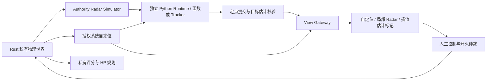

# 18 M4 教学关卡实现

## 目的与范围

实现 C0 手动熟悉、C1 理想 Radar 的 SE(3) 矩阵坐标变换、C2 噪声下跟踪与击杀。复用同一 Authority、固定提交门、Python Runtime、Workspace 和 View Policy；完整模块图仍属 M5。Radar、巡逻、血量及销毁规则已由用户逐项确认。所有模型、控制、场景和任务阈值在 `config/m1.json` 的 `campaign` 段；配置版本为 `1.6`，仍能读取不含 Campaign 的 `1.5` 沙盒配置。

## 关卡与数据流

| 关卡 | 提供与撤回的信息 | 玩家任务与完成条件 |
| --- | --- | --- |
| C0 | 系统自定位、真实靶标与弹道；无 Radar | 离开初态至少 1 m、车体转向至少 0.5 rad、命中靶标一次 |
| C1 | 保留自身系统位姿与地图；隐藏目标、真实弹道和命中特效位置 | 完成返回 NumPy SE(3) 矩阵的函数，由框架执行 T @ p，至少发布一个合法目标估计并命中一次 |
| C2 | 理想 Radar 改为噪声/丢失；保留手动控制，授权敌车 HP | 复用 C1 函数，编写跟踪状态类；敌车 HP 归零即通关，算法误差用于复盘 |

三关玩家初态均为零位姿/零速度，复用原地图；C0 靶标 `(-3, 0, 0)`，C1 换新靶标 `(-3, 1.5, 0)`，C2 使用新敌车场景。切换建立新纪元，不能把 C0 已公开的目标原地改称秘密。玩家按 C0 → C1 → C2 解锁；开发者模式可直接选择任一关练习，详见 [22](22_SETTINGS_MODES_AND_PROGRESS.md)。首期没有账号。



## 用户确认的 Radar 模型

质心安装，`radar_link` 与 `base_link` 重合；量程 12 m、视场 2π、10 Hz。按目标中心测量距离和方位。先用理想距离/视场和中心到中心线段的墙体遮挡判断可见，再判定独立丢失并加入独立高斯噪声。擦墙也遮挡；没有虚假目标。视野外目标不会因噪声进入检测。

C1 的误差全部为零。C2 距离标准差 0.15 m、方位标准差 0.02 rad、每次目标检测独立 10% 丢失；零偏置、零延迟。负距离截为零，方位归一到 `[-π, π)`。噪声使用任务 seed 的独立 PRNG，不改变物理随机流；保证同实现/同输入重现，不承诺跨 Python/编译目标位级一致。

物理保持 60 Hz / 4 子步，Encoder/IMU 30 Hz，Radar 与算法 10 Hz，视图 30 Hz，渲染由 RAF 独立驱动。Radar 采样与自定位采样对齐，输出按原 activation + 6 tick 提交。Radar 在共享可信 Authority 中从 Core 私有 DTO 计算，原生与 Pyodide 使用同一逻辑；玩家 SDK 不包含模拟器或目标初态。

## 用户确认的巡逻敌车与伤害

C2 敌车独立选择差速底盘，复用玩家的车体、独立炮台质量、逐轴受限力/力矩伺服、黏性阻力与非弹性接触。与玩家同处一个 Rapier World；每个子步调用同一个速度伺服函数。敌车零速度、炮台零相对角/角速度，炮台以零目标主动制动；本阶段不瞄准或开火。

初态 `(-4.5, -2, 0)`；依次巡逻 `(-1.5,-2) → (-1.5,2) → (-4.5,2) → (-4.5,-2)`。10 Hz 计算航点角误差 `e`，目标 `wz = clamp(2e, ±1.5)`；`|e| > 0.35` 时原地转向，否则 `vx = 0.6 m/s, vy = 0`。距离航点 0.25 m 内切换，接触或受击均不瞬移纠正。

敌车 3 HP，每次弹丸命中扣 1 HP，碰撞不扣血。受击沿用世界速度动量、差速车体 x 轴投影、实际接触点偏心角冲，质量不增加。动态目标使用与玩家同类的子步刚体扫掠；冲量在子步末施加。致命命中在当前固定子步结束后移除车体、炮台、关节与碰撞体，不留残骸；同时移除弹道障碍物。现有弹丸继续遵守原反弹/碰撞/寿命规则。

## 接口与边界

前三关保留系统自定位和人工执行器权限。自己的公开位姿通过 `/robot/localization/pose` 提供给玩家模块；这不授权敌方位置。Radar 使用已有 `radar@1`，每次采样的 `observation_id` 只标识该次观测，不是稳定实体 ID。

玩家发布 `/robot/estimates/perception/target`，负载 `target_estimate@1`：`x_m`、`y_m`、可空的行优先 2×2 `covariance`。坐标系为 `map`，时间是估计描述的采样 tick。估计由玩家产生，不修正为真值，也不写入 Core。非法值、错帧、超龄或非法协方差拒绝；部署切换清除旧估计。

SDK 使用不可变 `RadarDetection`、`RadarData`、`TargetEstimate`；函数模板和状态类由同一周期 Module 包装，使用同一 Contract。C2 保留 C1 的坐标转换函数。模板只自动补不存在的文件，已有文件通过 M3 预览迁移。

```python
import math
import numpy as np
from numpy.typing import NDArray
from tankbot import Pose2D

def radar_to_map(own_pose: Pose2D) -> NDArray[np.float64]:
    c: float = math.cos(own_pose.yaw_rad)
    s: float = math.sin(own_pose.yaw_rad)
    T_map_radar: NDArray[np.float64] = np.array([
        [c, -s, 0.0, own_pose.x_m],
        [s, c, 0.0, own_pose.y_m],
        [0.0, 0.0, 1.0, 0.0],
        [0.0, 0.0, 0.0, 1.0],
    ], dtype=np.float64)
    return T_map_radar
```

这是矩阵约定示例；生成的学习文件保留 TODO，完整学习说明见 [19](19_LEARNING_GUIDES_AND_SE3.md)。系统生成 `campaign_robot.py` 包装、Manifest、Contract 与测试，C1 解锁 `perception/transforms.py`，C2 追加 `perception/tracker.py`。前者实现 `radar_to_map(own_pose: Pose2D) -> NDArray[np.float64]`；框架使用 4×4 矩阵左乘齐次雷达点，再转换为协议中的目标估计。后者实现 `Tracker.update(measurements, dt)` 状态类；输入为地图点元组，丢失时为空，返回 `TargetEstimate` 或 `None`。

三个阶段共用一个 `perception` 周期 Module，声明 `self_pose` 和可选 `radar` 端口，输出 `target`；可选端口声明不授予额外输入，C0 Router 不提供 Radar。玩家初始化配置仅含公开初始自身位姿、轮组标定、模块配置与 `lesson.level_id`。目标位置、巡逻航点、私有历史和评分器不进入 Runtime。

视图新增 `view_snapshot@3`，沿用 v2 的已授权字段并加入 `target_estimates`（最多一个类型化 Envelope）。v1/v2 仍有效。玩家 C1/C2 的 `objects` 与 `effects` 为空；玩家 UI 的局部 Radar 不做全局坐标换算。开发者图层通过独立 grant 的只读 DTO 调试，不改变关卡快照或 Python 权限，见 [22](22_SETTINGS_MODES_AND_PROGRESS.md)。地图标记来自玩家输出，与自身位姿一起按授权时间缓存插值；目标无合法新鲜估计时隐藏，无真值回退。

## 生命周期与验收方向

关卡开始/重试建立新 `run_id`，撤销旧 Runtime、候选与显示缓存；跨关保留源码。开始关卡不能自动执行未测试草稿。测试只校验候选，不把它的结果用于正式关卡评分。

活动期间仅反馈已授权的观测、估计和任务进度；C2 额外显示 HP。详细真值误差只在明确结束或通关后发布。评分按估计的采样 tick 匹配私有目标历史，重复/倒退时间戳不重复计分；只有正式提交输出计入诊断，M3 候选测试输出不计入正式任务。

结束后关闭玩家 Runtime、取消候选与待提交输出、撤销人工控制并主动制动；物理与已有弹丸继续运行。报告不可变，后续测试/部署须先重试，评分不会回灌活跃算法。C2 的通过条件只有击杀；不强制滤波算法或额外 RMSE 阈值。错误估计继续按其原值显示。

误差诊断涵盖本次尝试中正式激活的部署版本；跨版本 Test/Deploy 不重置世界或累计诊断，因此该数值不能作为不同版本的独立性能排名。

| 本机管理接口 | 行为 |
| --- | --- |
| `GET /api/campaign` | 原生当前 run 与公开任务状态；浏览器使用同名 Worker RPC |
| `POST /api/campaign/start`，`{level_id}` | 仅选择已注册且当前模式可访问的关卡；新纪元、重试、非覆盖解锁，页面重新加载 |
| `POST /api/campaign/finish`，`{}` | 结束尝试、关闭 Runtime 后返回诊断；不接受客户端的 passed 参数 |

修改沿用 loopback Host/Origin/token 校验。浏览器的 start 只切换启动内容及版本库，刷新后由新的 Core Worker 建立 World；finish 在该 Worker 的 Authority 执行。原生在 Authority 锁内切换。两种部署共享规则与协议语义。

## 约束、替代方案与待确认项

将教学逻辑放进 Renderer 无法执行权限；复制三套引擎会造成规则漂移。因此用受信关卡配置驱动 Authority。首期使用一个目标和单周期模块，后续多目标关联、多模块、Arena 和强服务器隔离不属于本阶段。

源码、版本和模板 ledger 保存在 Workspace；玩家通关结果另写 `userdata/progress.json`，开发者练习不奖励解锁，见 [22](22_SETTINGS_MODES_AND_PROGRESS.md)。重试先加载随游戏提供的启动脚手架，已保存草稿需重新 Test/Deploy。沙盒项目与首次进入 Campaign 使用独立版本库，防止不同 Contract 混入旧项目。用户通过 UI 切换前必须先保存草稿并等待当前测试/部署结束。

待验证平台仍包括 Windows/macOS 实机与其他浏览器。敌车不避障或反击，玩家可用车体阻挡巡逻；这是当前控制策略的边界。浏览器设备所有者仍可调试自己的 Core/启动配置；本机内容与诊断不构成 Arena 安全隔离。服务器私有场景和公平上传仍属于 M8。

## 验收

`tests/test_campaign.py` 覆盖 Radar 可见性/噪声/丢失/复现、两个跟踪解法、C0–C2 实际通关、三层状态、结束后评分及非覆盖解锁。Rust 测试量测动态受击冲量、偏心角冲、质量和死亡后刚体/障碍物移除。`tools/browser_m4.py` 使用真实编辑器、测试部署、授权视图与普通控制通路完成三关，检查源码保留、新纪元和固定视口；浏览器模式需显式 `--browser-qa`，其测试桥仅返回既有授权快照和控制结果的 JSON。
