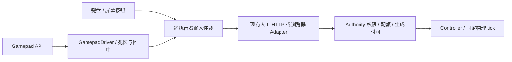

# 20 手柄驱动与人工输入仲裁

## 目的、范围与约束

用户要求像普通游戏一样使用手柄驾驶 TankBot。本轮覆盖现有原生 Host 和浏览器 WASM 两种运行方式、差速与全向底盘、炮台、单发及编辑器切换。手柄是 Web UI 的输入适配器，沿用已有人工权限与 Controller，不引入 ROS2、HID 原生服务或新的物理模型。

采用浏览器 [Gamepad API](https://www.w3.org/TR/gamepad/)。浏览器负责将设备转换为 `standard` 布局；页面每个 RAF 读取新的 `navigator.getGamepads()`，不能长期持有旧事件里的采样对象。首次使用可能需要在页面可见时按手柄按钮；远程部署使用 HTTPS，本机 localhost 可用，具体浏览器策略见 [Mozilla 使用说明](https://developer.mozilla.org/en-US/docs/Web/API/Gamepad_API/Using_the_Gamepad_API)。

## 默认操作与配置

连接设备后点击游戏页面，按任意手柄按钮，再松开摇杆和操作键。顶部按钮显示连接状态；「驾驶」页可启停手柄、选择多个已连接设备之一，并查看映射说明。键盘和屏幕按钮继续可用。

| 输入 | 差速底盘 | 全向底盘 |
| --- | --- | --- |
| 左摇杆纵轴 | 车体前进/后退 | 车体前进/后退 |
| 左摇杆横轴 | 车体左转/右转 | 车体向左/右平移 |
| LB/RB（L1/R1） | 车体左转/右转 | 车体左转/右转 |
| 右摇杆横轴 | 炮台相对角速度 | 炮台相对角速度 |
| RT（R2） | 每次按下单发，长按不连发 | 相同 |
| Start（Options/+） | 打开/收起代码编辑器 | 相同 |

目标速度使用 `base_link`，不随相机或地图旋转转换；摇杆幅度控制目标速度比例，仍服从已有受力伺服、限速、接触和制动。肩键与差速摇杆转向相加后截断到配置范围。

全部设备索引、正负方向、死区、阈值、速度和发送周期在唯一配置 `config/game.yaml` 的 `view.gamepad`，由 [gamepad-input.schema.json](schemas/gamepad-input.schema.json) 校验。默认死区 0.18、按钮阈值 0.5、刷新周期 50 ms，线速度 1 m/s、底盘角速度 1 rad/s、炮台相对角速度 2 rad/s。左摇杆采用径向死区与幅度重映射，斜推不获得额外线速度；炮台轴采用轴向死区。

标准索引为 forward=1、horizontal=0、turret=2，默认 sign 均为 -1；按钮为 yaw_left=4、yaw_right=5、fire=7、editor=9。非标准设备默认不驾驶，显示映射提示；维护者可以设置 `standard_mapping_only=false`，按实际设备修改轴/按钮索引及 sign，不在程序内猜测型号。自定义配置仍须具备所有必需的轴/按钮。旧 1.5/1.6 配置可省略 gamepad，保留键盘功能，不静默补入手柄参数。

## 数据流与接口

`web/gamepad.js` 的 `mapGamepad` 只读取设备样本与配置，产生 vx/vy/wz/turret 和按钮状态；`GamepadDriver.sample(pads, {motionAllowed, uiAllowed})` 管理设备选择、回中与按下边沿。`manualTargets` 输出标准 Twist 和 TurretVelocity。UI 不读取 Ground Truth，也不从显示位姿反算控制。

连续输入仍为 `POST /api/cmd_vel`、`POST /api/turret_cmd_vel`，单发仍为带新 request_id 的 `POST /api/fire`；浏览器模式使用既有 browser.post 路由。没有新增协议消息或权限。历史配置值 `control_sources.*=keyboard` 表示现有 UI 人工租约，现涵盖键盘、屏幕按钮和手柄；值为 robot 时，UI 不发送该执行器指令，Authority 也拒绝伪造人工请求。

键盘优先级按执行器处理：按住任一驾驶键时整组底盘使用键盘，炮台可同时使用手柄；按住 J/L 时炮台使用键盘。不把不同设备的速度相加。手柄保持当前选择，显式选定的设备断开后不会偷偷换到另一个设备；自动选择模式的新设备仍须回中。

## 生命周期、错误与边界

- 连接、换手柄、重新启用、断连重连及窗口失焦后，所有绑定轴进入死区且绑定操作键释放，才重新允许手柄驱动。
- 编辑器或输入控件获得焦点时发送零目标，暂停驾驶/开火；Start 的边沿检测仍可用于关闭编辑器。关闭后仍需回中，不能补发编辑期间按下的扳机。
- blur、隐藏页面、断连或 API 异常时清除缓存输入并提交零目标；已有请求只能按其正常边界完成，不回滚已发生的射击。传输失联仍由现有 0.5 s 仿真看门狗主动制动，实际速度不会瞬间置零。
- RAF 采样与发送分离：默认最多约 20 Hz 更新连续目标，释放/失焦立即提交零目标；空闲不持续发包，不把显示帧率改成物理 tick。有限数检查和设备范围检查失败时拒绝样本。
- 开火只取扳机上升沿，不随 RAF、冷却结束或重新聚焦自动连发；原有单发、幂等和冷却模型保持不变。

## 方案取舍、未决项与验收

浏览器原生 API 能复用两种运行方式及 Authority；引入原生 SDL/Steam Input SDK 会新增部署和跨进程适配成本，当前没有必要。此处不宣称已接入 Steam Input SDK；Steam 或操作系统呈现的标准设备仍由浏览器识别。

验收覆盖两种底盘的比例与方向、漂移/斜向限幅、按钮边沿、换设备、API 不可用、编辑/失焦/重连回中、旧配置、程序租约拒绝，以及真实网页到 Authority 的闭环。实体 Xbox、DualSense、Switch/通用手柄、操作系统和浏览器组合仍须做硬件矩阵验收；震动、游戏菜单全手柄导航和可视化重映射留待后续需求。证据见 [手柄验收](reports/GAMEPAD_VALIDATION.md) 与 [ADR-0024](adr/0024-gamepad-manual-input.md)。
