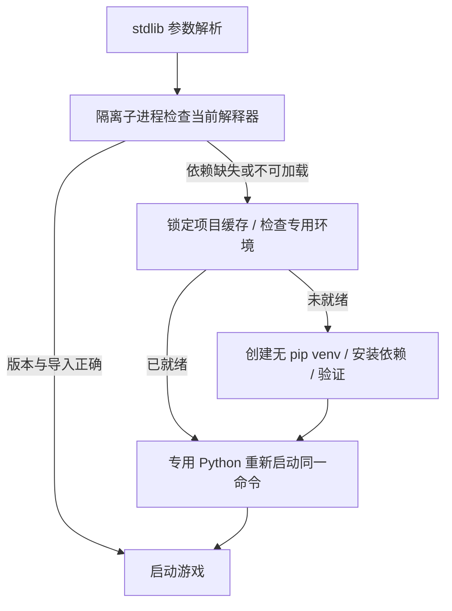

# 21 首次运行与 Python 依赖准备

## 目的、范围与要求

2026-10-24 用户反馈直接启动 C0 报缺少 NumPy，要求首次运行自动解决外部依赖。此前 CLI 仅检查 NumPy；系统 Python 可能同时没有 pip/ensurepip，不能把安装任务继续转交玩家。

本设计覆盖 `tools/tankbot.py` 的 serve/browser/headless/probe。启动器在创建 Authority、运行玩家源码和启动仿真前，自动准备仓库 `requirements.txt` 所声明的应用依赖；现有 npm 构建由 `tools/build.py` 管理，Pyodide 文件仍由 `prepare_browser.py` 按锁准备。Rust、Node.js 和 CPython/标准库属于宿主工具前提。

## 启动顺序与接口



`tools/python_env.py` 仅使用标准库。`ensure_environment(root, offline=False)` 返回需要切换的 Python 路径；当前解释器已经满足固定版本与导入检查时返回 None。`relaunch_if_needed(entry, offline=False)` 使用参数列表重新启动，保留原命令、工作目录和退出语义；不使用 shell 拼接，也不要求手动激活环境。

依赖检查用 `python -I` 子进程读取 distribution 版本并真实导入关键模块，避免 PYTHONPATH 掩盖缺包或 NumPy 扩展加载错误。Host 延后导入第三方代码，`--help` 和无效参数始终可以仅靠标准库显示。SDK 路径优先于 tools，防止入口文件 `tools/tankbot.py` 遮蔽 `tankbot` 包。

## 环境、缓存与安装器

专用环境位于 `.m1-cache/python/envs/<key>/`。key 绑定仓库绝对路径、解释器版本/基础路径、平台/ABI、requirements 和安装器锁；依赖更新使用另一环境，保留正在运行的旧版本。Unix 使用 bin/python，Windows 使用 Scripts/python.exe。

启动器通过 stdlib venv 创建无 pip、无系统 site-packages 的环境。pip 从 [PyPI 官方发行 wheel](https://pypi.org/project/pip/26.2.2/) 准备，URL、版本、字节数与 SHA-256 固定在 `config/python-bootstrap.lock.json`；校验后按 [CPython ensurepip](https://github.com/python/cpython/blob/3.14/Lib/ensurepip/__init__.py) 使用 wheel 的方式引导安装。无需宿主预装 pip、ensurepip 或 uv；不执行远程 get-pip 脚本。

首次联网下载 requirements 及传递依赖的可用 wheel 到 `.m1-cache/python/wheels/`，随后从本地目录安装。安装器只使用 binary wheel，不触发源码编译；pip 使用隔离模式、专用缓存和 require-virtualenv，并清除目标目录类环境覆盖。完成后重新验证版本/导入，原子写入 `ready.json` 记录版本与解释器；不单凭 ready 标记跳过检查。

已有且完整的解释器或缓存无需访问网络。启用 `--offline` 时，安装器和依赖都只从已有缓存读取；缓存不完整会明确报错，联网重跑同一命令即可继续。缓存 wheel 依赖操作系统和 Python ABI，不是可随意跨机器复制的发行包。

## 错误、并发与安全边界

- 采用操作系统文件锁保护共享安装器和 wheel 缓存；并发首次启动串行准备，等待时显示进度，进程退出后锁由操作系统释放。
- 安装中断、下载校验失败或依赖导入失败不写入成功标记；下次启动重试。损坏安装器可重新下载，已有算法及 Workspace 不参与安装。
- 安装发生在项目私有环境；不对用户当前虚拟环境、系统 Python 做 pip install，不使用 sudo、--user 或 break-system-packages。已有环境满足要求时直接复用。
- 玩家 Workspace 的 requirements/Manifest 不会成为安装输入，ModuleRunner 不联网安装任意 import；运行时权限、Python 隔离和固定 tick 边界保持原样。
- 重新启动后的 `sys.executable` 是专用解释器，现有 Supervisor 的 `-I` 子进程自动使用同一环境，解决“Host 有包而玩家进程没包”的问题。

## 使用方式、取舍与未决项

```bash
python3 tools/tankbot.py serve --level c0
python3 tools/tankbot.py headless --level c0 --ticks 12 --offline
```

玩家使用原命令。开发者仍可使用已安装 requirements 的自有虚拟环境，独立测试工具需要相应解释器；专用解释器与版本可在 ready.json 中查看。

选择 venv 与固定 wheel 引导可覆盖没有 pip/ensurepip 的当前 Linux 系统，避免引入必装的额外管理器或修改全局环境。代价是首次下载、磁盘缓存及启动检查开销。当前只锁定 requirements 的直接依赖；完整传递依赖及逐平台离线发行锁、缓存清理策略仍待后续打包阶段处理，不承诺跨平台字节一致。旧缓存不自动删除，避免影响正在运行的进程。

验收必须包含：真正缺少 pip/ensurepip/NumPy 的系统首次启动、正常 C0 HTTP、隔离玩家进程、再次启动无安装、离线新环境安装、失败重试、路径含空格、并发锁、帮助无依赖、SDK 名称不被入口遮蔽，以及系统环境/玩家文件保持不变。证据见 [启动依赖验收](reports/PYTHON_BOOTSTRAP_VALIDATION.md) 和 [ADR-0025](adr/0025-automatic-python-environment.md)。
