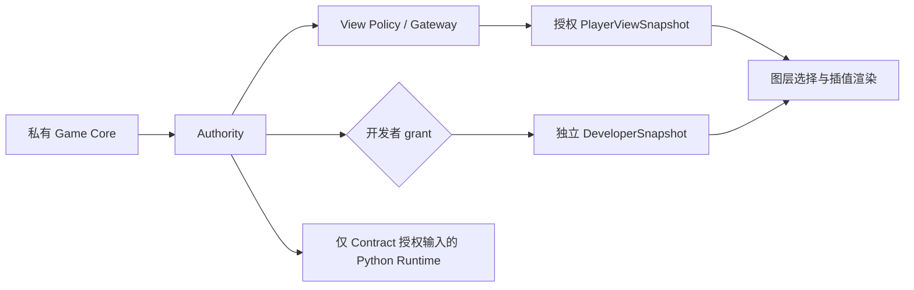

# 22 设置、游戏模式与玩家存档

## 目的、范围与要求

提供固定视口内的设置页面、持久键盘映射，以及玩家教学进度。开发者可像 RViz 的 Displays 一样独立开关当前已实现的数据图层；玩家只看本关授权信息。覆盖本机原生 Authority 与浏览器 Authority，不引入 ROS2、账号、云存档或 Arena 权限系统。

默认玩家模式，公共 c0 通关后同时开放 Weapons c1 和 Navigation navigation.c0；两条主线分别遵守自己的显式前置，可任选或交替推进。稳定ID/章节身份不变，完整树见 [36](36_BRANCHING_PROGRESSION.md)。重玩不撤销进度；开发者可练习所有已注册关卡，不奖玩家通关。两种模式不改变 Python 输入、输出或执行器权限。

不含 Campaign 的旧 `1.5` 沙盒配置需使用 `--developer`，设置中拒绝切到不存在教学关卡的玩家模式。

旧版本仅有会话进度，无法从 Workspace 或部署记录推断历史通关；首次创建新存档从 C0 开始，已有源码继续保留，也可开启开发者模式继续实验。

## 文件与设置界面

默认设置来自 `config/settings.yaml`，首次运行复制到 `userdata/settings.yaml`；玩家进度为 `userdata/progress.json`，玩家源码版本库为 `userdata/workspaces/`，迁移规则见 [17](17_EDITOR_AND_DEPLOYMENT.md)。`userdata/` 忽略提交，独立于构建缓存。可用 `--settings-file`、`--save-file` 指定长期路径。已有文件先验证，损坏时报错并保留，不静默重置；不存在的文件才创建。

设置页面通过顶部按钮或默认 F10 打开/收起，右上角 × 关闭，内容在弹窗内部滚动。进入设置先释放驾驶和武器输入；手柄在设置期间暂停，返回后需回中。模式变更前必须保存代码并等待 Test/Deploy 完成；切换重建关卡与 Runtime，清除旧显示缓存，已保存源码保留。

YAML 的 `version: 1` 包含 `developer_mode`、`keyboard` 和 `layers`；完整字段见 [默认文件](../config/settings.yaml) 与 [Settings Schema](schemas/settings.schema.json)。键位例如 `keyboard.forward: KeyW`、`keyboard.editor: F2`。每项一个物理 `KeyboardEvent.code`，支持字母、数字、方向键、空格、F1–F12 和小键盘数字；拒绝重复键位、未知操作与组合键。Ctrl/⌘S、Vim 等编辑器内部绑定继续由编辑器处理。

UI 点击键位后捕获下一键，Esc 取消，再点击保存生效；提供恢复默认键位。重映射先转换为既有操作语义，继续复用 Twist、速度上限、按执行器仲裁和 watchdog。差速的左/右用于转向，全向用于横移；全向另有车体转向键。现有 Gamepad 映射与参数仍按 [20](20_GAMEPAD_INPUT.md) 配置，本轮设置页面编辑键盘绑定。

YAML 使用 PyYAML SafeLoader 的受限子类，拒绝重复键及 Python 对象标签；读取限额 8 KiB，并执行严格字段/类型/冲突校验。新增 PyYAML 由既有首次启动机制自动准备；浏览器玩家 Worker 不加载它。解析依据见 [PyYAML 文档](https://pyyaml.org/wiki/PyYAMLDocumentation)。UI 不提交原始 YAML，只提交校验后的设置对象及 revision；手工编辑文件后重启服务。

## 关卡与存档语义

通关条件继续由 CampaignSession 与声明式规则计算，主动结束、Test Ready、部署成功均不算通关。metadata.prerequisites 表示必须全部通关的前置；metadata.order只用于目录展示及既有存档序列化。ApplicationState统一计算unlocked_levels，CLI/HTTP/浏览器启动都检查require_level，锁定消息列出缺少的关卡名称与ID；UI禁用按钮不构成权限。

顶部或任务页“关卡路线”打开固定视口弹窗，公共入口置顶，Weapons/Navigation分列，窄屏纵向分组。节点可查看简介、前置、提示和开始/重试，区分已通关、可挑战、锁定及当前；通关列出本次所有新开放节点，不自动进入唯一下一关。默认恢复上次选择的已解锁关卡；新档选择首个无前置入口，不取展示列表第一项猜测权限。

启动前可执行`python3 tools/tankbot.py --level-tree`查看同一依赖树和正式玩家进度，`--save-file`选择存档。复用LevelProgression的前置/存档校验，只读且不初始化设置、Workspace或仿真；无存档时预览新玩家状态，详细行为见 [36](36_BRANCHING_PROGRESSION.md)。

存档结构示例（`completed_at` 使用 UTC）：

```json
{
  "version": 1,
  "completed_levels": ["c0", "navigation.c0", "navigation.c1"],
  "current_level": "navigation.c2",
  "completions": {
    "c0": {"completed_at": "2026-11-03T12:00:00+00:00"},
    "navigation.c0": {"completed_at": "2026-11-03T12:10:00+00:00"},
    "navigation.c1": {"completed_at": "2026-11-03T12:20:00+00:00"}
  }
}
```

[Progress Schema](schemas/progress.schema.json)约束结构与ID格式，已知ID、完成项前置闭包、稳定序列化顺序、当前关卡已解锁、记录与完成列表对应由领域验证。完成集合无需是全局前缀，上例未完成Weapons C1也合法。版本仍为1；读取不排序重写，不补送未玩关卡，旧链式存档和成绩/当前关卡保留。新增完成按原metadata.order写出，重复通关幂等；写临时文件、flush/fsync后原子替换，OS锁保护读改写。模式切换撤销旧ticket；开发者选关不改玩家current_level。

原生宿主观察 Authority 的 passed 状态后记录，失败在任务面板提示并重试。浏览器由独立 Core Worker 发出完成通知，UI 用启动 ticket 向本机存储服务提交，仅通知当前已注册尝试；服务验证 ticket、模式、显式前置关系并幂等保存。该本机完成通知不是服务器独立验算，设备所有者仍可编辑文件或调试 Worker，不能用作竞技成绩证明。未来 Arena 必须在服务器运行比赛并验算。

## 可视化与权限边界



“图层”页包含静态地图、授权车体、轨迹、玩家目标估计、Radar、IMU、轮编码器、炮台观测；开发者额外获得真实车体/目标、弹丸、真实速度和碰撞外形。坐标系可按已有授权位姿显示。C0 或显式真值练习本来授权的目标/弹丸仍可在玩家图层列表中选择；C1/C2 不出现这些真值选项。图层开关保存在 YAML 的 `layers` 中，不改变权限。

开发者真值与估计分别显示，可同时比较；真值通过独立时间缓存插值，不改写估计或物理世界。仅开发者 Radar 图层可把观测投到地图；玩家保留局部 Radar，地图目标仍须由 Python 输出，避免替玩家完成 C1 变换。速度箭头按车体系速度转换到世界系，并标注显示比例；碰撞外形显示当前已实现车体几何，不宣称提供接触力。

关卡 YAML 的 `visualization.user_toggleable` 约束玩家模式。开发者模式下，已实现图层的复选框均可独立开关，不能沿用玩家限制将真实目标、速度等选项禁用。敌车显示使用自身底盘模型及真实 yaw；例如 C5 即使玩家选择差速底盘，真实敌车仍绘制四轮全向底盘并随物理运动自转。该外观信息由独立 DeveloperSnapshot 的 `target_visuals` 提供，详见 [15](15_RENDERING_DESIGN.md)。

Navigation C3 新增可选的 `layers.waypoints`，只显示获授权的公开路线、目标容差圈与离散任务进度，不包含真实车体或速度。旧设置缺少该字段仍可读取，在内存中补默认值；显示权限、初始状态与用户切换继续由关卡YAML限制，详见 [37](37_NAVIGATION_WAYPOINT_CONTROL.md)。

Navigation C4另有可选 `layers.path/checkpoints`，分别显示完整公开路径/起终点和顺序检查点；旧设置缺项只在内存补false，不写回或重置文件。显示上限与默认/可切换状态来自YAML，任务距终点标量及终局追踪误差由独立task_feedback授权，不加入玩家输入。见 [40](40_NAVIGATION_CONTINUOUS_PATH_TRACKING.md)。

消息查看器可选择现有授权 Topic 并隐藏/显示原始内容；开发者另可选私有物理 DTO、候选位姿、选中位姿、目标估计、Runtime 与最近 100 条审计。没有数据时不伪造传感器。新增消息类型需添加对应可视化适配，尚无通用 RViz 插件生态。

`GET /api/developer` 在玩家模式下由原生宿主拒绝，浏览器同名 Worker RPC 也检查开发者 grant；开发者 DTO 不加入协议的 PlayerViewSnapshot 或 SDK。关闭模式重建 Authority/Worker，销毁旧 DOM/缓存；同服务其他标签页检测模式变更后关闭旧 Worker 并刷新。浏览器设备所有者边界仍按 [16](16_BROWSER_RUNTIME.md)，不是远程安全隔离。

## 管理接口

| 接口 | 输入与行为 |
| --- | --- |
| `GET /api/settings` | 返回 settings、defaults、revision、文件位置与本机 control token |
| `POST /api/settings` | `{revision, settings}`；严格校验与 CAS，返回 mode_changed / reload_required |
| `GET /api/progress` | 完成列表、当前关卡、解锁列表、developer_mode |
| `GET /api/profile` | 公共目录含level_id/title/chapter_id/prerequisites/order/description；浏览器由共享Authority生成相同profile |
| `POST /api/campaign/start` | `{level_id}`；检查模式及存档，再建立新关卡 |
| `GET /api/developer` | 原生开发者 DTO；浏览器使用同名 Worker RPC |
| `POST /api/session/start` | 浏览器 `{}`，为当前启动关卡登记 ticket 与模式 |
| `POST /api/progress/complete` | 仅浏览器本机持久化 `{ticket, level_id}`；原生无此客户端写入入口 |

变更接口沿用Host/Origin/control-token校验，Runtime origin不服务设置/存档。配置版本、Envelope、控制消息保持兼容。headless/probe指定--level也检查玩家前置，但不改current_level或记录通关；诊断--developer只在本次覆盖模式、不写个人设置。serve/browser的--developer/--player沿用持久模式选择。没有--level的诊断沙盒不是正式挑战，不产生关卡成绩。

## 取舍、开放项与验收

采用单个本机存档文件，暂不引入账号/多个槽位 UI；不同存档可用路径区分。UI 单独禁用按钮不能保障前置权限，因此 Authority 入口和本机存储入口均检查。开发者数据走独立受权入口，避免扩宽关卡策略或污染标准估计 Topic。修改 YAML 时格式/注释可能规范化，不影响算法文件。

存档未来版本升级需要显式迁移；当前遇到未知版本拒绝，不能推断新旧课程对应关系。未验证跨平台文件锁/原子替换和其他浏览器快捷键；多人身份、远程管理员授权与竞技存档另行设计。

原设置/模式验收见 [历史报告](reports/SETTINGS_VALIDATION.md)，其中链式进度描述记录当时规则。当前双主线取代全局连续前缀约定，见 [ADR-0049](adr/0049-branching-course-progression.md)；其他模式、权限和文件约束保持。两种玩家UI真实完成公共c0、两分支开放、跨scope往返及旧存档/源码历史保留均已验收，详见 [双主线报告](reports/BRANCHING_PROGRESSION_VALIDATION.md)。
