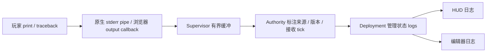

# 24 玩家运行日志与调试反馈

## 目的、范围与数据来源

为玩家提供 `print()`、测试输出、异常调用栈和执行失败的 UI 反馈。原来原生 stderr 被丢弃、浏览器 Python 输出 callback 为空，普通运行异常也只返回 `MODULE_ERROR`；本轮增加两种 Runtime 共用的有界日志聚合。它不读取或输出私有 World，不开放通用宿主日志接口。

## 玩家操作

- 主游戏右侧「日志」页签查看输出。
- 代码编辑器工具栏「运行日志」打开/收起日志区，编辑代码时可同时查看。
- 来源可选择全部、当前程序、测试快照、部署启动或回滚启动。
- 异常保留错误类型、消息与调用栈；点击项目文件行号定位到代码。
- 当前源码已改变时提示行号可能来自旧快照；不会为定位错误覆盖草稿。
- 「清空显示」清除两个面板的当前显示，后续新输出继续出现。

正常 `print("value", x)` 即可使用，不要求额外日志库。语法/导入拒绝同时出现在编辑器下方与测试来源日志；超时/Worker 停止有 Runtime 失败反馈。失败部署继续保留旧程序；运行已停止时编辑器显示故障状态，可修复后重新 Test/Deploy。

## 数据流与接口

原生保留 stdout 作为协议 framing，玩家 stdout 继续重定向到 stderr，由独立 reader 读取；使用增量 UTF-8 解码并按行合并、移除临时项目根前缀。读取不等待算法完成，物理线程不读取阻塞管道。

浏览器 Python 输出通过 `op: log` 的固定 Runtime 旁路消息，由 runtime-frame 校验、计量、标注 worker 身份后转给 BrowserSupervisor。无关或已关闭 worker 的日志忽略。失败 traceback 在 ModuleRunner 以及初始化错误处打印；初始化、测试、update 都得到反馈。

日志字段放在已有 `GET /api/deployment` 管理状态中，浏览器使用同名 Worker RPC；不新增机器人 Topic，也不改变 TankBot Protocol Envelope。`logs` 包含 `entries`、`next_sequence`、`dropped`、`max_bytes`；每条含 text、stream、source、module_id、接收 tick，并在有候选/正式部署时带 deployment_id/revision。tick 表示宿主收到日志的逻辑时刻，不能当作算法准确采样时间。

`runtime_fault` 说明当前程序停止的原因；它不等于测试是否 Ready。Traceback 的 SDK/Runtime 帧保留作上下文，只为项目内路径提供跳转。输出使用 textContent，不能作为 HTML 执行。

## 容量与生命周期

复用 `config/game.yaml.runtime.max_log_bytes`，当前 32768 字节；每个 Supervisor 和 Authority 聚合缓冲均按序列化字节数及最多 512 条记录裁剪旧日志，单条长文本继续拆分。原生不完整行也有长度上限；浏览器每个初始化/step 阶段额外限制输出字节与 128 条消息，超出后提示省略。

滚动到最新时跟随输出，主动向上查看时保留位置。日志只保存在当前 run 内存，不持续写玩家存档/Workspace；重试、切关或服务重启建立新缓冲。清空显示是 UI 操作，不是删除源码或重置程序。

有界日志避免缓冲随时间无限增长，但不能保证任意打印程序不消耗 CPU，也不等于 Python 硬内存限制。日志输出仍计入批次预算；应避免在循环中大量打印。见 [08](08_RUNTIME_AND_SECURITY.md) 和 [23](23_PLAYER_CODE_AND_LIBRARIES.md)。

## 取舍、约束与验收

采用现有管理状态和固定旁路，避免引入通用日志中间件。当前只提供输出、错误、文件定位与重新部署反馈；没有断点、单步、交互式 pdb、任意变量求值或完整 LSP。日志不修改控制权、View Policy 或算法输入；开发者 Inspector 与玩家日志为不同数据来源。

验收：两种 Runtime 的 print/测试输出可见，运行异常含文件/行号且能定位；来源筛选、清空显示、修复后重新部署正常；UTF-8、大输出裁剪、失败候选保留日志，页面不滚动。报告见 [玩家 Runtime 验收](reports/PLAYER_RUNTIME_VALIDATION.md)。其他平台的路径清理、日志洪泛压力与持久日志导出仍待验证。
