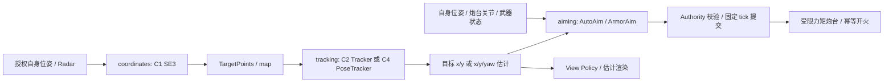

# 26 多模块运行图与 Weapons 章节

## 目的、范围与已确认要求

M5 在原有物理、权限与 Edit/Test/Deploy 上实现多模块机器人项目，以及 C3 自动瞄准、C4 敌车位姿与装甲瞄准。用户明确调整教学顺序：**Hello Robot（C0）→ Weapons（C1–C4）→ Locomotion（后续）**。自身定位、scan 和建图从原 C3/C4 计划移至后续章节；不得把敌车姿态估计称为玩家自身定位。

本机原生和浏览器使用同一个 `GraphExecution`、SDK、Contract 和协议。外部服务端强沙箱、Arena、异步 Python、持久检查点、独立浏览器 Workspace 存储不属于此次交付。验证证据与限制见 [M5 报告](reports/M5_VALIDATION.md)。

## 关卡与控制权限

| 关卡 | 玩家任务 | 控制权 | 时限 |
| --- | --- | --- | --- |
| C0 / Hello Robot | 驾驶、转向、命中靶标 | 人工底盘、炮台速度与单发 | 60 s，首次有效操作起算 |
| C1 / Weapons | 返回 NumPy SE(3) 矩阵，用于实际坐标变换 | 底盘禁用；人工炮台与单发 | 60 s，首次部署起算 |
| C2 / Weapons | 带噪中心点跟踪 | 同 C1 | 120 s，首次部署起算 |
| C3 / Weapons | 复用 C1/C2，自瞄、制动、提前量与开火决策 | 底盘禁用；仅程序炮台角加速度与单发 | 120 s，首次部署起算 |
| C4 / Weapons | 估计敌车 x/y/yaw，计算并瞄准有效装甲 | 同 C3 | 180 s，首次部署起算 |

C1–C4 保留系统自身位姿和公开地图。底盘锁定为零目标主动制动，仍受后坐、弹丸和炮台反向力矩影响，不冻结物理刚体。Router 与 Authority 拒绝人工或程序驾驶；C3/C4 不授权旧炮台速度接口。C2–C4 双方 3 HP、每次有效命中扣 1、反弹可自伤；玩家死亡优先失败，存活并在最后预算 tick 内击杀可通过。结束按钮、重试、计时与不可变结算沿用 [25](25_ATTEMPT_RULES_AND_CONFIGURATION.md)。

Weapons 全部关卡默认显示炮弹，可在设置中开关 projectiles 图层；显示权限由各关 YAML 声明，沿用现有插值。敌车真实位姿/装甲模型仍不显示，算法不能订阅炮弹真值，开火、动力学和评分规则不变。

C2 另按用户要求授权运行中累计位置 RMSE 的 UI 教学反馈，包含有效样本数及有界走势；C3/C4 的误差仍只在结束后发布。此设置来自 YAML 的 allowed_metrics / live_feedback，不给模块新增真值输入，详见 [18](18_CAMPAIGN_DESIGN.md)。

关卡组合、目标、教学说明、Profile 与模板合同来自 `levels/*.yaml`；通用模型、控制参数、预算和验收参考控制器参数仍在 `config/game.yaml`。加载器及迁移边界见 [27](27_LEVEL_PLUGIN_ARCHITECTURE.md)；YAML→JSON Core DTO 不增加玩家读取私有场景的权限。

## 模块职责与数据流



生成的 `robot_modules/weapons.py` 只做类型、时间与端口适配。玩家继续编辑 `perception/transforms.py`、`perception/tracker.py`，C3 增加 `weapons/auto_aim.py`，C4 增加 `perception/pose_tracker.py` 和 `weapons/armor_aim.py`。同模块内算法直接调用；模块间只能经声明端口/Topic 交互。单文件入口不限制整个项目，Manifest 的 `entry_point` 必须对应图中某个模块，但不会作为另一个总控模块重复执行。

返回早期单模块关卡时，共用项目中后关的三模块 Manifest 需要按当前配置预览适配；检测同时检查运行声明和包装版本。算法保留，系统文件经确认后创建新 revision，不要求玩家改算法或删除 userdata；具体流程见 [19](19_LEARNING_GUIDES_AND_SE3.md)。

连接形式为 `module.port → /topic` 与 `/topic → module.port`。内部频道限定 `/robot/modules/<module_id>/<port>`，类型必须登记；位姿候选限定 `/robot/estimates/<module_id>/pose`，目标估计为 `.../target` 或 `.../target_pose`。每个 Topic 一个发布者，每个端口一个连接，所有端口必须绑定。输入必须为 Topic；离散 fire Command 只能作为输出，请读 weapon_state 获得反馈。未知频道、真值输入、类型不匹配、重复 ID、循环 setup 依赖或超额预算均在执行前拒绝。Contract/Manifest 正例见 [C3 Manifest](examples/m5-workspace.json) 与 [tracking Contract](examples/m5-module-contract.json)。

`dependencies` 只决定 setup/reset 顺序；控制反馈 Topic 可以成环，但不会形成同一回调内递归调用。初始化按依赖拓扑及稳定 ID，批次回调按稳定 ID，关闭按反向初始化顺序尽力执行。共享 Worker 内模块相互不构成安全隔离。

## 时间、状态与失败语义

每次部署创建全新进程或 Worker，setup 成功后才能切换。`origin_tick` 是实际激活 tick；reset 在首次执行前按此时刻调用，而不是候选启动时刻。周期模块首发为 `origin_tick + period_ticks`；event 仅在指定输入出现新序号且满足最小间隔时触发。必要输入过期/缺失则跳过，可选输入返回 `None`。首次 dt 从 origin 计算，此后从上次实际调用计算；跳过累积 dt。

每个机器人同一时间最多一个批次。先冻结所有模块输入，然后计算；输出只在激活后 6 tick 提交。提交再激活，所以最短链的一跳仍跨批次，不取决于 Python 计算先后。转发测量必须保留其 `simulation_tick`，不能把旧测量冒充新测量。`origin_tick` 是 `runtime_step_request@1` 的新增可选字段，多模块请求会提供它；它属于调度元数据，不是执行器消息的开始/终止时间。

当前图最多 8 模块、64 连接、每批 128 输出、可视 Topic 总计 32 KiB；具体值以 YAML 为准。period/min_interval 至少 deadline，所有 deadline 等于全局 6 tick。C3/C4 各模块 6 ms，合同预算合计 18 ms，不超过机器人 20 ms 硬预算。**每模块预算用于准入，外部 Supervisor 强制整个机器人批次预算**，不声称 Python 内逐模块抢占。

普通回调异常或非法输出按模块原子拒绝，其同批合法兄弟模块可提交；连续失败 3 次停止该模块。模块内 Python 字段不回滚。Worker 崩溃、死循环或错过截止则整个未提交批次丢弃、撤回控制，物理继续推进；控制器看门狗仍生效。重新部署/显式回滚重建整图、清空缓存与状态，物理世界和关卡倒计时继续。

测试运行语法、依赖策略、Schema、图准入、unittest 和 6 个授权输入批次。候选输出进入独立缓存，不控制实时世界或计分；报告明确列出 `modules_executed` 和 `modules_waiting`，不能把未触发模块称为已执行。通过接口测试不等于通关，也不要求自瞄最优；零控制程序可以部署观察。未实现坐标变换、非法返回或异常仍需修复。

## Python 数值接口

```python
import numpy as np
from numpy.typing import NDArray
from tankbot import AimInput, AimOutput, TargetPoseEstimate

class AutoAim:
    def __init__(self, projectile_speed_mps: float,
                 max_acceleration_radps2: float) -> None:
        self.previous_target: NDArray[np.float64] | None = None

    def update(self, observation: AimInput, dt: float) -> AimOutput:
        # TODO: 根据已授权估计实现控制；零输出可用于观察。
        return AimOutput(acceleration_radps2=0.0, fire=False)

class PoseTracker:
    def update(self, measurements: NDArray[np.float64],
               dt: float) -> TargetPoseEstimate | None:
        raise NotImplementedError
```

`TargetPoints.positions_m` 是只读 float64 `(N,2)` 数组，空帧 `(0,2)`；当前一帧至多一个敌车中心，**不是不断增长的历史**。C2 既有 `Tracker.update(tuple[TargetEstimate,...],dt)` 保持兼容，适配器完成转换；新矩阵接口使用 NumPy。

`AimInput.target_xy` 为 `(2,)` 或 None，`own_pose` 为 `(3,) [x,y,yaw]`；`target_age_s` 是目标采样时刻至计划控制提交时刻的仿真秒，包含管线时延。另有 `turret_angle_rad`（连续相对角）、`turret_rate_radps`、`weapon_ready`、C4 的 `target_yaw_rad`。`dt` 与测量采样间隔不同。`AimOutput` 只含 `acceleration_radps2: float`、`fire: bool`。框架负责冷却检查和幂等请求，玩家不用构造 JSON。

`TargetPoseEstimate(x_m,y_m,yaw_rad,covariance=None)` 表示**敌车**中心，不是自身 Pose2D。参考系 map，yaw 从世界 +x 逆时针，范围 `[-π,π)`；协方差为只读 `(3,3)` NumPy 数组，线上为 row-major 9 元数组。JSON 结构、有限数、对称 PSD、帧、新鲜度、权限分层校验。渲染 `view_snapshot@4` 在 v3 基础上允许这种目标类型，旧版本仍有效；估计不修正碰撞、不回退为真实目标朝向。

## 角加速度与装甲物理

程序发布 `TurretAcceleration(acceleration_radps2)` 到 `/robot/turret/cmd_accel`，Schema `turret_acceleration@1`、frame `base_link`，不添加执行开始/结束字段。α 限幅 ±25 rad/s²，电机 `τm=clamp(I_t α,±2 N·m)`，现有 `I_t=0.08 kg·m²`。轴承力矩 `−c_b(ω_t−ω_b)` 与电机合成，并给底盘等大反向力矩；实际相对角加速度还受底盘反作用、阻力和接触影响，不保证恰等于 α。

零 α 不主动加速，只保留轴承阻力；0.5 s 未更新则按配置制动时间常数 0.1 s 请求受限电机制动。相对角速度达到 8 rad/s 且指令继续向外加速时也制动；不直接裁剪真实速度，数值积分可有暂态超限。负向加速度可正常减速。C0–C2 人工速度伺服保持原接口。

C4 在敌车前/后/左/右平直侧面的中央各设宽 0.24 m 装甲段，安装中心为 `[±L/2,0]`、`[0,±W/2]`，向外法线分别为 0、−π、π/2、−π/2。使用真实弹丸与车体**首次接触点**在碰撞时敌车参考系中的位置做命中掩码；不是按距离中心猜测。装甲不增加质量/碰撞体。有效段扣血，其他部位也吸收弹丸、施加已确认动量投影和偏心角冲，但不扣血。目标生命使用独立有效伤害计数；物理命中数可更大。玩家仍为整车受击，原寿命、反弹、自伤与子步规则不变。

## Radar 难度、可观测性与可视化

C2–C4 统一 σr=0.45 m、σθ=0.08 rad、10% 独立丢失、零偏置/延迟，固定种子可重现；C1 理想观测不变。4 m 处约 95% 点云的全宽为径向 1.8 m、横向 1.28 m，大于 0.8×0.6 m 车体；实际分布与距离、遮挡和非线性变换相关，不保证每个点都在车外。可见性先于丢失与噪声，负距离截零，方位归一化。

C4 仍只观测底盘中心。教学公开差速模型 `xdot=v cosψ, ydot=v sinψ, ψdot=ω`、`vy_body=0`、只前进/可原地转向及装甲安装，不公开巡逻航点、真实 yaw 或装甲坐标。运动时可从平滑中心轨迹推断航向；原地转向时中心观测对 yaw 不可观，须保持/预测/表达不确定性或等待射击。通关按存活击杀，不规定唯一估计器或运行中的真值 yaw 答案。

「模块」页展示合同、端口、依赖、激活和错误；自由图有权限时可显式选择自身位姿来源，切换清空显示缓存，无静默回退。C3/C4 固定系统自身位姿，不开放选源。消息查看器只读 ViewGateway 授权且有大小上限的 Topic。目标矩形朝向/装甲来自玩家估计和公开安装，不从开发者真值图层补齐。局部 Radar、类型参考、代码说明和日志仍可使用，主页面固定视口。

## 替代、取舍、开放项与验收

放弃“C3 立即自身定位、C4 建图”，降低武器学习的跨度；未取消后续机器人自治目标。未采用装甲观测 Radar 或直接真实 yaw，保留用户要求的中心跟踪问题。共享 Worker 比每模块进程轻，但一个死循环会中止整个机器人；无逐模块安全隔离承诺。严格单写者与显式 Topic 牺牲自由路由以简化权限和确定性。

验收须覆盖：图准入正反例、冻结输入/采样与提交 tick、event 去重与 dt、失败原子性/回滚、跨关源码无损、无未授权真值、角加速度受力/看门狗、旋转装甲与非装甲命中、两种数值解法、原生/WASM ABI 及真实网页 Test/Deploy。详见报告及 `tests/test_robot_graph.py`、`tests/test_weapons_m5.py`、`tools/browser_m5.py`。

开放项：其他平台与实体手柄回归、不同种子/初态的大规模难度评估、长期玩家教学反馈、每模块独立资源隔离。Locomotion 的具体级别和新增物理/观测必须继续共同确认。此前同意的理想 scan（质心对齐、360°/180束、0.05–8m、10Hz、只扫静态墙、null 无回波）保留为未来设计输入，**本轮没有实现或启用 scan/建图**。
