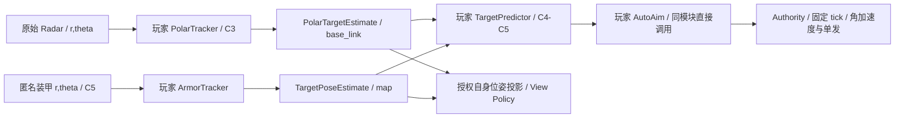

# 26 多模块运行图与 Weapons 章节

## 目的、范围与当前状态

M5建立同步多模块项目、Contract/Topic图与渐进武器课程。当前公共Hello Robot（c0）后并列开放Weapons（c1–c5）和Navigation（navigation.c0–c4），主线内按YAML prerequisites推进，见 [36](36_BRANCHING_PROGRESSION.md)。本篇负责模块图和Weapons：C3原始极坐标滤波、C4复用滤波并接管中心自瞄、C5匿名装甲/小陀螺。当前接口见 [28](28_WEAPONS_PROGRESSIVE_ESTIMATION.md)、[30](30_ARMOR_OBSERVATIONS.md)；原C3/C4自动武器范围保留为 [历史M5报告](reports/M5_VALIDATION.md)，不作为当前配置。

本机原生和浏览器复用GraphExecution、SDK、Contract与协议。Navigation已用同一模块图实现轮控、里程计、GPS/EKF、航点及连续路径；自身定位不再是未实现项。scan、建图、玩家全局规划、异步Python、持久检查点、服务端沙箱/Arena和独立Web存储仍未实现。

## 关卡与控制权限

| 关卡 | 玩家任务 | 控制权 | 时限 |
| --- | --- | --- | --- |
| C0 / Hello Robot | 驾驶、转向、命中靶标 | 人工底盘、炮台速度、单发 | 60 s，首次有效操作起算 |
| C1 / Weapons | NumPy SE(3) 矩阵坐标变换 | 底盘禁用；人工炮台/单发 | 60 s，首次部署起算 |
| C2 / Weapons | 地图系带噪中心点跟踪 | 同 C1 | 120 s，首次部署起算 |
| C3 / Weapons | 原始距离/方位滤波，输出车体系 r/theta | 同 C1 | 120 s，首次部署起算 |
| C4 / Weapons | 复用 C3 滤波，中心预测与炮台闭环；整车扣血 | 仅程序角加速度/单发 | 120 s，首次部署起算 |
| C5 / Weapons | 匿名装甲关联/等价相位估计、预测与炮台闭环 | 仅程序角加速度/单发 | 180 s，首次部署起算 |

C1–C5 保留系统自身位姿和公开地图。底盘零目标主动制动，仍受后坐、受击和炮台反向力矩影响；Router 与 Authority 拒绝驾驶。C4/C5 不授权人工炮台/开火或程序旧速度接口。C2–C5 双方 3 HP，死亡、超时、末 tick 判定及运行期编辑锁沿用 [25](25_ATTEMPT_RULES_AND_CONFIGURATION.md)。

Weapons均通过YAML授权炮弹可视化并插值；真实敌车/命中特效位置仍隐藏。C4使用C3同款中心Radar；C5只有匿名装甲极坐标，不生成GPS或中心Radar，见 [30](30_ARMOR_OBSERVATIONS.md)。估计车体/装甲只来自玩家输出。Weapons C2/C3显式授权累计位置RMSE、样本数与曲线，C1/C4/C5误差在终局发布；Navigation另按各关授权，不能由本篇推断。配置源见 [27](27_LEVEL_PLUGIN_ARCHITECTURE.md)。

## 模块职责与数据流

`robot_modules/observations.py` 做 C3/C4 类型化元组、采样时间和 Topic 适配，传入 tuple[PolarTargetEstimate, ...]，不先滤波或转地图坐标；C5 使用独立 `robot_modules/armor_observations.py` 与原 NumPy 装甲矩阵；`robot_modules/aiming.py` 组合玩家预测器与控制器。C3 的图只有 tracking，C4/C5 为 tracking 与 aiming；**模块数不等于 Python 文件数**。同模块内直接函数/类调用，模块间经声明 Topic 传递；不让玩家管理 JSON、Worker 或进程。

连接形式为 `module.port → /topic` 与 `/topic → module.port`。内部频道限定 `/robot/modules/<module_id>/<port>`，位姿候选为 `/robot/estimates/<module_id>/pose`；目标候选按类型使用 `target`、`target_pose`、`target_polar`。每个 Topic 一个发布者，每个端口一个连线，所有端口须绑定；离散 fire 只能输出，通过 weapon_state 读取反馈。

`dependencies` 只决定 setup/reset 拓扑顺序。控制反馈 Topic 可成环，不会在同一回调递归调用。初始化按依赖拓扑与稳定 ID，批次按稳定 ID，关闭按反向初始化顺序尽力执行。共享 Worker 内模块不构成安全隔离。结构样例 [Manifest](examples/m5-workspace.json) 与 [Contract](examples/m5-module-contract.json) 保留原三模块示意；当前关卡权威定义是各 YAML，不从样例生成初始化。

## 时间、状态与失败

部署创建全新进程/Worker，setup 成功后在算法边界激活。`origin_tick` 为实际激活 tick；reset 在首批执行前以该时刻调用。周期首发为 origin+period；event 需新序号且满足最小间隔。必要输入过期/缺失则等待，可选输入为 None；dt 从上次实际调用计算，跳过累积时间。

每机器人同时最多一个批次，先冻结全部模块输入，结果只在配置的提交 tick 生效。提交后激活，跨模块至少跨一个批次；同模块预测→控制直接组合。转发测量保留采样 tick，不把旧测量冒充新数据。`runtime_step_request@1.origin_tick` 是调度元数据，不是执行器开始/终止字段。

原始Radar/装甲适配器匹配同期自身位姿，再按实际处理间隔调用算法；C3/C4缺测为类型化空元组，C5为(0,2)数组，支持只预测。C4控制适配器以有界公开位姿历史投影极坐标目标，找不到同期样本则按无目标处理，不回退真值。Navigation C2已实现特定GPS/编码器时间对齐，不能扩大为任意异步传感器融合能力。

图、连线和消息限制取YAML，额度字段的权威定义见 [05](05_ROBOT_MODULE_SYSTEM.md)、[41](41_RUNTIME_EXECUTION_PROFILES.md)。当前Weapons合同每模块声明6ms，C4/C5合计12ms，低于共同20ms声明准入上限；这不是实际执行耗时。外部Supervisor按可信后端profile执行独立整批往返截止，结果还须满足固定6tick门；不宣称共享Python内逐模块抢占或硬CPU配额。

普通异常/非法输出按模块原子拒绝，同批合法兄弟模块可提交；连续失败达到配置阈值后停止该模块，Python 字段不回滚。Worker 崩溃、死循环或错过截止丢弃整批未提交输出并撤回控制，物理继续；看门狗仍生效。算法异常不自动结束尝试或解锁编辑器。

## 接口与物理边界

目标位置、位姿和极坐标类型可在图中传递，但必须符合声明的 frame、新鲜度、有限数、协方差与发布权限。估计永不修改真实碰撞/位姿；C3/C4 地图投影仅使用已经公开的自身位姿。C4/C5 `AimInput.target_rt` 与多文件预测接口详见 28。

程序角加速度使用 `/robot/turret/cmd_accel`，`TurretAcceleration` / `turret_acceleration@1`、frame `base_link`，不加执行窗口。确认的 ±25 rad/s²、±2 N·m、连续旋转、轴承阻力、反向力矩、0.5 s watchdog、受限力矩速率制动均保留；零 α 不等于立即停止。C0–C3 人工速度伺服沿用原接口。

C4 与 C3 均整车扣血；C5 敌车四侧中央 0.24 m 装甲，按首次真实表面接触在敌车参考系中判定。不增质量/碰撞体；非装甲也吸弹并受冲量但不扣血。玩家仍整车受击。C5 改变敌车巡逻目标控制及底盘类型，不改变弹道、后坐、吸收动量、偏心角冲或接触模型。

## Workspace、验证与开放项

快照、非覆盖、固定 tick 激活、失败保留与回滚继承 [17](17_EDITOR_AND_DEPLOYMENT.md)。切换单模块包装/图模式或目标类型时，预览并确认系统脚手架更新；算法文件和历史 revision 保留，不能自动覆盖旧自瞄器。新 F2 文件树的高亮由 YAML `tutorial.lesson.edit_files` 声明。

Test 执行语法、依赖、Schema、图准入、项目 unittest 和配置数量的授权输入批次；输出不驱动世界或计分。报告分别列出 modules_executed/modules_waiting，不能把未触发模块称为已执行。通过接口测试不代表估计精度或关卡完成，不强制 KF/EKF/PD 的唯一实现。

选择共享Worker与显式单写者以降低框架负担；代价是死循环影响整台机器人。C4不引入GPS/朝向融合，C5朝向按模90°等价。Weapons课程与Navigation增量各有独立验收，不由历史M5报告推定。剩余项为长期教学效果、其他平台、强沙箱/每模块抢占、完整Lab和后续导航课程；C2滤波实验、现有Navigation和运行profile已分别实施，见38、40、41。
