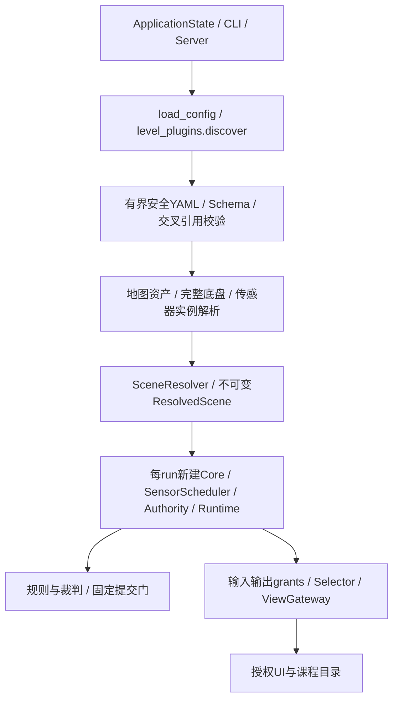

# 27 YAML关卡插件架构与迁移记录

## 当前范围与权威来源

当前十二关全部由 `levels/*.yaml` 自动发现、校验并通过同一加载器创建。应用配置为2.1，关卡Schema为1.0；公共c0后开放Weapons与Navigation，分支内部按prerequisites推进。关卡是配置，不是可执行插件；物理、传感器、适配器与裁判由通用引擎组件提供。原五关迁移属于历史阶段，见文末，不用旧报告替代后续课程验收。

| ID | 当前课程 | 配置源 | 必须通关的前置 |
| --- | --- | --- | --- |
| `c0` | C0 · 认识坦克与坐标 | [hello_robot.C0.yaml](../levels/hello_robot.C0.yaml) | 无 |
| `c1` | C1 · 用 SE(3) 矩阵变换坐标 | [weapons.C1.yaml](../levels/weapons.C1.yaml) | c0 |
| `c2` | C2 · 噪声中跟踪与击杀 | [weapons.C2.yaml](../levels/weapons.C2.yaml) | c1 |
| `c3` | C3 · 直接处理距离与方位观测 | [weapons.C3.yaml](../levels/weapons.C3.yaml) | c2 |
| `c4` | C4 · 从极坐标滤波到自动瞄准 | [weapons.C4.yaml](../levels/weapons.C4.yaml) | c3 |
| `c5` | C5 · 预测小陀螺并自动瞄准 | [weapons.C5.yaml](../levels/weapons.C5.yaml) | c4 |
| `navigation.c0` | Navigation C0 · 让双轮执行速度指令 | [navigation.C0.yaml](../levels/navigation.C0.yaml) | c0 |
| `navigation.c1` | Navigation C1 · 从轮速推算自身位姿 | [navigation.C1.yaml](../levels/navigation.C1.yaml) | navigation.c0 |
| `navigation.c2` | Navigation C2 · 用 GPS 校正里程计漂移 | [navigation.C2.yaml](../levels/navigation.C2.yaml) | navigation.c1 |
| `navigation.c3` | Navigation C3 · 让定位参与航点驾驶 | [navigation.C3.yaml](../levels/navigation.C3.yaml) | navigation.c2 |
| `navigation.c4` | Navigation C4 · 连续路径追踪 | [navigation.C4.yaml](../levels/navigation.C4.yaml) | navigation.c3 |

课程目标与控制权见 [09](09_LEVEL_DESIGN.md)，分支/存档见 [36](36_BRANCHING_PROGRESSION.md)。原五个ID保留，新增课程按独立增量验收；关卡数、章节名和order不参与仿真分支。

## 已知地图规划组件

C5声明objectives.global_planning和communication.runtime.preparation；编译器由后者派生Manifest准备声明，避免两处人工维护。已解析场景包含不可变规划任务，起点、网格覆盖和地图边界统一确定。prepare_planning用私有有界搜索选择安全目标；玩家输入为原始网格。PlanningPreparation管理一次请求、独立5秒截止与路径验证，PlanningNavigation只评价无碰撞到点停稳。C4的自动路径/检查点裁判保持独立，不按关卡ID选择行为。planning_map、safety_grid和path图层及live/terminal标量授权分开配置；完整字段见 [42](42_NAVIGATION_GLOBAL_PLANNING.md) 和 [规划Schema](schemas/global-planning.schema.json)。

## 逻辑架构与加载生命周期

`load_config`发现目录，`campaign.configure(id)`只查定义并装配通用组件；`scene_definition.py`先解析引用、验证初态和可选路径，随后创建世界。SceneResolver缓存不可变定义，重试复用定义但新建run、物理、传感器/RNG、Topic序号、算法Worker、评分和部署状态。Native/Browser启动器沿用同一解析器；浏览器通过既有authority-config交付已解析DTO，不手写注册列表。具体场景接口见 [32](32_RESOLVED_SCENE_AND_COMPONENTS.md)。

文件尚未读取为Unloaded，校验/解析后Loaded，实例初始化后Ready；Campaign active/preparing等待起算，active/running正式计时，passed/finished或ended/finished记录成功、失败或主动结束原因。切关与重试替换Authority并关闭旧Core/Worker/候选，整页重载清理监听器、计时器、插值和测试/部署会话；已保存Workspace不清空。没有独立暂停/恢复UI，不能把通用状态图当成已交付按钮。

## Schema与配置归属

正式结构为 [level.schema.json](schemas/level.schema.json)，精确组件与编写步骤见 [levels/README](../levels/README.md)。

| 来源 / 字段 | 当前职责与限制 |
| --- | --- |
| config/game.yaml | 通用时钟、求解器、接触、武器、平台、存储及模型/关卡/profile目录；非第二套课程配置 |
| config/chassis/*.yaml | 完整底盘2.0：质量/惯量、轮组、伺服、黏性阻力、限制、装甲/GPS安装与外观；关卡按模型类型选择 |
| metadata | 稳定ID、名称/章节、学习说明、order和prerequisites；order仅展示/存档序列化，前置数组表示全部满足 |
| world | 2D/map、固定频率、武器开关、inline矩形墙或assets内地图引用；C0/Weapons/Nav C0–C3为空旷场地，Nav C4为仓储资产 |
| robots | 一个player和可选任务target；初态、生命、drive/control_sources、传感器实例和既有巡逻/装甲组件 |
| communication.runtime | managed/graph、Contract/Manifest、处理组件、声明预算、模板版本；不加载任意Python入口或安装钩子 |
| permissions.data_access | 以玩家程序为参照的inputs/outputs/actuators、参考发布与task_inputs；缺省拒绝 |
| permissions.visualization | View Policy、图层/指标/控制信号上限与独立task_feedback；不是程序订阅grant |
| visualization | 初始显示、可切换项、来源、图表/历史容量；用户偏好不能突破上限 |
| objectives | 参数、进度、组合成功/有序终局规则、时限/起算；可声明twist_sequence、waypoint_route或path_tracking |
| evaluation | 采样对齐的目标/自身定位诊断、固定评分与对照源；显式live_feedback或C2滤波实验；没有通用星级/加权分数系统 |
| randomization | seed、发生/重建时机；传感器实例使用已登记随机流，路径生成使用独立seed流 |
| tutorial / scaffolding | 完整教材、edit_files高亮、公开参数引用、注册的文本脚手架与workspace_scope；YAML不携带可执行脚本 |

底盘模型是通用引擎资产，地图是关卡可引用的内容资产；不得借此include任意关卡专属配置或脚本。生成的campaign/lesson/旧Core字段只是兼容DTO，default-profile.json由同一加载器导出，禁止手工维护。地图覆盖/预览及练习隔离见 [31](31_MAP_OVERRIDE_AND_PREVIEW.md)。

读取拒绝超大文件、过深/过多节点、alias、重复键、危险tag和非有限数，再做Schema与领域验证。后者检查组件/模型、机器人/传感器ID与归属、canonical Topic、类型/发布冲突、Contract依赖/声明准入、前置未知/循环、地图路径、权限/来源、指标及源码生成上限。报错包含File/Path/Reason。资源限额由受信应用配置给定，插件不能放大。

## 复用组件与接口

`level_plugins.SENSORS/ACTUATORS`登记当前传感器/执行器的Topic、Schema和frame，`level_templates.COMPONENTS`登记受管算法脚手架，`level_rules`执行compare/all/any/not及固定比较符；不eval表达式或按关卡ID分派。通用进度为displacement/heading_change；任务组件另产生固定指令、航点和连续追踪事实。位置/yaw诊断仍由METRICS计算，路径裁判独立累计时间加权追踪误差。

现有实例后端包括Rust理想轮组/IMU和Python Radar、匿名装甲、带噪编码器及自身GPS，统一生命周期见32。intercepted_gps兼容组件保留，但当前正式Weapons不启用它。Navigation支持差速轮电压、无武器/无敌车，见 [33](33_NAVIGATION_MOTION_CONTROL.md)；定位、航点和路径组件分别见 [35](35_NAVIGATION_GPS_LOCALIZATION.md)、[37](37_NAVIGATION_WAYPOINT_CONTROL.md)、[40](40_NAVIGATION_CONTINUOUS_PATH_TRACKING.md)。

连续路径在可信准备阶段生成并复验，不占玩家批次预算；readonly path_reference只经task_inputs授权。PathFollower复用EKF/轮控制链，裁判生成路线不等于玩家规划课程。Runtime声明准入与后端往返截止分开，准入读取冻结profile而非墙钟别名，见 [41](41_RUNTIME_EXECUTION_PROFILES.md)。不引入通用中间件或任意代码式注册。

## 权限、评分与Workspace边界

程序只收到data_access授权输入，测试也不额外授予真值；可选未授权端口保持无数据。ViewGateway裁剪真实对象、局部观测和估计，UI只在allowed_layers与user_toggleable内展示，来源由注册组件限定。开发者grant提供独立只读DTO，不改变普通Runtime或正式进度。浏览器场景在客户端运行，不能保证恶意设备所有者无法读取内部真值。

裁判独立使用私有真实状态/历史，不依赖UI或估计图层是否打开。终局规则按YAML顺序执行；如Weapons玩家死亡优先、时限内击杀成功、随后超时。估计按采样tick评价，正式测试输出不计分。运行中反馈只发布获授权指标：Weapons C2/C3累计目标RMSE、Navigation各关定位/控制反馈，C4另授权距终点/检查点，真实追踪误差仅终局。程序数据权限、显示和任务反馈分别校验，详见 [04](04_STATE_AND_VIEW_MODEL.md)。

进度文件仍为版本1，非连续完成集合合法；仅metadata.prerequisites决定解锁，见36。campaign/navigation两个scope保存独立工程，切换清理旧会话但保留源码/revision/ledger/history；模板只补缺失文件，更新先预览，见 [06](06_WORKSPACE_AND_TEMPLATES.md)、[17](17_EDITOR_AND_DEPLOYMENT.md)。项目备份/清理属于38，不代替部署会话GC。

## 历史：原五关迁移（基线ba2b5f8）

原迁移前game.yaml混有课程、Radar、lesson/graph配置，模板、UI、CLI及存档还存在按ID的分支。迁移提取配置、统一发现/规则/权限/教材，并冻结 `tests/fixtures/level-behavior-before.json`；该夹具不是配置源。原阶段不增加关卡或玩法，验收见 [历史迁移报告](reports/LEVEL_PLUGINS_VALIDATION.md)。下表和当时地图、时限、诊断发布方式仅表示迁移前事实，不代表当前C3/C4或当前显示权限。

| ID / 名称 | 目标与输入 | 控制、初态与权限 | 成功、失败与诊断 |
| --- | --- | --- | --- |
| c0 / 认识坦克与坐标 | 移动≥1m、转向≥0.5rad、命中一次；无 Radar | 玩家原点、零速度；可选差速/径向全向轮；手动驾驶/炮台速度/单发，系统自身位姿、地图及目标弹道真值 | 首次有效人工操作计时，60秒；无需估计；超时或主动结束 |
| c1 / 用 SE(3) 矩阵变换坐标 | 理想中心 Radar，返回 NumPy 4×4 SE(3)，框架实际做矩阵乘法 | 原点零态；静靶(-3,1.5,0)；禁驾驶、人工武器；公开自身位姿/地图，隐藏敌方真值及弹道 | 合法估计≥1、命中≥1；首次部署起60秒；结束后位置误差 |
| c2 / 噪声下跟踪 | 复用变换、状态类跟踪；Radar σr=.45m、σθ=.08rad、10%丢失 | 原点零态；差速巡逻敌车(-4.5,-2,0)，矩形路径；禁驾驶、人工武器；双方3HP | 存活击杀；首次部署起120秒；玩家死亡优先，最后预算tick击杀有效 |
| c3 / 让炮台自己瞄准 | 三模块坐标→跟踪→自瞄；输入仍为带噪敌车中心 | 同 c2 初态/巡逻/生命；程序角加速度及单发，禁止人工武器和驾驶；系统自身位姿仍公开 | 存活自动击杀；首次部署起120秒；不强制某种估计/控制算法 |
| c4 / 从底盘中心推算装甲瞄准点 | 三模块估计敌车 x/y/yaw、计算四面装甲点；中心 Radar 不给真实 yaw | 同 c3，敌车四侧中央0.24m有效装甲；非装甲吸弹/受力不扣血；玩家整车受击 | 存活装甲击杀；首次部署起180秒；原地转向 yaw 不可观，不设唯一 yaw 答案 |

五关使用相同现有墙体地图、60Hz/4子步、30Hz基础传感器、10Hz算法/Radar；C0靶标(-3,0,0)。玩家和敌车的运动、接触、反作用、弹道、自伤均由既有 Rust Core 处理。巡逻不主动瞄准或开火。Radar 每次新 run 使用现有 runtime seed 重建 Python Random，按目标稳定顺序先遮挡/量程/视场、再丢失/高斯误差；无地图随机化。详细数值以冻结基线及迁移后各 YAML 为准。

原有诊断为有效估计采样数、位置 RMSE、可用时的 yaw RMSE、物理命中数；仅结束后发布，无加权分数、星级或额外误差通关门槛。重复/倒退采样不计分。计时、手动结束、热部署不重置倒计时、末 tick 和同时死亡优先级必须保持。

### 历史迁移与后续修订的对应

| 原关卡 | 原实现 | 迁移配置 | 后续变化及当前权威 |
| --- | --- | --- | --- |
| c0 认识坦克与坐标 | game.yaml、被动包装与UI真值分支 | hello_robot.C0.yaml | 后续改共享空旷地图，稳定ID保留 |
| c1 SE(3)坐标变换 | ideal Radar、函数模板与checklist | weapons.C1.yaml | 玩家矩阵API保留，后续明确授权炮弹 |
| c2 噪声跟踪 | noisy profile、Tracker与击杀判断 | weapons.C2.yaml | 后续授权实时RMSE及单关滤波实验，见38 |
| 原c3 自动瞄准 | 三模块图与程序武器 | weapons.C3.yaml | 当前为极坐标滤波；中心自瞄在c4，见28 |
| 原c4 装甲瞄准 | 中心轨迹推算yaw/装甲 | weapons.C4.yaml | 当前为中心自瞄；匿名装甲/小陀螺在c5，见30 |

后续C5和Navigation五关是独立功能增量，不冒充原五关迁移验收。旧单链入口已由ADR-0049修订；完整模型/实例由ADR-0043修订；运行预算由ADR-0053修订。各历史报告保留原测试计数、失败、配置与平台范围。

## 限制与验收入口

当前组件只覆盖上述十二关、一个玩家及可选单目标；真正的多机器人/同类多实例命名、非零传感器安装、机械臂和scan/SLAM仍为Planned；已知地图规划采用42的一次性准备任务。强服务端沙箱、独立静态Web及其他平台完整流程仍待实现/验证。

新关仅复用已有组件时添加一个合法YAML即可发现；新能力需扩展组件、Schema、规范和测试，不能藏在ID分支。回归覆盖发现/非法字段、行为冻结、权限、切换/重试/关闭、旧源码/存档及临时YAML零代码扩展。标准检查及独立WASM/网页分组见 [38](38_ENGINEERING_AND_ALGORITHM_LAB.md)；本轮文档核对不重新宣称全部玩家流程已运行。
