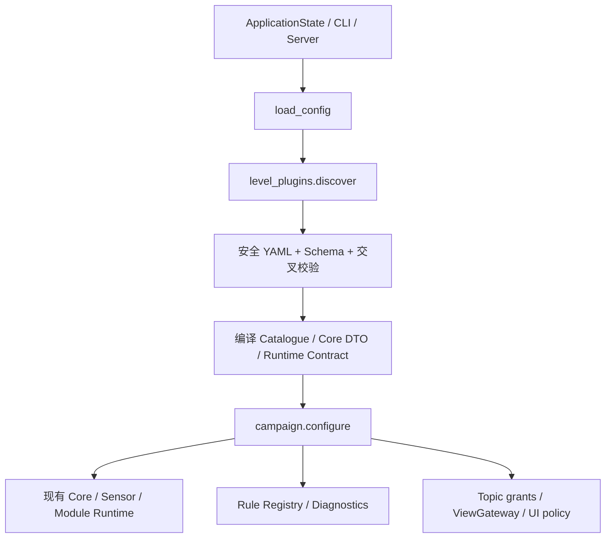

# 27 YAML 关卡插件：审计与迁移设计

## 范围与迁移前审计

仅重构当前五关，基线提交 `ba2b5f8`；不增加关卡、传感器、物理或评分玩法。基线快照在 `tests/fixtures/level-behavior-before.json`，由重构前的真实 Authority、Core、Radar、学习说明与 CampaignSession 生成。数据不是运行时配置源。

下表记录重构前基线。后续用户要求 Weapons 全章炮弹可见，当前 C1–C4 已通过 YAML 开放此显示权限，见 [ADR-0022 修订](adr/0022-campaign-capabilities-and-evaluation.md)。冻结夹具保留，回归仅明确允许 world_effects 这一项后续变更；其余原有行为继续对照。

| ID / 名称 | 目标与输入 | 控制、初态与权限 | 成功、失败与诊断 |
| --- | --- | --- | --- |
| c0 / 认识坦克与坐标 | 移动≥1m、转向≥0.5rad、命中一次；无 Radar | 玩家原点、零速度；可选差速/径向全向轮；手动驾驶/炮台速度/单发，系统自身位姿、地图及目标弹道真值 | 首次有效人工操作计时，60秒；无需估计；超时或主动结束 |
| c1 / 用 SE(3) 矩阵变换坐标 | 理想中心 Radar，返回 NumPy 4×4 SE(3)，框架实际做矩阵乘法 | 原点零态；静靶(-3,1.5,0)；禁驾驶、人工武器；公开自身位姿/地图，隐藏敌方真值及弹道 | 合法估计≥1、命中≥1；首次部署起60秒；结束后位置误差 |
| c2 / 噪声下跟踪 | 复用变换、状态类跟踪；Radar σr=.45m、σθ=.08rad、10%丢失 | 原点零态；差速巡逻敌车(-4.5,-2,0)，矩形路径；禁驾驶、人工武器；双方3HP | 存活击杀；首次部署起120秒；玩家死亡优先，最后预算tick击杀有效 |
| c3 / 让炮台自己瞄准 | 三模块坐标→跟踪→自瞄；输入仍为带噪敌车中心 | 同 c2 初态/巡逻/生命；程序角加速度及单发，禁止人工武器和驾驶；系统自身位姿仍公开 | 存活自动击杀；首次部署起120秒；不强制某种估计/控制算法 |
| c4 / 从底盘中心推算装甲瞄准点 | 三模块估计敌车 x/y/yaw、计算四面装甲点；中心 Radar 不给真实 yaw | 同 c3，敌车四侧中央0.24m有效装甲；非装甲吸弹/受力不扣血；玩家整车受击 | 存活装甲击杀；首次部署起180秒；原地转向 yaw 不可观，不设唯一 yaw 答案 |

五关使用相同现有墙体地图、60Hz/4子步、30Hz基础传感器、10Hz算法/Radar；C0靶标(-3,0,0)。玩家和敌车的运动、接触、反作用、弹道、自伤均由既有 Rust Core 处理。巡逻不主动瞄准或开火。Radar 每次新 run 使用现有 runtime seed 重建 Python Random，按目标稳定顺序先遮挡/量程/视场、再丢失/高斯误差；无地图随机化。详细数值以冻结基线及迁移后各 YAML 为准。

原有诊断为有效估计采样数、位置 RMSE、可用时的 yaw RMSE、物理命中数；仅结束后发布，无加权分数、星级或额外误差通关门槛。重复/倒退采样不计分。计时、手动结束、热部署不重置倒计时、末 tick 和同时死亡优先级必须保持。

## 原实现职责与问题

`campaign.configure` 已统一启动，但 `game.yaml` 同时混有关卡、Radar profile、lesson 和 graph profile；仅改文件仍无法新增可运行关卡。`campaign_templates` 生成/执行按 c0/c1/c2 分支；learning 另有按 ID 的文案和行为；前端按 ID 选文件、展示真值说明/进度。CLI choices、Schema 枚举及存档数字排序也固定了关卡集合。权限校验对 c0 特许，成功规则直接耦合 CampaignSession。

可复用部分：Rust 机器人/炮台/弹丸/墙体/巡逻与生命模型，Python Radar，Protocol/Validator、Pose Selector/ViewGateway，GraphExecution、Sandbox/Supervisor、Workspace CAS/非覆盖迁移、现有 UI 布局和管理 API。地图当前为中心/尺寸矩形墙体，无独立资产加载器。

## 目标设计与边界

每个 `levels/*.yaml` 包含 metadata、world、robots、communication、permissions、visualization、objectives、evaluation、randomization、tutorial 和 scaffolding。配置只能组合注册的现有组件，不能加载脚本/导入钩子；唯一文件资产引用为 assets 内地图。通用 Python 算法脚手架属于引擎组件，YAML 指定组件和教学说明，不能提供可执行插件代码。

统一流程为发现→受限安全解析→JSON Schema→引用/权限/组件校验→解析地图→编译现有 Core/Authority DTO→沿用启动生命周期。ID 只用于索引、存档、管理和随机观测标签，不能选择关卡行为。浏览器使用同样的已编译配置，构建/启动自动扫描，不手写注册列表。

规则注册仅包含当前需要的组合/比较及移动转角进度；指标注册保留现有位置/yaw RMSE 与命中/采样计数。Authority 执行输入输出 grant 与 View Policy；UI 在上限内应用初始显示和可切换状态，程序数据权限与显示权限独立。浏览器本地隔离不保证恶意用户无法检查客户端内部真值。

## 迁移计划与验收

先保留初态、组件参数、传感器序列、合同、教程、成功/死亡/超时/评分基线，再提取 YAML 和建立统一加载器。旧 API 可保留通用 DTO 适配，不保留隐藏的 ID 配置。玩家已有源码不覆盖，现有 Topic/Schema、关卡ID、存档版本与管理路由不变。新文件复用组件时无需改引擎。

验收包括五关完整回归、旧玩家代码、权限负例、切换/重试/资源回收、旧存档、严格错误路径、临时第六配置的零代码发现。未来机械臂、SLAM、多机器人教学组件为 Planned，不能以通用 Schema 冒充已支持。

## 已实现的逻辑架构与加载生命周期

物理及机器人实例仍由既有 Rust 工厂创建。Host 的 `core_configuration` 只向私有 IPC/WASM 传递物理需要的配置，防止教材目录使原有 64KiB 消息边界膨胀；协议和消息限额不变。浏览器启动器运行同一发现/编译器，经既有 `/authority-config.json` 交付生成的目录，Core Worker 使用同一 Authority；不需要浏览器读取任意文件、PyYAML 或手写五关列表。源码包构建仍用 `prepare_browser.py`；独立无启动器 Web 部署仍未实现。

`load_config` 发现/校验并加载目录，`configure(id)` 只按 ID 取数据；UI 选择、CLI 启动、原生和浏览器都走同一路径。新实例 ready 后替换旧 Authority，关闭旧 Runtime/Core 与候选；重试也建立新 run、清空观测/估计/计时/评分缓存。Workspace 源码保持，缺失文件按 ledger 非覆盖解锁。编辑/测试/部署时钟行为及主动结束保持原样，编辑器不暂停正式尝试；原 UI 没有独立暂停/恢复操作，本次未新增。

状态映射：文件尚未读取为 Unloaded；发现/编译成功为 Loaded；Core/Runtime 初始化成功为 Ready；Campaign 的 `active/preparing` 表示等待既有起算条件，`active/running` 表示正式计时；`passed/finished`、`ended/finished` 表示成功、失败或 aborted，原因保留原字段。退出和切关关闭进程/Worker，前端仍通过整页重新加载清理计时器、事件监听和插值缓存。

## 正式 Schema 与配置来源

源格式为 `schema_version: "1.0"`，正式结构在 [level.schema.json](schemas/level.schema.json)。应用配置版本为 1.9；`config/game.yaml` 只保留通用模型、平台、预算与插件目录/上限。`campaign`、lesson/profile 等旧形状现在是生成的内部兼容 DTO，不是第二套手工配置。Rust/Node 的 `default-profile.json` 也由 `export_profile.py` 从同一加载器生成，禁止手工编辑。

| YAML 字段 | 权威内容与限制 |
| --- | --- |
| metadata | 稳定 id、name、description、chapter、order、version、学习元信息与 prerequisites；ID 无数值解析规则 |
| world | 2D/map、现有 clock 参数、inline 矩形墙体或 assets 内地图；地图资产沿用 `{walls:[{center,size}]}` 形状 |
| robots | 一个 player 与一个任务 target；当前可复用 tank、static_tank_target、patrol_tank；实例初态、生命、控制源、传感器归属及既有巡逻/装甲参数 |
| communication.runtime | 单模块/图模式、Manifest、Contract、处理组件、预算与模板版本；默认入口只能来自注册的脚手架 Module |
| permissions.data_access | 以玩家程序为参照：inputs 可订阅、outputs 可发布的估计 Schema、actuators 可发布的执行器 Topic；缺省拒绝 |
| permissions.visualization | Authority View Policy、可显示图层上限；与程序订阅权限分别检查 |
| visualization | initial_enabled、user_toggleable、source；现有五关 preserve_user_settings=true 保留已有图层偏好，偏好不能越权 |
| objectives | 参数、可锁存移动/转角进度、组合成功条件、按数组顺序执行的终局条件、时限与起算 |
| evaluation | terminal_diagnostics 及位置/yaw RMSE 组件；无新增星级、加权分数或通关误差门槛 |
| randomization | 既有 Python Random 的 seed、新 run 重建策略；不增加地图随机化 |
| tutorial | 原文任务/提示、完整学习说明、默认文件、UI 说明与公共标定引用；数量/频率/噪声用公开占位符引用权威参数 |
| scaffolding | 注册的通用模板组件及文档字符串；不允许 YAML 提供可执行脚本或任意导入路径 |

通用机器人运动/物理、轮组、伺服、炮台和弹道模型继续使用 `game.yaml` 的既有引擎组件参数；五关没有独立动力学差异，不复制实现。玩家 `model: scene_selected` 保留原 CLI 底盘选择，也可用已有 differential/omnidirectional 类型；敌车依其既有 patrol 参数创建。独立每实例动力学模型、更多传感器、机械臂与多机器人教学需将来扩展引擎组件，不能宣称当前支持。

所有新配置先做大小/层级/节点限制与安全解析，拒绝 alias、重复键、危险 tag、非有限数；再执行 JSON Schema 与语义校验。后者包括 ID/顺序/前置引用、组件与模型、Topic 类型/冲突/绑定、合同依赖/预算、地图路径、可视化来源/上限、指标与生成源码大小。报错携带 File/Path/Reason，例如 `robots[0].sensors[0].update_hz`。资源限额在 `game.yaml: level_plugins.limits`，不是可由插件自行放大的值。

## 实际组件注册与接口

`level_plugins.SENSORS/ACTUATORS` 登记既有 canonical Topic/Schema/frame；新插件只能复用已支持的接口，不重命名旧频道。`level_templates.COMPONENTS` 登记通用多文件脚手架，文案由 YAML 安全写为字符串；只允许已登记默认 Module 类，不把 YAML 当代码加载器。现有多文件玩家源码依然由编辑→测试→部署执行，和插件数据属于不同信任域。

`level_rules.PROGRESS` 只有 displacement 和 heading_change；规则树支持 compare/all/any/not，操作符为 ==、!=、<、<=、>、>=。compare 读取已登记的事实 moved/turned/hits/estimates/target_alive/player_alive/objective_complete/elapsed_ticks，以及参数/limit_ticks，不 eval 表达式。`METRICS` 只有现用 position_rmse/yaw_rmse；重复采样过滤、计数与命中报告保持原样。

例如既有“存活、时限内击杀”由成功条件 `target_alive == false` 与终局数组表达：先 player_alive=false 失败；再 objective_complete=true 且 elapsed_ticks<=limit_ticks 成功；最后 elapsed_ticks>=limit_ticks 超时。C0/C1 的移动/转角/估计/命中检查通过同一规则树与锁存进度组合。

## 权限、默认显示与评分边界

程序只收到 data_access 允许的输入；Manifest 声明端口不授予权限，可选未授权端口保持无数据。测试快照也使用同一裁剪，不能从测试通道取得额外真值。系统自身位姿可被允许显示但禁止程序读取，也可允许程序读取而禁止显示，均有自动化验证。

编译器将 allowed_layers 与 View Policy 取交集，Authority/ViewGateway 裁剪对应地图、真实物体、局部观测和估计，消息查看器也不能获得被禁止图层的数据；UI 只列出 allowed_layers，初始显示和用户开关取交集。锁定开关不能由普通操作重新启用。来源是注册组件规定的数据源，不允许把机器人估计图层改接真值。开发者独立 grant 保留全量只读调试，关闭模式撤回；不改变玩家程序权限或通关奖励。

评分读取私有物理历史，独立于是否显示 UI、是否允许玩家读真值。正式提交的估计按采样 tick 评分，测试输出不计分；终局前不公布诊断，不把估计修正回物理状态。浏览器完整场景在客户端运行，权限是教学/接口边界，不能保证恶意客户端无法检查内部真值。

## 五关迁移结果与开放项

| Level | 原实现 | 唯一关卡源 | 状态 |
| --- | --- | --- | --- |
| C0 认识坦克与坐标 | game.yaml + 被动包装 + UI 真值分支 | [c0.yaml](../levels/c0.yaml) | 已迁移，基线及实际通关验证 |
| C1 用 SE(3) 矩阵变换坐标 | ideal Radar profile + 函数模板 + checklist | [c1.yaml](../levels/c1.yaml) | 已迁移，旧玩家矩阵 API 保留 |
| C2 噪声下跟踪 | noisy profile + Tracker 分支 + 击杀判断 | [c2.yaml](../levels/c2.yaml) | 已迁移，噪声、巡逻、生命和评分不变 |
| C3 让炮台自己瞄准 | graph profile + 角加速度控制授权 | [c3.yaml](../levels/c3.yaml) | 已迁移，三模块与自动武器不变 |
| C4 从底盘中心推算装甲瞄准点 | armor graph/profile + 敌车姿态/装甲组件 | [c4.yaml](../levels/c4.yaml) | 已迁移，中心观测和装甲判定不变 |

存档仍为原 v1 结构，五个 ID 保持；顺序来自 metadata.order，解锁来自 prerequisites，不从 ID 数字推断。已有源码和 userdata 目录不自动改写；原先带关卡判断的玩家包装作为用户代码兼容，新的引擎包装只读声明的 processing，不检查 ID。

剩余限制：当前组件只有已实现的五关能力、单玩家/单任务目标；其他 OS/浏览器、服务端强沙箱、独立静态 Web、未来组件均仍待验证/实现。源码与测试/部署会话规则继续遵守既有设计。完整证据见 [迁移验收](reports/LEVEL_PLUGINS_VALIDATION.md)，编写流程见 [levels/README](../levels/README.md)。
