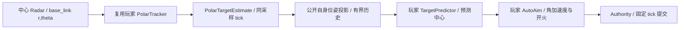
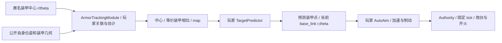

# 28 Weapons：极坐标滤波、中心自瞄与小陀螺装甲

## 目的、范围与状态

根据 2026-10-26 用户确认，保留 C0–C2 的玩法、观测、控制、目标和参数，重做 C3/C4，新增 C5。取代原 C3 自动瞄准、原 C4 仅凭中心运动推断朝向的课程安排；[26](26_MODULE_GRAPH_AND_WEAPONS_CHAPTER.md) 的调度、隔离与模块契约继续适用。初版决策见 [ADR-0035](adr/0035-progressive-weapons-estimation.md)；当前 C4 课程以 [ADR-0038](adr/0038-center-target-auto-aim.md) 为准，C5 观测以 [30](30_ARMOR_OBSERVATIONS.md) 为准，当前验收见 [报告](reports/CENTER_AUTO_AIM_VALIDATION.md)。

所有关卡仍由独立 `levels/*.yaml` 声明，不按 ID 在引擎中选择行为。新增的是可复用的传感器、适配器、模板及巡逻控制能力；不引入 ROS2、外部算法库或关卡脚本。当前正式关卡均不使用车头 GPS，通用组件保留兼容。

## 课程与控制权

| 关卡 | 主要输入 / 玩家输出 | 武器控制 | 目标与时限 |
| --- | --- | --- | --- |
| C0–C2 | 原接口、源码和行为保持 | 原权限 | 原规则 |
| C3 | 原始车体系 Radar `(r,theta)` → 车体系 `PolarTargetEstimate` | 人工炮台速度 / 单发 | 无装甲差速敌车，存活击杀；120 s |
| C4 | 复用 C3 的 `PolarTargetEstimate` → 中心预测 / 自瞄 | 仅玩家程序 | 同 C3 差速巡逻与整车扣血；120 s |
| C5 | 匿名可见装甲 `(r,theta)` → 中心/等价相位估计 → 预测 / 自瞄 | 仅玩家程序 | 全向小陀螺与有效装甲；180 s |

C1–C5 我方底盘零目标主动制动，保留后坐、受击及炮台反向力矩。系统自身位姿与地图继续授权。C2–C5 双方 3 HP，每次有效受击扣 1，原死亡/超时/最后 tick 顺序不变。C3–C5 从首次成功部署计时；运行阶段编辑器锁定，先结束或重试再改代码。原 C2 实时 RMSE 保持，C3–C5 的误差只在结束后公布。

## C3：输出极坐标，保留非线性问题

`PolarTracker.update(measurements_rt, own_pose, dt)` 接收 NumPy `(N,2)` 原始测量，每行 `[range_m,bearing_rad]`；当前 N 为 0 或 1，缺测是 `(0,2)`。`own_pose` 为公开的地图系 `[x,y,yaw]`，shape `(3,)`；dt 为仿真秒。框架不先把测量转成全局 x/y，不要求玩家输出地图坐标。

```python
import numpy as np
from numpy.typing import NDArray
from tankbot import PolarTargetEstimate

def update(measurements_rt: NDArray[np.float64], own_pose: NDArray[np.float64],
           dt: float) -> PolarTargetEstimate | None:
    # 返回当前我方车体系距离、方位；内部状态模型由玩家选择。
    raise NotImplementedError
```

推荐用笛卡尔运动状态、非线性观测模型 `h(x)=[hypot(dx,dy), atan2(dy,dx)-own_yaw]` 理解 EKF、Jacobian 与角度创新。**极坐标输入输出本身不会强制产生 EKF**；直接对 r/theta 建线性模型仍是另一种近似，教学不能把格式当算法证明。方位创新及输出归一到 `[-pi,pi)`。

输出为 `target_polar_estimate@1`，频道 `/robot/estimates/tracking/target_polar`，frame `base_link`；协方差为 `(2,2)` NumPy，顺序 r/theta，线上 row-major 4 元数组，允许 None。Authority 分层验证有限数、非负距离、角度、PSD、帧、采样时间和发布权限。

地图显示与终局评分使用**同采样时刻已经公开的自身位姿**投影估计；协方差按 Jacobian 旋转/缩放，不重新查询私有真值替玩家纠错。自身公开位姿历史按 `estimate_history_ticks` 有界；找不到对应时刻就不显示该估计。原始极坐标输出继续保留在模块 Topic 中，不回写物理世界。

投影标记还受 UI 自身位姿/map 显示授权约束；不能因程序能读系统位姿就自动扩大界面权限。隐藏该显示不影响内部终局评分。

## C4：复用 C3 滤波器，接管武器

本轮用户撤销车头 GPS/中心 Radar 两点融合。C4 与 C3 的地图、初态、差速巡逻动力学、Radar 参数、双方 HP、整车扣血与判定顺序完全相同，时限同为 120 仿真秒，从首次部署计时。没有 GPS 或装甲观测，无需估计敌车 yaw。底盘继续锁定；C4 由程序控制炮台角加速度和单发，不再允许键盘/手柄人工武器输入。



tracking 与 aiming 两模块通过原极坐标 Topic 连接；预测/控制在 aiming 内直接调用。通用适配器按目标采样 tick 匹配公开自身位姿，保存期限来自 `runtime.estimate_history_ticks`；找不到匹配位姿则传入无目标，不回退私有真值或最新位姿。`target_age_s` 是采样到控制提交的仿真秒数，包含跨模块与提交延迟。

C4 高亮三个文件，其中 `perception/polar_tracker.py` 可原样沿用 C3。另两个接口在 C4/C5 共用：

```python
import numpy as np
from numpy.typing import NDArray
from tankbot import AimInput, AimOutput

class TargetPredictor:
    def __init__(self, projectile_speed_mps: float, armor_mounts: NDArray[np.float64]) -> None:
        self.projectile_speed_mps: float = projectile_speed_mps
        self.armor_mounts: NDArray[np.float64] = armor_mounts

    def update(self, observation: AimInput, dt: float) -> NDArray[np.float64] | None:
        raise NotImplementedError

class AutoAim:
    def __init__(self, projectile_speed_mps: float, max_acceleration_radps2: float) -> None:
        self.max_acceleration_radps2: float = max_acceleration_radps2

    def update(self, observation: AimInput, dt: float) -> AimOutput:
        raise NotImplementedError
```

预测器收到地图系 `target_xy` 中心、当前公开 `own_pose`、目标年龄和当前车体系 `target_rt`；无估计时目标为空。C4 的 `target_yaw_rad=None`，构造参数 `armor_mounts` 为 shape=(0,3) NumPy 空矩阵。通过有界历史估计中心速度并补偿飞行时间，返回当前车体系 float64 shape=(2,) 的预测 `[r,theta]`，或 None 暂不瞄准/射击。框架不替玩家滤波、估计速度或计算提前量。

控制器的 `observation.target_rt` 已是预测点，结合连续炮台角、角速度、dt 和 weapon_ready 实现加速/制动与开火。返回 `AimOutput(acceleration_radps2: float, fire: bool)`；原 ±25 rad/s²、受限力矩、watchdog、冷却和幂等机制保持。没有预测点时不会发射。

GPS 消息、SDK 与注册组件保留兼容，但当前正式关卡不启用；旧 fusion_tracker.py 不再是本关入口，也不会被删除或覆盖。决策见 [ADR-0038](adr/0038-center-target-auto-aim.md)。

## C5：预测与炮台控制分文件

敌车复用四轮 90° 对称全向底盘。原矩形航点、0.6 m/s 平移目标、10 Hz 控制和零初态保留，新增 `spin_rate_radps: 3.0`；世界系平移目标每次控制更新转到车体系，交给同一受限力/力矩速度伺服。控制器不直接覆盖真实速度/朝向，实际速度可受阻力、碰撞和耦合影响。全向行进方向不等于车头方向。

后续用户确认的紧凑全向模型由 [29](29_CHASSIS_PROFILES.md) 统一管理：车体 0.42×0.42 m、装甲中心 ±0.21 m、车头 GPS (+0.21,0) m，质量/惯量/伺服不变。C4 差速模型仍用原几何并按整车扣血；C5 当前仅启用装甲观测，不使用 GPS；预测读取本关 `armor_mounts`。通用模型中的 GPS 安装点不代表关卡启用了该传感器。

开发者预览时，在「图层」中启用「真实目标」，即可看到敌车自身的四轮全向模型、车头标记和装甲随真实 yaw 连续旋转；玩家自身选择差速底盘不会改变敌车外观。该图层可自由开关，不受课程玩家的显示限制。普通玩家仍只看到本关授权的观测与自身算法估计，不会因开发者显示修复而获得敌车真值。

C5 后续按用户要求改为只观测最近两块可见装甲，不再使用中心 Radar/车头 GPS；完整模型、噪声与对称性规则见 [30](30_ARMOR_OBSERVATIONS.md)。



主要编辑文件：

- `weapons/target_prediction.py`：滤波、平移/旋转预测、装甲选择、飞行时间和发布时延；返回 float64 `(2,)` 当前我方车体系 `[r,theta]`，或 None。
- `weapons/auto_aim.py`：读取预测后的 `AimInput.target_rt`、炮台连续角/角速度及冷却，输出 `AimOutput`；可用 PD，也可选其他控制器。
- `perception/armor_tracker.py`：新增匿名装甲跟踪，输入当前帧 0/1/2 行观测，估计中心与模 90° 等价朝向；旧融合器保留；C4 中心预测器和控制器可复用。

`PredictiveAimingModule` 在同一次 update 内直接组合预测器与控制器。`AimInput.target_rt` 为新增只读计算属性；`with_target_polar` 用于生成控制输入副本。旧 `target_xy`、`own_pose` 和构造参数保持，已有控制器文件不被自动替换。没有预测点时传入无目标控制输入，框架不会开火。角加速度限幅、watchdog、双刚体耦合和幂等单发继续沿用既有 YAML。

控制器收到的 target_rt 已是预测瞄准点；迁移旧自瞄器时，把其中的滤波/提前量放到预测文件，避免再对该点重复预测。接口兼容不等于旧算法在新小陀螺任务中无需调整。

## 文件树、模板与兼容

F2 侧栏按目录显示 `├──` / `└──`，文件名高亮来自 YAML `tutorial.lesson.edit_files`，不是 UI 中的关卡分支。未声明时由 `lesson.functions` 推导，保持已有插件兼容。高亮表示本关主要编辑文件，不是唯一可编辑文件；自建文件、复用算法、未保存星号及当前选择保留。长文件名在侧栏内部横向滚动。

C3 脚手架版本 `3.0.0`，C4/C5 共用预测控制脚手架 `4.1.0`。C3 单个图模块、C4/C5 两个图模块同样遵守 Module Contract；图模式不再假定至少两个模块。切关比较模块与端口类型，需更新时使用既有预览/确认流程。旧 C1/C2、旧 `pose_tracker.py` / `armor_aim.py`、旧 `auto_aim.py` 和历史 revision 均保留；迁移不自动改算法签名/内容。旧关卡 ID 与已完成进度不删除，C5 按 prerequisites 依赖 C4。

## 取舍、验收与开放项

采用 C3→C4 复用滤波、接管武器，C4→C5 复用预测/控制、扩展装甲观测与旋转的顺序。撤销 GPS 教学避免同时增加多个主要难点；保留极坐标输出与既有 SDK。原始观测适配器按同期自身位姿/传感器 tick 去重，dt 按实际调用间隔计算；任意异步融合仍为未来扩展。

验收覆盖 C0–C3 配置不变、C4 与 C3 参数/噪声/判定一致、程序控制权限、有界同期位姿投影、旧源码/进度保留、C4/C5 自主闭环和原生/浏览器真实 Test/Deploy，见 [当前报告](reports/CENTER_AUTO_AIM_VALIDATION.md)。参考程序可达性不能替代玩家教学测试；多 seed 难度、其他 OS/浏览器和学习效果仍待验证。
