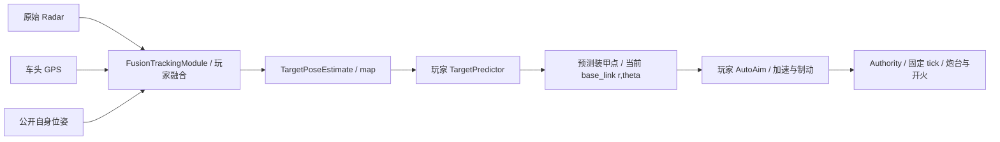

# 28 Weapons：极坐标滤波、GPS 融合与小陀螺自瞄

## 目的、范围与状态

根据 2026-10-26 用户确认，保留 C0–C2 的玩法、观测、控制、目标和参数，重做 C3/C4，新增 C5。取代原 C3 自动瞄准、原 C4 仅凭中心运动推断朝向的课程安排；[26](26_MODULE_GRAPH_AND_WEAPONS_CHAPTER.md) 的调度、隔离与模块契约继续适用。决策见 [ADR-0035](adr/0035-progressive-weapons-estimation.md)，实现与验收见 [报告](reports/WEAPONS_REDESIGN_VALIDATION.md)。

所有关卡仍由独立 `levels/*.yaml` 声明，不按 ID 在引擎中选择行为。新增的是可复用的传感器、适配器、模板及巡逻控制能力；不引入 ROS2、外部算法库或关卡脚本。GPS 在本游戏中指地图平面米制坐标，不实现经纬度/WGS84。

## 课程与控制权

| 关卡 | 主要输入 / 玩家输出 | 武器控制 | 目标与时限 |
| --- | --- | --- | --- |
| C0–C2 | 原接口、源码和行为保持 | 原权限 | 原规则 |
| C3 | 原始车体系 Radar `(r,theta)` → 车体系 `PolarTargetEstimate` | 人工炮台速度 / 单发 | 无装甲差速敌车，存活击杀；120 s |
| C4 | 中心 Radar + 地图系车头 GPS → 敌车中心 `TargetPoseEstimate` | 人工炮台速度 / 单发 | 四面中央有效装甲，差速敌车；180 s |
| C5 | 复用 C4 融合 → 预测装甲 `(r,theta)` → 炮台角加速度 / 单发 | 仅玩家程序 | 全向小陀螺与有效装甲；180 s |

C1–C5 我方底盘零目标主动制动，保留后坐、受击及炮台反向力矩。系统自身位姿与地图继续授权。C2–C5 双方 3 HP，每次有效受击扣 1，原死亡/超时/最后 tick 顺序不变。C3–C5 从首次成功部署计时；运行阶段编辑器锁定，先结束或重试再改代码。原 C2 实时 RMSE 保持，C3–C5 的误差只在结束后公布。

## C3：输出极坐标，保留非线性问题

`PolarTracker.update(measurements_rt, own_pose, dt)` 接收 NumPy `(N,2)` 原始测量，每行 `[range_m,bearing_rad]`；当前 N 为 0 或 1，缺测是 `(0,2)`。`own_pose` 为公开的地图系 `[x,y,yaw]`，shape `(3,)`；dt 为仿真秒。框架不先把测量转成全局 x/y，不要求玩家输出地图坐标。

```python
import numpy as np
from numpy.typing import NDArray
from tankbot import PolarTargetEstimate

def update(measurements_rt: NDArray[np.float64], own_pose: NDArray[np.float64],
           dt: float) -> PolarTargetEstimate | None:
    # 返回当前我方车体系距离、方位；内部状态模型由玩家选择。
    raise NotImplementedError
```

推荐用笛卡尔运动状态、非线性观测模型 `h(x)=[hypot(dx,dy), atan2(dy,dx)-own_yaw]` 理解 EKF、Jacobian 与角度创新。**极坐标输入输出本身不会强制产生 EKF**；直接对 r/theta 建线性模型仍是另一种近似，教学不能把格式当算法证明。方位创新及输出归一到 `[-pi,pi)`。

输出为 `target_polar_estimate@1`，频道 `/robot/estimates/tracking/target_polar`，frame `base_link`；协方差为 `(2,2)` NumPy，顺序 r/theta，线上 row-major 4 元数组，允许 None。Authority 分层验证有限数、非负距离、角度、PSD、帧、采样时间和发布权限。

地图显示与终局评分使用**同采样时刻已经公开的自身位姿**投影估计；协方差按 Jacobian 旋转/缩放，不重新查询私有真值替玩家纠错。自身公开位姿历史按 `estimate_history_ticks` 有界；找不到对应时刻就不显示该估计。原始极坐标输出继续保留在模块 Topic 中，不回写物理世界。

投影标记还受 UI 自身位姿/map 显示授权约束；不能因程序能读系统位姿就自动扩大界面权限。隐藏该显示不影响内部终局评分。

## C4：车头 GPS 与底盘中心的联合观测

GPS 安装在敌车底盘前侧中央 `[L/2,0]`，不增加质量或碰撞体。地图系车头点为 `center + R(yaw) @ mount`，因此不等于底盘中心。公开安装偏移、误差模型和装甲几何，不公开敌车 yaw、角速度、巡逻航点或实体 ID。

| 参数 | 确认基线 |
| --- | --- |
| 更新 | 10 Hz，零偏置 / 延迟 |
| 误差 | x/y 独立高斯 σ=0.15 m，每帧独立 10% 丢失 |
| 截获条件 | 我方中心到车头天线距离 ≤12 m，不受墙体遮挡 |
| 随机流 | run seed + YAML `random_stream`，与原 Radar 独立 |
| Radar | 原中心观测，σr=0.45 m、σtheta=0.08 rad、10% 丢失 |

`gps_fix@1` Topic `/robot/sensors/intercepted_gps`、frame `map` 的 payload 为 `{"positions_m":[[x,y]]}`，无本帧 fix 时 `{"positions_m":[]}`。SDK `GpsFixData.positions_m` 是只读 `(N,2)` NumPy 数组，当前至多一个点。不产生虚假目标；超距/死亡先过滤，再丢失、加噪。重试重建独立随机流，部署不重置世界或噪声序列；跨平台不承诺位级相等。

`FusionTracker.update(measurements_rt, gps_xy, own_pose, dt)` 输出地图系敌车底盘中心与 yaw 的 `TargetPoseEstimate`。构造时由框架提供 `gps_mount`、`radar_covariance`、`gps_covariance`。可复用 C3 类或自行联合估计；无需解析 JSON、安装依赖或配置进程。朝向来自两个不同安装点的观测关系，原地转向也有方向信息；丢失与噪声仍会降低精度。

GPS 程序订阅与 UI 显示分别授权。C4/C5 的观察层允许显示紫色 GPS 测量点，沿用 Radar 图层开关；它是带噪测量，不能画成真实装甲或真值轨迹。C3 未授予 GPS 输入。装甲宽度、首次表面接触、吸弹/冲量、非装甲不扣血规则沿用原模型。

## C5：预测与炮台控制分文件

敌车复用四轮 90° 对称全向底盘。原矩形航点、0.6 m/s 平移目标、10 Hz 控制和零初态保留，新增 `spin_rate_radps: 3.0`；世界系平移目标每次控制更新转到车体系，交给同一受限力/力矩速度伺服。控制器不直接覆盖真实速度/朝向，实际速度可受阻力、碰撞和耦合影响。全向行进方向不等于车头方向。

后续用户确认的紧凑全向模型由 [29](29_CHASSIS_PROFILES.md) 统一管理：车体 0.42×0.42 m、装甲中心 ±0.21 m、车头 GPS (+0.21,0) m，质量/惯量/伺服不变。C4 差速模型仍用原几何；C5 复用融合器时必须读取本关 `gps_mount/armor_mounts`，不能写死 C4 的 +0.4 m 偏移。

开发者预览时，在「图层」中启用「真实目标」，即可看到敌车自身的四轮全向模型、车头标记和装甲随真实 yaw 连续旋转；玩家自身选择差速底盘不会改变敌车外观。该图层可自由开关，不受课程玩家的显示限制。普通玩家仍只看到本关授权的观测与自身算法估计，不会因开发者显示修复而获得敌车真值。



主要编辑文件：

- `weapons/target_prediction.py`：滤波、平移/旋转预测、装甲选择、飞行时间和发布时延；返回 float64 `(2,)` 当前我方车体系 `[r,theta]`，或 None。
- `weapons/auto_aim.py`：读取预测后的 `AimInput.target_rt`、炮台连续角/角速度及冷却，输出 `AimOutput`；可用 PD，也可选其他控制器。
- `perception/fusion_tracker.py`：沿用 C4；可自行改进小陀螺的状态模型，不强制重写。

`PredictiveAimingModule` 在同一次 update 内直接组合预测器与控制器。`AimInput.target_rt` 为新增只读计算属性；`with_target_polar` 用于生成控制输入副本。旧 `target_xy`、`own_pose` 和构造参数保持，已有控制器文件不被自动替换。没有预测点时传入无目标控制输入，框架不会开火。角加速度限幅、watchdog、双刚体耦合和幂等单发继续沿用既有 YAML。

控制器收到的 target_rt 已是预测瞄准点；迁移旧自瞄器时，把其中的滤波/提前量放到预测文件，避免再对该点重复预测。接口兼容不等于旧算法在新小陀螺任务中无需调整。

## 文件树、模板与兼容

F2 侧栏按目录显示 `├──` / `└──`，文件名高亮来自 YAML `tutorial.lesson.edit_files`，不是 UI 中的关卡分支。未声明时由 `lesson.functions` 推导，保持已有插件兼容。高亮表示本关主要编辑文件，不是唯一可编辑文件；自建文件、复用算法、未保存星号及当前选择保留。长文件名在侧栏内部横向滚动。

新脚手架版本 `3.0.0`。C3/C4 单个图模块、C5 两个图模块同样遵守 Module Contract；图模式不再假定至少两个模块。切关比较模块与端口类型，需更新时使用既有预览/确认流程。旧 C1/C2、旧 `pose_tracker.py` / `armor_aim.py`、旧 `auto_aim.py` 和历史 revision 均保留；迁移不自动改算法签名/内容。旧关卡 ID 与已完成进度不删除，C5 按 prerequisites 依赖 C4。

## 取舍、验收与开放项

选择一个物理可解释的车头位置观测，补上原中心 Radar 的方向盲区；拒绝直接提供真实 yaw 或复用路径真值。保留 C3 极坐标输出，使控制接口贴近车体系；地图仅为授权投影。GPS 与 Radar 当前为同期 10 Hz/零延迟，适配器按采样 tick 去重并匹配同帧，dt 按实际处理间隔计算；异步外感知融合属于未来扩展，不冒充已实现。

验收覆盖 C0–C2 冻结基线、GPS 安装/范围/独立随机流、原地旋转可观测性、极坐标帧/协方差/权限、全向平移与自转、三个关卡闭环、源文件/进度保留、真实网页文件树与多文件部署。参考程序可达性不能替代玩家教学测试；多 seed 难度评估、其他 OS/浏览器和实际学习效果仍待后续验证。
