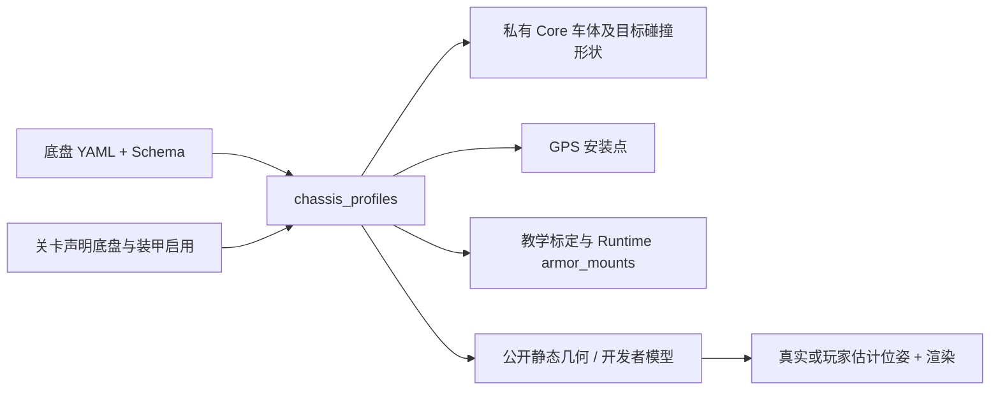

# 29 可复用底盘、装甲与切关容量

## 目的、范围与约束

底盘类型、车体几何、装甲安装与外观必须一致。解决 C5 全向车身较小但仍沿用差速装甲位置的问题；保留两种既有运动学、受限伺服、阻力、质量、独立惯量和权限边界，不增加轮组碰撞体或关卡脚本。用户已确认紧凑全向尺寸，决策见 [ADR-0036](adr/0036-shared-chassis-geometry.md)。

## 配置源与加载

应用配置版本为 `2.0`。`config/game.yaml` 的 `chassis_profiles` 显式引用 `config/chassis/differential.yaml`、`omnidirectional.yaml`。每个文件声明 `schema_version`、`chassis_type`、`body`、`armor`、`gps_mount_m`、`visual`。文件不能引用代码或其他配置；模型文件只允许在 `config/chassis/` 内，沿用有界安全 YAML 读取器，使用 [chassis-profile.schema.json](schemas/chassis-profile.schema.json) 验证。

| 配置 | 差速 | 四轮径向全向 |
| --- | --- | --- |
| 车体长×宽 | 0.8×0.6 m | 0.42×0.42 m |
| 圆角半径 | 0.08 m | 0.08 m |
| 装甲中心：前/后 | (±0.4,0) m | (±0.21,0) m |
| 装甲中心：左/右 | (0,±0.3) m | (0,±0.21) m |
| 装甲宽 | 0.24 m | 0.24 m |
| 车头 GPS | (+0.4,0) m | (+0.21,0) m |

`armor.mounts_m` 是四行 `[x_m,y_m,outward_yaw_rad]`，顺序前、后、左、右，角度为 0、−π、π/2、−π/2。结构校验之外还验证安装点位于真实直边、宽度避开圆角、GPS 位于前侧中央、外观类型合法。未知类型和错误字段拒绝加载，不静默使用另一底盘。

全向外观的装甲壳中心由真实安装面减去壳厚一半生成；源文件只保存壳尺寸，不再另存一组安装坐标。高亮有效装甲段使用 `armor.mounts_m`；因此变更模型时不会让装甲显示仍停留在旧车体外缘。

质量 20 kg、惯量 2 kg·m² 及通用伺服/轮组标定仍在 `game.yaml`。几何不再重复编辑在该文件或 UI 中；`rendering.chassis_models`、完整 `body` 和测试 JSON 是编译产物。旧无模型目录的 1.x 私有配置仍可使用原内联结构。

## 数据流与接口

关卡的 `armor: {source: chassis_profile}` 启用对应模型的装甲，不复制安装数值；未启用装甲的目标沿用整车扣血规则。旧内联 `layout/width_m` 仍接受。目标的 `motion.chassis` 选择通用模型，与关卡 ID 和章节无关。

`configure()` 和 Authority 按选择生成玩家 `body`；与玩家几何不同的敌车带独立可选 `TargetConfig.body`。Rust 使用该目标形状执行刚体接触和弹丸扫掠；装甲扣血以同一安装面上的真实首次接触点判定，非装甲仍吸弹并施加冲量。目标伺服使用该刚体的质量/惯量。

现有 `armor_mounts`、`gps_mount` Python 参数形状不变，数值来自当前目标模型。教学 `body_length_m/body_width_m` 指敌车几何。公开 `target_geometry` 只含静态车体、装甲和安装点；开发者 `target_visuals` 关联目标自身外观。普通算法/界面不会因此获得真实位置或 yaw。真实目标、估计轮廓与开发者碰撞外形均使用目标几何，不使用玩家尺寸兜底替代新模型。

## C0 切 C5 的工作区问题

原问题不是章节分支。C0 启动会打开另一个既有持久项目；该项目叠加 C5 文件后约 34 KiB，超过原 `workspace.max_source_bytes=32768`，非覆盖解锁拒绝，原场景因此保留。不能通过删除玩家文件解决。

现将源码预算改为 64 KiB，私有 Runtime/管理帧预算改为 256 KiB，均从 `game.yaml` 读取；仍保留明确限额和拒绝行为。切关失败时 UI 明确说明原因和当前仍在原场景。已有文件、历史 revision、关卡 ID 和存档不改写。更大项目、分块源码传输及多工作区管理仍属后续需求，不取消资源边界。

## 替代方案、风险与验收

只挪图层会使瞄准点与真实碰撞面不一致；放大外观可保留旧碰撞，却不符合本轮确认的紧凑几何。采用独立模型会增加一层受信配置编译；共享组件模型是对关卡自包含原则的明确修订，不允许关卡借此引用额外专用脚本/隐藏参数。

验收覆盖 Schema/错误路径、双底盘独立几何、实际四向装甲与非装甲命中、GPS/教学/Runtime 一致、较大 C0 项目跨关及历史保留、原生/WASM 等价、两种真实网页切关及撤权。当前单一圆角矩形仍是车体碰撞近似，未单独模拟伸出的全向轮组件；其他平台与新模型需要另行验证。
