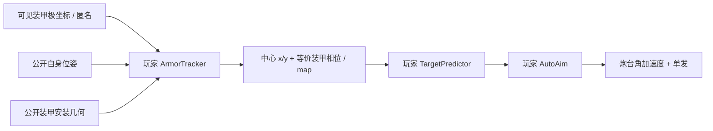

# 30 C5：匿名装甲观测与对称朝向

## 目的、范围与确认

C5 不再使用敌车中心 Radar 与车头 GPS。根据用户逐项确认，只提供最近两块可见装甲中心在我方车体系的距离/方位，玩家完成关联、状态估计、预测与自瞄。该轮仅修改 C5；后续 [ADR-0038](adr/0038-center-target-auto-aim.md) 将 C4 改为沿用 C3 观测的中心自瞄，作为本关的控制基础。C5 的全向小陀螺、紧凑车体、装甲受击、双方 HP、程序武器控制和 180 s 时限保持；模型与底盘见 [29](29_CHASSIS_PROFILES.md)，决策见 [ADR-0037](adr/0037-anonymous-armor-observations.md)。

## 传感器、可见性与随机流

关卡通过通用 `armor_detector` 组件声明传感器，不按关卡 ID 选择行为。唯一可编辑源为 `levels/c5.yaml`：

| 参数 | 确认基线 |
| --- | --- |
| 安装 / 帧 | 我方质心、零安装角，`base_link` |
| 更新 / 范围 | 10 Hz、360°、12 m |
| 数据 | 当前帧 0/1/2 行，无目标或装甲身份 |
| 误差 | 每块独立高斯 σr=0.03 m、σθ=0.005 rad |
| 丢失 | 每块独立 10%，不补齐 |
| 时间 | 零偏置、零延迟；沿用固定 tick 采样 |
| 随机 | run seed + 独立 YAML random_stream，新 run 重建 |

Authority 由真实目标姿态及公开安装几何生成候选装甲中心；先检查目标存活、每块装甲量程、朝向和墙体遮挡，再选真实距离最近的两块，之后逐块丢失并加噪。圆角矩形为凸体，位于侧面中央的装甲仅在外法线指向观察者时可见；法线与装甲到传感器方向点积必须大于零，切向不算可见。墙体相切按既有线段/AABB 规则遮挡。

有效回波按加噪前距离排列；现有数值容差内等距时按无噪方位排序，不能用物理装甲编号打破平局。观测距离噪声越界截为 0，方位归一到 [-π,π)。不产生虚假装甲、不返回遮挡点、不用第三块填补丢失的前两块。相同配置、种子和输入可复现；不承诺跨硬件位级一致。

## 消息、SDK 与权限

Topic 为 `/robot/sensors/armor_detections`，schema 为 `armor_detections@1`，frame 为 `base_link`。使用既有 Envelope、时间和发布权限；新增的是类型，不改变已有消息。完整消息见 [样例](examples/armor-detections-message.json)，payload 示例：

```json
{
  "measurements_rt": [
    [4.10, 0.20],
    [4.25, 0.25]
  ]
}
```

SDK `ArmorDetections.measurements_rt` 是只读 float64 NumPy 数组，shape=(N,2)，每行 [range_m,bearing_rad]，单位 m/rad。无观测在线上为 []、SDK 为 shape=(0,2)；一块为 (1,2)。数组只保存当前帧，不追加历史；不保证带噪 r0≤r1，行号不表示固定装甲。

C5 的 runtime grants 和 View Policy 只声明新装甲 Topic，不再授权中心 Radar 或 GPS；这两种观测也不再生成。玩家仍可读取已授权的自身位姿、炮台与武器状态。局部传感器面板显示实际 0/1/2 条测量及数值，图层名称为“装甲观测”；普通地图不会替玩家反算敌车中心。开发者可以在独立 grant 下叠加测量与真值，不改变玩家 Runtime 输入。

## 估计、预测与评价



新增玩家文件 `perception/armor_tracker.py`，主要接口：

```python
import numpy as np
from numpy.typing import NDArray
from tankbot import TargetPoseEstimate

def update(measurements_rt: NDArray[np.float64], own_pose: NDArray[np.float64],
           dt: float) -> TargetPoseEstimate | None:
    ...
```

类构造参数为 `armor_mounts: (4,3)` 和 `measurement_covariance: (2,2)`。安装行是敌车局部 [x,y,外法线yaw]，不是传感器给出的身份标签。返回仍为地图系敌车中心的 TargetPoseEstimate，以兼容现有预测与控制 API；None 表示没有合法估计。只看见一块时可用历史预测，不要求猜出唯一新姿态。

四块同形装甲呈 90° 对称，yaw 与 yaw+kπ/2 对应同一装甲点集。匿名观测不能区分真实车头，不应把该问题伪装为绝对航向估计。连续跟踪可以选择任意等价分支；角速度估计、创新与预测需按 π/2 展开或关联，防止换板/绕回造成假跳变。两个相邻装甲中心的平均值也不是车体中心。

评价保持位置 RMSE，C5 yaw_rmse 的 YAML 显式配置 `period_rad=π/2`：误差为 wrap(estimated_yaw−truth_yaw, π/2)。加载器检查该周期保持公开装甲几何不变；C4 仅估计极坐标中心，不要求 yaw，朝向诊断为空。误差仍仅在结束后显示，存活击杀是通关条件，不增加唯一算法或误差门槛。

## 模板升级与兼容

当前 C4/C5 共用预测/控制脚手架 4.1.0，C3 保持 3.0.0。新管理适配器为 `robot_modules/armor_observations.py`，Module Contract 将 tracking 输入由 radar/gps 改为 armor。F2 高亮 armor_tracker.py、target_prediction.py、auto_aim.py 三个文件，并提供完整签名、矩阵形状、帧、空值与相位说明。

解锁只补缺失文件；C4 的 polar_tracker.py、控制器、预测器及旧 fusion_tracker.py 和全部历史 revision 保留。采用管理脚手架仍需预览确认，不替换玩家算法。中心预测器需要扩展旋转装甲选择，控制器可直接复用；预测器必须处理本关模 90° 相位。改版后需重新 Test/Deploy，旧测试报告不适用于新 Contract/传感器环境。

## 取舍、开放项与验收

采用匿名装甲测量使自瞄问题直接围绕可击中点；较小观测误差与原中心 Radar 不同，是本轮明确确认的传感器模型。保留数据关联和缺测，而不靠稳定编号绕过难点。真实车头不可观测是已知对称性，不以隐藏 ID 或评分惩罚解决。

多敌车关联、图像/PnP、异步外感知融合、杂波/虚假检测、非对称装甲与其他平台仍为后续需求。本轮只实现既有单目标 C5 所需能力。验收覆盖几何/帧/可见性/噪声/排序、匿名对称、Schema/SDK/权限、无损升级、数值自瞄闭环及原生/浏览器实际 Test/Deploy，见 [报告](reports/ARMOR_OBSERVATIONS_VALIDATION.md)。
