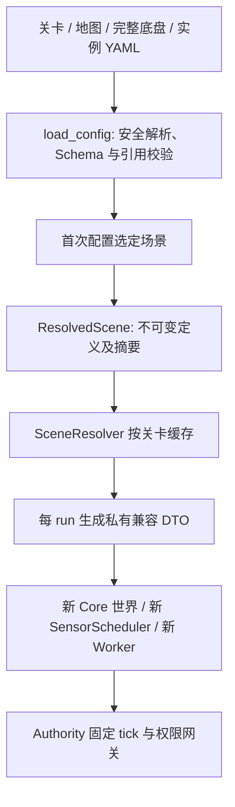

# 32 完整底盘、传感器实例与已解析场景

## 目的与范围

本轮重构配置归属、装配和生命周期，保留既有运动方程、传感器观测、消息、课程和玩家源码。世界时钟与求解器仍属于仿真，轮组仍为理想滚动观测，不新增轮地接触或噪声模型。决策见 [ADR-0043](adr/0043-resolved-simulator-components.md)。

## 配置与责任

| 来源 | 职责 |
| --- | --- |
| config/chassis/*.yaml | 完整底盘 profile 2.0：body 含质量/惯量，servo、drive 黏性阻力、motion_limits、controller、wheels、armor/GPS 安装及 visual |
| config/game.yaml | 应用 2.1：时钟、求解器、世界接触、武器、预算、平台、模型引用及自由试验场传感器实例 |
| levels/*.yaml | 地图/初态/敌车策略、传感器实例、权限、规则、课程与模块组合 |
| scene_definition.py | 引用解析后的不可变 World/Robot/Chassis/Sensor 定义、配置验证与场景缓存 |
| sensor_instances.py | 实例规范化、类型/归属校验、统一采样入口与每 run 的随机/去重状态 |
| Core / Authority | 根据每次运行的私有适配数据创建世界，推进既有物理、传感器计算、权限与调度 |

正式资产不在 game.yaml 重复保存底盘参数。`body/servo/chassis/wheels/controller/motion_limits/rendering.chassis_models` 等旧形状为生成 DTO，供既有 Core、SDK 和工具读取；不得手工编辑生成夹具。模型选择变化时编译对应参数；敌车的 body、servo 和 motion_limits 使用自身模型，差异通过可选私有字段传给 Core，不借用玩家模型。敌车全向轮显示标定也使用自身轮径。

差速 wheels 声明 radius_m、track_m；径向全向 wheels 声明 radius_m、geometry_version、center_radius_m 和四轮安装方位。只接受已实现的两类布局，未新增底盘物理。世界接触摩擦、恢复系数与引擎求解设置不属于轮电机模型；炮台/弹丸参数继续独立。

## 传感器实例接口

每个正式实例在 YAML 中显式声明下列字段；输出接口沿用 topic/schema/frame_id，不新增消息 Envelope。

```yaml
id: radar
robot_id: player
type: radar
mount:
  parent_frame: base_link
  translation_m: [0.0, 0.0]
  yaw_rad: 0.0
period_ticks: 6
random_stream:
  id: radar
  seed_mode: legacy_seed
topic: /robot/sensors/radar
schema: radar@1
frame_id: radar_link
```

参数仍由 parameters 声明，例如 Radar 量程/视场/误差。实例 mount 是安装信息的源，period_ticks 是采样周期的源；兼容后端所需 mount_m/yaw_rad/update_hz 在规范化时生成，若旧字段同时存在且矛盾则拒绝。原生理想观测没有随机性，random_stream 显式为 null。

解析得到冻结的 SensorInstance：id、robot_id、type、backend、Mount2D、period_ticks、RandomStream、topic/schema/frame_id、publisher_id 和 parameters_json。backend 由受信组件注册表确定；YAML 不能导入代码或选择任意执行后端。

ID/输出 Topic 必须唯一、owner 必须存在且与容器一致，随机流不能重复。当前仍仅支持玩家的既有传感器与 canonical Topic；重复类型/多机器人传感器、非质心安装不是已实现能力。Rust 基础观测周期须等于 clock.sensor_hz，Python 周期须整除既有基础采样边界。非法频率、安装或接口在 Core 创建之前拒绝，不静默忽略参数。

## 生命周期、时间与随机流

SensorScheduler 是 Authority 唯一采样入口：创建后端适配器 → reset → sample(private,tick) → close。每个 run 创建新实例，管理器不把真值引用交给玩家。Rust 后端从 Core 当期采样结果提取；Python 后端调用相同测量方程的 measure。旧 sample 方法只作为独立测试/工具的兼容外壳；Authority 不再逐个调用它们。

sample 按整数 period_ticks 在既有 S_n 边界采样，重复 tick 不重复输出，倒退时间需要显式 reset，close 后拒绝继续使用。不存在当期 Rust 样本时不会伪造新测量。IMU 积分窗口仍由 Core 管理，调度器不能把旧样本重标为新时间。固定提交门、计算延迟、失效策略和显示频率沿用 [07](07_SIMULATION_DESIGN.md)。

每个 Python 实例持有独立 RNG。为保持既有序列，Radar 使用明确的 legacy_seed：Random(seed)；装甲/GPS 使用 named：Random(f"{seed}:{stream_id}")。新增命名流不消耗其他实例 RNG。reset 重置 RNG/去重，不声称能单独回滚物理世界；新 run 或世界重建须同步重建传感器。并行顺序与跨平台确定性限制保持原规定。

## 已解析场景与重试



ResolvedScene 包含 definition_id、level_id、ResolvedWorld、ResolvedRobot、ResolvedChassis、SensorInstance 元组，以及只读序列化配置。嵌套集合为 tuple/不可变字符串；to_config 每次返回独立字典，外部修改不能改变定义。

Authority 可直接接受 ResolvedScene；旧调用方传 dict 时先走同一 resolver。原生 LocalServer 和 BrowserServer 都持有 SceneResolver：首次选关解析并缓存，重试命中同一对象；源资产改变需重新 load/新建 resolver 才生效。浏览器启动器保留定义并发送每次运行 DTO，页面内 Authority 在自己的内存中建立同等定义，不试图跨进程共享 Python 对象。

每次实例化仍创建新的 run_id、物理世界、传感器/RNG、序号缓存、算法 Worker、评分与部署状态；Workspace 按原非覆盖策略保留。map_override 是本进程选项，参与定义摘要并贯穿切关/重试；练习不计正式成绩，见 [31](31_MAP_OVERRIDE_AND_PREVIEW.md)。实例化不重新读地图或底盘文件；变更预算/模型/地图后应重载定义，不修改运行中的冻结对象。

## 兼容、替代方案与开放项

旧几何 profile 1.0 和内联 DTO 通过显式适配继续读取，完整与旧几何 profile 不允许混用。旧 update_hz 和中心安装字段可在载入时规范化；正式源已全部迁移。控制 Topic、Schema、SDK Python 签名和模板版本不变，升级不改写玩家文件或历史。

逐模块建立新配置来源会继续漂移；把所有传感器搬进 Rust 会扩大模型变更；直接缓存可变 Authority/字典会串用状态。当前选择不可变定义加每 run 适配，保留现有后端，代价是仍需一个内部 DTO 转换层和有限配置复制；没有宣称完全消除复制成本。

开放项：真正的多机器人/同类多实例命名、非零安装、异频 IMU 窗口、轮电机模型和动态模型热替换，均需独立协议/物理讨论，本轮不实现。

## 验收

保存重构前六关×两底盘的 180 tick 轨迹摘要，见 tests/fixtures/simulator-before.json；测试使用固定输入，不把测试向量当游戏默认参数。覆盖物理状态、旧/新传感器序列一致、不同模型实际受力独立、定义不可变、重复引用/周期错误在 Core 前失败、reset/close、同定义不同 run 无串用、课程/工作区和进度回归。完整结果见 [验收报告](reports/SIMULATOR_REFACTOR_VALIDATION.md)：201 项 Python、18 项 Rust、原生/WASM 对比及两种真实网页 C3–C5 通关均通过。

## Navigation 增量说明

后续 Navigation 首关已在相同 ResolvedScene/实例架构下增加可选轮电机组件；明确选择 wheel_voltage 时启用，旧六关仍使用原伺服。轮参数集中在完整差速模型，不变更世界求解器。此项属于本篇原重构后的独立功能开发，详见 [33](33_NAVIGATION_MOTION_CONTROL.md)。

Navigation C2 又增加中心自GPS和带误差编码器，仍通过同一 SensorInstance/SensorScheduler 生命周期。wheel_encoder 无 parameters 时保留 Rust 理想后端；声明误差时 Python 后端仅在受信侧改变测量值，不改变物理。GPS与编码器使用各自命名随机流，所有消费模块共享采样结果；GPS为2 Hz，具体误差、缓存、角度积分约定和权限见 [35](35_NAVIGATION_GPS_LOCALIZATION.md)。

## ResolvedPath增量

ResolvedScene可选path_reference保存不可变ResolvedPath(identity, definition_json)。解引用/校验地图、底盘及初态之后、创建物理世界之前完成有界生成；私有兼容DTO通过navigation_path携带已冻结结果。浏览器验证输入摘要、完整参考摘要、线段安全、指标与检查点，不重新采样路径。canonical摘要允许JSON往返对0.0/0的表示规范化，不量化物理坐标。

SceneResolver对相同关卡定义复用路径，重试新建世界；configure切换关卡清除上一关静态参考及接触观测开关，避免状态污染。路径参数来自本关YAML，无预存答案或按ID选择的生成分支；详见 [40](40_NAVIGATION_CONTINUOUS_PATH_TRACKING.md)。
