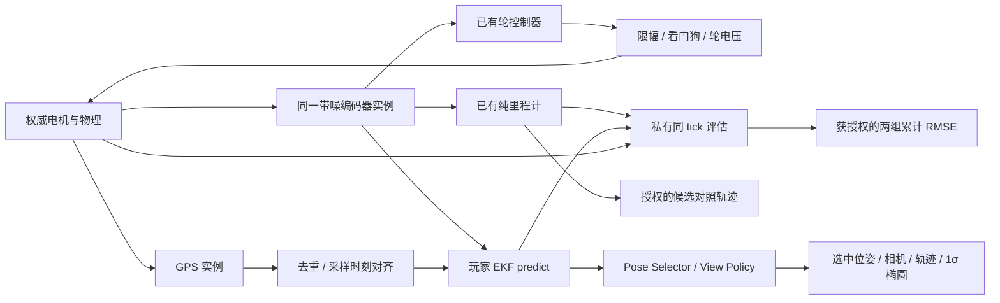

# 35 Navigation C2：GPS 与 EKF 定位

## 目的、范围与确认

用户逐项确认传感器模型、函数接口、课程阈值与显示方案。新增 [navigation.C2.yaml](../levels/navigation.C2.yaml)，稳定 ID `navigation.c2`，在 C1 后解锁。本关复用 [C0 控制器](33_NAVIGATION_MOTION_CONTROL.md) 和 [C1 里程计](34_NAVIGATION_ODOMETRY_AND_FEEDBACK.md)，不包含武器、IMU、打滑或新运动模型。[ADR-0048](adr/0048-navigation-gps-localization.md) 已 Accepted；真实原生/浏览器结果及平台边界见 [验收报告](reports/NAVIGATION_GPS_LOCALIZATION_VALIDATION.md)。

问题是“轮式里程计累积漂移，低频 GPS 本身又抖动”，而不是强制提交某一种滤波公式。玩家维护自己的状态和协方差；框架处理文件、消息、时间对齐与发布。所有课程/模型参数均来自 YAML；参考解只用于测试，不写入玩家工程。

## 数据流与边界



Core 继续只消费合法轮电压，估计绝不修改物理。真实位姿及编码器真实增益不进入 Runtime；控制、纯里程计和 EKF 获得同一消息，不能给控制器隐藏的理想反馈。默认车体/相机跟随 ekf，没有合法估计时隐藏全局车体，不回退真值。开发者真值保持独立权限、独立通道及显式图层。

## 传感器与随机流

| 实例 | 确认参数 | 输出 |
|---|---|---|
| wheel_encoder | 质心对齐，30 Hz；每轮独立速率噪声 σ=0.20 rad/s；每次尝试独立采样固定 gain_error∼uniform[−0.03,+0.03] | 既有 joint_state@1，左右轮角/轮速均含同一误差模型 |
| gps | 质心对齐，map 系，2 Hz；独立 x/y 高斯 σ=0.20 m；零偏置/延迟/丢失，无墙体遮挡，不测 yaw | /robot/sensors/gps/fix，position_fix2d@1 |

两个 Python 计算后端复用 SensorScheduler 的 reset/sample/close 与独立命名随机流 navigation-encoder / navigation-gps；seed=0，同配置/输入重试重现，增加 GPS 不改变编码器流。旧关卡无误差参数时仍使用原 Rust 理想编码器，物理和旧观测不变。

轮速 ω̃ᵢ=(1+gᵢ)ωᵢ+εᵢ；累计轮角 φ̃ᵢ=(1+gᵢ)φᵢ+Σ εᵢΔtᵢ。首样本 Δt=0，后续把本次速率噪声积分在前一采样间隔；这是一致的离散误差约定，不声称加速时的瞬时轮速等于累计轮角的精确差分。传感器只保留噪声积分、增益和最新缓存，不积累无界历史。

GPS 的 position_m 是只读 float64 NumPy (2,)，covariance 是只读 (2,2)；线上协方差按行优先四元素编码，分别为 m / m²。类型为 PositionFix2D，见 [消息样例](examples/position-fix2d-message.json)。它是投影到游戏平面的米制定位，不假装完整 NavSatFix。既有敌车 gps_fix@1 / GpsFixData / intercepted_gps 保持兼容。

## 玩家合同与脚手架

新增持久算法文件 localization/ekf.py：

```python
class EkfLocalization:
    def __init__(
        self,
        model: DifferentialDriveParameters,
        initial_pose: NDArray[np.float64],
        initial_covariance: NDArray[np.float64],
        wheel_rate_covariance: NDArray[np.float64],
        gain_error_bounds: NDArray[np.float64],
    ) -> None: ...

    def predict(self, wheel_rates_radps: NDArray[np.float64], dt: float) -> None: ...

    def correct(
        self,
        position_m: NDArray[np.float64],
        measurement_covariance: NDArray[np.float64],
    ) -> None: ...
```

self.state 为可写 float64 (3,) [x,y,yaw]；self.covariance 为可写 (3,3)、顺序相同、有限且对称半正定。框架复制一次公开初态，初始 P=0 表示起点已知；噪声先验是 (2,2) 的轮速协方差与 (2,) 的增益误差边界，均只读，不含真实增益。内部可增广状态，但公开输出保持三维位姿与对应边缘协方差。两个函数均返回 None。

系统文件 localization/ekf_module.py 负责构造、取左右轮名、重复样本跳过、GPS 去重、类型/形状/有限性检查、yaw 归一化，发布 /robot/estimates/ekf/pose。SDK/Router 检查协方差形状、对称与 PSD；失败使用现有 Python traceback 或明确的 INVALID_COVARIANCE，不会替玩家修复错误矩阵。C2 默认 graph 包含 wheel_control、odometry、ekf，周期均为6 tick、deadline6 tick，预算分别为8/4/8 ms，总预算仍为20 ms。

Navigation 使用原独立工作区。进入 C2 只补缺失文件；已有控制器、里程计、EKF、其他文件与历史 revision 不覆盖。受管 graph 从 C1 的两个模块变为三个，走已有预览/显式应用，只更新系统适配器、合同和 manifest。返回 C1 同样检查受管工程声明，保留算法。自定义高级项目仍使用通用 graph 校验，不按关卡 ID 分支。

## 教学公式与时序

F2 给出每个变量的类型、维度、单位、完整函数签名与常见错误，并说明：

- 差速 v=r(ωL+ωR)/2、w=r(ωR−ωL)/B；可采用中点 d=v dt、a=w dt、h=yaw+a/2，非线性均值 f=[x+d cos h,y+d sin h,yaw+a]。
- 协方差 P⁻=F P Fᵀ+G Qω Gᵀ+Qmodel；F=∂f/∂state、G=∂f/∂wheels。均值必须使用非线性 f，不能把 F 乘状态当预测。
- GPS H=[[1,0,0],[0,1,0]]；创新 z−H state、S=H P⁻ Hᵀ+R、K=P⁻ Hᵀ S⁻¹、Joseph 更新。推荐线性求解与保持协方差对称。
- 固定增益引入相关漂移，不能只当独立白噪声；允许玩家选择有效过程噪声或增广模型，不提供唯一调参答案。

60 Hz/4子步物理、30 Hz编码器、10 Hz算法、2 Hz GPS、6 tick固定提交。每次预测只处理最新轮样本，dt 是本次与上次已处理样本的仿真时间差；不是渲染帧时间，也不声称积分了全部30 Hz数据。GPS 采样边界与预测边界对齐；只在新 GPS 的 tick 等于当前轮样本 tick 时调用 correct 一次，缓存不会重复收缩 P。

加载器验证受管 EKF 周期与两种传感器对齐。漏调用、重部署或自定义 graph 导致不对齐时，适配器跳过并打印采样 tick，不偷偷用当前状态吸收旧观测。本轮不实现通用乱序重放/插值滤波。部署 reset 只获得最初公开初态，不获得部署时真值；重部署不重置正式计时，正常调试流程仍为结束→编辑→测试→部署。

## 验收、显示与权限

复用空旷地图及四次“0.5 m/s直行4秒→π/4 rad/s原地左转2秒”，从首个正式控制提交起算24仿真秒。最后段结束立即结算、冻结，不等待尚未提交批次。成功必须同时满足实际路程≥7.2 m、EKF全程位置RMSE≤0.15 m、最短弧朝向RMSE≤0.15 rad、有效估计≥100次；取消回原点距离门槛，避免将带噪反馈的控制偏差算作定位失败。运行故障优先，之后成功、估计失败、超时；主动结束/重试沿用原功能。

`evaluation.source: player_pose` 配合固定 `module_id: ekf`，独立 `reference_module_id: odometry`；Authority 用有界私有真值历史按输出采样 tick 评分。显示选源不改变评分，基线不参与通关，重复/旧/无对应真值/非 map 样本不计数。两者共享同一测量，不用真值修正玩家输出。

view_snapshot@5 在 V4 基础上增加授权 pose_estimates 列表。View Policy 的 pose_estimate_channels 只列本部署声明的玩家候选；Gateway 检查来源白名单、允许帧和样本年龄。pose_estimates 图层权限决定 Authority 是否投影，UI 开关只改变呈现。旧关卡继续用 V4，不必升级旧消息结构。

独立可切换图层 gps / pose_estimates / pose_covariance 的数据源分别是授权测量、授权玩家候选与选中位姿协方差。保留最多100个GPS点、各900个估计路径点，插值使用同一授权快照时钟；位置P采用凸插值，不改算法结果。椭圆半轴为位置协方差特征值平方根，这是主轴1σ，不是二维联合68%置信区域。默认绿色EKF、蓝色纯里程计、黄色GPS。

两组RMSE每项都需 allowed_metrics；live_feedback 的 reference_metric/reference_label/reference_color 声明对照，两条线共用坐标轴，各自计有效样本。缺测显示“—”，不把零样本当零误差。新增图层在旧设置文件中按false补齐到内存，不重写已有设置/进度；关卡默认显示声明不受旧开关缺失影响。

## 取舍、限制与开放问题

仅轮速+GPS有利于集中解释基础EKF；加入IMU、异步延迟、打滑或多径会扩大本关难点，本轮未实现。参考解使用有效Q近似固定增益漂移，不代表唯一正确误差建模；无需逐个随机种子都优于纯里程计每一项，只按公开绝对阈值评分。参考结果只对当前配置、种子和已测平台成立，不承诺跨硬件位级相同。

后续IMU融合、增广参数估计、地图定位及路径跟踪仍待独立课程设计。浏览器本地运行只提供教学/接口隔离，强服务端安全沙箱仍按原运行时路线图推进。验收包括传感器重现、共享输入、GPS去重/对齐、数值拒绝、固定评分、权限投影、保存升级、重试，以及真实原生/浏览器编辑测试部署。
