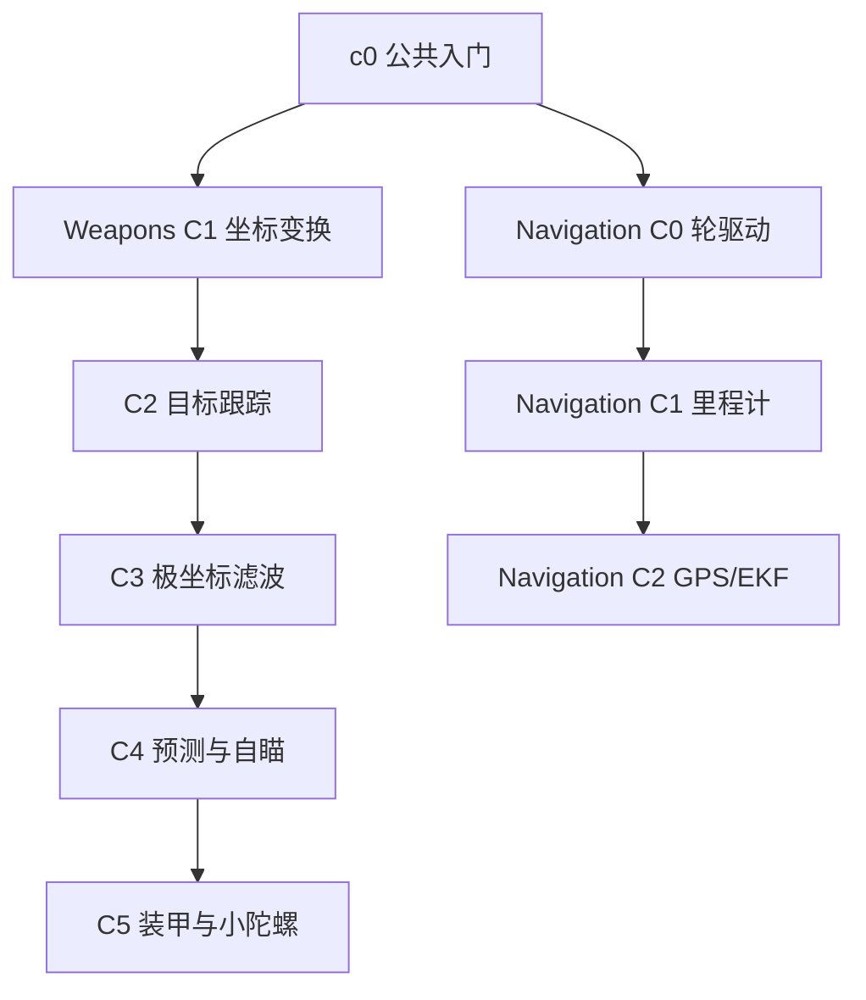

# 36 公共入门与双主线关卡树

## 目的、范围与要求

让玩家任选目标感知/自瞄或底盘/自身定位主线，保留各自主线真实的知识和代码依赖。本轮只修改九关的进度与选择界面，不增加关卡或调整仿真、传感器、预算、评分与算法合同。用户已确认依赖，实施状态见 [ADR-0049](adr/0049-branching-course-progression.md)。

实线均为必须通关的前置。公共入口保留Hello Robot章节与c0存储身份；Weapons和Navigation原章节ID、文件名及metadata.order不变。跨主线建议只进入现有关卡tutorial.hints，不影响解锁，也不复制算法。

## 单一规则与存档

metadata.prerequisites数组表示全部前置完成。ApplicationState统一判断CLI、选关API、浏览器启动ticket和正式完成存档；开发者保留自由练习，地图覆盖练习不奖进度。完成不等于部署、测试Ready或主动结束。锁定提示列出缺少前置的名称和稳定ID。

沿用version=1、completed_levels、current_level与completions。完成集合无需是全局前缀，[c0,navigation.c0,navigation.c1]合法；完成项仍按原目录顺序写出，读取不排序重写，旧顺序与当前关卡保留。目录只校验已知前置和无环，不从order产生权限。正式Schema仅约束ID格式，已知ID、前置闭包、稳定序列化顺序及记录一致性由领域层验证。

## 目录与界面合同

公共catalogue/profile在既有level_id/title/problem/chapter_id之外返回prerequisites、order、description，来自同一YAML。UI以服务器unlocked_levels为状态依据；目录前置用于连线和具体缺失说明，不是额外授权规则。

公共入口置顶，其余按章节分列；节点与所有实线从目录生成，不写死九关关系。节点展示已通关、可挑战、锁定及独立的当前标记。锁定节点可以查看任务/前置，但开始按钮不可用；服务端仍验证请求。通关列出本次新开放的所有节点，允许任选或重玩，不强制自动进入下一关。

选择器使用固定视口弹窗、独立图内/详情滚动，窄屏可纵向分组。按钮可Tab/Enter/Space操作，Esc/×关闭；打开释放控制，禁止手柄或F2穿透到游戏/编辑器。现有任务面板保留当前关卡开始/重试与主动结束。

## Workspace与生命周期

默认campaign和navigation分组不变。只完成c0即可创建独立Navigation工程；返回Weapons复用原库。原生在成功创建候选Authority/Workspace后原子切换并关闭旧运行；浏览器切换对应配置/库后刷新，关闭旧Worker及缓存。保存、测试、部署和模板预览均沿用已有机制，不修改玩家源码或历史。失败切换保留当前运行与工程。

## 取舍、开放项与验收

只开放同主线真实依赖，避免“解锁但缺前序算法”；全自由选关仍留给开发者。树只解决路线阻塞，不证明单关难度已经平滑。未来新增插件仍需完整教材与可玩性验收，多机器人/更多推荐系统不属于本轮。

验收覆盖新档双分支、Navigation独立通关记录、互不越权、旧档/非前缀集合、API/CLI、未知/环/展示顺序独立、地图练习与开发者、源码/历史往返，以及原生和浏览器真实玩家界面，结果见 [双主线验收报告](reports/BRANCHING_PROGRESSION_VALIDATION.md)。历史报告描述当时的链式规则，不改写。
