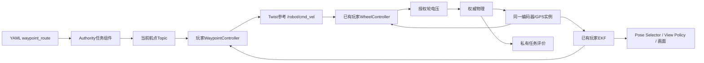

# 37 Navigation C3：航点导航与位置闭环控制

## 目的、范围与确认

用户已确认本关模型、接口、路线、时限、到点/停稳及安全规则。稳定ID为navigation.c3，源为 [navigation.C3.yaml](../levels/navigation.C3.yaml)，前置navigation.c2，继续使用独立navigation工程。复用C0轮控制器、C1里程计、C2 EKF及现有带噪编码器/GPS，不增加武器、传感器或物理模型。实现和验证状态见 [ADR-0050](adr/0050-estimated-pose-waypoint-control.md)。

问题是“已经知道自己大致在哪里，怎样驶向目标并停住”。新文件navigation/waypoint_controller.py只要求玩家填写位置反馈；框架处理构造、文件、消息、目标切换、检查和部署。算法不限定为某个指定控制律。

## 数据流与职责



位置控制器只决定速度参考，真实运动仍由电压、电机、阻力和接触求解。导航明确订阅/robot/estimates/ekf/pose；UI切换到里程计不会改变控制输入。没有系统位姿回退，真实位置/速度不进入玩家程序，估计不修改物理。

## 已确认场景与任务

| 项目 | 配置与语义 |
| --- | --- |
| 场景 | 原空旷地图、差速底盘、原点零初态，无人工驾驶 |
| 路线 | 地图系(2,0)→(2,2)→(0,2)→(0,0)m；未指定终点yaw |
| 到点 | 真实车体质心距当前点≤0.35m；按序确认，每个物理tick最多推进一个点 |
| 终点停稳 | 在终点容差内，真实平移速率≤0.05m/s且绝对角速度≤0.10rad/s，连续0.5s |
| 时限 | 首个正式轮控制提交生效后120仿真秒；有效零电压输出也属于提交 |
| 判定 | 控制故障优先失败；所有航点及停稳达成则成功；之后检查超时，最后一个tick成功有效 |
| 其他 | 碰墙沿用既有接触，不立即失败；RMSE继续反馈，不额外作为通关门槛 |

首个合格停稳快照记录时刻，随后连续满30tick才完成；重复观察同tick不累计，失去位置/速度条件或观察时刻中断均重新计时。公开当前目标、已达数量和停稳进度是明确授权的任务反馈，不提供精确真实距离或速度。

## 参考授权与消息

wheel_voltage场景的/robot/cmd_vel是轮控制器的输入参考；实际执行器仍为/robot/wheels/cmd_voltage。permissions.data_access.references显式授权Twist参考发布，actuators只授权轮电压。Authority在图输出校验后、缓存前执行逐轴限幅，保证订阅者、曲线和参考缓存获得同一数据；参考不会进入Core的速度伺服target。

现有速度伺服场景仍使用原cmd_vel执行器语义。加载器拒绝参考/执行器重叠、重复发布者、系统序列与玩家参考争用，以及不匹配的驱动。图不能从上一部署或其他图的输出缓存获得自己的首次输入。

当前目标为map系waypoint_goal@1，Topic /robot/navigation/goal，内容只有goal_index（从0开始）和position_m（两个米制坐标）。SDK为WaypointGoal，坐标是不可重新开启写权限的float64 NumPy (2,)；该类型仅供读取，不允许玩家发布目标。见 [消息样例](examples/waypoint-goal-message.json)。每6tick更新一次，路线、采样周期、容差和限幅全部来自关卡YAML。

## 玩家接口与教学

```python
class WaypointController:
    def __init__(
        self,
        position_tolerance_m: float,
        max_vx_mps: float,
        max_wz_radps: float,
    ) -> None: ...

    def update(
        self,
        estimated_pose: NDArray[np.float64],
        target_xy: NDArray[np.float64],
        dt: float,
    ) -> Twist: ...
```

estimated_pose是只读地图系(3,) [x,y,yaw]，target_xy是只读地图系(2,) [x,y]；dt为位置控制器执行间隔。返回Twist，linear.x为车体前进速度m/s、angular.z为逆时针rad/s。vx限幅±0.5m/s、wz限幅±1.5rad/s；非零vy、其他非平面分量、错误类型和NaN/Inf会明确报错。

F2高亮新算法文件，提供完整类型、数组维度、单位、构造/返回例子、坐标差、atan2、最短弧、减速与调试说明。玩家可自行设计控制律及跨帧状态。空模板返回零Twist，参考算法只存在测试临时工程，不能作为解锁赠送答案。

## 时序、安全与生命周期

沿用60Hz/4子步、30Hz编码器、2Hz GPS、10Hz模块和6tick提交。四模块声明额度为轮控6ms、里程计3ms、EKF8ms、位置控制3ms，合计20ms用于图准入；整批往返墙钟另由冻结后端profile执行，见 [41](41_RUNTIME_EXECUTION_PROFILES.md)。声明额度不表示独立模块CPU配额，不移动6tick门。

输入在批次开始时冻结。EKF→位置控制→轮控制读取先前提交的数据，不能同批串联；稳态从位姿采样到对应电压生效可跨三次6tick边界。课程明确该延迟，控制器须据此选择增益。缺少合法map系估计或超过合同12tick有效期时适配器发布零参考，底层继续闭环制动；轮电压失联保留0.5秒看门狗。

正式部署前不启动任务；测试仅使用隔离候选图缓存，不施加电压或推进正式目标。重部署保留目标、到达记录和计时，清除旧控制引用并重新等待新估计；重试创建新run，清空任务/曲线/停稳状态。成功、超时、故障或主动结束后冻结本关物理，关闭玩家运行并恢复编辑入口。

## 显示与信息权限

waypoints图层显示公开路线、编号、目标容差圈、当前/已达状态，可独立开关。静态几何从授权catalogue投影，动态状态从Campaign公开任务投影；没有该显示权限时两者均裁剪，程序目标订阅权限仍独立。图层不补画真实车体。

继续显示玩家EKF/里程计、带噪GPS、协方差及获授权的两组RMSE。控制曲线读取限幅参考、带噪轮速和轮电压；每18tick采样、容量512，可覆盖完整120秒，不通过真实速度产生反馈。终局只发布航点与停稳结果及授权累计误差，不增加真实终点距离/路程报告。

## Workspace、兼容与扩展

C3仅补缺失算法文件；原control/wheel_controller.py、localization/odometry.py、localization/ekf.py及历史完整保留。受管manifest、合同和适配器通过预览/显式应用更新；返回C2也只迁移受管文件。已解析场景、协议旧消息、版本1存档与稳定ID不变，目录及CLI依赖树自动发现C3。旧九关的配置冻结回归仍保留，历史验收报告不改写。

waypoint_route是可复用任务组件，Rule使用waypoints_complete事实，教材/样式/参数均来自YAML；没有按关卡ID的行为分支。当前只支持已有单玩家、二维差速轮电压模型，不宣称已实现规划、避障、更多传感器或多机器人导航。

## 取舍、验收与限制

私有真值到点避免错误定位伪造成功，离散任务反馈有意授权；它不代替定位。单关只新增位置闭环，保留已学算法；固定航点不证明复杂场景鲁棒性。

已验收参考无物理旁路、限幅/帧/过期/缺测、严格顺序与停稳边界、末tick优先级、测试隔离、重部署/重试、原九关兼容、源码与旧存档，以及原生和浏览器真实编辑、测试、部署和通关，具体证据见 [验收报告](reports/NAVIGATION_WAYPOINT_CONTROL_VALIDATION.md)。平台证据限于Linux/Firefox，不自动扩展到其他OS/浏览器。
