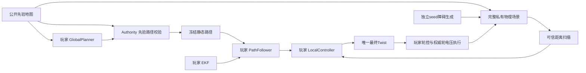

# Navigation C6：局部感知与静态障碍避让

## 目的与范围

`navigation.c6` 前置 `navigation.c5`，复用 Navigation 工程五项算法，只新增 `navigation/local_controller.py`。玩家利用距离扫描绕过先验仓储地图未标出的静态障碍，接回路线并到达原终点。本关不要求建图、SLAM、在线全局重规划或指定避障算法。

## 几何与任务合同

公开先验地图仍来自 `maps/navigation_warehouse.yaml`；规划器、全局路径校验和普通地图只读取先验。可信解析另生成一个 0.60×0.60 m 静态方障碍，Core 和扫描使用完整场景。障碍在玩家规划前由独立命名随机流生成，绑定地图、底盘、生成版本、参数、seed 和起终点。

障碍完整外形在场地内、不与原墙相交，外形到起终点最近距离均不小于 1.50 m；加入后按 C5 的四格方形膨胀仍安全可达。先验任务保留 12–18 m 参考搜索距离约束，完整场景绕行不增加长度约束。节点与尝试均有配置上限，失败明确终止，不放宽规则。玩家路线碰巧绕开障碍也可通关。



## 扫描与接口

`/robot/sensors/scan` 使用 `scan2d@1`，frame 为 `base_link`，米与弧度。180 条射线覆盖整周，首条为 0 rad，递增 2°，正向为左侧逆时针，无重复末端。10 Hz 瞬时整帧，量程 0.05–6 m；最近几何命中后加入独立 σ=0.02 m 高斯距离噪声并截断。无回波为 6 m 且 `hit_mask=False`，不加噪声；恰好 6 m 命中为 True。忽略自身，无角噪声、偏置、丢帧或额外交付延迟。

```python
class LocalController:
    def __init__(self, model: DifferentialDriveParameters,
                 robot_radius_m: float, safety_margin_m: float,
                 max_vx_mps: float, max_wz_radps: float,
                 command_delay_s: float) -> None: ...

    def update(self, observation: LocalControlInput, dt: float) -> Twist: ...
```

输入包含不可变 `estimated_pose: float64(3,)`、`reference_path: float64(N,2)`、`scan: Scan2D`、`nominal_command: Twist`、`wheel_rates_radps: float64(2,)`，以及各输入的仿真采样年龄。位姿来自玩家 EKF，轮速与 EKF/轮控制共用同一带噪编码器。名义指令不是实测速度；扫描坐标属于扫描采样时车体系。数组使用不可写字节背衬，不能重新打开写权限。

## 调度、保护与权限

同模块先调用 PathFollower，再调用 LocalController，仅最终 Twist 发布。年龄来自原始 sample tick；任一输入缺失、错误帧、不可用或年龄 >0.20 s 时不调用 LocalController，固定门主动发布零参考；恰好 0.20 s 有效。不得回退名义速度、真值或系统位姿。零参考经既有轮控制链执行；若轮控自身缺少必需编码器样本，原轮控合同仍会等待有效输入，执行器既有失联看门狗兜底置零电压，不虚构轮速，不承诺立刻停住。

运动、计时及预算沿用 C5：vx∈[0,0.5]、wz∈[-1.5,1.5]，非平面与 vy 为零；负 vx 拒绝。导航 6 tick 加轮控制 6 tick，`command_delay_s` 由图推导为 0.20 s；扫描年龄额外计入。物理 60 Hz/4 子步，编码器 30 Hz、GPS 2 Hz、算法 10 Hz。模块声明总额 20 ms 与原生 30/Pyodide 40 ms 墙钟分离，profile 仍 experimental。

规划独立 5 秒，测试和正式 Runtime 分别执行。正式首次轮电压提交开始 120 仿真秒；无碰撞、距终点 ≤0.35 m、实际平移 ≤0.05 m/s、|wz|≤0.10 rad/s 连续 0.5 s 通关。碰撞和控制故障优先，末 tick 可通关；不增加检查点、偏离、RMSE、路程、停车次数或指定绕行门槛。

## 可视化与诊断

先验地图、路径与 EKF 车体可显示；车体系扫描与地图扫描点可独立开关。地图投影必须匹配同 sample tick 的合法玩家 EKF，否则仅车体系显示。历史有界且身份切换清理。私有矩形仅独立开发者授权图层可见。

运行反馈包含规划墙钟、路径长度、任务时间、授权距终点/定位误差、输入年龄、零参考保护及名义/最终指令曲线。最近回波标为带噪测量，不等同真实车体净空。终局路程与相对原路径的时间加权 RMSE/最大偏离只用于诊断。真实标量在 Authority 裁剪，不进入算法。

## 替代方案、风险与验收

取舍见 [ADR-0055](adr/0055-prior-map-local-navigation.md)。扫描之间/量程外不代表自由，纯旋转、制动距离和两级提交延迟可能导致局部最小值；教材允许 DWA 或有状态几何绕行，不提供正式参考解。

验收覆盖两种独立局部算法、seed 0/1/2、两种 Runtime、名义碰撞对照、停车超时、输入年龄边界、独立随机流、同 tick 投影、私有几何隔离及 C5 工程历史保留。具体实测以验收报告为准；未执行项目不得标为通过。

## 参数来源与实现边界

新增参数集中于 `levels/navigation.C6.yaml`。障碍候选来自先验参考路线的可信视线简化与按网格分辨率取样，随后独立随机打乱；尝试上限256、搜索节点上限20000，沿用C5场地容量，不存固定控制点。该配置在seed 0/1/2均能选择合法障碍；未满足约束时拒绝启动。

C6声明分配为轮控制4、里程计2、EKF4、组合导航10ms，总额20ms。该分配为局部算法留出声明空间，依据隔离参考中控制/定位远低于局部导航的观测成本；不改变旧关合同，也不保证单模块强CPU隔离。扫描采样耗时另在可信后端有界记录；完整周期往返仍以冻结profile和固定门裁决。

`ResolvedScene.world`保存完整物理墙体，兼容配置的`scene.walls`保持公开先验，`private_obstacles`仅为可信解析DTO。Core适配器组合墙体，启动/切换浏览器资源均移除私有DTO。随机流 `navigation-hidden-obstacle`、`navigation-scan`、`navigation-gps` 与 `navigation-encoder` 独立。解释器/JS往返后范围参数可能为整数，扫描输出数组仍显式构造float64，避免噪声量化。

## 验收证据

本机原生与Firefox/Pyodide的两参考/三seed、完整玩家流程、扫描与权限回归、耗时、失败及截图见 [验收报告](reports/NAVIGATION_LOCAL_AVOIDANCE_VALIDATION.md) 与 [机器结果](reports/navigation-local-avoidance-validation.json)。393项Python、87项Node TAP及18项Rust通过；WASM对照另组。仅接受已记录范围，其他平台和可靠性仍待独立验证。
