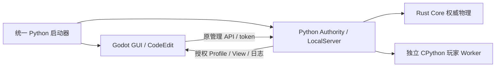

# 44 Godot 桌面客户端原型

## 目的与范围

将显示与编辑入口从浏览器扩展到 Godot 4 标准版/GDScript，使用统一启动和原生 CPython，保留独立玩家 Worker。当前交付是 Linux 桌面最小闭环，Web GUI/Pyodide 入口继续用于原课程与回归；没有替换物理或修改课程。决策见 [ADR-0056](adr/0056-godot-desktop-presentation.md)。

## 进程、职责与接口



Godot 使用原 `GET /api/profile`、`/api/view`、`/api/workspace`、`/api/deployment`、`/api/campaign`、`/api/progress` 和 `/api/settings`。修改使用现有 `/api/workspace/*`、`/api/deployment/*`、`/api/campaign/*` 与人工执行器接口；保持 Origin、Host、JSON 大小和控制令牌检查，不增加通用 World 或 Python 执行接口。UI 的“禁止操作”只是交互提示，后端仍独立执行解锁、权限和部署验证。

`backend.gd` 限定 loopback、并发数、响应大小和超时；网络异步，不等待玩家 update。`timeline.gd` 使用 simulation_tick 缓存与插值，拒绝旧序号/版本；位姿跳变清理对应历史，没有估计不显示车体，不外推断流。`world_view.gd` 只绘制公开墙体、所选位姿、授权炮弹/目标估计和局部雷达；Godot 坐标变换显式将 map +y 向上转换为屏幕 +y 向下，yaw 不带动相机旋转。开发者完整图层和 C6 扫描投影尚未移植，不能绕过已有授权以补齐显示。

右侧“任务与授权反馈”仅在文本变化时更新；反馈变化保留玩家当前滚动位置，切关或重试后新任务从顶部显示，不因周期状态轮询跳回顶部。

## 编辑、部署与源码兼容

F2/顶部按钮打开全窗口 CodeEdit；×/同一键收起，Ctrl/⌘S 保存。左侧原生 Tree 显示全部文件，高亮当前课程 edit_files；可新增文件，文件切换不丢草稿。保存仍经 Workspace CAS 原子生成 revision，不写 Godot `user://` 保存算法，不复制或重置玩家工程。

测试执行现有独立 Runtime、Python 异常输出、项目测试和授权短测，只有当前 revision Ready 才能部署。Active 后自动收起并锁定编辑器；结束/重试后恢复。编辑或窗口失焦时清除人工输入；关闭前有未保存内容会确认。框架升级展示旧/建议文本，用户显式确认后创建新 revision，计划仍由后端排除已有算法。历史恢复和完整备份后端接口保留，本原型尚无对应维护面板。

## 配置与运行

`config/desktop.yaml` 与 [desktop Schema](schemas/desktop.schema.json) 管理 Godot 版本、官方便携包 SHA-512、窗口、HTTP 容量及轮询等客户端参数；仿真/模型/课程仍使用原 YAML，预算仍来自 [41](41_RUNTIME_EXECUTION_PROFILES.md)。首次缺少 Godot 时在 `.m1-cache/godot/<version>/` 准备固定便携包；离线须已有缓存或显式二进制。系统安装不被修改。自带 Godot 仅检查主版本4，实际被验证的版本见报告。

```sh
python3 tools/tankbot.py godot --level c0
python3 tools/tankbot.py godot --godot-binary /path/to/godot --level c1
python3 tools/check.py --suite godot --offline -- --headless
python3 tools/check.py --suite godot --offline
```

CLI 的 `--workspace-store`、`--settings-file`、`--save-file`、`--map`、`--player/--developer` 继续使用相同含义。需要查看锁定关卡时明确启用开发者练习；原型不会自动解锁关卡。启动器退出关闭当前 Authority，包括切关后替换的新实例。正式玩家命令读写原存档；验收工具使用临时设置、进度、工程和 XDG 目录及随机端口。

## 验收与限制

标准 Python 测试包含生命周期/配置/CLI 回归；需要 Godot 的真实客户端检查独立为 `--suite godot`，不混入 npm test。隔离 C1 流程验证错误日志、修正/保存、Ready、Active、授权估计、通关/存档、重试、源码与旧 revision 保留。无头检查不证明显示和输入法，窗口检查截图与实测见 [报告](reports/GODOT_DESKTOP_VALIDATION.md)。

原型尚未实现完整关卡树布局、Vim、智能补全/悬停、交互矩阵实验、项目维护/实验台、曲线、全部 Navigation 图层与手柄；原 Web 对应能力保留。未制作独立安装包、Windows/macOS 导出或浏览器 Godot 版本。图形 API、中文输入法、真实硬件和长时运行均需进一步验证；本轮不宣称完整迁移、平台安全沙箱或可靠性已达发行标准。

API依据为Godot官方 [HTTPRequest](https://docs.godotengine.org/en/stable/classes/class_httprequest.html) 和 [CodeEdit](https://docs.godotengine.org/en/stable/classes/class_codeedit.html)。具体可运行性以本仓库锁定版本的实际检查为准，不由通用API文档推断平台已通过。
