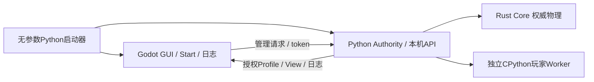

# 44 Godot 桌面客户端

## 目的与当前范围

Godot 4标准版/GDScript是当前唯一玩家GUI，使用原生CPython和Rust权威Core。无参数 `python3 tools/tankbot.py` 直接打开游戏；Web GUI、CodeMirror/npm、Pyodide/双Worker和专用浏览器工具已移除。用户确认的退役范围见 [ADR-0057](adr/0057-godot-only-player-entry.md)；[ADR-0056](adr/0056-godot-desktop-presentation.md)记录先前原型阶段，不再要求保留Web入口。

现有十三关的物理、算法接口、评分、权限和Workspace数据不变；客户端仍未具备所有历史Web界面功能，不能把保留后端能力说成完成Godot移植。

## 进程、职责与接口



Godot使用既有 `GET /api/profile`、`/api/view`、`/api/workspace`、`/api/deployment`、`/api/campaign`、`/api/progress` 和 `/api/settings`。修改使用 `/api/workspace/*`、`/api/deployment/*`、`/api/campaign/*` 与人工执行器接口。服务仅绑定loopback，保留Origin、Host、控制令牌、JSON大小及频率检查；页面、编辑器bundle、浏览器Runtime配置等旧静态路由返回404。保留HTTP API不等于保留浏览器入口。

`backend.gd` 限制请求目标、并发、响应大小和超时；不等待玩家update。`timeline.gd` 使用simulation_tick插值、拒绝旧序号/版本，位姿跳变清理历史，无估计不显示车体，不外推断流。`world_view.gd` 只读取公开地图和获授权快照，map +y向上转换为屏幕+y向下，yaw不旋转相机。Godot刚体不是权威物理，玩家代码不持有Core/World句柄。

任务反馈文本仅变化时刷新，保留滚动位置；切关/重试后从顶部显示新任务。

选关列表、状态栏、任务说明标题及前置提示统一显示“章节名称.Cn”，每章从C0编号，列表保留中文课题和完成/锁定标记。章节名取目录title，章内编号取该章levels列表中的零起始位置，不维护章节映射或关卡特例。当前为`Hello Robot.C0`、`Weapons.C0–C4`和`Navigation.C0–C6`。历史标题在显示时去除重复前缀。

显示编号与稳定ID分离：Weapons.C0–C4依次对应c1–c5；Hello Robot.C0仍为c0，Navigation.C0–C6仍为navigation.c0–navigation.c6。选项元数据、请求、CLI、存档、YAML文件名及Workspace仍使用原ID。文档中的旧课程编号若用于API/算法复用，应按稳定ID理解；本次仅调整显示，不迁移玩家源码、历史版本或解锁记录。

### 预制 Sprite

实体外观加载 [assets/sprites](../assets/sprites/README.md) 下的图片，由 [desktop-sprites.yaml](../config/desktop-sprites.yaml) 和 [Schema](schemas/desktop-sprites.schema.json) 管理引用、文件/像素限额及弹丸最小显示直径。启动器验证后将可信绝对路径只传给Godot，不进入公共profile或玩家Runtime。旧desktop配置省略sprites_file时使用同一默认配置；缺文件或非法图像明确失败，不悄悄退回几何占位。

`sprite_library.gd`首次解码图片、建立共享ImageTexture/AtlasTexture和mipmap；`vehicle_sprite.gd`按现有底盘、轮标定、装甲壳与炮口尺寸装配Sprite2D。底盘、炮台和炮管分层；四轮保持90°对称、主滚动方向切向。靶标采用圆角/倒角底板、同心圆与十字纹。图片是美术轮廓，权威碰撞继续由Rust模型判定。

`world_view.gd`每帧只更新实体Sprite变换，保留授权时间插值和相机语义；同ID复用节点，消失/切关时清理，无合法位姿则隐藏。墙体、网格、路径与雷达/估计标记仍是诊断几何。没有新增敌车真值权限或开发者数据旁路；完整敌车开发者图层仍待移植。现有已授权target占位改为靶板Sprite，不以资源推断未授权敌车的位置/朝向。

当前从源码仓库目录读取资产，不依赖Godot导入缓存或图片生成服务。独立Godot导出包的资源打包仍待专门验收。实际C0、双底盘夹具和清理验证见 [Sprite验收](reports/GODOT_SPRITES_VALIDATION.md)。

## 外部编辑、Start与源码兼容

内置CodeEdit、源码文件树及保存/测试/部署按钮已按 [ADR-0058](adr/0058-external-editor-and-single-start.md) 删除。F2/VS Code按钮打开当前课程真实代码目录及主要文件，玩家保存后只需点击Start。Godot保留只读说明、升级预览、日志和停止操作，具体磁盘/版本接口见 [45](45_EXTERNAL_EDITOR_AND_START.md)。

Start自动生成原Workspace CAS快照，执行原独立检查，再创建全新正式Worker。失败显示Python日志；不以操作简化绕过检查、权限、规划准备或固定提交门。运行中可外部编辑，当前revision不变；停止后才能Start新版本。框架升级先捕获保存内容、预览/明确确认，再同步未修改文件，冲突拒绝并保留源码/历史。

文件保存在原userdata版本库的files目录，不迁移或清空原工程、ledger、revision或进度；游戏退出不关闭玩家VS Code。缺失编辑器时说明安装/PATH和实际目录，不恢复内置编辑器。选择课程载入准备场景，Start才运行保存代码。

## 配置与入口

`config/desktop.yaml` 和 [desktop Schema](schemas/desktop.schema.json) 管理Godot版本/官方包摘要、窗口、轮询及HTTP容量。仿真/模型/课程仍取原YAML，原生profile见 [41](41_RUNTIME_EXECUTION_PROFILES.md)。Linux x86_64首次缺Godot时在 `.m1-cache/godot/<version>/` 准备固定SHA-512便携包；离线须缓存完整或指定二进制。Python依赖使用原专用环境；缺Core时仅构建Rust，不调用Node/npm。

### 桌面主题

`theme_file` 引用 [desktop-theme.yaml](../config/desktop-theme.yaml)，由 [主题Schema](schemas/desktop-theme.schema.json) 验证后仅传给Godot；旧桌面配置省略此字段时使用同一默认主题。色值为不透明RGB，配色、边距、圆角、字体层级及滚动条尺寸集中配置。`ui_theme.gd` 生成统一Theme，主界面与说明/升级对话框共享，避免各控件重复定义颜色。

保留深色场景；普通按钮使用浅色实心背景和深色文字，Start使用青色，结束尝试使用红色。悬停、按下、禁用分别有独立样式，禁用状态仍保持文字可读。图层按钮同时显示“开/关”和选中颜色，显示开关仍只作用于已获授权的数据。工具栏使用流式排列，任务、场景和日志独立分区。

当前配色的按钮文字（含禁用状态）对比度至少4.5:1，按钮填充对相邻面板至少3:1，由Python回归核对；这些是本主题的可读性目标，不代表完整无障碍认证。按钮保持不获取游戏键盘焦点，点击后Space和F2沿用原输入规则。主题不改变Start、快照、Worker、View Policy或物理参数。实际窗口及交互证据见 [主题验收](reports/GODOT_UI_CONTRAST_VALIDATION.md)。

```sh
python3 tools/tankbot.py
python3 tools/tankbot.py --level c1
python3 tools/tankbot.py --godot-binary /path/to/godot --offline
python3 tools/tankbot.py headless --level c0 --ticks 600
python3 tools/tankbot.py probe --level c0
python3 tools/check.py --suite godot --offline -- --headless
python3 tools/check.py --suite godot --offline
```

`--workspace-store`、`--settings-file`、`--save-file`、`--map` 和 `--player/--developer` 含义不变。默认读取current_level并检查解锁，不自动开启开发者模式。`serve/browser/godot`位置子命令和 `--browser-qa` 拒绝；headless/probe仍是开发工具。关闭窗口后统一清理API、仿真和当前Worker，包括切关后替换的Authority。

## 检查与当前限制

标准入口自动发现Python回归，并检查Rust、文档/Schema和生成配置；不需要Node。Godot真实流程单列 `--suite godot`，使用临时设置/进度/工程/XDG和随机端口。Rust WASM构建/ABI对照为独立开发能力，`--suite wasm`才需要Node，不提供浏览器显示或Pyodide。

待移植界面：游戏专用矩阵实验（编辑能力交由VS Code）；控制/定位曲线；算法实验台；项目导出/备份/历史/清理管理；设置/改键、手柄与完整关卡树；完整开发者图层及导航专用可视化。有关后端API和数据仍保留，旧教材中的网页菜单/快捷键不代表已在Godot实现。用户明确选择本轮先清理，不同时补齐这些功能。

历史原型证据见 [2026-11-17报告](reports/GODOT_DESKTOP_VALIDATION.md)，本轮证据见 [退役验收](reports/GODOT_ONLY_ENTRY_VALIDATION.md)。Linux窗口证据不推断Windows/macOS、输入法、全部课程或正式发行能力。普通CPython子进程仍非OS强沙箱；30ms profile保持experimental，不因删除浏览器提高预算或可靠性等级。

本轮X11默认垂直同步下多次未完成握手；验收工具可用 `--disable-vsync` 仅对测试窗口禁用垂直同步，该诊断流程已通过。未将此选项设为游戏生产默认，也未据此确认GPU/显示服务器根因。无子命令启动/退出另以无头自动关闭夹具验证。
