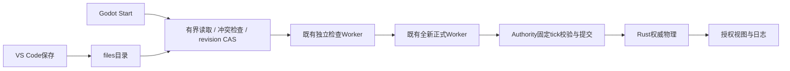

# 45 VS Code 编辑与单次 Start

## 范围与操作

Godot负责游戏显示、只读任务说明、框架升级预览和运行日志，不再内置CodeEdit、源码树或保存/测试/部署按钮。F2/「VS Code」打开当前课程真实代码目录和主要算法文件；在VS Code中保存，返回游戏点击Start。Start自动完成快照与原检查/启动流程；短输入检查不等于算法效果或正式通关。决策见 [ADR-0058](adr/0058-external-editor-and-single-start.md)。

运行中可继续编辑，当前运行的不可变revision不会改变；先「结束尝试」，再Start才运行新版本。Start有意创建新run/初态；计时仍按各关YAML约定起算，自动检查和规划准备不额外扣行驶时限。选择课程只载入准备场景，不自动执行保存的代码。人工被动课程不要求编程。

## 存储与同步合同

```text
userdata/workspaces/<existing-project-key>/
    HEAD.json
    <revision>.json          # 原不可变源码/ledger历史
    files/                  # VS Code编辑的真实.py/.json/.md
        .vscode/settings.json
    EDITABLE.json            # 上次同步的revision与逐文件摘要
    editable-recovery/       # 更新时移出的旧文件/竞争保存
```

工程键、campaign/navigation分组和旧存档不迁移、不清空。显式workspace-store仍作为版本库根目录，编辑副本随该目录。Ctrl+S只保存文件；Start才捕获新revision，测试及正式Worker继续使用快照副本，不从files动态import。新增文件、合法删除和改名按原Workspace路径/容量规则校验；.vscode、隐藏元数据和缓存不进入Runtime。

同步比较编辑文件、上次基线和当前HEAD。只有磁盘未修改时才能接收版本库变更；两边同改冲突拒绝，磁盘和历史都保留。框架升级先捕获保存的修改，再展示原有预览，显式确认才应用；预览期间再次保存导致revision变化时拒绝旧计划。新解锁文件只补缺失项，已有算法不自动替换。

更新已有磁盘文件先移至恢复目录，再独占创建新文件；竞争保存不能被直接覆盖，恢复文件不自动删除。磁盘文件不与IDE共享锁，读取采用有界双扫描来发现常见保存竞争，不承诺获取尚未保存的编辑器缓冲。遇到并发保存/合并错误，先保留相关文件，再合并并重试；不以重建工程处理冲突。状态写入失败后，原HEAD原子发布及历史仍有效，可重入同步。

旧版本库备份/历史清理机制保持，编辑草稿在Start前不属于revision导出。需要备份尚未Start的保存内容时复制整个userdata；未保存缓冲仍由VS Code管理。此限制不等于已保存磁盘文件会在游戏退出时丢失。

## 单次 Start 的数据流



`EditableProject`只管理文件/启动编辑器，不执行玩家源码。`PlayerRun`仅编排DeploymentManager的Checking→Starting→Running→Finished，或Failed/Cancelled；不另写测试器、调度器或权限系统。测试失败不启动正式Worker；测试中的主动结束取消后续启动。尝试结束或切关关闭旧候选；旧run/job结果不能激活新尝试。

周期预算、6tick门、规划5秒准备预算与物理频率保持。自动检查仍是原短测；C5/C6正式Worker再次规划，不能复用测试Worker路径。程序输出继续走Authority和View Policy，编辑器不持有World/引擎句柄。

## 本机接口与配置

| 接口 | 请求 / 结果 |
| --- | --- |
| `POST /api/workspace/external_open` | `{}`；同步安全文件并请求VS Code打开目录/本关文件，返回目录与启动请求状态 |
| `POST /api/campaign/run` | `{level_id}`；原权限检查、新尝试、捕获已保存源码及自动检查/启动；返回profile和player_start |
| `GET /api/deployment` | 原状态外增加player_start：run_id、revision、phase、error |
| `POST /api/workspace/external_upgrade` | `{}`；捕获已保存文件并创建原受管升级预览 |
| `POST /api/workspace/external_apply` | 原plan_id/revision/resolutions；再次捕获并CAS应用、同步编辑副本 |

均是原Host/Origin/token保护的loopback管理接口，不是机器人Topic；不新增玩家数据权限。原底层test/deploy管理接口保留供工具兼容，Godot不再暴露这组操作按钮。普通运行时不能通过源码/请求配置VS Code程序或任意目录。

`assets/config/desktop.yaml.editor`提供executable（默认code）、arguments、working_directory、max_scan_entries和max_scan_depth，结构见desktop Schema。未安装VS Code时显示VSCODE_NOT_FOUND与目录，不恢复内置编辑器。外部启动不使用shell，不等待窗口关闭，不自动安装Python扩展或启用Workspace Trust。缺失的.vscode设置只提供当前专用Python与SDK分析路径，现有设置保持。

命令行文件/目录行为参照 [VS Code官方CLI](https://code.visualstudio.com/docs/configure/command-line)，默认不强制替换用户最近活动窗口；窗口策略可在可信YAML arguments中配置。游戏退出不关闭玩家编辑器。

## 验收与限制

需覆盖首次导出、重开/跨章、文件增删、容量/链接拒绝、并发修改与中断、显式升级、快照隔离、自动检查失败及正常启动、停止取消和管理鉴权。真实流程使用隔离设置、存档、源码及编辑器配置；记录型启动器检查不等于真实VS Code窗口验证。结果见 [本轮报告](reports/EXTERNAL_EDITOR_AND_START_VALIDATION.md)。其他OS、扩展体验、未保存缓冲和长期可靠性另行验证，不因操作简化升级experimental声明。
