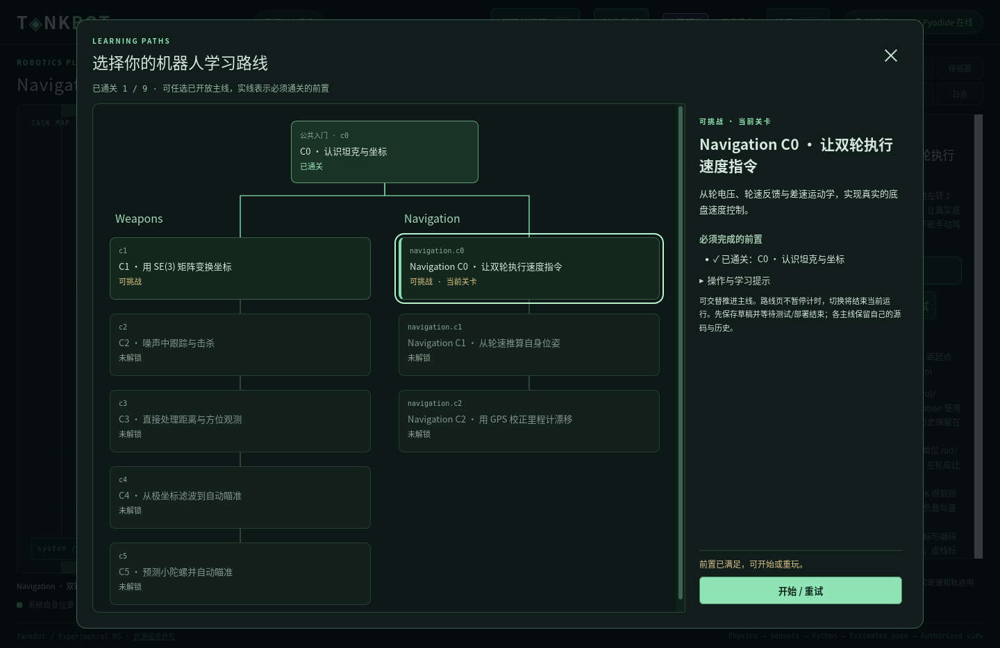
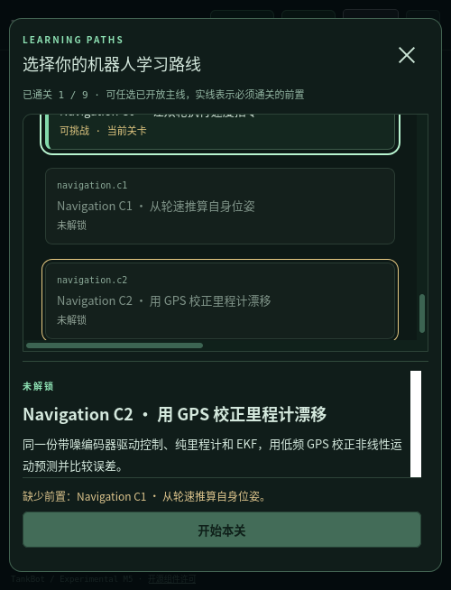

# 公共入门与双主线进度验收

日期：2026-11-04，工作及验收跨11月3–4日。范围为用户确认的九关进度、关卡选择界面和兼容验证，设计见 [36](../36_BRANCHING_PROGRESSION.md)、[ADR-0049](../adr/0049-branching-course-progression.md)。不增加关卡，不改变物理、传感器、算法合同、执行预算或评分。原有阶段报告保留当时链式进度的历史事实。

## 最终规则与实现

```text
c0 公共入门
├── Weapons:    c1 → c2 → c3 → c4 → c5
└── Navigation: navigation.c0 → navigation.c1 → navigation.c2
```

只将navigation.c0的硬前置从c5改为c0，其余边不变。稳定ID、文件名、metadata.order和章节身份保留。Weapons C4、Navigation C2各添加一条可选补充练习提示，不参与解锁。

ApplicationState统一执行YAML prerequisites的全部前置要求；CLI四种模式、原生选关和浏览器启动路径共用该检查。缺失前置错误包含具体名称/ID，开发者保留自由练习，地图覆盖练习不奖进度。加载器拒绝未知前置和环，允许合法前置出现在更后的展示位置；章节展示不再隐含全局先后依赖。

目录公开prerequisites、order、description，界面从目录生成公共入口、章节分列及所有实线。完成、可挑战、锁定与当前状态可同时表达；锁定节点可查看任务与具体缺少的前置。通关展示本次所有新开放节点，玩家选择下一步或重玩。保留当前关卡开始/重试及主动结束；代码编辑、部署、计时与权限语义不变。

## 存档与工程兼容

存档仍为version=1，四个字段不变。`[c0,navigation.c0,navigation.c1]`是合法非连续完成集合；已完成列表按既有目录顺序保存，不由布局重排。读取旧链式/分支存档不写回文件，不赠送关卡，不丢失完成时间或current_level。Schema取消固定关卡枚举，已知ID、前置闭包和当前关卡授权由领域层验证，示例见 [分支存档](../examples/branch-progress.json)。

campaign/navigation继续独立存储。选关成功后原子切换Authority/Workspace，关闭旧候选/部署；返回选择原库，不复制跨主线算法。回归比较旧revision的完整快照（含源码和ledger），并验证重试、刷新及被拒绝的切换不会破坏原工程。真实界面只写入临时注释文件用于辨识工作区，没有参考解或日常userdata修改。

## 自动化结果

| 检查 | 实际结果 |
| --- | --- |
| 完整Python回归 | **263项通过，227.145秒**，含分支专项11项及既有玩法/权限/工程测试 |
| Node界面回归 | **13个测试文件通过**，含新增目录图、状态、新解锁集合与任意ID/前置图测试 |
| 玩法冻结检查 | 九关除显式前置和新增可选提示外的解析配置哈希全部不变，旧提示保留 |
| 存档与权限 | 新档、双分支、主线独立推进、全部前置、旧档字节保留、交替完成顺序、地图练习/开发者不奖进度通过 |
| 加载与入口 | 未知/循环前置拒绝；展示顺序独立；API/CLI锁定一致；原生/浏览器scope切换回归通过 |

首轮完整回归发现一条仍要求章节展示等于全局解锁顺序的旧断言，已替换为“每关恰好属于一个章节”。同轮另有一次模块图MISSED_DEADLINE；未调整预算或调度，图专项8项独立重跑及最终263项完整回归均通过，不能据此宣称消除了既有墙钟调度抖动。

相关命令：

```bash
env PYTHONPATH=sdk/python .m1-cache/learning-venv/bin/python -m unittest discover -s tests -v
python3 - <<'PY'
from pathlib import Path
import subprocess
files = sorted(str(p) for p in Path('tests').glob('test_*.mjs') if p.name != 'test_wasm.mjs')
for path in files:
    subprocess.run(['node', path], check=True)
PY
python3 docs/tools/check_design.py
python3 tools/export_profile.py --offline --check
python3 tools/prepare_browser.py --offline
git diff --check
```

本轮Rust物理未改，未因进度调整重跑独立WASM物理基准。最终生成配置检查通过，浏览器包已离线重建；文档检查通过124份Markdown、852个本地链接、15份Schema、37个正例和25个结构负例，git diff --check通过。文档检查不能代替真实运行。

## 两种真实玩家界面

使用独立临时配置、设置、空存档和工程，developer_mode=false；工具为 [browser_progression_tree.py](../../tools/browser_progression_tree.py)。原生/浏览器分别从新玩家开始：

1. 初始只开放c0；查看锁定Navigation节点，普通API也拒绝开始。
2. 通过正常驾驶、转向及人工武器接口实际命中，完成c0；没有写入假完成记录或使用开发者绕过。自动化瞄准只读取C0本来公开的自身/目标/关节观测。
3. 同时显示c1与navigation.c0可挑战，其他后续仍锁定；新解锁提示包含两个节点。
4. 直接通过树进入Navigation，创建独立工程；六批空控制脚手架测试Ready，不提供控制解。原生最大批时0.493 ms，浏览器2 ms；测试Ready不等于通过运动关卡。
5. 重试Navigation、返回Weapons C1、读取原revision/ledger，再回Navigation并刷新；两个工程各自保留，旧测试/部署不跟随切关。
6. 500×740窗口下只有图与详情内部滚动，页面不整体滚动；缺少的具体前置和开始按钮保持可见。Esc关闭；路线弹窗内F2不穿透到编辑器。节点使用可聚焦原生按钮，支持Tab/Enter/Space及上下/Home/End导航。

原生首次实测C0结束后记录c0通关；浏览器实际在tick300通关，起算tick33、耗时267tick（4.45仿真秒）。两者最终存档都只有真实完成的c0，开放集合为`[c0,c1,navigation.c0]`，没有替玩家完成Navigation课程。





最终布局在原生与浏览器均额外复核。截图复核曾误用缺少`?runtime=browser`的URL而进入原生客户端路径；改用浏览器服务打印的完整地址后通过，未为该测试操作调整产品逻辑。早期纯键盘自动瞄准在浏览器未能及时命中，改用已有人工炮台API后完成；这些失败证据保留，未放宽60秒时限或物理命中条件。

本机证据在`.m1-cache/progression-tree-qa/`：python-final.log、node-final.log、native-ui.json、browser-ui.json、native-layout.json、browser-layout.json及源码差异审计；缓存不提交。任务开始前58个已有改动文件中42个保持原哈希，其余16个是本任务明确涉及的共享文件；无文件丢失。前序Navigation C2实现和其他无关改动保留。收尾关闭本次专用服务与Firefox，不影响其他服务。

## 本任务实际修改文件

以下按职责列出本任务新增或编辑的文件；同一工作区中原有C2改动不全部归入本任务。

- 入口与权限：`host/tankbot_host/application.py`、`campaign.py`、`level_plugins.py`、`cli.py`、`server.py`、`browser_server.py`（均在同一目录）。
- 界面：`web/level-tree.js`（新增）、`campaign-ui.js`、`index.html`、`style.css`、`app.js`、`workspace-dialog.js`。
- 关卡：`levels/navigation.C0.yaml`、`levels/navigation.C2.yaml`、`levels/weapons.C4.yaml`。
- Schema/生成物：`docs/schemas/progress.schema.json`、`docs/schemas/level.schema.json`、`core/tests/fixtures/default-profile.json`、`docs/tools/check_design.py`。
- 测试：`tests/test_branching_progression.py`、`tests/test_level_tree.mjs`、`tests/fixtures/progression-gameplay-before.json`（新增）；`tests/test_application.py`、`tests/test_level_plugins.py`、`tests/test_weapons_m5.py`；工具`tools/browser_progression_tree.py`（新增）。
- 设计与入口：`README.md`、`levels/README.md`、`docs/README.md`、`docs/09_LEVEL_DESIGN.md`、`docs/10_DEVELOPMENT_ROADMAP.md`、`docs/22_SETTINGS_MODES_AND_PROGRESS.md`、`docs/27_LEVEL_PLUGIN_ARCHITECTURE.md`、`docs/33_NAVIGATION_MOTION_CONTROL.md`、`docs/36_BRANCHING_PROGRESSION.md`、`docs/adr/README.md`、`docs/adr/0049-branching-course-progression.md`、`docs/schemas/README.md`。
- 证据：`docs/examples/branch-progress.json`、`docs/images/branching-progression.png`、`docs/images/branching-progression-narrow.png`及本报告（新增）。

## 限制与后续

验证平台为本机Linux/Firefox，未验证Windows/macOS或其他浏览器。浏览器权限仍是本地教学与接口隔离，不是竞技成绩安全证明。此轮不解决单关内部难度、算法引导质量或既有偶发Runtime墙钟超时，也不实现推荐系统。后续课程仍须声明真实知识/代码依赖；主线布局不能成为第二套解锁规则。按本任务要求，没有git提交或推送。
