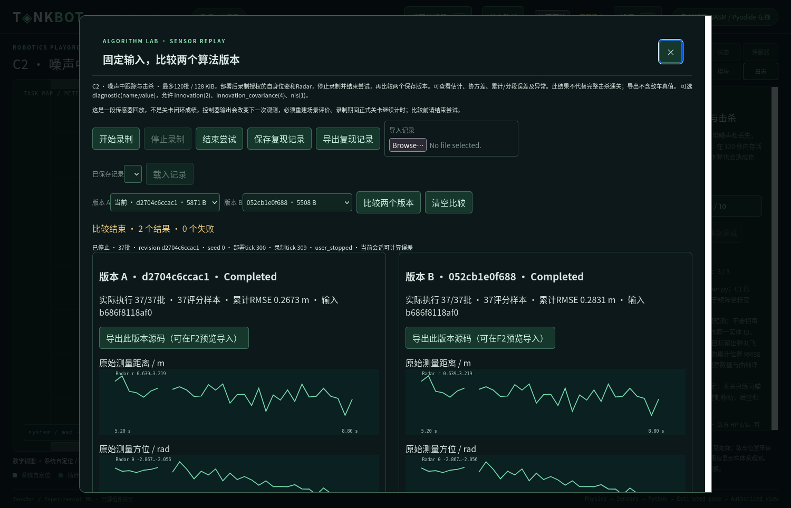
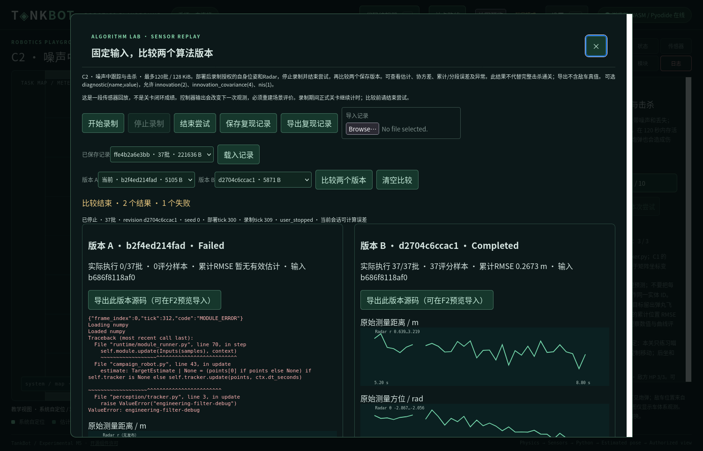
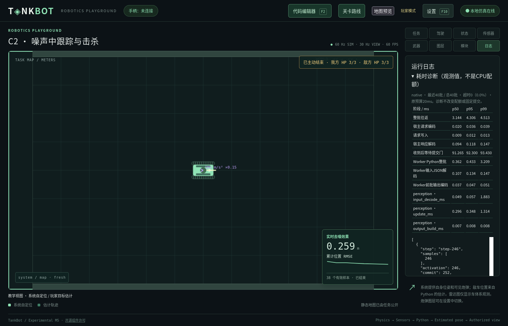
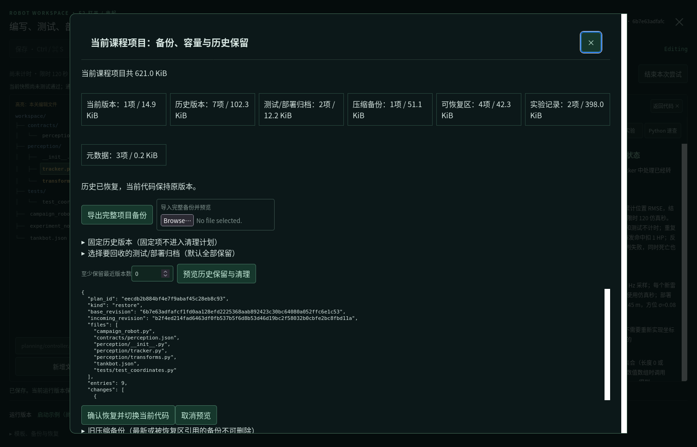
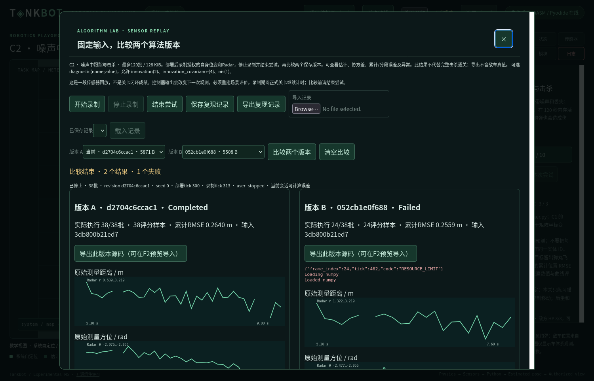

# 工程入口、算法实验与项目保留验收

日期：2026-11-05。起始提交`38207aa`；本报告记录未提交的工作区增量。原 [2026-11-04评估](PROJECT_REVIEW_20261104.md) SHA-256仍为`35f0db651a29fbde7354c0760075414e28dcfe57593caa4814a4830fb5a5cd92`。没有提交或推送Git，没有修改日常userdata。设计见 [38](../38_ENGINEERING_AND_ALGORITHM_LAB.md)，后续评估见 [跟进报告](PROJECT_REVIEW_FOLLOWUP_20261105.md)。

## 阶段与范围

先核查Authority、Supervisor、模块Runner、课程插件、版本库、部署、服务和构建入口，再按“检查→C2实验→耗时→存储→局部组织→文档”交付。Serena用于符号、引用和定向实现检查；没有用旧评估代替当前代码验证。

| 交付 | 实际内容 | 保持的边界 |
| --- | --- | --- |
| 检查入口 | tools/check.py、普通Node自动发现、独立WASM/Firefox命令和CI复用 | 失败退出非零；构建与玩家流程分开声明 |
| C2实验 | 有界授权录制、源码/配置/环境关联、独立A/B回放、测量/估计/协方差/分段误差/缺测/traceback、持久化及导出 | 无执行器、无真值输入、不计正式成绩；导入缺私有参考时无新RMSE |
| 运行诊断 | 模块/编码/解码/往返/提交等待、采样/激活/接收/提交、p50/p95/p99、超时率和失败位置 | 保持20ms墙钟、6tick提交和看门狗，不增加CPU额度 |
| 项目维护 | 类别总量、固定版本、完整备份、显式清理预览/恢复区/旧备份清理、跨机器导入 | 文件锁、CAS、不可变快照、原子HEAD；不自动覆盖或删除源码 |
| 局部提取 | 公开课程参数、资源/纯分发、SDK类型注册、两个航点模板 | 两种Transport安全检查、Authority权威和模板来源机制保留 |
| 文档 | 当前状态、Schema/样例、ADR、工程规范与未来课程提案 | 十关不变，未添加物理/传感器/阈值或正式关卡 |

## 命令与结果

| 实际命令 | 结果与解释 |
| --- | --- |
| python3 tools/check.py --offline | 通过：314项Python（281.008秒）、17个普通Node文件/71个子测试、18项Rust、文档和生成profile；入口退出码0 |
| npm test | 17个普通前端文件、71个子测试通过，含曲线、定位、树、Workspace、日志及新增工程UI |
| npm run test:wasm | 通过；2×600武器、1800课程、600角加速度/装甲、600全向小陀螺、600轮电压快照原生/WASM一致，含非法操作和缓冲限制 |
| python3 tools/build.py --web-only --offline | 锁定依赖检查和编辑器构建通过 |
| python3 tools/prepare_browser.py --offline | 锁定Pyodide 0.29.5及两种bundle准备通过，模板与诊断模块均打包 |
| python3 tools/test_browser.py --mode both --offline及分环境复测 | 原生与Pyodide实际编辑/部署、实验和项目恢复通过；中途截止失败保留，未改变预算 |
| Python定向回归 | 实验9、维护9、公共合同4、耗时3，以及既有Transport/课程/模板回归通过 |
| 文档、生成profile及git diff --check | 通过：133份Markdown、1034条本地链接、19份Schema、43个结构正例/25个结构反例；profile一致，diff无空白错误。文档收尾后再次检查，不以结构检查替代运行验证 |

完整统一日志保存在`.m1-cache/engineering-quality-20261104/standard-closeout.log`，先前312项通过的日志为standard-final.log。中途发现并修复：低层Transport探针没有payload、非法telemetry可能破坏读线程、实验记录日志超过字节上限、重复输出未拒绝、恢复备份跨机器缺必要副本，以及维护界面忙态/比较结束文案等问题。回归不是只验证新增类的同形实现。

新增前端失败回调和空目录夹具验证了非零退出；旧runtime_step_result无telemetry仍合法。九关冻结比较只排除新增evaluation.experiment元信息，不修改物理/目标/评分摘要。航点模板资源提取前后SHA一致。未知前置/循环、非连续存档、权限/时序、部署、历史迁移及源码保留仍由原有全量回归执行。

## 两种真实界面流程

使用Linux x86_64、Firefox 157无头Marionette；原生Python 3.14.4/NumPy 2.3.3，Pyodide Python 3.13.2/NumPy 2.2.5。每次创建独立设置、c0/c1前置存档、C2工程、端口、下载和Firefox目录，结束后清理专用进程。前置记录是测试夹具，未宣称本轮重新手动通关所有旧课程。

两条路径均验证：F2短测通过→部署收起/锁编辑器→录制至少35批→结束尝试→A/B同输入→可选诊断/协方差→保存/导出→故意ValueError显示Python栈→导入无私有评分参考→容量/固定/清理预览→恢复历史→旧备份显式清理→完整备份预览/原子HEAD恢复→旧源码和进度保持。另在两环境执行真正不返回的update，均在第一批以RESOURCE_LIMIT、wall_deadline结束，未提交执行器或修改物理。

| 路径 | 相同记录的A/B结果 | 正式运行耗时样本 |
| --- | --- | --- |
| 原生 | 两版本均Completed，36个评分样本，输入摘要相同 | 40批，无超时；往返p50/p95/p99为3.144/4.306/4.513ms，update为0.296/0.348/1.314ms |
| Pyodide | 两版本均Completed，37个评分样本，输入摘要相同；完整数值见下方JSON | 40批，无超时；往返p50/p95/p99为10/11/12ms，update为0/1/3ms |

数值是一次短流程，浏览器时钟有毫秒量化；0不代表零CPU成本。收到后等待固定门常有约76–98ms，属于提交等待，不能加到模块执行或拿来扩大20ms。原生和浏览器准备/部署/开始录制tick不同，**不能横向比较两次RMSE来宣称某个后端算法更优**；每个A/B组内部的输入摘要才相同。

复测确实出现一条浏览器B版本在frame_index=24、sample tick=462处RESOURCE_LIMIT：前24批Authority往返p50=14ms、最大18ms，桥接p50=2ms、最大5ms，失败被观察到时为21ms。它保存在结构化证据和下方失败截图中。随后将迟到响应从receive_validation细分为wall_deadline，保留迟到到达与桥接时间；没有放宽失败规则。验收脚本保留各版本真实状态，允许有证据的截止作为实验失败结果，不能把Failed标成算法通过。完整A/B通过与这一失败事实同时报告。

机器可读摘要、环境/输入摘要、异常与超时位置见 [本轮证据JSON](engineering-quality-validation-20261105.json)。原始结果分别在缓存native/bbe32961b13f4dbb91b21be77b9a6d28和browser/25e50a425ea7425b8dc1ab72efb5831a；失败记录为browser/9021fb33d5c948c989ee46c0b10a365f。该JSON只整理隔离测试数据，不含玩家日常源码。

## 存储恢复与中断

定向回归覆盖当前/固定/归档/部署/实验引用保护、过期预览CAS、半完成移动回滚、备份内容/路径/摘要拒绝、恢复时HEAD最后发布、迁移保留全部历史，以及清空恢复区后导出到新项目再恢复。新导出补齐必要恢复数据，跨机器不依赖旧机器的backups目录；最新和被恢复日志引用的备份不可清理。

没有用删除日常历史来验证容量；所有变更只在隔离临时目录。完整备份范围为一个Workspace，不包含设置、通关进度或其他课程工程。清理为用户预览/确认流程，未实现后台自动GC或数据库去重。

## 未完成与后续

- 实验首版仅C2单模块目标滤波。Navigation/多模块、自瞄误差归因和控制器成对场景重跑尚未建设；当前会拒绝把执行器套进传感器回放。
- 导入复现记录可重跑输出/错误，私有参考不持久化，所以新RMSE为空；没有通过导出真值来补齐评分。
- 遥测为观察值，不是强CPU隔离；本机代码仍仅供本人可信使用，Pyodide浏览器隔离不是Arena OS沙箱。
- Windows/macOS构建只修改了CI配置，远程CI及这些平台完整玩家流程本轮未执行；其他浏览器/移动端未验证。
- 两个模板之外的字符串、Authority任务/输出适配及Schema/SDK完整生成暂未迁移；本轮按职责局部提取。
- 持续路径、全局规划、局部避障、IMU/建图/SLAM仅完成 [分阶段设计提案](../39_NAVIGATION_COURSE_PROPOSALS.md)，模型和验收参数仍须确认。

## 实际文件清单

以下由工作区差异整理，不包含任务开始前已有的评估原文；生成的测试profile和验收截图/JSON属于本轮文件。共96个文件。

- [.github/workflows/checks.yml](../../.github/workflows/checks.yml)
- [AGENTS.md](../../AGENTS.md)
- [README.md](../../README.md)
- [config/engineering.yaml](../../config/engineering.yaml)
- [core/tests/fixtures/default-profile.json](../../core/tests/fixtures/default-profile.json)
- [docs/03_PROTOCOL_SPECIFICATION.md](../../docs/03_PROTOCOL_SPECIFICATION.md)
- [docs/05_ROBOT_MODULE_SYSTEM.md](../../docs/05_ROBOT_MODULE_SYSTEM.md)
- [docs/06_WORKSPACE_AND_TEMPLATES.md](../../docs/06_WORKSPACE_AND_TEMPLATES.md)
- [docs/10_DEVELOPMENT_ROADMAP.md](../../docs/10_DEVELOPMENT_ROADMAP.md)
- [docs/12_VALIDATION_AND_OPEN_QUESTIONS.md](../../docs/12_VALIDATION_AND_OPEN_QUESTIONS.md)
- [docs/17_EDITOR_AND_DEPLOYMENT.md](../../docs/17_EDITOR_AND_DEPLOYMENT.md)
- [docs/24_RUNTIME_LOGS.md](../../docs/24_RUNTIME_LOGS.md)
- [docs/38_ENGINEERING_AND_ALGORITHM_LAB.md](../../docs/38_ENGINEERING_AND_ALGORITHM_LAB.md)
- [docs/39_NAVIGATION_COURSE_PROPOSALS.md](../../docs/39_NAVIGATION_COURSE_PROPOSALS.md)
- [docs/README.md](../../docs/README.md)
- [docs/adr/0051-engineering-experiments-and-retention.md](../../docs/adr/0051-engineering-experiments-and-retention.md)
- [docs/adr/README.md](../../docs/adr/README.md)
- [docs/examples/engineering-settings.json](../../docs/examples/engineering-settings.json)
- [docs/examples/experiment-empty-package.json](../../docs/examples/experiment-empty-package.json)
- [docs/examples/experiment-empty-record.json](../../docs/examples/experiment-empty-record.json)
- [docs/examples/runtime-telemetry.json](../../docs/examples/runtime-telemetry.json)
- [docs/examples/workspace-backup.json](../../docs/examples/workspace-backup.json)
- [docs/images/engineering-browser-deadline.png](../../docs/images/engineering-browser-deadline.png)
- [docs/images/engineering-failure.png](../../docs/images/engineering-failure.png)
- [docs/images/engineering-lab.png](../../docs/images/engineering-lab.png)
- [docs/images/engineering-storage.png](../../docs/images/engineering-storage.png)
- [docs/images/engineering-timing.png](../../docs/images/engineering-timing.png)
- [docs/reports/ENGINEERING_QUALITY_VALIDATION_20261105.md](../../docs/reports/ENGINEERING_QUALITY_VALIDATION_20261105.md)
- [docs/reports/PROJECT_REVIEW_FOLLOWUP_20261105.md](../../docs/reports/PROJECT_REVIEW_FOLLOWUP_20261105.md)
- [docs/reports/engineering-quality-validation-20261105.json](../../docs/reports/engineering-quality-validation-20261105.json)
- [docs/schemas/README.md](../../docs/schemas/README.md)
- [docs/schemas/engineering.schema.json](../../docs/schemas/engineering.schema.json)
- [docs/schemas/experiment-package.schema.json](../../docs/schemas/experiment-package.schema.json)
- [docs/schemas/experiment.schema.json](../../docs/schemas/experiment.schema.json)
- [docs/schemas/level.schema.json](../../docs/schemas/level.schema.json)
- [docs/schemas/payloads.schema.json](../../docs/schemas/payloads.schema.json)
- [docs/schemas/workspace-backup.schema.json](../../docs/schemas/workspace-backup.schema.json)
- [docs/tools/check_design.py](../../docs/tools/check_design.py)
- [host/tankbot_host/authority.py](../../host/tankbot_host/authority.py)
- [host/tankbot_host/browser_server.py](../../host/tankbot_host/browser_server.py)
- [host/tankbot_host/campaign.py](../../host/tankbot_host/campaign.py)
- [host/tankbot_host/deployment.py](../../host/tankbot_host/deployment.py)
- [host/tankbot_host/engineering.py](../../host/tankbot_host/engineering.py)
- [host/tankbot_host/experiments.py](../../host/tankbot_host/experiments.py)
- [host/tankbot_host/level_plugins.py](../../host/tankbot_host/level_plugins.py)
- [host/tankbot_host/management.py](../../host/tankbot_host/management.py)
- [host/tankbot_host/navigation_templates.py](../../host/tankbot_host/navigation_templates.py)
- [host/tankbot_host/robot_graph.py](../../host/tankbot_host/robot_graph.py)
- [host/tankbot_host/runtime_profile.py](../../host/tankbot_host/runtime_profile.py)
- [host/tankbot_host/runtime_timing.py](../../host/tankbot_host/runtime_timing.py)
- [host/tankbot_host/server.py](../../host/tankbot_host/server.py)
- [host/tankbot_host/supervisor.py](../../host/tankbot_host/supervisor.py)
- [host/tankbot_host/template_resources.py](../../host/tankbot_host/template_resources.py)
- [host/tankbot_host/workspace_api.py](../../host/tankbot_host/workspace_api.py)
- [host/tankbot_host/workspace_maintenance.py](../../host/tankbot_host/workspace_maintenance.py)
- [levels/weapons.C2.yaml](../../levels/weapons.C2.yaml)
- [package.json](../../package.json)
- [protocol/tankbot_protocol/wire.py](../../protocol/tankbot_protocol/wire.py)
- [runtime/browser_authority.py](../../runtime/browser_authority.py)
- [runtime/graph_runner.py](../../runtime/graph_runner.py)
- [runtime/module_runner.py](../../runtime/module_runner.py)
- [runtime/runtime_metrics.py](../../runtime/runtime_metrics.py)
- [runtime/worker.py](../../runtime/worker.py)
- [sdk/python/tankbot/__init__.py](../../sdk/python/tankbot/__init__.py)
- [sdk/python/tankbot/diagnostics.py](../../sdk/python/tankbot/diagnostics.py)
- [sdk/python/tankbot/messages.py](../../sdk/python/tankbot/messages.py)
- [templates/navigation/waypoint_controller.py](../../templates/navigation/waypoint_controller.py)
- [templates/navigation/waypoint_module.py](../../templates/navigation/waypoint_module.py)
- [tests/test_branching_progression.py](../../tests/test_branching_progression.py)
- [tests/test_browser.py](../../tests/test_browser.py)
- [tests/test_campaign.py](../../tests/test_campaign.py)
- [tests/test_engineering_contracts.py](../../tests/test_engineering_contracts.py)
- [tests/test_experiment_ui.mjs](../../tests/test_experiment_ui.mjs)
- [tests/test_experiments.py](../../tests/test_experiments.py)
- [tests/test_frontend_entry.py](../../tests/test_frontend_entry.py)
- [tests/test_runtime_timing.py](../../tests/test_runtime_timing.py)
- [tests/test_storage_ui.mjs](../../tests/test_storage_ui.mjs)
- [tests/test_timing_ui.mjs](../../tests/test_timing_ui.mjs)
- [tests/test_workspace_maintenance.py](../../tests/test_workspace_maintenance.py)
- [tools/browser_engineering.py](../../tools/browser_engineering.py)
- [tools/build.py](../../tools/build.py)
- [tools/check.py](../../tools/check.py)
- [tools/prepare_browser.py](../../tools/prepare_browser.py)
- [tools/test_browser.py](../../tools/test_browser.py)
- [tools/test_frontend.mjs](../../tools/test_frontend.mjs)
- [web/app.js](../../web/app.js)
- [web/core-worker.js](../../web/core-worker.js)
- [web/experiment-ui.js](../../web/experiment-ui.js)
- [web/index.html](../../web/index.html)
- [web/robot-worker.js](../../web/robot-worker.js)
- [web/runtime-frame.js](../../web/runtime-frame.js)
- [web/runtime-logs.js](../../web/runtime-logs.js)
- [web/storage-ui.js](../../web/storage-ui.js)
- [web/style.css](../../web/style.css)
- [web/timing-ui.js](../../web/timing-ui.js)
- [web/workspace-ui.js](../../web/workspace-ui.js)
