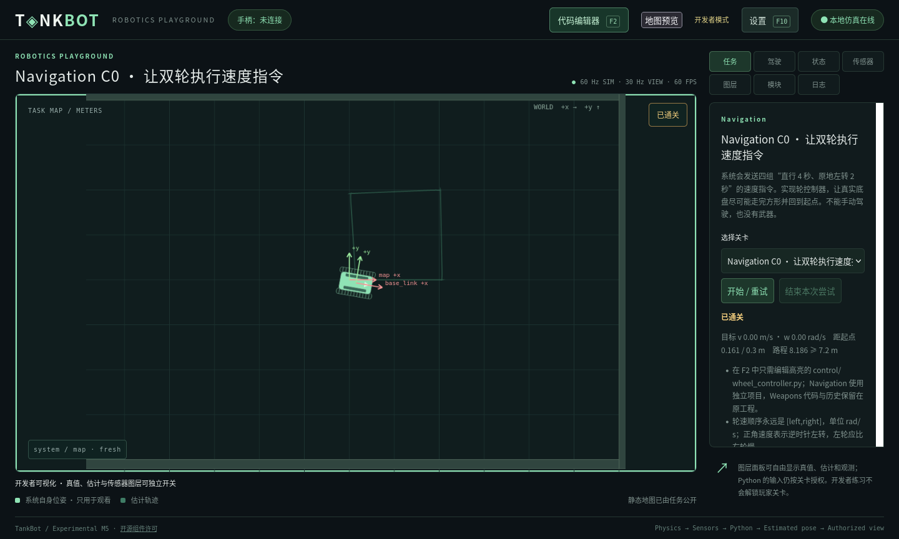

# Navigation C0 验收记录

日期：2026-11-02 至 2026-11-03。范围为用户确认的首关，不代表后续课程或其他平台完成。设计见 [33](../33_NAVIGATION_MOTION_CONTROL.md)。

## 已确认配置与自动验收

- navigation.c0 使用独立工作区，C5 后解锁，无武器/敌车/人工驾驶。
- 轮端直流电机与惯量耦合；参数来自差速底盘 YAML，旧六关仍用车体伺服。
- 4×（0.5 m/s 直行 4 s、π/4 rad/s 原地左转 2 s），24 仿真秒结束时结算。
- 参考控制器首批 tick 12 生效，tick 1452 结束；距起点 0.1608913803 m、实际路程 8.1859424673 m，满足 ≤0.30 m / ≥7.2 m。参考解只在测试中使用，未写入真实玩家源码。
- tests/test_navigation.py 专项 10 项通过：闭环、零输出失败、非法数组原生 traceback、精确时序/不重置、限幅/惯量/方向/看门狗、输入/UI 权限、无效参数/反馈撤权、工程/历史保留。
- Rust 18 项通过；原生/WASM 共 4800 个快照相等，含 600 个轮电压状态，不承诺跨平台位级一致。

## 网页与回归结果

原生服务与浏览器 WASM/Pyodide 均通过 Firefox 真实界面验收：Weapons→Navigation、仅底盘显示、F2 文件高亮、保存/测试不计时、部署关闭编辑器并锁定、24 秒轨迹成功、完整轨迹保留、重试和往返章节。每次返回 Weapons 原快照（含 ledger）完全相等，Navigation 源码也保留；两种模式的最终误差/路程均为上述数值。

独立配置/报告位于 .m1-cache/navigation-qa/{native,browser}，UI 报告为 native-ui.json/browser-ui.json；可重跑 tools/browser_navigation.py。全部验收服务和专用 Firefox 已关闭。

最终完整 Python 回归 **222 项通过，170.848 s**；新增“独立课程不读取损坏的旧工程”用例后另运行工作区回归 **26 项通过**。旧六关/两底盘共 12 条冻结物理/传感器轨迹继续相等。第一次运行中的三处旧数量/顺序断言已按新增关卡修正，没有改旧关卡数值或冻结基线。

Rust **18 项通过**；Node 的 10 个 UI 测试文件通过；原生/WASM **4800 快照比较通过**。文档链接、Schema、JSON/Python 示例、生成配置与 git diff --check 通过。其他 OS/浏览器、强服务端沙箱及后续 Navigation 课程仍未验证或实现。

## 限制与数据保护

轮惯量仅在驱动方程计入；碰撞沿用原刚体参数，轮速随真实状态反算。未模拟电感、电流限幅、轮胎滑动或轮组碰撞体。终点/路程两项条件不能唯一约束方形路线，不增加未经确认的方向/路径门槛。

真实 userdata 源码/进度未迁移、覆写或删除；所有测试写入使用 .m1-cache/navigation-qa 或临时目录。未执行 Git 提交/推送。
