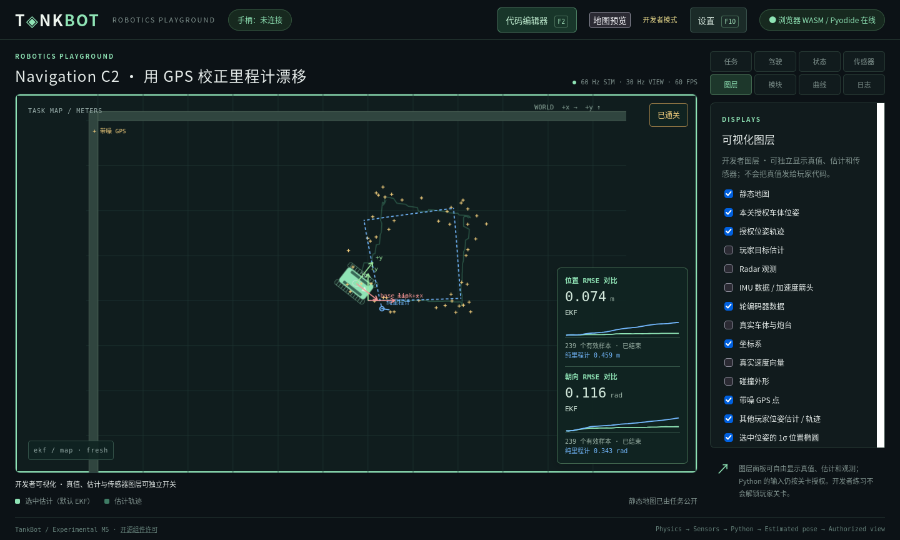

# Navigation GPS/EKF 定位验收

日期：2026-11-03。范围为用户确认的 Navigation C2，见 [设计](../35_NAVIGATION_GPS_LOCALIZATION.md)、[ADR-0048](../adr/0048-navigation-gps-localization.md) 与 [关卡 YAML](../../levels/navigation.C2.yaml)。未改旧八关的玩法或物理，没有增加外部算法依赖。

## 同采样时刻的闭环结果

参考轮控制器、中点里程计及三状态EKF仅用于测试临时工程，未写入真实玩家源码。正式运动序列为24秒，终局前已提交239次有效估计；末批次不等待、不补算。

| 运行 | EKF位置RMSE (m) | EKF朝向RMSE (rad) | 纯里程计位置 (m) | 纯里程计朝向 (rad) | 实际路程 (m) |
|---|---|---|---|---|---|
| controlled原生，seed=0，启动即部署 | 0.087210 | 0.108640 | 0.457053 | 0.346629 | 8.184311 |
| 原生服务，Firefox实际编辑/升级/部署 | 0.067826 | 0.090994 | 0.410967 | 0.309067 | 8.222848 |
| WASM/Pyodide，Firefox实际编辑/升级/部署 | 0.074266 | 0.115676 | 0.458930 | 0.342896 | 8.204899 |

三项均满足已确认的路径≥7.2 m、位置RMSE≤0.15 m、朝向RMSE≤0.15 rad和有效估计≥100次。原生controlled终点距起点0.423700 m，仍正确通关：本关已经明确取消回原点门槛，没有偷偷放宽定位标准。关闭GPS校正时，默认种子下误差与纯里程计一致，估计验收失败。

原生/浏览器UI部署时刻分别为tick120/306，首个正式控制提交为132/318，结束为1572/1758，均恰好1440 tick。准备期传感器继续采样，部署时刻不同会使用不同段的固定随机流；重现必须包含配置、seed、部署时刻及完整输入序列，不是仅匹配seed。测试另验证seed=1重复运行相同，seed=1/2参考解也通过；不承诺跨硬件/目标位级确定性，也不要求融合在每个种子的每一项指标都优于里程计。

## 自动化覆盖

完整Python回归：**252项通过，219.174秒**，含原有武器/地图/模块图/部署/工作区/存档回归。C2专项10项在最终权限与错误路径收尾后再次通过，20.995秒。新增传感器5项、SDK/协议3项验证：

- GPS位置/协方差、噪声统计、采样周期、实例重置与独立随机流；增加GPS不改变编码器序列。
- 编码器轮速和累计轮角共享增益/噪声模型，控制/里程计/EKF共用一次消息，没有理想旁路。
- GPS缓存去重、采样tick严格匹配、旧或未对齐观测跳过/诊断；部署reset不泄漏当前位姿。
- float64数组形状、NaN/Inf、非PSD协方差的Python traceback或明确Router拒绝，错误快速结束。
- 固定EKF评分独立于显示选源；纯里程计单独计数；比较指标分别授权，运行和终局均裁剪。
- V5候选白名单、帧/过期检查、无真值输入；源代码/历史非覆盖、受管C1↔C2升级与旧设置/进度字节保留。

Node的**13个测试文件通过**，含新增GPS/轨迹容量、重复轮询、run/revision清空、椭圆主轴、巨大有限协方差、防溢出插值和共轴RMSE。已有4800个原生/WASM物理快照对比继续相等，Rust物理源码未修改。

## 真实界面验收

工具 [browser_navigation_localization.py](../../tools/browser_navigation_localization.py) 在原生与浏览器服务均通过：C1工程→切C2→控制器/里程计源码相同→编辑高亮EKF文件→预览仅升级系统文件→测试→部署→编辑器自动关闭且运行期锁定→显示GPS、两条估计轨迹、P椭圆、两项双线RMSE→通关→重试清空评分并使用新run→检查源码revision保留。页面无整体滚动；图层允许独立切换，开发者真值开关默认未开启。



复跑使用独立临时配置、工作区、设置与存档，证据在 `.m1-cache/navigation-c2-qa/`，完整回归日志在 `.m1-cache/navigation-c2-probe/`；这些本机产物不提交。验收服务与专用Firefox在检查后关闭，不操作日常userdata。独立配置中的端口只供本机QA，不改变产品默认端口。

额外复跑曾在第6个测试批次触发一次 RESOURCE_LIMIT，未部署候选，失败记录保留为 browser-timeout.json；启动示例在长时间准备状态也另有一次同类拒绝。该run的已完成启动示例批次p50=2 ms、p95=3 ms、max=7 ms，Authority tick记录到max=121 ms；这些数据不能精确解释候选失败批次的耗时。当前预算包含执行与消息往返的墙钟时间，浏览器/OS停顿可能导致偶发失败，未宣称硬实时或以“重试成功”认定根因已修复。保留20 ms预算后，在干净Firefox进程中完整复跑再次通过，数值与上表浏览器行相同；此调度限制仍存在，后续需独立的分段延迟测量再决定优化。

## 命令与限制

```bash
env PYTHONPATH=sdk/python .m1-cache/learning-venv/bin/python -m unittest discover -s tests -v
node --test tests/test_*.mjs
python3 docs/tools/check_design.py
python3 tools/export_profile.py --offline --check
python3 tools/prepare_browser.py --offline
git diff --check
```

套接字测试与浏览器检查在获准的本机回环网络环境执行。测试主要平台为Linux/Firefox，本次不宣称已经验证Windows/macOS或其他浏览器。最终文档/Schema/生成配置检查应以提交前输出为准；文档检查只是结构检查，不能替代上述真实运行证据。

仍未实现IMU融合、异步GPS延迟/乱序重放、打滑/多径、导航路径跟踪或强服务器沙箱；本地浏览器信息权限仍是教学与接口隔离。C2的三状态参考EKF使用有效Q近似固定增益漂移，玩家可选择更完整的内部模型，公开输出及权限不变。
