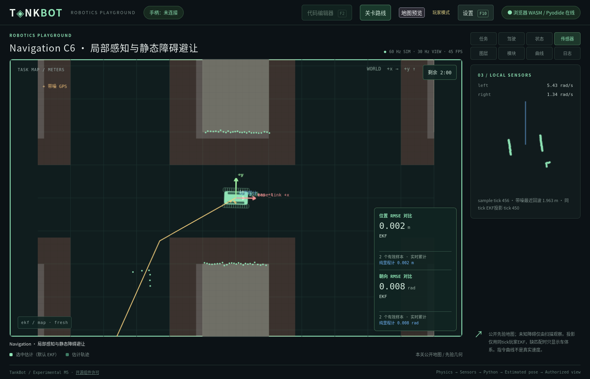
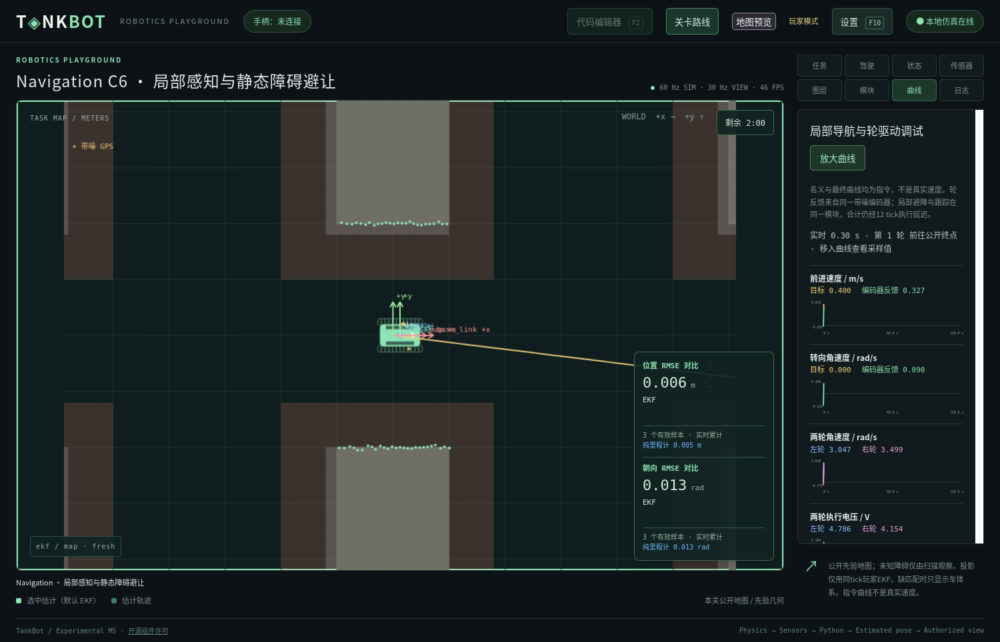
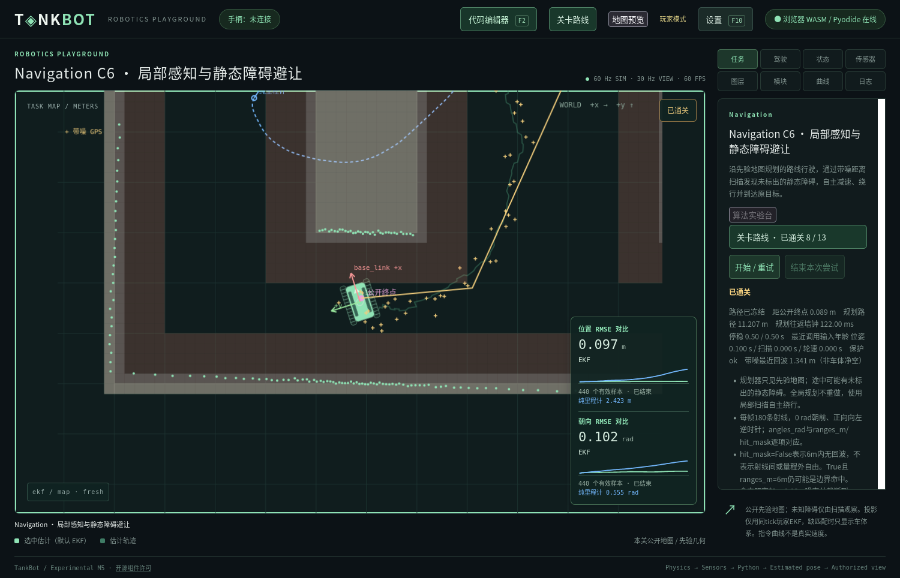

# Navigation C6 验收记录

日期：2026-11-11。本轮起始保留C5未提交工作；期间外部HEAD更新为435adcd，C5成为已提交实现，本轮未执行commit/push。当前C6仍在工作区。设计见 [43](../43_NAVIGATION_LOCAL_AVOIDANCE.md)，决策见 [ADR-0055](../adr/0055-prior-map-local-navigation.md)。[机器可读结果](navigation-local-avoidance-validation.json)包含实际耗时、失败、配置/源码身份和验证范围。

## 数据流与边界

公开先验地图→GlobalPlanner独立5秒规划→Authority只按先验校验→冻结路径→玩家EKF/PathFollower→同模块LocalController→一份Twist→原轮控制器→轮电压→权威物理。新障碍在玩家代码执行前由独立随机流选定，完整私有物理场景仅用于碰撞、扫描及私有可达性检查。普通profile/catalogue/map与浏览器启动配置不携带私有矩形；开发者独立grant不扩大程序输入。

新增scan2d@1、Scan2D及LocalControlInput。180线、整帧10Hz、中心安装、0.05–6m与σ=0.02m均取课程YAML。相同带噪轮速供轮控、EKF及局部控制使用。原采样tick决定年龄；缺失/错误帧/年龄>0.20s主动零参考，恰好0.20s有效。两级固定提交合计12tick，command_delay_s从Contract推导，扫描年龄另计。若轮控本身也缺必需轮速，仍按原合同等待并由既有执行器看门狗兜底置零电压，不虚构反馈或承诺瞬间停车。规划/测试Worker独立，测试不移动正式世界，不把测试路径当作正式授权。

局部控制参考各不相同：几何方法使用带方向记忆的测距空隙选择和接回路线；动态窗口方法采样速度/角速度轨迹，以临时扫描窗口提供短程引导并处理局部停滞，不改变冻结全局路径或调用在线GlobalPlanner。参考只在tests/fixtures与隔离工程，正式模板为带完整类型和说明的空算法。

## 原生参考闭环

以下为独立原生Worker、真实Core物理、controlled测试提交模式。所有行均成功、连续停稳30tick；正式行驶120秒、5秒规划、原30ms周期截止及6tick门保持。不是宿主追赶可靠性测试。

| 方法 | seed | 行驶秒 | 终局追踪RMSE/m | 最大偏离/m | 往返p99/ms | 截止故障 |
| --- | --- | --- | --- | --- | --- | --- |
| geometric | 0 | 48.00 | 0.488 | 1.076 | 4.743 | 0 |
| geometric | 1 | 47.90 | 0.461 | 1.072 | 4.774 | 0 |
| geometric | 2 | 45.78 | 0.463 | 1.140 | 4.664 | 0 |
| dwa | 0 | 37.65 | 0.471 | 1.162 | 9.270 | 0 |
| dwa | 1 | 39.83 | 0.573 | 1.288 | 9.634 | 0 |
| dwa | 2 | 37.65 | 0.590 | 1.241 | 9.411 | 0 |

绕行可超过C4的0.20/0.50m门槛而仍正常通关，证明没有误套C4评分。追踪误差使用真实质心到完整原规划折线的时间加权统计，仅终局诊断。直接名义跟踪在seed0发生碰撞，只停车最终超时。另以仅公开地图的不同搜索代价且不做捷径生成替代路线，局部控制原样返回名义指令仍通关；没有必须触发避障动作的隐含条件。

## Firefox / Pyodide 实际流程

以下每行实际完成隔离的C5→C6→F2编辑→升级预览/显式应用→独立测试→新Runtime正式规划/部署→通关→重试→返回C5。前置进度为隔离夹具，不冒充本轮从C0逐关游玩。另有原生HTTP模式下两种参考的同一Firefox流程，详见JSON。最新DWA流程额外通过不可变revision回读检查；所有流程核对五项旧算法和自建文件不变。

| 方法 | seed | 行驶秒 | 终局追踪RMSE/m | 最大偏离/m | 往返p99/ms | 截止故障 |
| --- | --- | --- | --- | --- | --- | --- |
| dwa | 0 | 37.12 | 0.475 | 1.155 | 25.000 | 0 |
| dwa | 1 | 42.77 | 0.518 | 1.285 | 22.000 | 0 |
| dwa | 2 | 44.03 | 0.586 | 1.386 | 28.000 | 0 |
| geometric | 0 | 56.27 | 2.555 | 4.738 | 30.000 | 0 |
| geometric | 1 | 48.17 | 0.466 | 1.071 | 25.000 | 0 |
| geometric | 2 | 46.00 | 0.486 | 1.134 | 23.000 | 0 |

车体系扫描和地图点可独立开关；地图投影等待同sample tick玩家EKF，真实运行例如扫描tick462配对投影tick456是对旧扫描的延迟匹配，不是拿456位姿投影462扫描。没有匹配时仅车体系；缓存有界并随run/revision/source/frame清理。旧revision、ledger/history通过共享存储回归和真实流程中的不可变revision回读验证。程序拿不到私有几何、真实速度或任务真值Topic。

## 耗时与失败记录

C6模块声明分配4/2/4/10ms，总额20ms；原生30/Pyodide40ms仍experimental，未引入逐模块CPU硬配额。组合导航update包含路径跟踪、局部控制、输入/诊断构建；分模块及整批数据见JSON，不相加各模块p99。扫描宿主成本与规划完整往返另列。窗口容量512，较长尝试只保留尾部窗口分位数，不能当作全程分位数；浏览器量化导致0ms不代表零成本。成功运行不证明截止失败率低于1%。

开发中保留的失败包括：DWA早期局部停滞超时、原生30ms与Pyodide40ms截止失败、首个EKF尚未发布的QA竞态、类型教材漏列字段、初次浏览器断连。JS把6.0转为整数曾使距离数组截断噪声，现显式float64且有复现回归；初次断连的原始Python栈未留存，不宣称已回溯证明其唯一原因。截止失败按原规则失败，没有增加预算、延长关卡或移动提交门。

有实测后才对新增扫描数组做等价结构校验优化：100次相同初始视图的原生校验均值约1.43→0.63ms，保留容器/容量/语义校验，非法与未知形状回标准JSON Schema路径。标准/优化验证器对照通过，不从此推断跨平台性能。

首轮统一检查392项Python中5项失败：4项为旧目录/曲线集合断言，另1项为DWA对准备时刻对应噪声序列的局部停滞。原日志standard-check.log保留。更新断言及参考脱困后完整重跑；所有失败JSON、日志、截图与重跑记录保存在.m1-cache/navigation-c6-qa，不只记录成功重试。

## 实际检查命令与结果

- `python3 tools/check.py --offline`：最终393项Python、21个普通Node脚本（TAP共87项）、18项Rust、文档和生成配置一致性通过。首轮失败未删除。
- `npm run test:wasm`：原生/WASM共享ABI与武器、轮电压、仓储接触等既有对照通过；不是其他浏览器支持证明。
- `python -m unittest tests.test_local_scan tests.test_local_control`：射线/范围/hit_mask/噪声/重复/reset/close、数组不可写、随机流隔离、缺失/过期/错误帧、0.20边界、倒车拒绝及限幅。
- `python -m unittest tests.test_navigation_local`：两参考×3seed、规划隔离/先验路径、开发者与程序边界、死循环终止、名义碰撞/停车超时/替代路线、五算法/自建文件/历史往返。
- `python -m unittest tests.test_branching_progression tests.test_level_plugins`：27项通过。初次本机HTTP用例被沙箱禁止端口，授权后在隔离环境重跑通过，保留compatibility.log与compatibility-unrestricted.log。
- `.m1-cache/learning-venv/bin/python tools/test_browser.py --scenario local-navigation --mode both --offline --seed 0 --local-controller dwa`：原生与Pyodide真实玩家流程及曲线截图；`--mode browser --seed 1/2`补其他种子，`--local-controller geometric`验证另一参考。
- `python3 docs/tools/check_design.py`、`python3 tools/export_profile.py --check --offline`、`git diff --check`：收尾另行复核。

## 兼容性与限制

原12关YAML、底盘模型、地图资产和任务开始时所有历史Markdown报告哈希不变。未操作日常userdata，未清理玩家工程或引入外部依赖；源码/自建文件及不可变历史按原锁/CAS/HEAD机制保留。未修改Rust物理、评分阈值、传感器既有误差、5秒规划、20ms声明或30/40ms截止。应用2.1、关卡Schema1.0、既有Topic保持，新增消息为未发布profile的加法扩展。

验证范围为本机Linux x86_64、Python3.14.4/NumPy2.3.3、Firefox/Pyodide0.29.5；具体UA和profile摘要见JSON。不是Windows/macOS、其他浏览器、移动障碍、在线全局重规划、建图/SLAM、Arena强沙箱或任意算法可靠性证明。相同seed重现任务/障碍；准备耗时、部署tick及随机流消费相位会改变测量序列，因此不承诺任意部署时刻得到相同成绩。正式生成有界失败，不放宽规则。

## 实际文件

- `README.md`
- `config/game.yaml`
- `core/tests/fixtures/default-profile.json`
- `docs/01_PROJECT_VISION.md`
- `docs/02_SYSTEM_ARCHITECTURE.md`
- `docs/03_PROTOCOL_SPECIFICATION.md`
- `docs/04_STATE_AND_VIEW_MODEL.md`
- `docs/05_ROBOT_MODULE_SYSTEM.md`
- `docs/06_WORKSPACE_AND_TEMPLATES.md`
- `docs/08_RUNTIME_AND_SECURITY.md`
- `docs/09_LEVEL_DESIGN.md`
- `docs/10_DEVELOPMENT_ROADMAP.md`
- `docs/11_CRITICAL_QUESTIONS.md`
- `docs/12_VALIDATION_AND_OPEN_QUESTIONS.md`
- `docs/27_LEVEL_PLUGIN_ARCHITECTURE.md`
- `docs/32_RESOLVED_SCENE_AND_COMPONENTS.md`
- `docs/36_BRANCHING_PROGRESSION.md`
- `docs/38_ENGINEERING_AND_ALGORITHM_LAB.md`
- `docs/39_NAVIGATION_COURSE_PROPOSALS.md`
- `docs/40_NAVIGATION_CONTINUOUS_PATH_TRACKING.md`
- `docs/43_NAVIGATION_LOCAL_AVOIDANCE.md`
- `docs/README.md`
- `docs/adr/0055-prior-map-local-navigation.md`
- `docs/adr/README.md`
- `docs/examples/README.md`
- `docs/examples/scan-message.json`
- `docs/reports/NAVIGATION_LOCAL_AVOIDANCE_VALIDATION.md`
- `docs/reports/assets/navigation-local-avoidance/native-control.png`
- `docs/reports/assets/navigation-local-avoidance/pyodide-control.png`
- `docs/reports/assets/navigation-local-avoidance/pyodide-finished.png`
- `docs/reports/assets/navigation-local-avoidance/pyodide-scan.png`
- `docs/reports/navigation-local-avoidance-validation.json`
- `docs/schemas/README.md`
- `docs/schemas/envelope.schema.json`
- `docs/schemas/level.schema.json`
- `docs/schemas/local-navigation.schema.json`
- `docs/schemas/payloads.schema.json`
- `docs/schemas/settings.schema.json`
- `docs/schemas/simulation-profile.schema.json`
- `host/tankbot_host/application.py`
- `host/tankbot_host/authority.py`
- `host/tankbot_host/browser_server.py`
- `host/tankbot_host/campaign.py`
- `host/tankbot_host/control_feedback.py`
- `host/tankbot_host/distance_scan.py`
- `host/tankbot_host/global_planning.py`
- `host/tankbot_host/learning.py`
- `host/tankbot_host/level_plugins.py`
- `host/tankbot_host/level_templates.py`
- `host/tankbot_host/local_scene.py`
- `host/tankbot_host/management.py`
- `host/tankbot_host/runtime_profile.py`
- `host/tankbot_host/scene_definition.py`
- `host/tankbot_host/sensor_instances.py`
- `levels/README.md`
- `levels/navigation.C6.yaml`
- `protocol/tankbot_protocol/validation.py`
- `sdk/python/tankbot/__init__.py`
- `sdk/python/tankbot/local_navigation.py`
- `sdk/python/tankbot/messages.py`
- `templates/navigation/local_controller.py`
- `templates/navigation/local_module.py`
- `tests/fixtures/local_dwa.py`
- `tests/fixtures/local_geometric.py`
- `tests/local_navigation_support.py`
- `tests/test_attempt_rules.py`
- `tests/test_branching_progression.py`
- `tests/test_control_feedback.py`
- `tests/test_level_plugins.py`
- `tests/test_local_control.py`
- `tests/test_local_scan.py`
- `tests/test_map_assets.py`
- `tests/test_navigation_local.py`
- `tests/test_scan_view.mjs`
- `tests/test_workspace_scopes.py`
- `tools/browser_navigation_planning.py`
- `tools/test_browser.py`
- `web/app.js`
- `web/browser-client.js`
- `web/campaign-ui.js`
- `web/index.html`
- `web/scan-view.js`
- `web/visualization.js`
