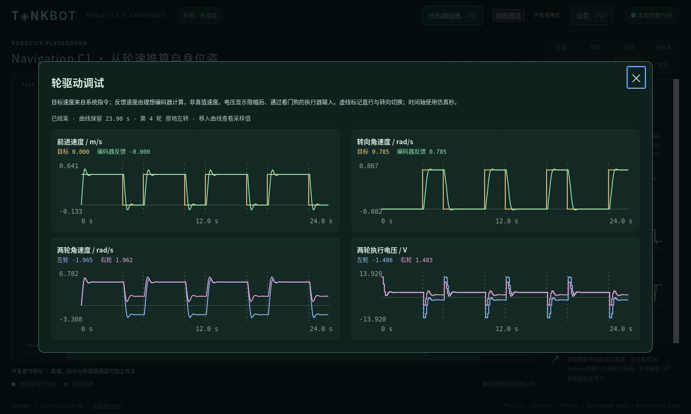

# Navigation 控制反馈与里程计验收

日期：2026-11-03。范围为授权控制曲线和用户确认的 Navigation C1；设计见 [34](../34_NAVIGATION_ODOMETRY_AND_FEEDBACK.md)，决策见 [ADR-0047](../adr/0047-navigation-odometry-and-control-feedback.md)。

## 本机闭环结果

参考轮控制器与中点里程计仅安装于测试临时工程，未写入真实玩家项目。24 秒结束时，239 个同采样 tick 的有效位姿得到位置 RMSE 0.0225988006 m、朝向 RMSE 0.0209921208 rad；真实终点误差 0.1608913803 m、真实路程 8.1859424673 m，满足五项确认条件。

固定返回初始位姿时，控制器仍完成原运动两项标准，但全程 RMSE 不达标，结果为 estimation_failed。偏移 2 m 的合法估计照常显示，不修改真实运动。返回错误形状时快速失败，运行日志保留 Python traceback。终局只使用结束前已提交的估计，不等待尚未提交的最后批次。

## 自动化与真实界面

专项检查覆盖采样对齐、重复/未知时刻、坐标系、选源、无估计、形状异常、源码/历史保留、非覆盖升级、曲线容量、单位/信号授权、电压截断、看门狗及增量游标。最终完整 Python 回归 **234 项通过，180.330 s**。

原生服务与 WASM/Pyodide 浏览器服务都通过 Firefox 真实界面验收：编辑 C0 控制器、测试、部署、查看四图、通关、切 C1、确认原控制器源码相同、编辑里程计、预览仅更新系统文件、再次测试部署、显示两项 RMSE、通关、重试和返回 C0。最终两种模式的 239 次估计及四项误差/路程数值均与上文一致；每次保留 240 个控制样本。放大面板四图同屏，页面不滚动；部署后编辑器自动关闭且运行期锁定。

复跑入口为 `tools/browser_navigation_odometry.py`。独立配置、JSON 和截图在 `.m1-cache/navigation-odometry-qa/`；专用服务与 Firefox 在验收后关闭。参考截图：



Node 的 11 个 UI 测试文件通过；原生/WASM 的 4800 个物理快照比较继续相等。Rust 物理源码本轮未修改。文档检查通过：118 个 Markdown、792 个本地链接、15 个 Schema、34 个正例、25 个结构拒绝用例、13 个 JSON 和 13 个 Python 代码块；生成配置及 git diff --check 通过。

第一次完整回归的 11 个套接字用例被执行沙箱阻止；允许本机回环网络后重跑。另发现地图测试仍按旧文件名拼接路径，已改为读取 metadata.id，不改变地图或冻结物理基线。

首次包含放大面板的浏览器验收出现一次 RESOURCE_LIMIT，已完成批次 p50=1 ms、p95=2 ms、max=5 ms。控制状态轮询原先重复传输整段曲线，现使用 run_id/control_after_tick 游标请求新增样本，旧接口仍可取完整快照；跨 run 自动恢复完整数据。最终同一 20 ms 预算下，两关完整流程通过，未放宽截止或隐藏该次失败。浏览器调度仍不承诺硬实时。

## 复核命令

```bash
env PYTHONPATH=sdk/python .m1-cache/learning-venv/bin/python -m unittest discover -s tests -v
node --test tests/test_control_feedback.mjs tests/test_live_metrics.mjs
node tests/test_wasm.mjs
python3 docs/tools/check_design.py
python3 tools/export_profile.py --check --offline
git diff --check
```

## 边界

控制反馈由参考指令、编码器和生效输入构成，没有新增 Ground Truth 通道。自身历史只在 Authority 内评分；位置/朝向 RMSE 通过独立授权的聚合接口显示。两个图模块共用 20 ms 预算，不增加电机、轮胎或噪声模型。

真实 userdata、已有玩家源码、存档及历史未修改；所有有写入的验收均使用临时目录或 .m1-cache 下的独立配置。后续噪声/IMU 融合、其他导航关卡、其他平台及强服务端沙箱不属于本轮完成项。
