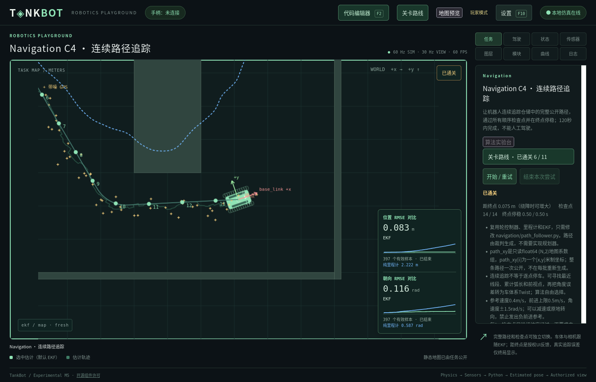
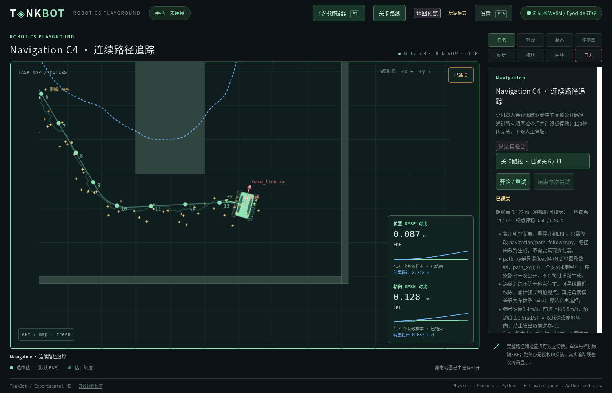

# Navigation C4连续路径追踪验收

日期：2026-11-05。对应 [40](../40_NAVIGATION_CONTINUOUS_PATH_TRACKING.md)、[ADR-0052](../adr/0052-generated-continuous-path-tracking.md)。本轮新增navigation.c4，旧十关的模型、接口、阈值与玩家代码不变；未提交或推送Git。

## 环境、隔离与复现

Linux x86_64，CPython 3.14.4 / Firefox 157.0 与 Pyodide 0.29.5，原生debug Core和WASM release使用同一Rust代码。全部QA使用临时目录或.m1-cache/navigation-c4-qa下独立Workspace/设置/存档，未修改日常userdata。真实页面验收以独立前置完成夹具从C3进入C4，不用开发者绕过解锁；不宣称重新玩完前置所有课程。

```bash
python3 tools/build.py --wasm --release --offline
python3 tools/prepare_browser.py --offline
python3 tools/check.py --offline
npm run test:wasm
npm run test:browser -- --scenario path-tracking --mode both --offline
npm run test:browser -- --scenario path-tracking --mode browser --seed 7 --offline
git diff --check
```

浏览器/HTTP检查需要本机套接字和Firefox进程权限；受限环境需单独放行。构建通过、规则回归和完整玩家闭环分别记录，不混为跨平台支持。

## 生成算法与默认参数

正式地图只引用navigation_warehouse.yaml，几何未修改。8邻接有界Dijkstra禁止穿角，以独立seed打乱符合约束的候选终点；可见性捷径后做圆弧圆角并重采样，最终逐线段复验。没有固定终点/控制点/路径答案。

搜索格0.20m与交付间距0.10m独立。完整差速车体外接圆半径0.50m，规划/交付余量0.30/0.15m，平滑半径1.0m、构造步长0.025m；最终最小转弯半径0.70m。上限20000格/展开、64候选、8192构造点和256交付点，失败明确退出；保守圆通道会拒绝部分实际可通过的狭窄间隙。

最终验证12–18m、端距≥5m、明显绕障/转弯、无自交、完整车体安全、有限坐标及每段0.10m（末段可短）。解析对象绑定地图/模型/初态/生成参数/seed和完整路径摘要；测试、部署和重试不改路径，不消费传感器随机流。32个seed的可复现性、JSON往返、平滑后安全和有界失败在自动测试中覆盖。

## 原生受控多seed闭环

参考解只在tests/path_tracking_support.py与隔离工程，正式空模板仍返回零Twist。轮控/里程计/EKF均复用旧课程测试解，追踪器只读取玩家EKF与公开路径。

| Seed | 路径长m | 追踪RMSE m | 最大偏离m | 计分仿真秒 | 检查点 | 结果 |
| --- | --- | --- | --- | --- | --- | --- |
| 0 | 12.760 | 0.1389 | 0.2626 | 40.783 | 14/14 | 通过 |
| 1 | 12.956 | 0.1209 | 0.3079 | 44.167 | 14/14 | 通过 |
| 2 | 14.448 | 0.1484 | 0.4286 | 46.050 | 16/16 | 通过 |
| 7 | 12.166 | 0.1735 | 0.3690 | 38.983 | 14/14 | 通过 |

受控执行用于可复现语义验证，不是20ms实时保证。传感器在准备阶段也推进；真实网页编辑/部署时刻不同，因此噪声流位置和分数可与受控测试不同，不能只凭同seed断言整段闭环逐位相同。实际网页另测墙钟、固定提交和正式通关。原始有界记录位于.m1-cache/navigation-c4-qa/native-multiseed.json，不将记录中的完整路径预存为正式答案。

## 真实页面流程

两环境均执行：从已有C3工程切C4→四个旧算法逐字保留→F2编辑新追踪器→预览并只更新受管框架→短测试Ready（正式世界/评分未启动）→部署自动关闭并锁定编辑器→四模块完整运行→通关→正式存档记录→重试恢复初态/新run_id/同路径/同源码revision。验证路径与检查点可独立关闭，普通视图/Runtime不含接触真值或真实位姿旁路。

| 运行方式 | Seed | 追踪RMSE m | 最大偏离m | 计分仿真秒 | 检查点/停稳 | 结果 |
| --- | --- | --- | --- | --- | --- | --- |
| 原生Firefox页面 | 0 | 0.1261 | 0.2645 | 39.717 | 14/14，0.50s | 通过 |
| WASM/Pyodide页面 | 0 | 0.1406 | 0.2697 | 41.783 | 14/14，0.50s | 通过 |
| WASM/Pyodide页面 | 7 | 0.1770 | 0.3571 | 38.467 | 14/14，0.50s | 通过 |

原生实际回合400批，页面完整通过记录往返p50/p95/p99为1.78/2.28/2.40ms，最大2.46ms。当前Pyodide seed0的420批为6/13/17ms，最大18ms；seed7的387批为5/8/15ms，最大17ms。Pyodide模块整批执行通常2ms、p95约3ms，桥接约4ms；固定提交等待单独统计，不能与执行时长相加后当作20ms预算。成功回合均无超时，检查每批提交差为6tick；这不是硬实时保证。





原始记录在.m1-cache/navigation-c4-qa/browser/native/75268ed5与browser/3e5b7b36、c6f7ac84等隔离目录。源码/快照、配置、seed、路径身份、实际起止tick与耗时随各回合保留；开发者模式未开启。

## 截止失败与基于测量的局部优化

开发过程保留失败：初始参考解前视0.60m时，seed7累计RMSE为0.203635m、最大偏离0.400058m，按原0.20m阈值失败；只调整测试参考解前视为0.45m，未改变评分。

Pyodide真实运行曾出现20–27ms往返截止，尽管模块执行通常2–4ms。记录位于.m1-cache/navigation-c4-qa/browser/browser的0640aa2a、1070c6c9、16dfd805等独立目录；以及后续ef497557回合；每次失败均按controller_error结算，未放宽预算或接受迟到输出。一次恰好20ms被浮点相减误判，改为比较绝对截止时间；20ms边界可接收、任意实际超限仍拒绝，有独立边界回归。

cProfile定位Authority主要开销为递归Envelope结构验证；120tick插桩从约7.50s降至约3.08s（插桩本身有开销，不是实际仿真速度）。局部优化只跳过严格证明条件为假的、没有else或其他兄弟约束的schema标签分支，保留所有基础/有效分支/其他规则，并在递归引用中保持相同2020-12验证类。标准Schema文件与公共消息形状未变，2451个夹具变体和通用条件边界与未修改标准验证器逐一对照。

另发现验收脚本每0.5秒重复请求整段控制历史，和正式UI的增量游标不同；Core Worker同步复制/JSON序列化大回复会阻塞结果投递。脚本改为同一control_after_tick/run_id接口，并确认真实曲线仍保留100个以上样本；随后完成通关。该关联来自消息路径和实测日志，不把非受控前后分位数当严格因果基准，也不声称所有超时均已消失。

## 规则、权限与兼容回归

覆盖点到完整折线（含端点）距离、时间加权、同tick幂等、检查点顺序/边界/单tick上限、最大偏离严格超限、真实求解器接触私有观测、逐项撤销终局反馈权限、连续停稳中断、终局优先级/最后tick、立即RMSE结算和冻结；控制负vx拒绝、上限限幅、缺测/过期/错帧零参考、只读数组、短测试隔离和重复部署不重置任务。原生/WASM增加900tick仓储接触对照，旧物理基线保留。

Schema回归拒绝缺少静态授权、矛盾生成参数、无效预算/组件/来源，并以临时非课程ID插件复用同组件验证零代码发现。旧课程源码/revision/ledger/history、Navigation工程往返、旧存档/非连续完成集合及分支进度保持既有回归。

统一入口 `python3 tools/check.py --offline` 返回0：337项Python（含旧课程冻结/物理/接口/部署/权限/存档和全部新关回归）、18个普通前端测试文件共75项、18项Rust测试均通过；文档/44个正例/25个结构反例与生成配置检查通过。原始日志：.m1-cache/navigation-c4-qa/standard-check.log。

`npm run test:wasm`通过：原有武器/双底盘/巡逻/装甲/轮电压对照，加900tick仓储墙体接触对照；同工具链逐快照实测相等，不外推其他硬件位级确定性。`build.py --format-check`与`git diff --check`通过。浏览器资源和编辑器分别重新prepare/build。

全量首轮发现旧时限列表与空地图可启动断言需要容纳新课程，另有一个新测试预期的错误路径过窄；已修正并全量重跑通过。另将3项旧HTTP安全测试显式绑定临时Workspace，单独重跑3项通过，避免默认玩家工程参与验证；未发现userdata当日文件变更。

另一次完整回归运行在快照测试阶段出现RESOURCE_LIMIT，保留9ea4db08目录与失败截图；此时正式任务尚未开始，部署按钮保持禁用，源码未改变。验收脚本现会在测试失败时立即收集job/Runtime诊断，不再只等待按钮超时。短测和正式执行都未放宽20ms；这类运行环境尾延迟仍需后续持续测量。

## 限制与下一步

本机Linux/Firefox证据不代表Windows/macOS、其他浏览器或硬实时保证。20ms包含Authority与跨Worker排队/往返，系统负载仍可造成失败；保留失败位置/分位数，不把观测当CPU配额。保守通道不是朝向相关最优规划；地图覆盖无解会明确拒绝，仍只算练习。生成摘要保证当前算法/配置可核对，不承诺不同硬件浮点位级一致。

完整控制器A/B自动成对实验、规划/避障/SLAM仍未实现。后续可按 [39](../39_NAVIGATION_COURSE_PROPOSALS.md) 设计已知地图规划；新增模型、正式阈值与课程须独立确认。

## 实际改动文件

核心新增为path_generation.py、path_tracking.py、只读数组SDK、两项通用模板、path-view.js与单独课程YAML；其余接入和回归文件如下。生成default-profile只增加新课程/模块/教材与章节成员，旧关卡已有键值经语义对比保持相同。

工作区中另有两份并行生成的Runtime时限评估文件，本任务未修改它们，也未采用其中候选预算；以下仅列本任务实际改动。

<details>
<summary>完整文件清单</summary>

- [README.md](../../README.md)
- [assets/maps/README.md](../../assets/maps/README.md)
- [assets/maps/navigation_warehouse.yaml](../../assets/maps/navigation_warehouse.yaml)
- [config/settings.yaml](../../config/settings.yaml)
- [core/src/lib.rs](../../core/src/lib.rs)
- [core/tests/fixtures/default-profile.json](../../core/tests/fixtures/default-profile.json)
- [docs/03_PROTOCOL_SPECIFICATION.md](../03_PROTOCOL_SPECIFICATION.md)
- [docs/05_ROBOT_MODULE_SYSTEM.md](../05_ROBOT_MODULE_SYSTEM.md)
- [docs/07_SIMULATION_DESIGN.md](../07_SIMULATION_DESIGN.md)
- [docs/10_DEVELOPMENT_ROADMAP.md](../10_DEVELOPMENT_ROADMAP.md)
- [docs/22_SETTINGS_MODES_AND_PROGRESS.md](../22_SETTINGS_MODES_AND_PROGRESS.md)
- [docs/27_LEVEL_PLUGIN_ARCHITECTURE.md](../27_LEVEL_PLUGIN_ARCHITECTURE.md)
- [docs/31_MAP_OVERRIDE_AND_PREVIEW.md](../31_MAP_OVERRIDE_AND_PREVIEW.md)
- [docs/32_RESOLVED_SCENE_AND_COMPONENTS.md](../32_RESOLVED_SCENE_AND_COMPONENTS.md)
- [docs/36_BRANCHING_PROGRESSION.md](../36_BRANCHING_PROGRESSION.md)
- [docs/39_NAVIGATION_COURSE_PROPOSALS.md](../39_NAVIGATION_COURSE_PROPOSALS.md)
- [docs/40_NAVIGATION_CONTINUOUS_PATH_TRACKING.md](../40_NAVIGATION_CONTINUOUS_PATH_TRACKING.md)
- [docs/README.md](../README.md)
- [docs/adr/0052-generated-continuous-path-tracking.md](../adr/0052-generated-continuous-path-tracking.md)
- [docs/adr/README.md](../adr/README.md)
- [docs/examples/path-follower-contract.json](../examples/path-follower-contract.json)
- [docs/images/navigation-c4-browser.png](../images/navigation-c4-browser.png)
- [docs/images/navigation-c4-native.png](../images/navigation-c4-native.png)
- [docs/reports/NAVIGATION_PATH_TRACKING_VALIDATION.md](NAVIGATION_PATH_TRACKING_VALIDATION.md)
- [docs/schemas/README.md](../schemas/README.md)
- [docs/schemas/campaign.schema.json](../schemas/campaign.schema.json)
- [docs/schemas/level.schema.json](../schemas/level.schema.json)
- [docs/schemas/path-tracking.schema.json](../schemas/path-tracking.schema.json)
- [docs/schemas/settings.schema.json](../schemas/settings.schema.json)
- [docs/schemas/simulation-profile.schema.json](../schemas/simulation-profile.schema.json)
- [host/tankbot_host/application.py](../../host/tankbot_host/application.py)
- [host/tankbot_host/authority.py](../../host/tankbot_host/authority.py)
- [host/tankbot_host/campaign.py](../../host/tankbot_host/campaign.py)
- [host/tankbot_host/learning.py](../../host/tankbot_host/learning.py)
- [host/tankbot_host/level_plugins.py](../../host/tankbot_host/level_plugins.py)
- [host/tankbot_host/level_templates.py](../../host/tankbot_host/level_templates.py)
- [host/tankbot_host/management.py](../../host/tankbot_host/management.py)
- [host/tankbot_host/navigation_templates.py](../../host/tankbot_host/navigation_templates.py)
- [host/tankbot_host/path_generation.py](../../host/tankbot_host/path_generation.py)
- [host/tankbot_host/path_tracking.py](../../host/tankbot_host/path_tracking.py)
- [host/tankbot_host/runtime_profile.py](../../host/tankbot_host/runtime_profile.py)
- [host/tankbot_host/scene_definition.py](../../host/tankbot_host/scene_definition.py)
- [levels/README.md](../../levels/README.md)
- [levels/navigation.C4.yaml](../../levels/navigation.C4.yaml)
- [protocol/tankbot_protocol/validation.py](../../protocol/tankbot_protocol/validation.py)
- [runtime/browser_authority.py](../../runtime/browser_authority.py)
- [sdk/python/tankbot/__init__.py](../../sdk/python/tankbot/__init__.py)
- [sdk/python/tankbot/paths.py](../../sdk/python/tankbot/paths.py)
- [templates/navigation/path_follower.py](../../templates/navigation/path_follower.py)
- [templates/navigation/path_module.py](../../templates/navigation/path_module.py)
- [tests/fixtures/path-tracking-reference.yaml](../../tests/fixtures/path-tracking-reference.yaml)
- [tests/path_tracking_support.py](../../tests/path_tracking_support.py)
- [tests/test_attempt_rules.py](../../tests/test_attempt_rules.py)
- [tests/test_branching_progression.py](../../tests/test_branching_progression.py)
- [tests/test_browser.py](../../tests/test_browser.py)
- [tests/test_level_plugins.py](../../tests/test_level_plugins.py)
- [tests/test_m1.py](../../tests/test_m1.py)
- [tests/test_map_assets.py](../../tests/test_map_assets.py)
- [tests/test_map_override.py](../../tests/test_map_override.py)
- [tests/test_navigation_path_tracking.py](../../tests/test_navigation_path_tracking.py)
- [tests/test_path_generation.py](../../tests/test_path_generation.py)
- [tests/test_path_tracking_rules.py](../../tests/test_path_tracking_rules.py)
- [tests/test_path_view.mjs](../../tests/test_path_view.mjs)
- [tests/test_validation_dispatch.py](../../tests/test_validation_dispatch.py)
- [tests/test_wasm.mjs](../../tests/test_wasm.mjs)
- [tests/test_weapons.py](../../tests/test_weapons.py)
- [tests/test_workspace_scopes.py](../../tests/test_workspace_scopes.py)
- [tools/browser_navigation_path.py](../../tools/browser_navigation_path.py)
- [tools/test_browser.py](../../tools/test_browser.py)
- [web/app.js](../../web/app.js)
- [web/campaign-ui.js](../../web/campaign-ui.js)
- [web/path-view.js](../../web/path-view.js)
- [web/visualization.js](../../web/visualization.js)

</details>
