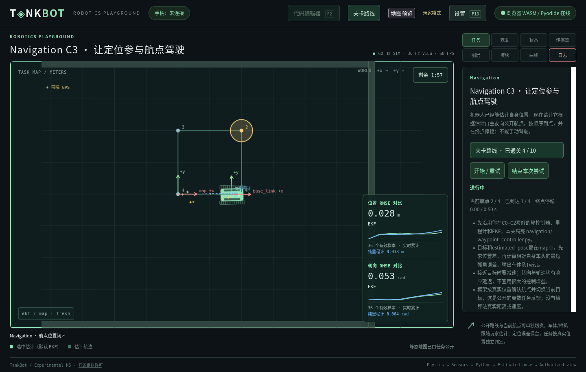
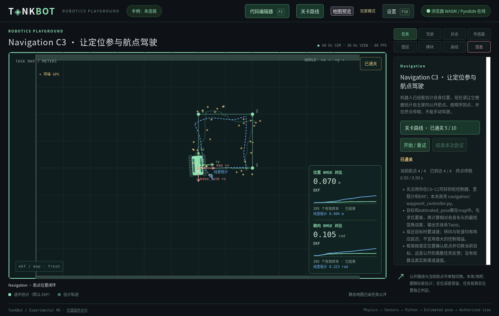

# Navigation C3 航点位置闭环验收

日期：2026-11-04。范围为用户逐项确认的 [Navigation C3](../37_NAVIGATION_WAYPOINT_CONTROL.md) 与 [ADR-0050](../adr/0050-estimated-pose-waypoint-control.md)。保留旧九关、物理及三个已有玩家算法；只新增位置控制任务，不增加规划、避障或传感器模型。

## 真实闭环结果

| 运行 | 正式耗时（仿真秒） | 到达航点 | 连续停稳tick | 位置RMSE（m） | 朝向RMSE（rad） |
| --- | --- | --- | --- | --- | --- |
| controlled原生，参考工程 | 22.567 | 4/4 | 30 | 0.102455 | 0.128108 |
| 原生服务，Firefox实际编辑/部署 | 23.100 | 4/4 | 30 | 0.082312 | 0.099423 |
| WASM/Pyodide，Firefox实际编辑/部署 | 20.600 | 4/4 | 30 | 0.070090 | 0.104797 |

全部在120秒内按序进入四个0.35m范围，并在终点满足真实平移速率≤0.05m/s、绝对角速度≤0.10rad/s连续0.5秒；不要求固定yaw。定位RMSE只作反馈，未为参考算法调整通关门槛。controlled原生在tick18开始、1372完成；原生网页144→1530；浏览器324→1560。

同seed但准备/部署时刻不同会消耗不同段的传感器随机流，表格不用于声明跨目标逐位确定性。参考控制器仅在tests和本次临时工程中使用，未写入日常userdata或系统生成的玩家算法模板。

## 两种真实玩家流程

工具 [browser_navigation_waypoints.py](../../tools/browser_navigation_waypoints.py) 在原生与浏览器均通过：

1. 使用隔离存档中的既有C2进度和独立C2工程；developer_mode=false，C3尚未通关。前置记录为测试夹具，不冒充本次实际重新通关旧课程。
2. 在真实关卡树选择C3；控制器、里程计与EKF源码相同，新增文件树高亮navigation/waypoint_controller.py。
3. 在F2编辑新位置控制器，预览升级列表，确认不含四个玩家算法文件；显式应用受管文件升级，再测试至Ready。
4. 测试后仍为preparing、航点进度为0；部署后编辑器自动关闭并锁定，正式轮控制提交才起算。
5. 显示公开路线、编号、目标容差圈、玩家估计和两组定位误差。普通图层操作可关闭/打开航点；视图无真实车体或目标对象。
6. 实际完成四航点并停稳，C3写入正式测试存档；三项旧源码和新算法保留。重试创建新run、清零目标/停稳/计时，源码revision不变，页面没有整体滚动。





## 自动化与边界

新增12项任务回归覆盖：严格航点顺序、半径边界、同tick幂等、横向速率/角速度门槛、连续停稳、观察中断、末tick成功、超时/故障优先、实际闭环、终局冻结、测试不驱动正式世界、任务显示与程序订阅独立、旧源码及历史保留、无真值输入、非法配置拒绝、错误类型/NaN反馈、缺测/过期/错帧制动、跳过适配器限幅后Authority仍强制限幅，以及重部署保留任务对象和起算时刻。

另有2项参考隔离测试、3项航点消息测试，验证Topic角色、旧图缓存不能预填新图、只读NumPy目标和消息权限；Node新增3项公开任务图层测试，覆盖显示权限、run清空、数据缺失及实际绘制。

完整Python回归：**287项通过，259.488秒**，日志为.m1-cache/navigation-c3-qa/python-final-unrestricted.log。首轮发现两处固定旧九关数量/时限数组的断言，已更新目录扩展预期；未改变旧关玩法或物理断言。另一次受限沙箱运行的12项HTTP错误均为监听本机端口时Operation not permitted，获得执行许可后重跑全部通过。旧九关解析配置哈希冻结检查继续通过，临时扩展关仍只创建于临时目录。

实际命令：

```bash
env PYTHONPATH=sdk/python .m1-cache/learning-venv/bin/python -m unittest discover -s tests -v
node tests/test_navigation_view.mjs
python3 docs/tools/check_design.py
python3 tools/export_profile.py --offline --check
python3 tools/prepare_browser.py --offline
git diff --check
```

Node对除test_wasm.mjs外的全部test_*.mjs逐个执行，**14个文件、67项测试通过**。文档检查通过127份Markdown、879条本地链接、15份Schema、38份正例与25份结构反例；生成profile核对、浏览器离线bundle重建及git diff --check通过。Rust物理没有修改，本轮未重跑独立物理基准。测试日志、原始结果和截图在.m1-cache/navigation-c3-qa/，不提交缓存。专用服务和Firefox已关闭，未操作日常userdata。

## 关键实现与限制

核心文件为levels/navigation.C3.yaml、host/tankbot_host/navigation_task.py、navigation_templates.py、authority.py、level_plugins.py、robot_graph.py、campaign.py、control_feedback.py和deployment.py。新增waypoint_goal@1的SDK/Schema/例子，web/navigation-view.js及其两种服务静态路由；文档、生成profile、进度/插件回归和课程索引同步更新。既有只读--level-tree入口及之前未提交改动保留。

验证平台为Linux/Firefox。本地浏览器隔离仍是教学/接口边界，不是服务器竞技安全证明；Windows/macOS及其他浏览器未在本次验证。既有Runtime墙钟预算仍为20ms，不宣称硬实时或已修复此前记录的偶发调度超时。重部署保留任务，但会重新初始化玩家算法状态，重新定位可能需要GPS收敛；推荐调试仍为结束→编辑→测试→部署。地图覆盖继续作为练习，不保证任意替换地图中的航点可达，也不奖正式进度。
