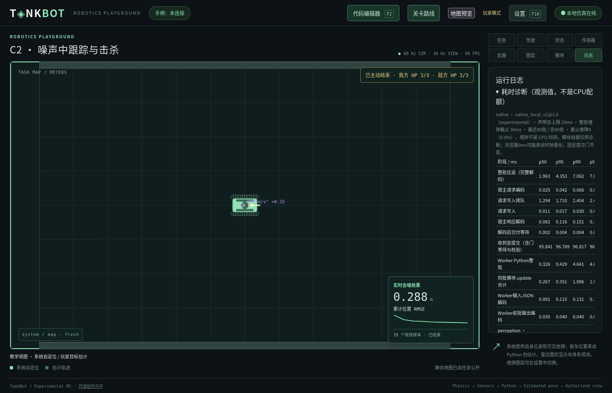
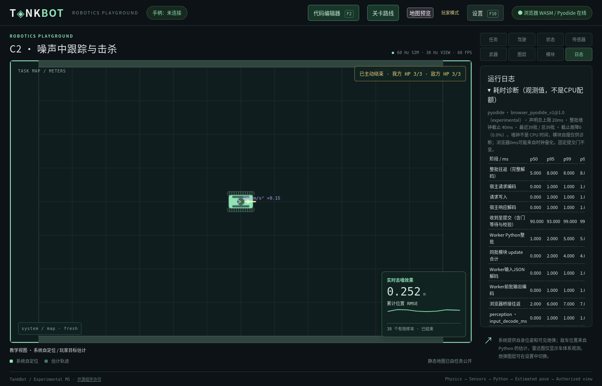

# Runtime运行profile与截止验收（2026-11-06至11-07）

## 结论与实际默认

已实现独立声明准入与整批墙钟、可信后端选择、尝试内冻结，以及两端完整响应解码后的整数截止。模块声明总上限仍为20ms；本机原生`native_local_v1@1.0`和浏览器`browser_pyodide_v1@1.0`分别选择原生30ms、浏览器40ms墙钟，均标记`experimental`。这是实际候选看门狗对照后的临时默认；没有把此前30/50ms建议直接当结论，也没有证明完整尝试截止失败率低于1%。

固定60Hz、算法dt、采样、activation+6tick门、评分/失败规则及玩家源码不变。早到缓存；迟到、解码跨界和错过门均不能提交。声明与内部墙钟观测均不是可信CPU配额或逐模块硬隔离。设计见 [41](../41_RUNTIME_EXECUTION_PROFILES.md)；全部条件、阶段分位数、失败、截断和原始分片摘要见 [机器可读结果](runtime-execution-profiles-20261107.json)。

## 环境、方法与可重复入口

- 单机Linux 7.0.0-42-generic / x86_64，AMD Ryzen 9 8945HX；原生CPython 3.14.4、NumPy 2.3.3、jsonschema 4.19.2。
- Firefox 157.0.1，Pyodide 0.29.5 / CPython 3.13.2 / Emscripten 4.0.9，NumPy 2.2.5、jsonschema 4.23.0；解释器/依赖由已校验的固定资源锁确认，浏览器版本来自真实Marionette会话。
- 原生为debug Core、WASM为release；各组构建摘要固定。主矩阵96格共81,139批，其中主要负载77,413批；主矩阵源码摘要固定为`267ecddaa8c1c1759b4e972f6429a9a9e0901660641f89babb355551832eb2e1`，每后端/负载的算法源和构建摘要均唯一。
- 独立设置、存档、工作区、端口和Firefox目录。为各基准进程设置互不重叠的CPU亲和性，具体请求逐格记录；未验证snap/Firefox所有子进程的实际放置，也没有cgroup硬隔离、锁频或消除热/OS影响。前台文档可见且有焦点，Firefox为headless；专用页保留正式双origin、Core/Robot Worker、60Hz调度和授权view/health消息，不绘制游戏画布。完整画布、编辑与部署另测。
- `foreground`不注入负载；`host_load`在激活边界后由Authority所在线程忙等8ms，两后端同一条件。物理不等待玩家；提交门仍固定，80ms诊断也不能移动门。
- 主要负载为Weapons C2 KF、C3 EKF、Navigation C4四模块，各后端每项合计至少10,000批；不是每一候选/每一条件各10,000。空update、接近声明上限和死循环是辅助组，样本数另列，不能冒充长时可靠性证明。
- KF/EKF真实场景运行120s，故意不操作武器，正常课程结果是timeout，不是通关；Runtime故障会中止预定全时域实验，若课程仍active单独计为中止，不能伪造为课程终局。Navigation C4是真实闭环裁判结果。

配置在`config/runtime-benchmark.yaml`；先校准合成负载，再冻结迭代数：原生517,261次、Pyodide216,000次，校准批update中位约16.88/17ms，首次激活从未剔除。所有候选使用同一测试源码/seed/场景，实际启用各自看门狗。记录按JSONL分片流式落盘，汇总按`timing_id + step_id`去重；无窗口遗漏，主矩阵journal丢失0。

```bash
python3 tools/benchmark_runtime.py --plan --offline
python3 tools/calibrate_runtime_benchmark.py --backend native --output .m1-cache/my-calibration --offline
python3 tools/benchmark_runtime.py --backend native --calibration-file .m1-cache/my-calibration/calibration.json --output .m1-cache/my-native-matrix --offline
python3 tools/benchmark_runtime.py --backend pyodide --workloads weapons_kf weapons_ekf navigation_path --output .m1-cache/my-browser-matrix --offline
python3 tools/summarize_runtime_benchmark.py --input .m1-cache/runtime-profile-matrix --output /tmp/runtime-profile-summary.json
```

浏览器前先构建WASM并执行`tools/prepare_browser.py`；辅助near_cap需先为对应后端校准，不能用未校准初值声称接近20ms。`--slice-attempts`只做工具短测。原始分片位于本机`.m1-cache/runtime-profile-matrix/`；共享JSON仅含版本、摘要、计时、授权终局指标，不含测量正文、真值、引擎句柄或玩家源码。

## 逐负载样本门槛

| 后端 | KF | EKF | 四模块路径追踪 |
| --- | ---: | ---: | ---: |
| native | 14146 | 14388 | 12300 |
| pyodide | 12053 | 12033 | 12493 |

## 候选对照

下表只汇总主要负载。分位数针对已完整解码响应，必须同时读取截断/失败数；详细逐格p50/p95/p99/p99.9/max、同批update之和、输入/输出适配、编码、排队、解码、收到后等待与校验等见JSON。没有相加模块p99，也没有用两个p99相减推导通信成本。

| 后端/截止 | 批数 | 墙钟故障 | 错过门 | 全时域实验/因截止中止 |
| --- | ---: | ---: | ---: | --- |
| native / 20ms | 13450 | 1 | 0 | 18 / 1 |
| native / 30ms | 13692 | 0 | 0 | 18 / 0 |
| native / 80ms | 13692 | 0 | 0 | 18 / 0 |
| pyodide / 20ms | 7459 | 5 | 0 | 15 / 5 |
| pyodide / 30ms | 7352 | 1 | 0 | 11 / 1 |
| pyodide / 40ms | 7256 | 0 | 0 | 10 / 0 |
| pyodide / 50ms | 7256 | 0 | 0 | 10 / 0 |
| pyodide / 80ms | 7256 | 0 | 0 | 10 / 0 |

20ms原生主要组有1次截止，near_cap正常/宿主负载各64次首激活均被终止，全部截断；达到max_attempts后明确停止，未达到该格120批目标。30ms原生主要组及辅助有限负载无截止，是所测最小可行候选；两条件合计13,692主要批、18次全时域实验。

浏览器20ms主要组5次截止；30ms有1次路径追踪负载组截止，near_cap前台/负载另有2/3次截止。该路径追踪批在Authority收到尚未解码的字节时已31ms，桥接仅4ms，说明桥外编码/交付/队列等合并阶段足以影响截止，不能把问题归为滤波器CPU超额。near_cap的迟到观察包括31/37ms到达、桥接28ms；未返回的样本仍截断，不补造完整成本。

40ms与50ms主要组均无截止，各7,256批、10次完整实验；near_cap 40ms正常/负载124/125批无截止，已完成整批最大34/36ms。选择更小的40ms作为浏览器实验性默认，没有机械采用原建议50ms。30ms在第一轮短组零失败，却在最终矩阵出现故障，正说明不能从一次零失败选择默认或永久忽略失败重跑。

空批已覆盖两后端所有候选和条件；死循环每格均被终止且无结果提交。辅助组短且部分有意失败，详情及失败位置全部保留。主矩阵80ms没有错过门；另外通过SIGSTOP/快速追赶回归证明，未到80ms也必须在第6tick拒绝缺失结果。

### 不确定性与完整尝试口径

所选默认的正常前台主要实验为原生30ms 0/9、浏览器40ms 0/5截止中止；合并两条件分别0/18、0/10。仅以独立二项模型作说明，前台Wilson双侧95%上界仍约29.9%/43.4%，远高于1%；调度故障存在相关性，实际不确定性不能更乐观。没有从单批率推导整局保证，profile保持experimental。继续验证需跨会话、完整游戏画布和更多整局，并覆盖其他机器/浏览器；不以无限扩大时限代替排队/追赶分析。

## 诊断分类修正与最终代码

开发中R1矩阵另有81,321批，包含3个“已迟到、尚未解码”到达观察被误标为round_trip；分析1.1将其标为未解码到达/截断，没有补造解码成本。修正后重新完整运行了本报告的最终96格矩阵；最终数据不需要此归一化，计数为0，两个版本不混合。原始R1 JSONL及分析保留在`.m1-cache/runtime-profile-matrix/`。

中间补测原生6格完成；浏览器曾在启动前因工具路径将tankbot.py误导入为SDK包而退出，未产生测量批次，中断证据保留。修复为不修改sys.path的共用浏览器工具，增加回归；所有源码最终冻结后再次运行完整矩阵。ArtifactGuard在每次尝试前后核对源码、Schema、YAML、构建和bundle；最终96格守卫摘要一致，没有混合变更。

最终工具1.2先解析场景并分配隔离端口，再记录有效config摘要；另用排除端口的scenario摘要支持已完成格resume，身份不符拒绝；中断格保留、不覆盖。完整矩阵使用当前截止/诊断/清理源码，最终只将目录默认改为已实测的30/40ms并重新生成夹具，不改变判定实现。

## 实际界面与回归

最终原生30ms/浏览器40ms在Linux/Firefox分别完成真实C3→C4：编辑、框架升级预览、测试、部署、通关、重试；旧源码保留，独立路径/检查点图层可用。原生追踪RMSE 0.12640m、最大偏离0.26441m；浏览器0.14078m、0.27064m。往返p99/最大分别约6.13/7.06ms与25/38ms，均0截止故障。该完整UI运行不与无画布矩阵混合统计。

原20ms浏览器完整UI另有一次明确失败：第2796激活批，桥接5ms、Authority原始字节到达21ms，控制故障终止；未完成解码，不能把21ms当完整往返。该失败保留在隔离证据中，不用成功重跑抹掉。

两后端工程UI还验证了同输入双版本、协方差/诊断、原生Python异常栈、时限表格、备份预览与恢复。诊断界面公开独立声明上限和墙钟、profile ID/版本/status、p99.9/最大及原始时刻；表格在面板内独立滚动。截图为隔离测试工程，详见下文。

## 限制与下一步

仅Linux/Firefox本机证据；没有验证Windows/macOS、Chrome/Safari、后台标签页、休眠恢复、远程部署或竞技公平性。30/40ms是实验性本机默认，不是硬CPU配额或跨平台可靠性结论。原生普通进程与浏览器Worker都不等价于服务器OS沙箱。

保留2026-11-05评估原文/JSON，不改写其历史事实。后续优先积累更多独立完整尝试，针对UI队列、冷启动/首次激活和宿主追赶分层；当前不增设自适应放宽、不更改编码、物理或评分。

## 实现与检查范围

- profile：`config/game.yaml`、`config/runtime-profiles.yaml`、`host/tankbot_host/execution_profiles.py`及runtime-execution Schema；`tools/export_profile.py`生成Rust/Node夹具和公共目录样例。
- 准入与租约：Authority、module_profile、robot_graph、level_plugins、DeploymentManager和ExperimentLab统一使用冻结profile；单模块SDK/算法接口未变。
- 截止与观测：Supervisor、BrowserSupervisor、wire解码计时、iframe/Core Worker；RuntimeTiming的窗口与可消费事件流独立，原生写线程有界，不在实时提交门等待管道或玩家。
- 工具：benchmark_runtime、calibrate_runtime_benchmark、summarize_runtime_benchmark、runtime_budget_support；共用browser_support消除工具/SDK同名导入问题；配额Schema和短测/源码变动守卫回归。
- UI与文档：timing-ui、独立表格滚动、无路径关卡的空图层保护；ADR-0053、07/08/16/38/41、README、路线图与索引同步。

定向测试包含旧配置/冲突、可信后端和冻结、独立准入、整数截止与解码跨界、迟到/重复、旧Worker、空闲finish、死循环与管道背压、固定门追赶/受控等待、遥测伪造、流式去重/分片/截断及工具导入/构建变动。统一检查由`python3 tools/check.py --offline`执行；最终数值以最后运行日志为准，收尾另核对WASM、真实界面和`git diff --check`。

## 本次修改文件

以下只列本任务文件；两份任务开始前已有评估文件按原字节保留。未提交或推送Git。

- `README.md`
- `config/engineering.yaml`
- `config/game.yaml`
- `config/runtime-benchmark.yaml`
- `config/runtime-profiles.yaml`
- `core/tests/fixtures/default-profile.json`
- `docs/07_SIMULATION_DESIGN.md`
- `docs/08_RUNTIME_AND_SECURITY.md`
- `docs/10_DEVELOPMENT_ROADMAP.md`
- `docs/16_BROWSER_RUNTIME.md`
- `docs/38_ENGINEERING_AND_ALGORITHM_LAB.md`
- `docs/41_RUNTIME_EXECUTION_PROFILES.md`
- `docs/README.md`
- `docs/adr/0010-simulation-scheduling.md`
- `docs/adr/0020-shared-browser-authority.md`
- `docs/adr/0031-multi-module-graph-execution.md`
- `docs/adr/0051-engineering-experiments-and-retention.md`
- `docs/adr/0052-generated-continuous-path-tracking.md`
- `docs/adr/0053-backend-runtime-execution-profiles.md`
- `docs/adr/README.md`
- `docs/examples/engineering-settings.json`
- `docs/examples/runtime-execution-profiles.json`
- `docs/reports/RUNTIME_EXECUTION_PROFILES_VALIDATION_20261107.md`
- `docs/reports/runtime-execution-profiles-20261107.json`
- `docs/schemas/README.md`
- `docs/schemas/engineering.schema.json`
- `docs/schemas/runtime-benchmark.schema.json`
- `docs/schemas/runtime-execution.schema.json`
- `docs/schemas/simulation-profile.schema.json`
- `docs/tools/check_design.py`
- `host/tankbot_host/authority.py`
- `host/tankbot_host/deployment.py`
- `host/tankbot_host/execution_profiles.py`
- `host/tankbot_host/experiments.py`
- `host/tankbot_host/level_plugins.py`
- `host/tankbot_host/module_profile.py`
- `host/tankbot_host/robot_graph.py`
- `host/tankbot_host/runtime_benchmark.py`
- `host/tankbot_host/runtime_timing.py`
- `host/tankbot_host/supervisor.py`
- `protocol/tankbot_protocol/wire.py`
- `runtime/browser_authority.py`
- `tests/test_browser.py`
- `tests/test_engineering_contracts.py`
- `tests/test_execution_profiles.py`
- `tests/test_path_view.mjs`
- `tests/test_runtime_budget_benchmark.py`
- `tests/test_runtime_deadlines.mjs`
- `tests/test_runtime_timing.py`
- `tests/test_workspace.py`
- `tools/benchmark_runtime.py`
- `tools/browser_engineering.py`
- `tools/browser_navigation_path.py`
- `tools/browser_support.py`
- `tools/calibrate_runtime_benchmark.py`
- `tools/export_profile.py`
- `tools/fixtures/runtime-benchmark.html`
- `tools/prepare_browser.py`
- `tools/runtime_budget_support.py`
- `tools/summarize_runtime_benchmark.py`
- `tools/test_browser.py`
- `web/core-worker.js`
- `web/path-view.js`
- `web/runtime-frame.js`
- `web/style.css`
- `web/timing-ui.js`

## 最后执行结果

- `python3 tools/check.py --offline`：最终默认配置下通过79个普通前端测试、357个Python测试、18个Rust测试、文档/Schema与生成配置核对；任一阶段失败均返回非零。
- `npm run test:wasm`：共享JSON ABI与原生/WASM仿真快照一致性通过；`npm run build`通过。
- 原生及真实Firefox/Pyodide：完整路径追踪编辑→升级预览→测试→部署→通关→重试均通过。工程UI的版本对照、异常栈、诊断与存储恢复亦通过；最终40ms诊断截图另附。
- `git diff --check`通过；AGENTS.md及任务开始前两份2026-11-05评估文件未修改。未操作日常userdata，没有自动提交/推送。

未证明整局Runtime截止失败率<1%，未验证其他平台/浏览器/后台模式，也未验证CPU硬配额、公平竞技或服务端沙箱。首要后续是更多独立完整UI尝试与其他平台实测，不再因当前代码耗时动态放宽时限。

## 诊断截图

原生30ms、声明总上限20ms：



Firefox/Pyodide40ms、声明总上限20ms：



图片来自隔离测试工程，未显示日常玩家源码或真值；两张PNG亦属于本次新增文件。
